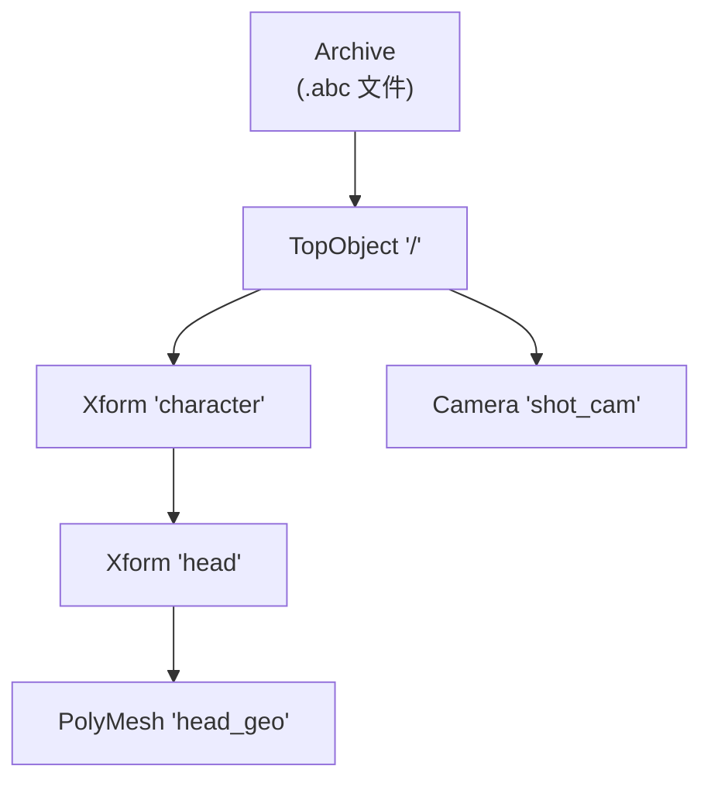

# Alembic 学习指南 —— 从入门到精通

**作者**：汪亮（bertonwang）
**邮箱**：<47608843@qq.com>
**版本**：v1.0 ｜ **最后更新**：2026-08-13

> **Alembic** 是电影/动画/游戏工业界的**通用三维几何动画交换格式**，最早由 Sony Pictures Imageworks 与 Lucasfilm 联合开源（2010）。它并不描述"角色骨骼绑定"或"节点连接"，而是把动画结果**烘焙成逐帧几何缓存**——从而在 Maya / Houdini / 3ds Max / Blender / UE / Unity 之间无损、快速传递大规模动画数据。

---

## 📋 目录

- [Alembic 学习指南 —— 从入门到精通](#alembic-学习指南--从入门到精通)
  - [📋 目录](#-目录)
  - [一、简介与定位](#一简介与定位)
  - [二、核心概念](#二核心概念)
    - [2.1 数据模型](#21-数据模型)
    - [2.2 后端存储：HDF5 vs Ogawa](#22-后端存储hdf5-vs-ogawa)
    - [2.3 时间采样 (TimeSampling)](#23-时间采样-timesampling)
  - [三、快速上手](#三快速上手)
    - [3.1 环境构建](#31-环境构建)
    - [3.2 写入一段动画](#32-写入一段动画)
    - [3.3 读取并遍历](#33-读取并遍历)
  - [四、Schema 与工程用法](#四schema-与工程用法)
  - [五、性能与最佳实践](#五性能与最佳实践)
  - [六、生态与对比选型](#六生态与对比选型)
  - [七、参考资料](#七参考资料)

---

## 一、简介与定位

| 字段 | 内容 |
|------|------|
| 定位 | 三维几何动画烘焙 & 交换格式 + 运行时 C++ 库 |
| 语言 | C++（Python/Rust 绑定完善） |
| 许可证 | BSD 3-Clause |
| 存储后端 | HDF5（老）/ **Ogawa（新，推荐）** |
| 文件扩展名 | `.abc` |
| 官方地址 | <https://www.alembic.io> / <https://github.com/alembic/alembic> |
| 常见使用者 | Maya、Houdini、3ds Max、Blender、Katana、Nuke、UE、Unity |

**核心卖点**：

1. **烘焙而非绑定**：`.abc` 里保存的是"第 N 帧顶点位置"这种终态数据，不含 rig，任何工具都能直接读用。
2. **压缩紧凑**：内部使用**顶点/属性去重 + 时间轴常量抽取**，一个 60 帧、100 万顶点的角色缓存通常只有几十 MB。
3. **可流式随机访问**：Ogawa 后端支持 mmap，播放器可按时间戳跳读单帧。
4. **可扩展 Schema**：除了 PolyMesh，还包括 SubD、Curves、Points、NuPatch、Xform、Light、Camera、Material。

---

## 二、核心概念

### 2.1 数据模型

Alembic 的模型是一棵 **层次化的 Object 树**，每个节点带若干 Property：



每个 Object 有 **属性容器**：

- `CompoundProperty` —— 命名空间/子容器
- `ScalarProperty` —— 标量或定长向量随时间变化（如相机 FOV）
- `ArrayProperty` —— 变长数组随时间变化（如逐帧顶点位置）

### 2.2 后端存储：HDF5 vs Ogawa

| 维度 | HDF5（旧） | **Ogawa（新，2013+）** |
|------|-----------|----------------------|
| 依赖 | 外部 HDF5 库 | 自带，零依赖 |
| 文件大小 | 大 | 小约 15%~30% |
| 读性能 | 较慢 | 显著更快，多线程 |
| 写性能 | 较慢 | 显著更快 |
| 生态支持 | 全 | 全（默认） |

**结论**：新工程一律使用 Ogawa（`OArchive` 默认参数即可）。

### 2.3 时间采样 (TimeSampling)

Alembic 把"时间"抽象为 `TimeSampling` 对象。三种模式：

- **Uniform**：等距采样，如每 1/24 s 一帧
- **Cyclic**：一个循环内多次采样（如运动模糊每帧 3 个子样）
- **Acyclic**：任意时间戳（模拟数据）

多个 Property 可以共享同一个 TimeSampling，从而只存一份时间轴，节省空间。

---

## 三、快速上手

### 3.1 环境构建

```bash
# vcpkg
vcpkg install alembic

# 或源码
git clone https://github.com/alembic/alembic.git
cd alembic
cmake -B build -DUSE_HDF5=OFF -DUSE_TESTS=OFF
cmake --build build --config Release -j
```

CMake 集成：

```cmake
find_package(Alembic REQUIRED)
target_link_libraries(my_app PRIVATE Alembic::Alembic)
```

### 3.2 写入一段动画

```cpp
#include <Alembic/AbcCoreOgawa/All.h>
#include <Alembic/AbcGeom/All.h>

using namespace Alembic::Abc;
using namespace Alembic::AbcGeom;

int main() {
    // 1) 打开 .abc 文件（Ogawa 后端）
    OArchive archive(Alembic::AbcCoreOgawa::WriteArchive(),
                     "cube_anim.abc");

    // 2) 定义时间采样：24 fps 等距
    TimeSamplingPtr ts(new TimeSampling(1.0 / 24.0, 0.0));
    Alembic::Util::uint32_t tsIdx = archive.addTimeSampling(*ts);

    // 3) 建立层次：/root/cube
    OObject topObj = archive.getTop();
    OXform xform(topObj, "root", tsIdx);
    OPolyMesh meshObj(xform, "cube", tsIdx);
    OPolyMeshSchema& mesh = meshObj.getSchema();

    // 4) 立方体顶点 / 索引 / face count
    static const V3f verts[8] = { /* 8 corners */ };
    static const int32_t indices[24] = { /* 6 quads */ };
    static const int32_t counts[6]   = { 4, 4, 4, 4, 4, 4 };

    // 5) 逐帧写入
    for (int frame = 0; frame < 48; ++frame) {
        V3f animVerts[8];
        for (int i = 0; i < 8; ++i) {
            animVerts[i] = verts[i] + V3f(0, sinf(frame * 0.1f), 0);
        }
        OPolyMeshSchema::Sample sample(
            V3fArraySample(animVerts, 8),
            Int32ArraySample(indices, 24),
            Int32ArraySample(counts, 6));
        mesh.set(sample);          // set 一次 = 一帧
    }
    // OArchive 析构时自动 flush
}
```

### 3.3 读取并遍历

```cpp
IArchive archive(Alembic::AbcCoreOgawa::ReadArchive(), "cube_anim.abc");
IObject top = archive.getTop();

std::function<void(IObject, int)> walk = [&](IObject obj, int depth) {
    std::string indent(depth * 2, ' ');
    std::cout << indent << obj.getName()
              << " [" << obj.getMetaData().get("schema") << "]\n";

    if (IPolyMesh::matches(obj.getHeader())) {
        IPolyMesh m(obj, kWrapExisting);
        IPolyMeshSchema& sch = m.getSchema();
        size_t numSamples = sch.getNumSamples();
        std::cout << indent << " -> " << numSamples << " frames\n";
    }
    for (size_t i = 0; i < obj.getNumChildren(); ++i)
        walk(obj.getChild(i), depth + 1);
};
walk(top, 0);
```

---

## 四、Schema 与工程用法

| Schema | 说明 | 常见来源 |
|--------|------|---------|
| `PolyMesh` | 多边形网格（三角/四边混合） | 建模、蒙皮烘焙 |
| `SubD` | Catmull-Clark 细分曲面 | 电影级角色 |
| `Curves` | 曲线（毛发、样条） | Hair/Fur 缓存 |
| `Points` | 粒子云 | 火焰、水花、点云 |
| `NuPatch` | NURBS 曲面 | 工业设计、CAD 交换 |
| `Xform` | 变换节点 | 骨骼动画、层次结构 |
| `Camera` | 相机（含 FOV/近远裁剪/景深） | 相机动画烘焙 |
| `Light` | 光源 | 光照烘焙 |

工程中最常见的两类用法：

1. **DCC → 引擎**：Houdini/Maya 把角色/流体/破碎/毛发烘焙成 `.abc`，UE/Unity/自研引擎导入播放。
2. **仿真 → 离线渲染**：物理仿真（布料、刚体、SPH）用 `.abc` 交给 Arnold/RenderMan/Redshift。

---

## 五、性能与最佳实践

1. **✅ 首选 Ogawa**：`WriteArchive()` 默认即可；老资产可用 `abcconvert` 批量转换。
2. **✅ 复用 TimeSampling**：所有同 24fps 的 Property 共享一个 `tsIdx`，避免时间轴冗余。
3. **✅ 常量数据只写一次**：拓扑不变的属性用 `setFromPrevious()` 或只 `set` 首帧，Alembic 自动感知常量。
4. **⚠️ 不要频繁 open/close Archive**：`OArchive` 打开代价不低；批量导出请把所有对象放在同一次会话内。
5. **⚠️ 变长数组比标量贵得多**：能存标量就不要存数组；不需要 per-vertex color 就别写。
6. **⚠️ 播放随机跳帧**：Ogawa 支持随机访问，但**内部块 (Chunk) 边界外仍会重读**；密集 seek 场景可开启 `IArchive` 的 stream cache。
7. **⚠️ 索引一致性**：如果拓扑逐帧变化，需要每帧写 `indices` + `counts`；否则只写首帧即可（拓扑常量）。

---

## 六、生态与对比选型

| 格式 | 定位 | 何时选择 |
|------|------|---------|
| **Alembic (.abc)** | 几何烘焙 | 跨 DCC 传角色/流体/毛发缓存 |
| **USD (.usda/.usdc)** | 场景组合与 Schema | 需要 Layer 覆盖、跨部门协作（Pixar/皮克斯工作流） |
| **glTF (.gltf/.glb)** | 运行时资产 | Web / 移动端 / AR 交付 |
| **FBX** | 通用 3D 交换 | 骨骼绑定、旧管线兼容 |
| **VDB** | 稀疏体积 | 烟雾、火、云 |

**关系**：USD 与 Alembic **并非替代**——USD 关注场景组合、变体、Layer；Alembic 关注几何缓存。工业界常用 USD 组合场景 + Alembic 引用几何缓存。

---

## 七、参考资料

- 🔗 官方文档：<http://docs.alembic.io>
- 🔗 GitHub：<https://github.com/alembic/alembic>
- 🔗 白皮书：*Alembic: An Open Framework for Baked Animation and Effects Interchange*（SIGGRAPH 2011）
- 🔗 与 USD 关系讨论：<https://openusd.org/release/apiDocs/index.html>

---

> ✨ **备注**：Alembic 2.x 已稳定多年，Ogawa 为默认后端；HDF5 后端已被官方标记为 deprecated。欢迎在 PR 中补充或修正。
