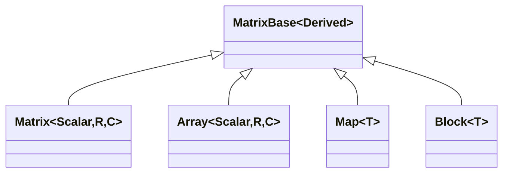

# Eigen 学习指南 —— 从入门到精通

**作者**：汪亮（bertonwang）
**邮箱**：<47608843@qq.com>
**版本**：v1.0 ｜ **最后更新**：2026-08-13

> Eigen 是 C++ 领域使用最广泛的**头文件级线性代数模板库**，被 TensorFlow、Ceres、OpenCV、ROS、PCL 等众多知名工程用作底层数学引擎。
> 本指南面向 C++ 中高级开发者，兼顾入门快速上手与工程实战注意事项。

---

## 📋 目录

- [Eigen 学习指南 —— 从入门到精通](#eigen-学习指南--从入门到精通)
  - [📋 目录](#-目录)
  - [一、简介与定位](#一简介与定位)
  - [二、核心概念速览](#二核心概念速览)
  - [三、快速上手（10 分钟 Hello Eigen）](#三快速上手10-分钟-hello-eigen)
    - [3.1 环境准备](#31-环境准备)
    - [3.2 第一个示例](#32-第一个示例)
  - [四、关键 API 与工作原理](#四关键-api-与工作原理)
    - [4.1 矩阵类型体系](#41-矩阵类型体系)
    - [4.2 表达式模板与惰性求值](#42-表达式模板与惰性求值)
    - [4.3 分解与求解](#43-分解与求解)
    - [4.4 几何模块 (`Eigen/Geometry`)](#44-几何模块-eigengeometry)
    - [4.5 稀疏模块 (`Eigen/Sparse`)](#45-稀疏模块-eigensparse)
  - [五、常见坑与最佳实践](#五常见坑与最佳实践)
  - [六、进阶方向](#六进阶方向)
  - [七、参考资料](#七参考资料)

---

## 一、简介与定位

| 字段 | 内容 |
|------|------|
| 定位 | 头文件级 C++ 模板线性代数库 |
| 语言 | C++03 / C++11+（Header-Only，无需编译） |
| 许可证 | MPL 2.0（允许静态链接闭源） |
| 依赖 | 无 |
| 核心能力 | 稠密/稀疏矩阵、向量运算、SVD、特征分解、LU/QR/Cholesky、FFT、几何变换 |
| 官方地址 | <https://eigen.tuxfamily.org> |
| 典型使用者 | TensorFlow、Ceres Solver、OpenCV、ROS、PCL、Autoware |

**核心卖点**：

1. **零开销抽象**：借助 C++ 表达式模板 (Expression Templates)，`c = a + b + c` 等复合运算会被编译期融合为单趟循环，无中间对象。
2. **SIMD 自动向量化**：默认使用 SSE/AVX/NEON 指令，加编译选项 `-mavx2` 即可获得数倍加速。
3. **纯头文件**：`#include <Eigen/Dense>` 即用，跨平台无二进制适配问题。

---

## 二、核心概念速览

| 术语 | 说明 |
|------|------|
| `Matrix<Scalar, Rows, Cols>` | 通用矩阵模板；`Rows/Cols` 为 `Dynamic` 时运行期确定尺寸 |
| `Vector3d` / `Matrix4f` / `MatrixXd` | 常用别名（`d`=double，`f`=float，`i`=int，`X`=动态尺寸） |
| **表达式对象** | `a + b` 返回的并非矩阵，而是延迟计算的表达式节点 |
| **Storage Order** | 默认列主序 (`ColMajor`)，可通过第 4 模板参数改为 `RowMajor` |
| **Alignment** | 16/32 字节对齐要求，直接决定能否走 SIMD |
| **Map** | 零拷贝把已有裸指针包装为 Eigen 矩阵视图 |

---

## 三、快速上手（10 分钟 Hello Eigen）

### 3.1 环境准备

```bash
# 方式一：包管理器
sudo apt install libeigen3-dev          # Ubuntu / Debian
brew install eigen                      # macOS
vcpkg install eigen3                    # Windows / 跨平台

# 方式二：直接下载源码
git clone https://gitlab.com/libeigen/eigen.git
# 头文件路径添加到 -I 即可，无需编译
```

CMake 集成：

```cmake
find_package(Eigen3 REQUIRED)
target_link_libraries(my_app PRIVATE Eigen3::Eigen)
```

### 3.2 第一个示例

```cpp
#include <Eigen/Dense>
#include <iostream>

int main() {
    // 1) 编译期尺寸矩阵：栈上分配，最快
    Eigen::Matrix3d A;
    A << 1, 2, 3,
         4, 5, 6,
         7, 8, 10;

    Eigen::Vector3d b(3, 3, 4);

    // 2) 求解 A * x = b
    Eigen::Vector3d x = A.colPivHouseholderQr().solve(b);
    std::cout << "solution:\n" << x << std::endl;

    // 3) 表达式模板：整行运算不会生成中间矩阵
    Eigen::Matrix3d C = A.transpose() * A + Eigen::Matrix3d::Identity();
    std::cout << "AtA + I =\n" << C << std::endl;
}
```

---

## 四、关键 API 与工作原理

### 4.1 矩阵类型体系



- **`Matrix`** 走矩阵语义（`*` 是矩阵乘法）
- **`Array`** 走逐元素语义（`*` 是逐元素乘），可 `.matrix()` / `.array()` 互转
- **`Map`** 把外部内存（如 `float*`）伪装成 Eigen 矩阵，零拷贝

### 4.2 表达式模板与惰性求值

```cpp
Eigen::VectorXd r = a + 3 * b - c;   // 只有 1 次循环、0 次临时对象
```

编译期展开为等价的 `for(i) r[i] = a[i] + 3*b[i] - c[i]`。这一机制的代价是**编译报错信息极长**——遇到 `no match for operator+` 时先看最底层错误。

### 4.3 分解与求解

| 方法 | 精度 | 速度 | 适用矩阵 |
|------|------|------|----------|
| `partialPivLu()` | 中 | ⭐⭐⭐⭐ | 一般方阵 |
| `fullPivLu()` | 高 | ⭐⭐ | 一般方阵 |
| `householderQr()` | 中 | ⭐⭐⭐⭐ | 任意矩阵 |
| `colPivHouseholderQr()` | 高 | ⭐⭐⭐ | 任意矩阵（推荐默认） |
| `llt()` / `ldlt()` | 高 | ⭐⭐⭐⭐⭐ | 对称正定 |
| `jacobiSvd()` | 最高 | ⭐ | 任意矩阵，可求秩、伪逆 |

### 4.4 几何模块 (`Eigen/Geometry`)

```cpp
Eigen::Quaterniond q(Eigen::AngleAxisd(M_PI / 4, Eigen::Vector3d::UnitZ()));
Eigen::Isometry3d T = Eigen::Isometry3d::Identity();
T.rotate(q);
T.pretranslate(Eigen::Vector3d(1, 0, 0));
Eigen::Vector3d p_world = T * Eigen::Vector3d(0, 0, 1);
```

覆盖：`Quaternion`、`AngleAxis`、`Rotation2D`、`Translation`、`Isometry`（刚体变换）、`Affine`（仿射）、`Projective`（射影）。

### 4.5 稀疏模块 (`Eigen/Sparse`)

```cpp
Eigen::SparseMatrix<double> A(N, N);
std::vector<Eigen::Triplet<double>> trips;
// ... fill trips ...
A.setFromTriplets(trips.begin(), trips.end());

Eigen::SimplicialLDLT<Eigen::SparseMatrix<double>> solver(A);
Eigen::VectorXd x = solver.solve(b);
```

工程上常用于**大规模最小二乘、PDE 离散、图优化**。

---

## 五、常见坑与最佳实践

1. **⚠️ 对齐问题**：`Eigen::Matrix4d` 需要 16 字节对齐；若将其作为 STL 容器元素，必须写：

   ```cpp
   std::vector<Eigen::Matrix4d, Eigen::aligned_allocator<Eigen::Matrix4d>> vec;
   ```

   在 C++17 后新分配器已自动对齐，Eigen 3.4+ 已缓解该问题，但**旧编译器仍要显式指定**。

2. **⚠️ 值传递陷阱**：函数参数不要写 `Eigen::MatrixXd A`（会拷贝），也不要写 `const Eigen::MatrixXd& A`（拒绝表达式）。推荐：

   ```cpp
   template <typename Derived>
   void process(const Eigen::MatrixBase<Derived>& A);
   ```

3. **⚠️ `auto` 与惰性求值的冲突**：

   ```cpp
   auto x = A * B;       // ❌ x 是表达式对象，A 变化后 x 结果跟着变
   Eigen::MatrixXd x = A * B;  // ✅ 立即求值
   ```

4. **⚠️ 动态尺寸的分配开销**：`MatrixXd` 每次赋值可能触发 `malloc`，热点循环里请预分配（`resize` 一次）。

5. **✅ 编译加速**：`-DEIGEN_NO_DEBUG` 关闭断言、`-march=native -O3` 开启 SIMD。

6. **✅ 与 OpenCV 互操作**：`cv::Mat` ↔ `Eigen::Map` 可零拷贝互转，注意行主序/列主序差异。

---

## 六、进阶方向

1. **Ceres Solver**：Google 的非线性最小二乘框架，几乎所有 SLAM/BA 都基于 Ceres+Eigen。
2. **Sophus**：李群/李代数库（SO3/SE3），Eigen 风格 API。
3. **Spectra**：大规模稀疏特征值求解，Eigen 的 ARPACK 替代。
4. **TensorFlow 的 `Eigen::Tensor`**：多维张量扩展，官方作为 TF 内核底座。
5. **对比替代**：Armadillo（更接近 MATLAB 语法）、Blaze（更激进的 SIMD）、xtensor（NumPy 风格）。

---

## 七、参考资料

- 🔗 官方文档：<https://eigen.tuxfamily.org/dox/>
- 🔗 Quick Reference：<https://eigen.tuxfamily.org/dox/group__QuickRefPage.html>
- 🔗 Common Pitfalls：<https://eigen.tuxfamily.org/dox/TopicPitfalls.html>
- 📘 《14 讲——视觉 SLAM 十四讲》第 3、4 章 —— 高翔（Eigen 几何模块最好的中文入门材料）

---

> ✨ **备注**：Eigen 版本以 3.4.x 为主流；4.x 分支已在路上，API 兼容。欢迎在 PR 中补充或修正。
