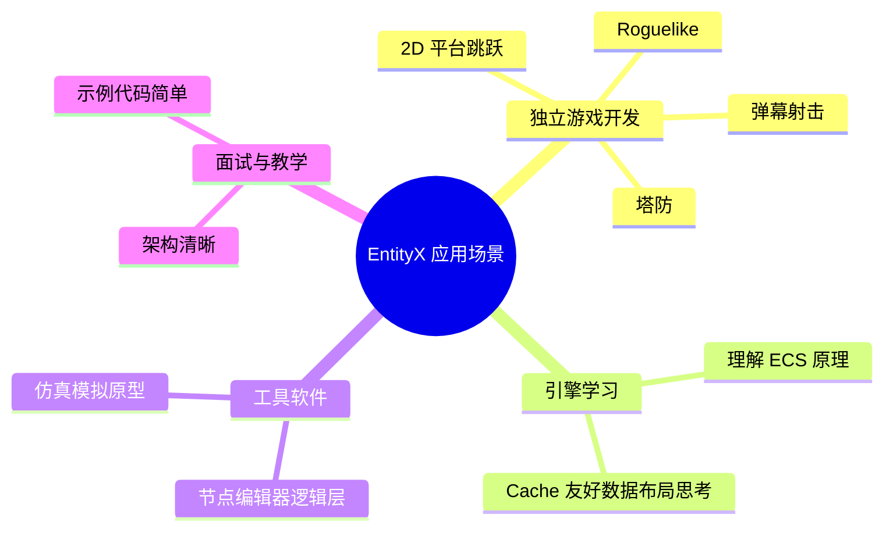
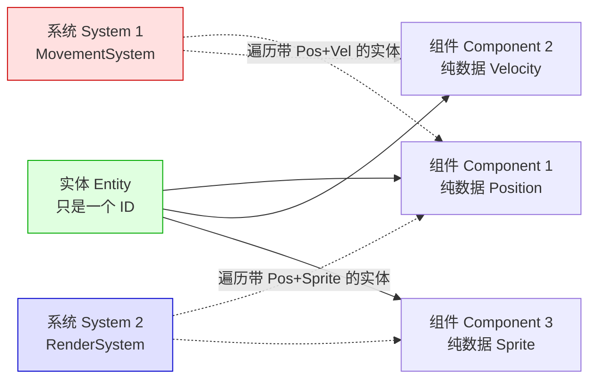
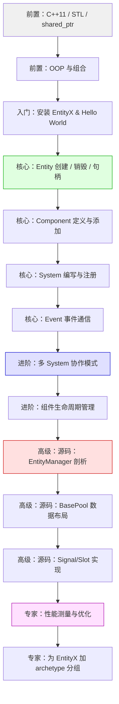
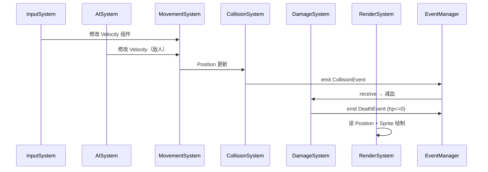
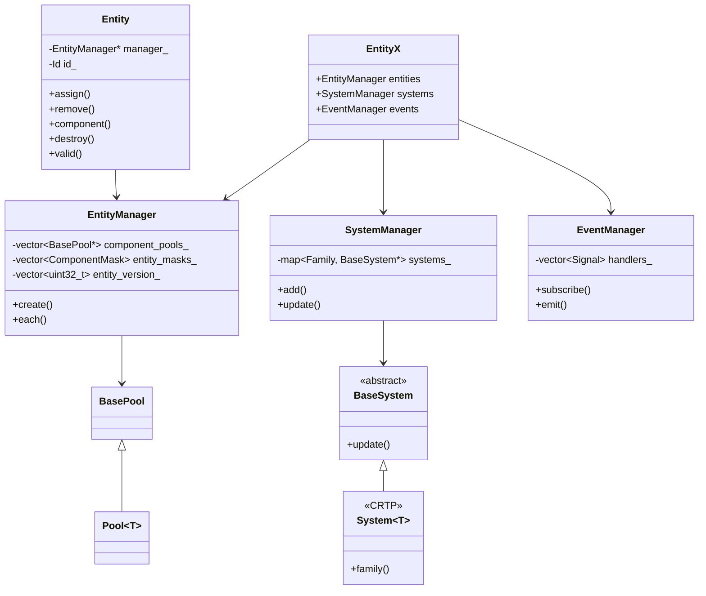
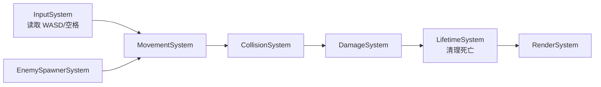

# EntityX 学习指南 —— 从入门到精通

**作者**：汪亮（bertonwang）
**邮箱**：<47608843@qq.com>
**版本**：v1.0 ｜ **最后更新**：2026-08-13

> **适用人群**：C++ 游戏 / 引擎开发者，想理解 ECS 架构的初学者 → 想深入源码与扩展的高级开发者
> **目标**：让你从"听说过 ECS"到"能独立用 EntityX 写小型游戏，甚至改写它的核心，为自研引擎打底"。

---

## 📋 目录

1. [什么是 EntityX？为什么要学它？](#一什么是-entityx为什么要学它)
2. [前置知识：ECS 架构范式](#二前置知识ecs-架构范式)
3. [EntityX vs 其他 ECS 框架](#三entityx-vs-其他-ecs-框架)
4. [学习路线图](#四学习路线图)
5. [入门篇：环境搭建与 Hello EntityX](#五入门篇环境搭建与-hello-entityx)
6. [核心篇：四大基石 Entity / Component / System / Event](#六核心篇四大基石-entity--component--system--event)
7. [进阶篇：常用模式与最佳实践](#七进阶篇常用模式与最佳实践)
8. [高级篇：源码剖析](#八高级篇源码剖析)
9. [专家篇：性能优化与扩展](#九专家篇性能优化与扩展)
10. [实战项目：用 EntityX 写一个 2D 小游戏](#十实战项目用-entityx-写一个-2d-小游戏)
11. [附录 A：EntityX API 速查表](#附录-aentityx-api-速查表)
12. [附录 B：常见坑与 FAQ](#附录-b常见坑与-faq)
13. [附录 C：学习资源推荐](#附录-c学习资源推荐)

---

## 一、什么是 EntityX？为什么要学它？

### 1.1 一句话解释

> **EntityX 是 Alec Thomas 用现代 C++11 编写的开源 ECS（Entity-Component-System）框架，代码总量仅约 2000 行，却完整实现了 Entity 管理、Component 存储、System 调度、Event 通信四大模块，是学习 ECS 架构最佳的"教科书级"实现。**

- 项目地址：<https://github.com/alecthomas/entityx>
- 许可：MIT，商业友好
- 语言：C++11（现代化，大量使用 `std::shared_ptr`、`std::tuple`、模板元编程）
- 依赖：仅 `Boost` 可选（新版已完全不依赖 Boost）

### 1.2 为什么要学 EntityX？

| 目的 | 说明 |
|------|------|
| **学 ECS 架构** | 代码短小、注释清晰、结构直白，比 EnTT / flecs 更适合入门阅读 |
| **写小型游戏** | 直接可用，语法简单，2D 独立游戏足够 |
| **做面试功课** | ECS 是游戏引擎面试高频题，EntityX 帮你彻底吃透概念 |
| **打自研引擎地基** | 读懂它之后，可以自己写一个更快、更定制化的 ECS |
| **理解 C++ 模板元编程** | 组件遍历用 variadic templates + `std::tuple`，是模板学习的绝佳案例 |

### 1.3 EntityX 能做什么？



### 1.4 EntityX 的核心特点

| 特性 | 说明 |
|------|------|
| **纯 C++11** | 一个 header + 一个 cpp（新版），拖进项目即可 |
| **类型安全** | 组件通过模板参数区分，编译期检查 |
| **Signal/Slot 事件** | 内建轻量级发布订阅系统 |
| **可测试** | 每个模块都有单元测试，学习时可对照运行 |
| **文档完善** | README + Wiki + 示例项目 |
| **代码量小** | 核心逻辑约 2000 行，一周可读完 |

### 1.5 EntityX 的局限

不要迷信它。EntityX 是**教学级**框架，性能上有明显短板：

- **Component 用 `std::vector<Pool*>` + 稀疏索引**：Cache 命中不如 EnTT 的稀疏集
- **Entity 用句柄 (id, version)**：正确但比 archetype 慢
- **不支持 archetype / 分组**：不能像 flecs 那样自动按组件组合分块
- **不适合超大规模**（>10 万实体每帧遍历）

> 💡 **结论**：**先学 EntityX 打好 ECS 基本功，性能极致场景再上 [EnTT](https://github.com/skypjack/entt)。**

---

## 二、前置知识：ECS 架构范式

### 2.1 传统 OOP 游戏的痛点

早期游戏用继承实现游戏对象：

```cpp
class GameObject { /*...*/ };
class Movable : public GameObject { /*...*/ };
class Renderable : public GameObject { /*...*/ };
class Player : public Movable, public Renderable { /*...*/ };  // 菱形继承
```

**问题**：
- 菱形继承地狱（`virtual` 继承、二义性）
- 组合爆炸（每加一种"能力"就要新类）
- 数据分散（同一实体的字段分布在多个基类）
- Cache 不友好（对象内存散乱）

### 2.2 ECS 的核心思想



**三大概念**：

| 概念 | 定义 | 类比 |
|------|------|------|
| **Entity（实体）** | 一个 ID，代表"游戏世界中的一个物体" | 数据库表的主键 |
| **Component（组件）** | 纯数据结构体（POD-like），无逻辑 | 数据库的一行数据 |
| **System（系统）** | 无状态的行为，遍历带特定组件的实体 | SQL 的 `SELECT ... FROM ... WHERE` + 处理 |

### 2.3 ECS 的核心优势

| 优势 | 说明 |
|------|------|
| **数据驱动** | 加"发光"能力只需加个 `LightComponent`，不用改类结构 |
| **组合优于继承** | 组件任意组合，没有菱形继承 |
| **Cache 友好** | 同类型组件连续存储，遍历极快 |
| **易于序列化** | 组件是 POD，直接 `memcpy` / JSON |
| **易于并行** | System 之间只要不写同一组件就能并行执行 |
| **易于测试** | System 输入输出明确，可单元测试 |

### 2.4 ECS 与 EntityX 的映射

| ECS 概念 | EntityX 类型 |
|---------|-------------|
| Entity | `entityx::Entity`（内部是 `Id` 句柄） |
| Component | 用户自定义结构体 + `entityx::Component<T>` |
| System | `entityx::System<Derived>` 派生类 |
| World | `entityx::EntityX`（`EntityManager` + `SystemManager` + `EventManager`） |
| Event | 用户自定义结构体 + `entityx::Event<T>` |

---

## 三、EntityX vs 其他 ECS 框架

| 框架 | 语言 | 存储策略 | 性能 | 学习曲线 | 生态 |
|------|------|---------|------|---------|------|
| **EntityX** | C++11 | Pool + 稀疏索引 | 中 | ⭐（最简单） | 小 |
| **EnTT** | C++17 | 稀疏集（Sparse Set） | 极快 | ⭐⭐⭐ | 大（Minecraft、Ubisoft 在用） |
| **flecs** | C99/C++ | Archetype | 极快 | ⭐⭐⭐⭐ | 中（有 Explorer 调试器） |
| **Artemis-Cpp** | C++ | Bag 数组 | 中 | ⭐⭐ | 小（老项目） |
| **Unity DOTS** | C# | Archetype + Chunk | 极快 | ⭐⭐⭐⭐ | 大（Unity 官方） |
| **Bevy ECS** | Rust | Archetype | 快 | ⭐⭐⭐ | 大（Bevy 引擎） |

> 💡 **选型建议**：
> - **入门 & 教学** → EntityX
> - **性能优先的自研引擎** → EnTT
> - **需要查询语言 + 可视化调试** → flecs
> - **写 Unity 游戏想上性能** → DOTS
> - **写 Rust 游戏** → Bevy

---

## 四、学习路线图



### 4.1 阶段目标

| 阶段 | 时间投入 | 能做到什么 |
|------|---------|-----------|
| **入门篇** | 2~3 天 | 编译 EntityX，跑通移动 + 渲染两个 System |
| **核心篇** | 1 周 | 独立编写带事件通信的 3~5 个 System |
| **进阶篇** | 1 周 | 明白依赖顺序、组件生命周期、避免典型陷阱 |
| **高级篇** | 1~2 周 | 读懂 EntityX 全部源码，能画出内部数据结构图 |
| **专家篇** | 2~4 周 | 用 profile 工具优化，甚至给 EntityX 加 archetype |

### 4.2 前置知识清单

- **C++11+**：模板、`std::shared_ptr` / `weak_ptr`、`std::function`、lambda、`std::tuple`
- **STL**：`std::vector`、`std::unordered_map`
- **面向对象基础**：继承、多态（用来对比 ECS 的优势）
- **一点点游戏循环概念**：`update(dt)` / `render()` 主循环

> 📚 建议先看本仓库：
> - [C++图形与游戏开发](C++图形与游戏开发.md)
> - [游戏开发核心基础](游戏开发核心基础.md)（如有）

---

## 五、入门篇：环境搭建与 Hello EntityX

### 5.1 拉取源码

```bash
git clone https://github.com/alecthomas/entityx.git
cd entityx
```

目录结构：
```
entityx/
├── entityx/           # 头文件与实现
│   ├── Entity.h / .cc
│   ├── System.h / .cc
│   ├── Event.h / .cc
│   ├── quick.h        # 便捷"一站式"头
│   └── ...
├── examples/          # 示例（如 example.cc）
├── CMakeLists.txt
└── README.md
```

### 5.2 CMake 集成

```cmake
cmake_minimum_required(VERSION 3.10)
project(entityx_demo)
set(CMAKE_CXX_STANDARD 11)

add_subdirectory(entityx)         # 假设 entityx 放在项目子目录
add_executable(demo main.cpp)
target_link_libraries(demo PRIVATE entityx)
```

或者用 `FetchContent`：
```cmake
include(FetchContent)
FetchContent_Declare(entityx
    GIT_REPOSITORY https://github.com/alecthomas/entityx.git
    GIT_TAG        master)
FetchContent_MakeAvailable(entityx)
target_link_libraries(demo PRIVATE entityx)
```

### 5.3 Hello EntityX：小球移动 Demo

```cpp
#include <iostream>
#include <entityx/entityx.h>

// ====== 1. 定义组件（纯数据） ======
struct Position {
    Position(float x = 0, float y = 0) : x(x), y(y) {}
    float x, y;
};

struct Velocity {
    Velocity(float dx = 0, float dy = 0) : dx(dx), dy(dy) {}
    float dx, dy;
};

// ====== 2. 定义系统 ======
struct MovementSystem : public entityx::System<MovementSystem> {
    void update(entityx::EntityManager &es,
                entityx::EventManager &events,
                entityx::TimeDelta dt) override {
        es.each<Position, Velocity>(
            [dt](entityx::Entity e, Position &pos, Velocity &vel) {
                pos.x += vel.dx * dt;
                pos.y += vel.dy * dt;
            });
    }
};

struct PrintSystem : public entityx::System<PrintSystem> {
    void update(entityx::EntityManager &es,
                entityx::EventManager &events,
                entityx::TimeDelta dt) override {
        es.each<Position>([](entityx::Entity e, Position &pos) {
            std::cout << "Entity " << e.id() << " at ("
                      << pos.x << ", " << pos.y << ")\n";
        });
    }
};

// ====== 3. 组装 World ======
class Game : public entityx::EntityX {
public:
    Game() {
        systems.add<MovementSystem>();
        systems.add<PrintSystem>();
        systems.configure();
    }
    void update(entityx::TimeDelta dt) {
        systems.update<MovementSystem>(dt);
        systems.update<PrintSystem>(dt);
    }
};

// ====== 4. 主循环 ======
int main() {
    Game game;

    // 创建三个实体
    for (int i = 0; i < 3; ++i) {
        entityx::Entity e = game.entities.create();
        e.assign<Position>(0.f, 0.f);
        e.assign<Velocity>(1.f + i, 0.f);
    }

    // 跑 3 帧
    for (int frame = 0; frame < 3; ++frame) {
        std::cout << "-- Frame " << frame << " --\n";
        game.update(1.0);  // dt = 1s
    }
    return 0;
}
```

**输出**：
```
-- Frame 0 --
Entity 0 at (1, 0)
Entity 1 at (2, 0)
Entity 2 at (3, 0)
-- Frame 1 --
Entity 0 at (2, 0)
Entity 1 at (4, 0)
Entity 2 at (6, 0)
...
```

**关键点**：
1. **组件是纯数据**：`Position` / `Velocity` 没有函数
2. **系统是行为**：`MovementSystem` 用 `es.each<...>` 遍历
3. **实体是句柄**：`Entity` 内部只是 `id + version`，值传递零成本
4. **`configure()` 必须调用**：让系统初始化（订阅事件等）

---

## 六、核心篇：四大基石 Entity / Component / System / Event

### 6.1 Entity：轻量句柄

```cpp
entityx::EntityManager entities(events);

// 创建
entityx::Entity e = entities.create();

// 查询 ID
uint64_t raw = e.id().id();  // 32 位 index + 32 位 version

// 是否有效
if (e.valid()) { /*...*/ }

// 销毁
e.destroy();     // 此后 e.valid() == false
```

**Entity 内部结构**（简化）：
```cpp
class Entity {
    EntityManager *manager_;
    Id id_;  // uint64_t = (version << 32) | index
};
```

> 💡 **版本号（version）** 用于检测悬垂句柄：销毁后 index 位置会被复用，但 version 加 1，旧句柄的 `valid()` 就返回 false。

### 6.2 Component：纯数据

#### 定义组件

```cpp
struct Health {
    int hp;
    int max_hp;
    Health(int hp = 100) : hp(hp), max_hp(hp) {}
};
```

任何 POD-like 结构体都可以做组件，**不需要继承任何基类**（EntityX 通过 `Component<T>` 内部包装）。

#### 添加、访问、移除

```cpp
// 添加（返回 ComponentHandle，可用于长期持有）
entityx::ComponentHandle<Health> h = e.assign<Health>(100);

// 或添加并转移临时对象
e.assign<Health>(std::move(hp));

// 访问
h->hp -= 10;
if (h->hp <= 0) e.destroy();

// 判断是否有
if (e.has_component<Health>()) { /*...*/ }

// 通过 component<T>() 拿句柄
auto h2 = e.component<Health>();

// 移除
e.remove<Health>();
```

#### 组件依赖（Component Dependencies）

EntityX 提供了 `entityx::deps::Dependency<A, B, C>`，声明"实体加了 A 就自动加 B 和 C"：

```cpp
systems.add<entityx::deps::Dependency<Player, Position, Velocity, Health>>();
```

### 6.3 System：行为逻辑

#### 定义 System

```cpp
struct DamageSystem : public entityx::System<DamageSystem> {
    // 可选：初始化时订阅事件
    void configure(entityx::EventManager &events) override {
        events.subscribe<DamageEvent>(*this);
    }

    void update(entityx::EntityManager &es,
                entityx::EventManager &events,
                entityx::TimeDelta dt) override {
        // 每帧的逻辑
    }

    // 事件回调（下节讲）
    void receive(const DamageEvent &ev) { /*...*/ }
};
```

#### 遍历实体的三种写法

```cpp
// 写法 1：lambda（最简洁，推荐）
es.each<Position, Velocity>(
    [](entityx::Entity e, Position &p, Velocity &v) {
        p.x += v.dx;
    });

// 写法 2：range-based for
for (auto e : es.entities_with_components<Position, Velocity>()) {
    entityx::ComponentHandle<Position> p;
    entityx::ComponentHandle<Velocity> v;
    e.unpack(p, v);
    p->x += v->dx;
}

// 写法 3：component_mask 手动过滤（很少用）
```

#### System 的执行顺序

**关键**：EntityX **不自动排序 System**，你必须按依赖顺序手动调用：

```cpp
systems.update<InputSystem>(dt);       // 1. 采集输入
systems.update<AISystem>(dt);          // 2. AI 决策
systems.update<MovementSystem>(dt);    // 3. 位置更新
systems.update<CollisionSystem>(dt);   // 4. 碰撞检测
systems.update<DamageSystem>(dt);      // 5. 伤害结算
systems.update<RenderSystem>(dt);      // 6. 渲染
```

或者用 `update_all(dt)` 按注册顺序全部执行。

### 6.4 Event：解耦通信

Event 用于 System 之间**低耦合**通信，避免相互 `#include`。

#### 定义与发布

```cpp
struct CollisionEvent {
    entityx::Entity a, b;
};

// 在某个 System 里发布
events.emit<CollisionEvent>(entA, entB);
```

#### 订阅

```cpp
struct DamageSystem : public entityx::System<DamageSystem>,
                      public entityx::Receiver<DamageSystem> {
    void configure(entityx::EventManager &events) override {
        events.subscribe<CollisionEvent>(*this);
    }
    void receive(const CollisionEvent &ev) {
        // 处理碰撞 → 减血
    }
};
```

#### 事件的三种时序

| 模式 | 触发时机 | 用途 |
|------|---------|-----|
| **立即（默认）** | `emit` 时同步调用 receive | 简单直接，主流用法 |
| **延迟队列** | 手动实现 `std::queue<Event>` | 避免遍历时修改 |
| **广播型事件** | EntityX 内建 `EntityCreatedEvent` 等 | 生命周期钩子 |

#### 内建事件

| 事件 | 触发时机 |
|------|---------|
| `EntityCreatedEvent` | Entity 创建后 |
| `EntityDestroyedEvent` | Entity 销毁前 |
| `ComponentAddedEvent<T>` | 组件添加后 |
| `ComponentRemovedEvent<T>` | 组件移除前 |

用途：写日志、实现"复活时自动加满血"等副作用。

---

## 七、进阶篇：常用模式与最佳实践

### 7.1 组件粒度：粗还是细？

**反例（过粗）**：
```cpp
struct Player {  // 全塞进一个组件
    float x, y;
    float dx, dy;
    int hp;
    int mp;
    Sprite sprite;
    // ...
};
```
问题：**违背 ECS 精神**，NPC/敌人也想用移动逻辑就复用不了。

**正确做法**：
```cpp
struct Position { float x, y; };
struct Velocity { float dx, dy; };
struct Health   { int hp, max; };
struct Mana     { int mp, max; };
struct Sprite   { /*...*/ };
struct PlayerTag {};   // 空组件，仅做标记
```

> 💡 **准则**：**一个组件只解一件事**，能被多个 System 独立使用。

### 7.2 Tag 组件：空结构体的妙用

```cpp
struct Enemy {};
struct Player {};
struct Dead {};

// AI 只处理敌人
es.each<Enemy, Position>([](auto e, auto &p) { /*...*/ });

// 死亡回收
es.each<Dead>([](entityx::Entity e) { e.destroy(); });
```

### 7.3 遍历中删除的陷阱

```cpp
// ⚠️ 危险：在遍历中直接 destroy 可能破坏迭代器
es.each<Health>([](entityx::Entity e, Health &h) {
    if (h.hp <= 0) e.destroy();  // 可能崩！
});
```

**推荐做法**：延迟销毁
```cpp
std::vector<entityx::Entity> to_destroy;
es.each<Health>([&](entityx::Entity e, Health &h) {
    if (h.hp <= 0) to_destroy.push_back(e);
});
for (auto &e : to_destroy) e.destroy();
```

或者用 `Dead` tag，独立 System 清理。

### 7.4 数据流示意



### 7.5 组件序列化建议

因为组件是 POD，可以直接：

```cpp
// 简单二进制
struct SaveHeader { uint32_t entity_count; };
// 遍历所有实体的 Position/Velocity 组件写入文件

// 或用 nlohmann::json / cereal
```

> 💡 EntityX 不内建序列化，需要用户自行遍历。

### 7.6 与图形库协作

EntityX **只管数据 + 逻辑**，不负责渲染。常见搭配：

| 图形库 | 用途 |
|-------|-----|
| **SFML** | 2D 简易，官方 example 就用它 |
| **SDL2** | 跨平台窗口 + 输入 |
| **raylib** | 极简 API，适合新手 |
| **bgfx** | 跨平台渲染（见 [bgfx学习指南](bgfx学习指南-从入门到精通.md)） |
| **Dear ImGui** | 调试面板 |

---

## 八、高级篇：源码剖析

### 8.1 源码整体结构

```
entityx/
├── Entity.h / Entity.cc       # EntityManager + Entity + BasePool + ComponentHandle
├── System.h / System.cc       # SystemManager + System<T> CRTP
├── Event.h / Event.cc         # EventManager + Signal/Slot
├── help/                      # 辅助工具
│   ├── Pool.h                 # 内存池模板
│   ├── NonCopyable.h
│   └── ...
├── deps/Dependencies.h        # 组件依赖
└── quick.h                    # 一站式 include
```

### 8.2 EntityManager 的核心数据结构

```cpp
class EntityManager {
    // 每个组件类型一个 Pool，用 family() 索引
    std::vector<BasePool*> component_pools_;

    // 每个 Entity 的组件掩码（bitset）
    std::vector<ComponentMask> entity_component_mask_;

    // 版本号（用于句柄失效检测）
    std::vector<uint32_t> entity_version_;

    // 空闲 index 列表（对象池）
    std::vector<uint32_t> free_list_;

    uint32_t index_counter_ = 0;
    EventManager &event_manager_;
};
```

**存储示意**（3 个实体，2 种组件）：

```
component_pools_ = [
    Pool<Position>{ [(0,0), (1,0), (2,0)] },   // 每个 entity 一格
    Pool<Velocity>{ [(1,0), (0,0), (3,0)] },
]
entity_component_mask_ = [
    0b11,  // entity 0 有 Position+Velocity
    0b11,  // entity 1 有两者
    0b01,  // entity 2 只有 Position
]
entity_version_ = [ 0, 0, 0 ]
```

### 8.3 Component Family：编译期 ID

每个组件类型有一个**运行时递增的 family ID**：

```cpp
class BaseComponent {
public:
    typedef std::size_t Family;
protected:
    static Family family_counter_;
};

template <typename T>
class Component : public BaseComponent {
public:
    static Family family() {
        static Family f = family_counter_++;
        return f;
    }
};
```

**巧妙点**：`static` 局部变量 + 首次调用递增，每个类型拿到唯一 ID，无需宏或注册函数。

### 8.4 BasePool：组件的内存布局

```cpp
class BasePool {
    std::vector<char*> blocks_;    // 每块能容纳 chunk_size 个组件
    std::size_t element_size_;
    std::size_t chunk_size_;
    std::size_t size_;
    std::size_t capacity_;
};

template <typename T, std::size_t ChunkSize = 8192>
class Pool : public BasePool {
public:
    T *get(std::size_t n) {
        assert(n < size_);
        return reinterpret_cast<T*>(blocks_[n / chunk_size_])
             + (n % chunk_size_);
    }
};
```

**要点**：
- 分块（Chunk）：避免大 `vector` 复制搬迁
- 按 entity index 直接下标访问 → **O(1)**
- 缺点：如果只有 10 个 Position 组件散布在 1000 个 index 里，仍会有 990 格空位（sparse 存储）

### 8.5 `each<...>` 遍历的模板黑魔法

```cpp
template <typename ... Components>
void each(std::function<void(Entity, Components&...)> f) {
    ComponentMask mask = component_mask<Components...>();
    for (uint32_t i = 0; i < index_counter_; ++i) {
        if ((entity_component_mask_[i] & mask) == mask) {
            Entity e = Entity(this, Id(i, entity_version_[i]));
            f(e, *get_component_ptr<Components>(i)...);   // 参数包展开
        }
    }
}
```

**关键技巧**：
1. **`component_mask<...>()`** 用可变模板生成 bitmask
2. **参数包展开** `*get_component_ptr<Components>(i)...` 一次性获取所有组件指针
3. **线性扫描 + bitmask 过滤**：简单但没 archetype 那么 cache 友好

### 8.6 System<T> 的 CRTP

```cpp
class BaseSystem {
public:
    typedef std::size_t Family;
    virtual ~BaseSystem() = default;
    virtual void configure(EventManager &) {}
    virtual void update(EntityManager &, EventManager &, TimeDelta) = 0;
protected:
    static Family family_counter_;
};

template <typename Derived>
class System : public BaseSystem {
public:
    static Family family() {
        static Family f = family_counter_++;
        return f;
    }
};
```

**CRTP（Curiously Recurring Template Pattern）** 让每个派生系统有独立静态 ID，用于 `SystemManager` 索引。

### 8.7 Signal/Slot：零依赖发布订阅

`EventManager` 内部为每个事件类型维护一个 `simplesignal::Signal`：

```cpp
class EventManager {
    std::vector<std::unique_ptr<BaseSignal>> handlers_;

    template <typename E, typename Receiver>
    void subscribe(Receiver &r) {
        auto sig = signal_for<E>();
        sig->connect([&r](const void* e) {
            r.receive(*static_cast<const E*>(e));
        });
    }

    template <typename E, typename ... Args>
    void emit(Args && ... args) {
        E e(std::forward<Args>(args)...);
        signal_for<E>()->emit(&e);
    }
};
```

**零依赖亮点**：不引入 Boost.Signals2，自己实现精简版。

### 8.8 类图总览



---

## 九、专家篇：性能优化与扩展

### 9.1 EntityX 的性能瓶颈

| 瓶颈 | 原因 | 影响 |
|------|------|-----|
| 稀疏 Pool 遍历空位 | 按 index 存储，实体销毁形成"洞" | Cache Miss 高 |
| bitmask 逐 entity 判断 | O(N) 扫描 | 大规模实体时 CPU 慢 |
| `std::function` 遍历回调 | 无法内联 | 函数调用开销 |
| Signal 用 `std::function` | 类型擦除 | 微小开销 |

### 9.2 优化技巧

#### 1) 用 tag 缩小遍历集

```cpp
// 慢：所有实体都要检查
es.each<Position>([](auto e, auto &p) { /*...*/ });

// 快：只处理"活跃"实体
es.each<Position, Active>([](auto e, auto &p, auto &_) { /*...*/ });
```

#### 2) 缓存查询结果

如果每帧遍历的组件集合稳定，可以在 `configure()` 时预先收集 entity 列表，帧间用 `ComponentAddedEvent` 增量维护。

#### 3) 分帧处理（Amortized）

```cpp
static int start = 0;
int end = std::min(start + 100, total);
for (int i = start; i < end; ++i) { /*...*/ }
start = (end == total) ? 0 : end;
```

#### 4) 并行 System

EntityX 单线程执行 update。要并行需要：

- **只读并行**：多个 System 不修改同一组件 → 用 `std::async` 或 TBB 分派
- **写写不冲突**：同 System 内部用 `tbb::parallel_for` 遍历
- **注意事件**：`emit` 需加锁

### 9.3 性能测量

```cpp
auto t0 = std::chrono::high_resolution_clock::now();
systems.update<MovementSystem>(dt);
auto t1 = std::chrono::high_resolution_clock::now();
double ms = std::chrono::duration<double, std::milli>(t1 - t0).count();
```

推荐工具：
- **Tracy Profiler**：帧级/System 级可视化
- **Google Benchmark**：微基准
- **perf / VTune**：热点函数

### 9.4 扩展：给 EntityX 加 archetype

如果想突破稀疏 Pool 的性能极限：

1. 在 `EntityManager` 里维护 `map<ComponentMask, EntityGroup>`
2. Entity 加/减组件时移动到新 group
3. 遍历时先按 mask 匹配 group，再连续遍历

但这时候你其实**已经在重写 EntityX 了** —— 不如直接切换到 [EnTT](https://github.com/skypjack/entt)。

### 9.5 与 EnTT 的迁移路径

| EntityX | EnTT 对应 |
|--------|----------|
| `es.create()` | `registry.create()` |
| `e.assign<T>(...)` | `registry.emplace<T>(e, ...)` |
| `es.each<A,B>(f)` | `registry.view<A,B>().each(f)` |
| `events.emit<E>` | `dispatcher.trigger<E>` |
| `System<T>` | 用 `class` 自行管理，EnTT 无强制基类 |

**迁移成本**：概念一样，只是 API 名字换 → 半天工作量。

---

## 十、实战项目：用 EntityX 写一个 2D 小游戏

### 10.1 项目：太空射击（Space Shooter）

**功能**：
- 玩家飞船（WASD 移动，空格发射子弹）
- 敌机随机生成
- 子弹碰撞敌机 → 敌机爆炸
- 玩家被撞 → 游戏结束

### 10.2 组件设计

```cpp
struct Position    { float x, y; };
struct Velocity    { float dx, dy; };
struct Sprite      { int texId; float w, h; };
struct Health      { int hp; };
struct Collider    { float radius; };
struct PlayerTag   {};
struct EnemyTag    {};
struct BulletTag   { entityx::Entity owner; };
struct Lifetime    { float remaining; };
```

### 10.3 系统列表



### 10.4 关键代码片段

```cpp
// InputSystem：只处理带 PlayerTag 的实体
struct InputSystem : entityx::System<InputSystem> {
    void update(EntityManager &es, EventManager &, TimeDelta) override {
        es.each<PlayerTag, Velocity>([](auto e, auto &_, Velocity &v) {
            v.dx = 0; v.dy = 0;
            if (isKeyDown('A')) v.dx = -200;
            if (isKeyDown('D')) v.dx =  200;
            if (isKeyDown('W')) v.dy = -200;
            if (isKeyDown('S')) v.dy =  200;
        });
    }
};

// CollisionSystem：发出 CollisionEvent
struct CollisionSystem : entityx::System<CollisionSystem> {
    void update(EntityManager &es, EventManager &events, TimeDelta) override {
        std::vector<entityx::Entity> ents;
        es.each<Position, Collider>([&](auto e, auto&, auto&){ ents.push_back(e); });
        for (size_t i = 0; i < ents.size(); ++i)
            for (size_t j = i+1; j < ents.size(); ++j)
                if (overlap(ents[i], ents[j]))
                    events.emit<CollisionEvent>(ents[i], ents[j]);
    }
};

// DamageSystem：订阅碰撞事件
struct DamageSystem : entityx::System<DamageSystem>,
                     entityx::Receiver<DamageSystem> {
    void configure(EventManager &events) override {
        events.subscribe<CollisionEvent>(*this);
    }
    void receive(const CollisionEvent &ev) {
        if (ev.a.has_component<BulletTag>() && ev.b.has_component<EnemyTag>()) {
            ev.b.component<Health>()->hp -= 10;
            ev.a.destroy();
        }
    }
    void update(EntityManager&, EventManager&, TimeDelta) override {}
};
```

### 10.5 建议扩展

- 加分数系统（`ScoreComponent` + UI）
- 加音效系统（订阅 `EnemyDeathEvent`）
- 加粒子爆炸（`ParticleSystem` + 短生命周期实体）
- 加关卡（`LevelManager` 定时改变生成速率）

---

## 附录 A：EntityX API 速查表

### A.1 世界生命周期

| API | 说明 |
|-----|------|
| `entityx::EntityX world;` | 创建世界（内含 3 大 manager） |
| `world.systems.add<S>(args...)` | 注册 System |
| `world.systems.configure()` | 初始化所有 System |
| `world.systems.update<S>(dt)` | 单个更新 |
| `world.systems.update_all(dt)` | 全部按序更新 |

### A.2 Entity 操作

| API | 说明 |
|-----|------|
| `entities.create()` | 创建 |
| `entity.destroy()` | 销毁 |
| `entity.valid()` | 检查有效 |
| `entity.id()` / `.id().id()` | 获取 Id |
| `entity.assign<T>(args...)` | 添加组件 |
| `entity.remove<T>()` | 移除组件 |
| `entity.has_component<T>()` | 判断 |
| `entity.component<T>()` | 获取 handle |
| `entity.unpack(a, b, ...)` | 批量取 handle |

### A.3 遍历

| API | 说明 |
|-----|------|
| `es.each<A,B>(lambda)` | 遍历带 A+B 的实体 |
| `es.entities_with_components<A,B>()` | 迭代器版 |
| `es.size()` | 实体总数 |

### A.4 事件

| API | 说明 |
|-----|------|
| `events.emit<E>(args...)` | 发布事件 |
| `events.subscribe<E>(receiver)` | 订阅（在 `configure` 中） |
| `events.unsubscribe<E>(receiver)` | 取消订阅 |

---

## 附录 B：常见坑与 FAQ

**Q1：为什么我加了 System 却没执行？**
A：忘了调用 `systems.configure()`，或没显式调用 `systems.update<XXX>()`。

**Q2：`e.component<T>()` 返回的 handle 什么时候失效？**
A：只要该实体不销毁、该组件不被移除，handle 一直有效。但如果 Pool 内部扩容（chunk 新增），指针**仍然稳定**（分块存储的好处）。

**Q3：如何跨帧持有 Entity？**
A：用 `Entity` 值（含 version），下一帧用前先 `if (e.valid())` 检查。

**Q4：能否用非默认构造的组件？**
A：可以，`e.assign<T>(a, b, c)` 会转发到 T 的构造函数。

**Q5：EntityX 支持多线程吗？**
A：**不完全支持**。`each` 是单线程遍历；跨线程需自己加锁或改造 `EventManager`。真要并行 → 用 EnTT。

**Q6：能否运行时动态添加组件类型？**
A：不能。组件类型必须编译期已知（模板参数）。想动态类型 → 用脚本层或反射框架。

**Q7：EntityX 项目还在维护吗？**
A：主分支多年未更新，但代码已稳定。作为学习/小游戏完全够用；生产环境推荐 EnTT。

**Q8：`ComponentHandle<T>` 和 `T*` 有什么区别？**
A：`ComponentHandle` 记录 `(manager, entity_id, family)`，会检查 Pool 是否搬迁；`T*` 是裸指针，短生命周期更快。

---

## 附录 C：学习资源推荐

### C.1 官方资料

| 名称 | 链接 |
|------|------|
| EntityX GitHub | <https://github.com/alecthomas/entityx> |
| Wiki | <https://github.com/alecthomas/entityx/wiki> |
| examples/ | 仓库内的示例代码 |

### C.2 相关文章

- **《Evolve Your Hierarchy》** by Mick West（ECS 经典入门文）
- **《Data-Oriented Design》** by Richard Fabian（数据导向设计权威书）
- **Bob Nystrom《Game Programming Patterns》** —— "Component" 章节
- **《ECS FAQ》** by Sander Mertens（flecs 作者，非常全面）

### C.3 视频

- CppCon 2018《Entity-Component-System Architecture with Unity by Example》
- Overwatch GDC 2017《Networking Scripted Weapons and Abilities》（讲了 ECS 在暴雪的落地）

### C.4 其他 ECS 框架（对照学习）

- **EnTT**：<https://github.com/skypjack/entt> —— 现代 C++17，性能王者
- **flecs**：<https://github.com/SanderMertens/flecs> —— C 语言，查询语言 + 调试器
- **Legion (Rust)**：<https://github.com/amethyst/legion>
- **Bevy ECS (Rust)**：<https://bevyengine.org/>

### C.5 本仓库相关

- [C++图形与游戏开发](C++图形与游戏开发.md)
- [bgfx学习指南-从入门到精通](bgfx学习指南-从入门到精通.md)
- [Vulkan学习指南-从入门到精通](Vulkan学习指南-从入门到精通.md)
- [图形学基础-虎书与LearnOpenGL-初学者版](图形学基础-虎书与LearnOpenGL-初学者版.md)

---

> ✨ **结语**：EntityX 是"最好读的 ECS 实现"。
>
> 完成本指南后，你应该能够：
> - 用 ECS 思维**重构**已有的 OOP 游戏代码
> - 独立编写多 System 协作的中小型游戏
> - **通读 EntityX 全部源码**，画出内部数据流
> - **迁移到 EnTT / flecs**，或写出自己的 mini-ECS
>
> ECS 不是银弹，但一旦你掌握了它，你会发现——**很多"游戏逻辑难维护"的问题，本质上是"数据组织错了"**。
>
> Happy Coding! 🎮
