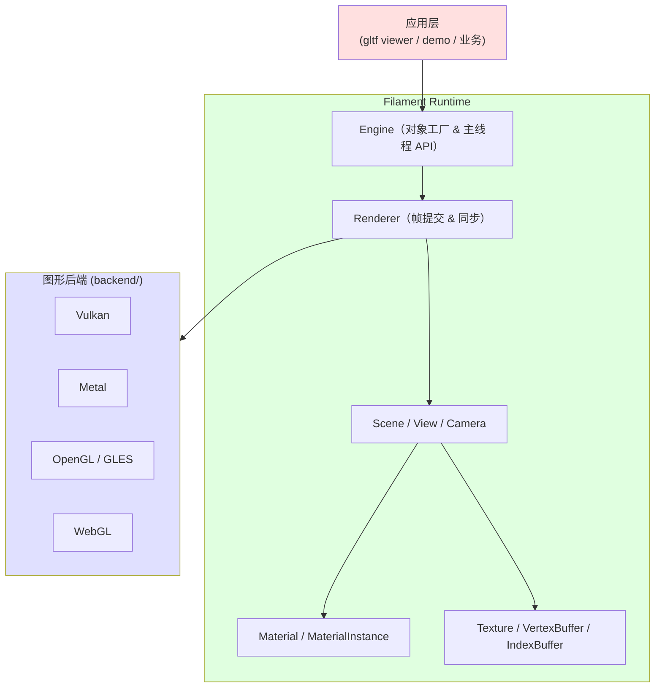

# Filament 学习指南 —— 从入门到精通

**作者**：汪亮（bertonwang）
**邮箱**：<47608843@qq.com>
**版本**：v1.0 ｜ **最后更新**：2026-08-13

> **Filament** 是 Google 开源的**基于物理的实时渲染引擎（PBR）**，主打 *轻量、跨平台、移动端友好*。它同时提供纯 C++ API 和 Java/Kotlin/JS 绑定，支持 Android/iOS/macOS/Windows/Linux/WebGL。
> **filagui** 是 Filament 生态中官方基于 [Dear ImGui](https://github.com/ocornut/imgui) 封装的 GUI 集成层，方便渲染样例快速搭建调参面板。

---

## 📋 目录

- [Filament 学习指南 —— 从入门到精通](#filament-学习指南--从入门到精通)
  - [📋 目录](#-目录)
  - [一、简介与定位](#一简介与定位)
  - [二、整体架构](#二整体架构)
  - [三、核心概念速览](#三核心概念速览)
  - [四、快速上手](#四快速上手)
    - [4.1 环境构建](#41-环境构建)
    - [4.2 一段最小可运行代码](#42-一段最小可运行代码)
  - [五、PBR 材质与光照](#五pbr-材质与光照)
    - [5.1 材质模型](#51-材质模型)
    - [5.2 光照与 IBL](#52-光照与-ibl)
    - [5.3 后处理](#53-后处理)
  - [六、filagui 集成](#六filagui-集成)
  - [七、常见坑与最佳实践](#七常见坑与最佳实践)
  - [八、进阶方向与对比选型](#八进阶方向与对比选型)
  - [九、参考资料](#九参考资料)

---

## 一、简介与定位

| 字段 | 内容 |
|------|------|
| 定位 | Google 开源的 PBR 实时渲染引擎 |
| 语言 | C++（核心）+ Java/Kotlin/JS 绑定 |
| 许可证 | Apache 2.0 |
| 后端 | Vulkan / Metal / OpenGL / OpenGL ES / WebGL |
| 平台 | Windows / macOS / Linux / Android / iOS / Web |
| 官方地址 | <https://github.com/google/filament> |

**核心卖点**：

1. **物理正确的 PBR**：默认使用 GGX 微表面 BRDF、能量守恒的多层材质。
2. **移动端优先**：极致优化，Android 上单帧开销远低于 Unity URP。
3. **易上手**：材质通过 **matc** 离线编译成跨后端字节码，运行时零着色器编译成本。
4. **配套齐全**：`gltfio`（glTF 加载）、`filagui`（GUI）、`matinfo`（材质检视）、`filameshio`（网格 IO）。

---

## 二、整体架构



---

## 三、核心概念速览

| 概念 | 说明 |
|------|------|
| `Engine` | 顶层对象工厂，所有资源必须由它创建/销毁 |
| `SwapChain` | 与窗口平台句柄绑定的呈现表面 |
| `Renderer` | 每帧调用 `beginFrame/render/endFrame`，负责同步与队列 |
| `View` | 视口：包含 Camera + Scene + Post-process 配置 |
| `Scene` | 光源 + 可渲染实体的集合 |
| `Camera` | 透视/正交投影，可绑定到 Entity |
| `Material` | 编译好的着色程序模板（离线由 matc 生成） |
| `MaterialInstance` | 材质模板的运行时实例，可独立设置参数 |
| `Renderable` | 通过 `RenderableManager` 附加到 Entity 上的可绘制组件 |
| `LightManager` | 管理定向光、点光、聚光、面光 |
| `Skybox` / `IndirectLight` | IBL 环境光照（推荐由 `cmgen` 离线烘焙） |

**ECS 味道**：Filament 使用 **utils::Entity + 各种 Manager** 的 EC 模型，与传统 OO 场景图相比更利于批处理与缓存友好。

---

## 四、快速上手

### 4.1 环境构建

```bash
git clone https://github.com/google/filament.git
cd filament

# 需要 CMake ≥ 3.19、Clang / MSVC 2019+
./build.sh -p desktop release        # Linux/macOS
build.bat -p desktop release         # Windows
```

产物：`out/release/filament/` 下含头文件 + 静态库；`out/release/samples/` 下含 `sample-hellotriangle`、`gltf_viewer` 等示例。

CMake 集成：

```cmake
find_package(filament REQUIRED)
target_link_libraries(my_app PRIVATE
    filament::filament
    filament::backend
    filament::filameshio
    filament::filamat        # 可选：运行时编译材质
    filament::gltfio         # 可选：加载 glTF
)
```

### 4.2 一段最小可运行代码

```cpp
#include <filament/Engine.h>
#include <filament/Renderer.h>
#include <filament/Scene.h>
#include <filament/View.h>
#include <filament/Camera.h>
#include <filament/SwapChain.h>
#include <utils/EntityManager.h>

using namespace filament;
using utils::Entity;

int main() {
    // 1) 创建 Engine（自动选择最佳后端，也可 Engine::create(Backend::VULKAN)）
    Engine* engine = Engine::create();

    // 2) 绑定窗口（这里用平台 native handle，SDL/GLFW/Win32/NSView 均可）
    void* nativeWindow = /* your window handle */;
    SwapChain* swapChain = engine->createSwapChain(nativeWindow);

    Renderer* renderer = engine->createRenderer();
    Scene* scene = engine->createScene();
    View* view = engine->createView();

    Entity camEntity = utils::EntityManager::get().create();
    Camera* camera = engine->createCamera(camEntity);
    camera->setProjection(45.0, 16.0 / 9.0, 0.1, 100.0);
    view->setCamera(camera);
    view->setScene(scene);
    view->setViewport({0, 0, 1280, 720});

    // 3) 主循环
    while (running()) {
        if (renderer->beginFrame(swapChain)) {
            renderer->render(view);
            renderer->endFrame();
        }
    }

    // 4) 销毁：所有对象都必须由 engine->destroy 显式释放
    engine->destroy(view);
    engine->destroy(scene);
    engine->destroy(camera);
    engine->destroy(swapChain);
    engine->destroy(renderer);
    Engine::destroy(&engine);
}
```

---

## 五、PBR 材质与光照

### 5.1 材质模型

Filament 的材质采用 **自研 DSL**（`.mat` 文件），由 `matc` 离线编译成 `.filamat` 二进制。核心示例：

```glsl
material {
    name : "MyPBR",
    shadingModel : lit,
    parameters : [
        { type : sampler2d, name : baseColorMap },
        { type : float,     name : metallic     },
        { type : float,     name : roughness    }
    ],
    requires : [ uv0 ]
}

fragment {
    void material(inout MaterialInputs mi) {
        prepareMaterial(mi);
        mi.baseColor = texture(materialParams_baseColorMap, getUV0());
        mi.metallic  = materialParams.metallic;
        mi.roughness = materialParams.roughness;
    }
}
```

**shadingModel** 可选：`lit`（金属工作流）、`subsurface`、`cloth`、`specularGlossiness`、`unlit`。

### 5.2 光照与 IBL

- 直接光：`LightManager::Builder(Type::DIRECTIONAL / POINT / SPOT / FOCUSED_SPOT)`
- 间接光 (IBL)：先用 `cmgen` 把 `.hdr` 环境图烘焙成 SH9 + 预滤 mip chain，再 `IndirectLight::Builder`
- **实时反射**：Screen Space Reflection (SSR) 在 View 上一行 `view->setScreenSpaceReflectionsOptions()` 打开

### 5.3 后处理

`View::setBloomOptions()` / `setTemporalAntiAliasingOptions()` / `setDynamicResolutionOptions()`
覆盖：Bloom、TAA、SMAA、FXAA、颜色分级 (ColorGrading LUT)、DOF、Motion Blur、Vignette、Dithering。

---

## 六、filagui 集成

filagui 把 [Dear ImGui](https://github.com/ocornut/imgui) 的 draw list 转成 Filament 的 `VertexBuffer` + `MaterialInstance`，让你能在渲染窗口里画调参面板：

```cpp
#include <filagui/ImGuiHelper.h>

filagui::ImGuiHelper imguiHelper(engine, view, /*ttf font path*/ "fonts/Roboto.ttf");

// 主循环
imguiHelper.render(deltaTime, [&](Engine*, View*) {
    ImGui::Begin("Debug");
    ImGui::SliderFloat("roughness", &roughness, 0.0f, 1.0f);
    ImGui::ColorEdit3("baseColor", baseColor);
    ImGui::End();
});
```

典型用途：**材质参数实时调节、后处理 A/B 对比、Renderable 拓扑检视、Profiler 面板**。

---

## 七、常见坑与最佳实践

1. **⚠️ 资源生命周期**：Filament 所有对象必须由 `Engine::destroy(...)` 释放，**不要用 delete**。销毁顺序：具体对象 → SwapChain → Renderer → Engine。
2. **⚠️ 线程模型**：Filament 是 **单一"主线程" API + 内部 driver 线程**。API 调用必须在同一线程；跨线程需 `Engine::flushAndWait()` 显式同步。
3. **⚠️ 材质变体爆炸**：每个 `Material` 会根据顶点属性、光照类型编译多个变体；避免为 1 个对象做 20 个特化，可用 `Instance` 参数化。
4. **⚠️ 后端差异**：Metal / Vulkan / GL 各有 quirk（如 GLES 不支持 compute shader），发布前跑 `matinfo` 检查目标平台是否落地全部特性。
5. **✅ IBL 用 cmgen 离线烘焙**：运行时烘焙成本极高，也无法保持一致性。
6. **✅ glTF 优先**：官方 `gltfio` 加载器已完成 90% 的工作，自定义格式建议只做转换器。

---

## 八、进阶方向与对比选型

| 引擎/库 | 定位 | 何时选择 |
|--------|------|---------|
| **Filament** | 轻量 PBR，移动端优先 | Android/iOS/嵌入式/AR |
| **Unreal / Unity** | 商业游戏引擎 | 完整游戏项目、生态需求 |
| **Godot** | 开源游戏引擎 | 中小型 2D/3D 游戏 |
| **bgfx** | 跨平台渲染抽象 | 只要 API 抽象，不要材质/场景 |
| **Ogre3D** | 传统场景图引擎 | 老项目迁移、企业可视化 |
| **The Forge** | 高性能 AAA 渲染库 | Console/PC 高端渲染 |

Filament 源码本身也是学习 **现代渲染工程范式**（Job System / Command Buffer / Handle Pool / ECS-lite）的极佳教材，推荐从 `libs/filament/src/RenderPass.cpp` 与 `libs/filabridge` 入手阅读。

---

## 九、参考资料

- 🔗 官方 PBR 白皮书：<https://google.github.io/filament/Filament.html>
- 🔗 材质系统文档：<https://google.github.io/filament/Materials.html>
- 🔗 官方示例：`samples/` 目录（推荐从 `hellotriangle` → `sample_full_pbr` → `gltf_viewer` 递进）
- 📘 [bgfx学习指南-从入门到精通](bgfx学习指南-从入门到精通.md)（跨平台渲染抽象层对比）
- 📘 [Vulkan学习指南-从入门到精通](Vulkan学习指南-从入门到精通.md)（理解 Filament 的 Vulkan 后端实现）

---

> ✨ **备注**：Filament 主线跟随最新 C++17，Vulkan 后端已默认启用 dynamic rendering。欢迎在 PR 中补充或修正。
