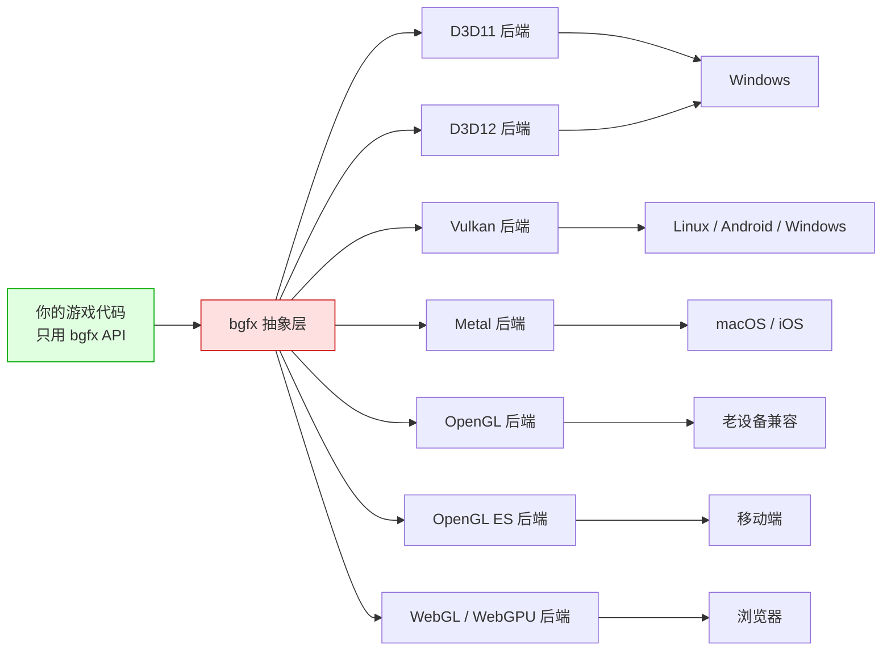
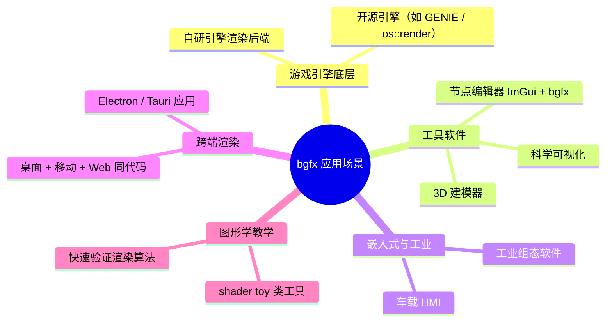
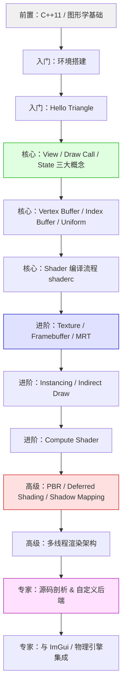
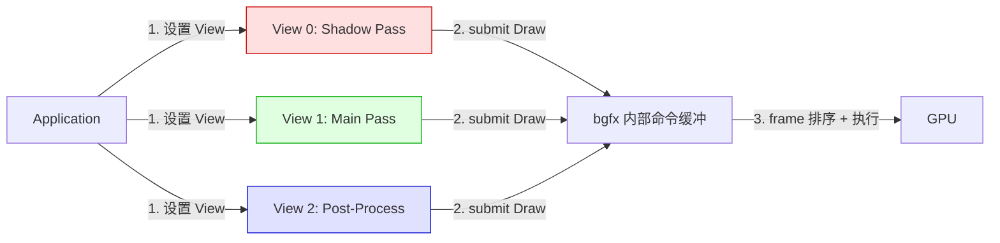
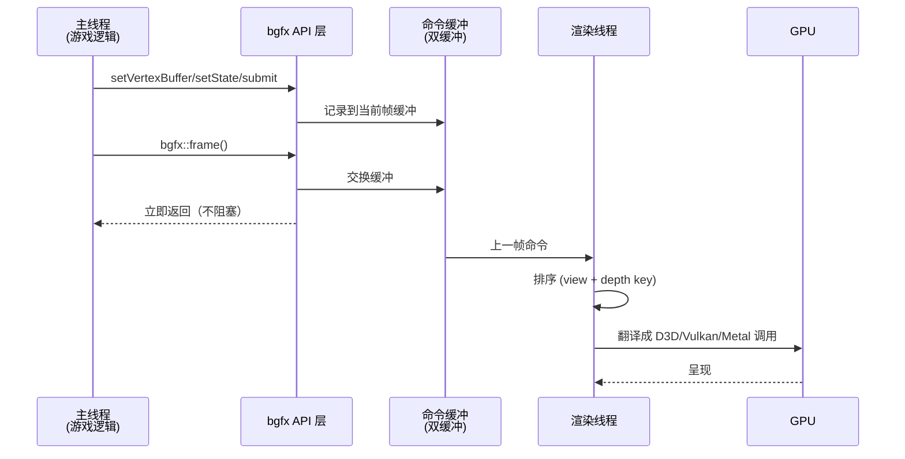
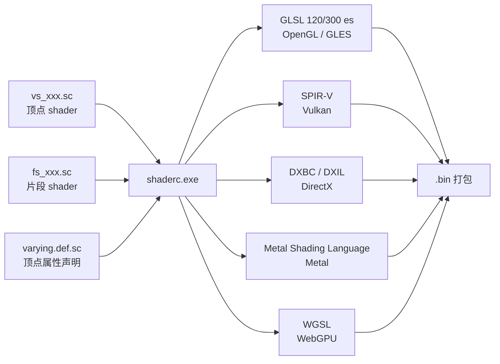
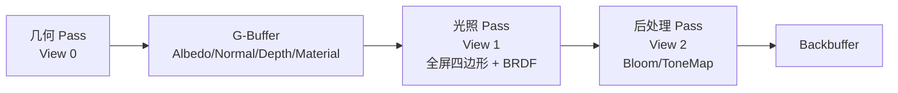
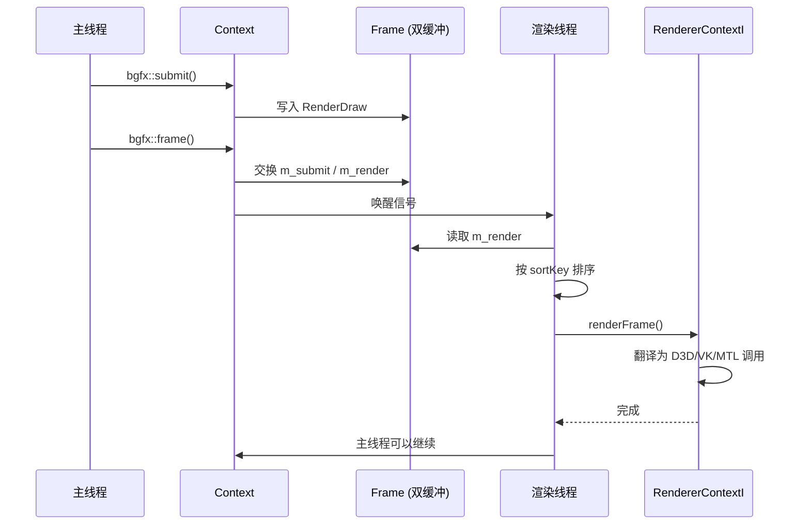

# bgfx 学习指南 —— 从入门到精通

**作者**：汪亮（bertonwang）  
**邮箱**：<47608843@qq.com>  
**版本**：v1.0 ｜ **最后更新**：2026-05-18

> **适用人群**：从零基础小白 → 跨平台图形引擎开发者
> **目标**：让你彻底吃透 bgfx 的设计哲学、API 用法、渲染管线与性能优化技巧，能够独立用 bgfx 构建跨平台图形应用与自研引擎。

---

## 📋 目录

1. [什么是 bgfx？](#一什么是-bgfx)
2. [bgfx vs OpenGL / Vulkan / Metal / DirectX](#二bgfx-vs-opengl--vulkan--metal--directx)
3. [学习路线图](#三学习路线图)
4. [入门篇：环境搭建与 Hello Triangle](#四入门篇环境搭建与-hello-triangle)
5. [核心篇：bgfx 的设计哲学与关键概念](#五核心篇bgfx-的设计哲学与关键概念)
6. [进阶篇：渲染管线深入](#六进阶篇渲染管线深入)
7. [高级篇：高级渲染技术](#七高级篇高级渲染技术)
8. [专家篇：性能优化与源码剖析](#八专家篇性能优化与源码剖析)
9. [实战项目](#九实战项目)
10. [附录 A：bgfx API 速查表](#附录-abgfx-api-速查表)
11. [附录 B：shaderc 使用手册](#附录-bshaderc-使用手册)
12. [附录 C：学习资源推荐](#附录-c学习资源推荐)
13. [附录 D：常见问题 FAQ](#附录-d常见问题-faq)

---

## 一、什么是 bgfx？

### 1.1 一句话解释

> **bgfx 是一个跨平台、渲染 API 无关（Render-API-Agnostic）的图形渲染库。它把 OpenGL / DirectX / Vulkan / Metal / WebGL / WebGPU 等一大堆图形 API 封装成"同一套 C/C++ 接口"，让你写一次代码就能在几乎所有平台上跑起来。**

作者是 Branimir Karadžić（前 EA / Rockstar 引擎程序员），项目托管在 [github.com/bkaradzic/bgfx](https://github.com/bkaradzic/bgfx)，采用 BSD 2-Clause 许可，商业友好。

### 1.2 小白版解释

想象你在写一个跨平台游戏，直接调用底层图形 API 会让你崩溃：

| 平台 | 必须用什么 API | 学习成本 |
|------|--------------|--------|
| Windows | DirectX 11 / DirectX 12 | ⭐⭐⭐⭐ |
| Linux | OpenGL / Vulkan | ⭐⭐⭐⭐ |
| macOS / iOS | Metal | ⭐⭐⭐⭐ |
| Android | OpenGL ES / Vulkan | ⭐⭐⭐ |
| Web 浏览器 | WebGL / WebGPU | ⭐⭐⭐ |
| 主机（Switch 等） | 私有 API | ⭐⭐⭐⭐⭐ |

如果每个平台都单独写一套渲染代码，光维护就要人命。

**bgfx 帮你干的事**：



> 💡 **一句话**：bgfx = 现代版的"跨平台 OpenGL"，但**性能可以逼近原生 API**，且完全掌控在你手里（开源、可修改）。

### 1.3 bgfx 的核心特点

| 特性 | 说明 |
|------|------|
| **多后端** | 支持 D3D11 / D3D12 / Vulkan / Metal / OpenGL 2.1~4.x / OpenGL ES 2.x/3.x / WebGL / WebGPU / NVN(Switch) |
| **渲染 API 无关** | 上层代码与图形 API 完全解耦，切换后端只改一个枚举 |
| **状态设置式 API** | 类似 OpenGL 的 `setState + setUniform + submit`，简单直观 |
| **多线程渲染** | 内建"渲染线程 + 提交线程"双线程模型，自动无锁并行 |
| **确定性提交顺序** | 通过 `view + depth key` 排序，避免 Draw Call 顺序错乱 |
| **无 GC / 极简依赖** | 纯 C++11，仅依赖姊妹库 `bx`、`bimg`，无 STL 强绑定 |
| **示例丰富** | 官方带 45+ 个 example，覆盖 PBR、GI、VXGI、集群光照等前沿技术 |

### 1.4 bgfx 三兄弟：bgfx / bx / bimg

| 库 | 作用 | 类比 |
|----|------|------|
| **[bgfx](https://github.com/bkaradzic/bgfx)** | 渲染核心库 | 图形 API 抽象层 |
| **[bx](https://github.com/bkaradzic/bx)** | 基础设施库：内存、字符串、线程、数学 | 相当于精简版 STL + glm |
| **[bimg](https://github.com/bkaradzic/bimg)** | 图像编解码：KTX / DDS / PVR / EXR / HDR / PNG | 相当于 stb_image + DirectXTex |

> ⚠️ 三者必须一起编译，缺一不可。bgfx 严格遵循 "bx 提供基础、bimg 提供图像、bgfx 提供渲染" 的分层设计。

### 1.5 bgfx 能做什么？



---

## 二、bgfx vs OpenGL / Vulkan / Metal / DirectX

### 2.1 定位对比

| 层级 | 代表技术 | 说明 |
|------|---------|------|
| **应用层** | Unity / Unreal / Godot | 完整游戏引擎 |
| **中间层（bgfx 在这一层）** | **bgfx** / Diligent / sokol_gfx / The-Forge | 跨平台渲染抽象库 |
| **底层图形 API** | D3D12 / Vulkan / Metal | 直接和 GPU 驱动打交道 |
| **驱动 + 硬件** | NVIDIA / AMD / Intel / ARM Mali | 芯片厂商实现 |

**bgfx 定位**：介于 "裸图形 API" 和 "完整游戏引擎" 之间。它**不提供场景图、动画、物理、资源管理**，只做"渲染层"。

### 2.2 vs 直接使用底层 API

| 对比维度 | bgfx | Vulkan / D3D12 | OpenGL |
|---------|------|----------------|--------|
| **代码量** | Hello Triangle 约 100 行 | 约 1000+ 行 | 约 200 行 |
| **跨平台** | ✅ 一份代码全平台 | ❌ 每个平台重写 | ✅（但被 Apple 弃用） |
| **性能** | 90%~95% 原生性能 | 100% | 60%~80% |
| **控制力** | 中等（隐藏了同步与命令池） | 极高（完全显式） | 中等 |
| **调试难度** | 低（有 RenderDoc 集成 + 内置统计） | 高 | 低 |
| **学习曲线** | ⭐⭐ | ⭐⭐⭐⭐⭐ | ⭐⭐ |

### 2.3 vs 同类竞品

| 库 | 语言 | 后端 | 特点 | 缺点 |
|----|------|------|------|------|
| **bgfx** | C++11 | 全平台 | 生态成熟、样例多、社区活跃 | 状态式 API 稍显老派 |
| **sokol_gfx** | C99 | GL/D3D11/Metal/WebGPU | 单头文件、极简 | 功能有限 |
| **The-Forge** | C++ | Vulkan/D3D12/Metal | 命令式、面向 3A | 只支持现代 API |
| **Diligent Engine** | C++ | 全平台 | 面向对象、C# 风格 | API 冗长 |
| **wgpu-native** | Rust/C | WebGPU 标准 | 未来趋势 | 目前性能仍待打磨 |

> 💡 **选型建议**：
> - 要写**跨平台 3D 工具**、上手快、性能够用 → **bgfx** 首选
> - 要写**极致性能 3A 引擎** → 直接用 Vulkan / D3D12 / Metal
> - 要写**Web 优先应用** → wgpu / WebGPU

---

## 三、学习路线图



### 3.1 阶段目标

| 阶段 | 时间投入 | 能做到什么 |
|------|---------|-----------|
| **入门篇** | 1~2 周 | 编译 bgfx，跑通 Hello Triangle，理解 View / Program |
| **核心篇** | 2~3 周 | 独立编写带纹理的 3D 模型渲染 |
| **进阶篇** | 1 个月 | 实现 MRT、后期处理、Compute Shader |
| **高级篇** | 1~2 个月 | 实现 PBR + Shadow Map + 后期管线的小引擎 |
| **专家篇** | 3+ 个月 | 阅读源码、修改后端、构建自研引擎 |

### 3.2 前置知识清单

- **C++11+**：模板、RAII、`std::function`、`std::atomic`
- **图形学基础**：向量、矩阵、齐次坐标、投影矩阵、法线变换
- **至少了解一种图形 API**：OpenGL 或 D3D11 均可，帮助理解 bgfx 抽象
- **命令行 & 构建工具**：make / CMake / genie（bgfx 官方脚本生成器）

> 📚 推荐先读本仓库中：
> - [图形学基础-虎书与LearnOpenGL-初学者版](图形学基础-虎书与LearnOpenGL-初学者版.md)
> - [图形学中的8个坐标系详解](图形学中的8个坐标系详解.md)
> - [GPU图形渲染中的着色器详解](GPU图形渲染中的着色器详解.md)

---

## 四、入门篇：环境搭建与 Hello Triangle

### 4.1 拉取源码

bgfx 采用 **GENie**（基于 Lua 的 premake fork）生成工程文件，姊妹库需要放在同一父目录：

```bash
mkdir bgfx-workspace && cd bgfx-workspace
git clone https://github.com/bkaradzic/bx
git clone https://github.com/bkaradzic/bimg
git clone https://github.com/bkaradzic/bgfx
```

目录结构必须是：
```
bgfx-workspace/
├── bx/
├── bimg/
└── bgfx/     ← 主项目
```

### 4.2 Windows 编译（Visual Studio 2022）

```bash
cd bgfx
..\bx\tools\bin\windows\genie.exe --with-examples vs2022
start .build\projects\vs2022\bgfx.sln
```

编译目标：
- `bgfx` / `bx` / `bimg` —— 三个静态库
- `example-XX-yyyy` —— 各种示例，最简单的是 `example-00-helloworld`

### 4.3 Linux / macOS 编译

```bash
cd bgfx
make -j8                       # 全平台自动检测
# 或者指定后端：
make linux-release64           # Linux 下用 GL
make osx-x64                   # macOS 下用 Metal
```

编译产物默认输出到 `.build/<平台>/bin/`。

### 4.4 CMake 集成（推荐用于自己项目）

社区维护的 [`bgfx.cmake`](https://github.com/bkaradzic/bgfx.cmake) 更适合现代工程：

```cmake
include(FetchContent)
FetchContent_Declare(
    bgfx
    GIT_REPOSITORY https://github.com/bkaradzic/bgfx.cmake.git
    GIT_TAG        master
)
FetchContent_MakeAvailable(bgfx)

add_executable(my_app main.cpp)
target_link_libraries(my_app PRIVATE bgfx bx bimg)
```

### 4.5 Hello Triangle 完整代码

```cpp
#include <bgfx/bgfx.h>
#include <bgfx/platform.h>
#include <bx/math.h>
#include <GLFW/glfw3.h>
#define GLFW_EXPOSE_NATIVE_WIN32
#include <GLFW/glfw3native.h>

// 1. 定义顶点结构 + 布局
struct PosColorVertex {
    float x, y, z;
    uint32_t abgr;
};

static PosColorVertex kTriangleVertices[] = {
    { -0.5f, -0.5f, 0.0f, 0xff0000ff },  // 左下 红
    {  0.5f, -0.5f, 0.0f, 0xff00ff00 },  // 右下 绿
    {  0.0f,  0.5f, 0.0f, 0xffff0000 },  // 顶部 蓝
};
static const uint16_t kTriangleIndices[] = { 0, 1, 2 };

int main() {
    // 2. 创建窗口
    glfwInit();
    glfwWindowHint(GLFW_CLIENT_API, GLFW_NO_API);
    GLFWwindow* window = glfwCreateWindow(1280, 720, "bgfx Hello", nullptr, nullptr);

    // 3. 把原生窗口句柄告诉 bgfx（关键！）
    bgfx::PlatformData pd{};
    pd.nwh = glfwGetWin32Window(window);
    bgfx::setPlatformData(pd);

    // 4. 初始化 bgfx
    bgfx::Init init;
    init.type     = bgfx::RendererType::Count;   // 自动选后端
    init.resolution.width  = 1280;
    init.resolution.height = 720;
    init.resolution.reset  = BGFX_RESET_VSYNC;
    bgfx::init(init);

    // 5. 设置 View 0 的清屏参数
    bgfx::setViewClear(0, BGFX_CLEAR_COLOR | BGFX_CLEAR_DEPTH, 0x303030ff, 1.0f, 0);
    bgfx::setViewRect(0, 0, 0, 1280, 720);

    // 6. 声明顶点布局
    bgfx::VertexLayout layout;
    layout.begin()
          .add(bgfx::Attrib::Position, 3, bgfx::AttribType::Float)
          .add(bgfx::Attrib::Color0,   4, bgfx::AttribType::Uint8, true)
          .end();

    // 7. 创建 VB / IB
    auto vbh = bgfx::createVertexBuffer(
        bgfx::makeRef(kTriangleVertices, sizeof(kTriangleVertices)), layout);
    auto ibh = bgfx::createIndexBuffer(
        bgfx::makeRef(kTriangleIndices, sizeof(kTriangleIndices)));

    // 8. 加载 Shader Program（.bin 由 shaderc 预编译产生）
    auto vsh = loadShader("vs_hello.bin");   // 用户自行实现的读文件函数
    auto fsh = loadShader("fs_hello.bin");
    auto prog = bgfx::createProgram(vsh, fsh, true);

    // 9. 主循环
    while (!glfwWindowShouldClose(window)) {
        glfwPollEvents();

        // 视图矩阵
        const bx::Vec3 eye = { 0.0f, 0.0f, -3.0f };
        const bx::Vec3 at  = { 0.0f, 0.0f,  0.0f };
        float view[16], proj[16];
        bx::mtxLookAt(view, eye, at);
        bx::mtxProj(proj, 60.0f, 1280.0f/720.0f, 0.1f, 100.0f,
                    bgfx::getCaps()->homogeneousDepth);
        bgfx::setViewTransform(0, view, proj);

        // 提交 Draw Call
        bgfx::setVertexBuffer(0, vbh);
        bgfx::setIndexBuffer(ibh);
        bgfx::setState(BGFX_STATE_DEFAULT);
        bgfx::submit(0, prog);

        // 结束帧
        bgfx::frame();
    }

    // 10. 清理
    bgfx::destroy(prog);
    bgfx::destroy(vbh);
    bgfx::destroy(ibh);
    bgfx::shutdown();
    glfwTerminate();
    return 0;
}
```

**关键点解读**：

1. **`setPlatformData` 必须在 `bgfx::init` 之前**：告诉 bgfx 目标窗口的原生句柄（Win32 是 `HWND`，X11 是 `Window`，macOS 是 `NSWindow*`）。
2. **`bgfx::frame()` 才真正提交**：`submit()` 只是把命令记录到缓冲区，`frame()` 触发实际渲染。
3. **Shader 需要预编译**：bgfx 使用自研的 shader 编译器 `shaderc`（详见附录 B），把 GLSL/HLSL 编译成 `.bin` 中间格式，运行时再翻译到目标后端。

---

## 五、核心篇：bgfx 的设计哲学与关键概念

### 5.1 三大核心概念：View / Draw / State

这是理解 bgfx 的**钥匙**，务必吃透：



#### View（视图）

- 一个 **View 对应一个 RenderPass**（一次完整的渲染阶段：如"阴影贴图 pass"、"主场景 pass"、"后处理 pass"）
- 每个 View 有独立的：**FrameBuffer / ViewMatrix / ProjMatrix / ClearState / Scissor**
- View 的顺序由 **View ID (`ViewId`, 0~255)** 决定，`bgfx::setViewOrder` 可以调整
- **在同一帧内，View ID 小的先渲染**

```cpp
bgfx::setViewFrameBuffer(0, shadowFB);      // View 0 = Shadow Pass
bgfx::setViewFrameBuffer(1, BGFX_INVALID_HANDLE);   // View 1 = 主 backbuffer
```

#### Draw Call（绘制调用）

- 每次 `bgfx::submit(viewId, program)` 就是一次 Draw Call
- 提交前的所有 `setVertexBuffer` / `setIndexBuffer` / `setTexture` / `setUniform` / `setState` / `setTransform` 都被"打包"进这次 Draw
- submit 后，**内部状态自动重置**，下一次 Draw 需要重新 set

> 💡 这种"设置-提交"模式类似 OpenGL，但 bgfx 的状态是**每 Draw Call 隔离**的，不会污染下一个。

#### State（状态）

- 一个 64 位的位掩码，编码：写掩码、深度测试、混合、背面剔除、图元类型等
- 用 `BGFX_STATE_XXX` 宏组合：

```cpp
uint64_t state = BGFX_STATE_WRITE_RGB
               | BGFX_STATE_WRITE_A
               | BGFX_STATE_WRITE_Z
               | BGFX_STATE_DEPTH_TEST_LESS
               | BGFX_STATE_CULL_CW
               | BGFX_STATE_MSAA
               | BGFX_STATE_BLEND_ALPHA;
bgfx::setState(state);
```

### 5.2 资源句柄：不透明的 HandleType

bgfx 所有资源都通过 **16 位轻量句柄** 管理：

| 句柄类型 | 说明 |
|---------|------|
| `ShaderHandle` | 单个 Shader 对象 |
| `ProgramHandle` | Shader Program（vs + fs） |
| `VertexBufferHandle` / `IndexBufferHandle` | 静态几何缓冲 |
| `DynamicVertexBufferHandle` / `DynamicIndexBufferHandle` | 动态更新的缓冲 |
| `TextureHandle` | 2D / 3D / Cube 纹理 |
| `FrameBufferHandle` | 渲染目标 |
| `UniformHandle` | Shader 常量 |
| `OcclusionQueryHandle` | 遮挡查询 |
| `IndirectBufferHandle` | 间接绘制参数 |

> 💡 好处：**API 稳定**（不依赖底层对象指针），**内存友好**（16 位比 64 位指针省 4 倍），**易于跨线程传递**。

### 5.3 内存管理：Memory 结构体

bgfx 用 `const bgfx::Memory*` 来传递数据，有三种创建方式：

```cpp
// 方式 1：拷贝（安全，最常用）
const bgfx::Memory* mem = bgfx::copy(data, size);

// 方式 2：引用（零拷贝，但要保证 data 生命周期直到 bgfx 用完）
const bgfx::Memory* mem = bgfx::makeRef(data, size);

// 方式 3：引用 + 自定义释放回调
const bgfx::Memory* mem = bgfx::makeRef(data, size, releaseFn, userData);
```

⚠️ **陷阱**：`makeRef` 常见的 bug 是 data 是**栈变量**，函数返回就被销毁，bgfx 帧结束时访问野指针崩溃。

### 5.4 Vertex Layout：跨后端顶点布局

不同图形 API 描述顶点布局的方式差异很大（GL 用 `glVertexAttribPointer`，D3D 用 `INPUT_ELEMENT_DESC`），bgfx 用 `VertexLayout` 统一封装：

```cpp
bgfx::VertexLayout layout;
layout.begin()
    .add(bgfx::Attrib::Position,  3, bgfx::AttribType::Float)
    .add(bgfx::Attrib::Normal,    3, bgfx::AttribType::Float)
    .add(bgfx::Attrib::TexCoord0, 2, bgfx::AttribType::Float)
    .add(bgfx::Attrib::Color0,    4, bgfx::AttribType::Uint8, true /*normalized*/)
    .end();
```

**支持的语义（Attrib）**：`Position / Normal / Tangent / Bitangent / Color0~3 / Indices / Weight / TexCoord0~7`。

### 5.5 Uniform：Shader 常量

bgfx 的 Uniform 分两类：

| 类型 | 用途 | 例子 |
|------|------|------|
| **`vec4`/`mat3`/`mat4`** | 每帧变化的常量 | `u_lightPos`, `u_viewProj` |
| **`Sampler`** | 纹理采样器绑定点 | `s_texColor` |

```cpp
auto u_lightDir = bgfx::createUniform("u_lightDir", bgfx::UniformType::Vec4);
auto s_texColor = bgfx::createUniform("s_texColor", bgfx::UniformType::Sampler);

// 每帧更新
float lightDir[4] = { 0.5f, -0.8f, 0.3f, 0.0f };
bgfx::setUniform(u_lightDir, lightDir);
bgfx::setTexture(0 /*stage*/, s_texColor, textureHandle);
```

> ⚠️ **重要**：bgfx **没有**类似 D3D 的 `cbuffer` 或 GL UBO 的自动组包，所有 `vec4` uniform 都是单独 setUniform。批量传参请用**动态 uniform 缓冲**或**instancing**。

### 5.6 帧生命周期



**核心特性**：
- **主线程调用 `submit` 是无锁的**（写入线程本地命令缓冲）
- **`frame()` 是唯一的同步点**：交换双缓冲，触发渲染线程执行
- **典型延迟：1 帧**（主线程记录第 N 帧命令时，渲染线程正在执行第 N-1 帧）

### 5.7 Debug 与统计

bgfx 内建强大的调试能力：

```cpp
bgfx::setDebug(BGFX_DEBUG_TEXT | BGFX_DEBUG_STATS);

// 用文字覆盖到画面
bgfx::dbgTextPrintf(0, 0, 0x0f, "Frame: %.2f ms", frameTime);

// 查询能力
const bgfx::Caps* caps = bgfx::getCaps();
if (caps->supported & BGFX_CAPS_COMPUTE) { /*支持计算*/ }

// 获取统计
const bgfx::Stats* stats = bgfx::getStats();
printf("Draw calls: %u\n", stats->numDraw);
```

按 F1 可以在 example 里看到内置的 profile HUD（Draw call 数、GPU/CPU 耗时、纹理内存等）。

---

## 六、进阶篇：渲染管线深入

### 6.1 Shader 编译流程：shaderc

bgfx 的 shader 语法基于 **GLSL 的方言（BGFX_SHADER_LANGUAGE）**，通过 `shaderc` 工具编译到目标后端：



#### shader 源码示例

**`varying.def.sc`** —— 描述 vs 输出 / fs 输入：
```glsl
vec3 v_normal   : NORMAL   = vec3(0.0, 1.0, 0.0);
vec2 v_texcoord : TEXCOORD0 = vec2(0.0, 0.0);

vec3 a_position : POSITION;
vec3 a_normal   : NORMAL;
vec2 a_texcoord : TEXCOORD0;
```

**`vs_mesh.sc`**：
```glsl
$input  a_position, a_normal, a_texcoord
$output v_normal, v_texcoord

#include <bgfx_shader.sh>

void main() {
    gl_Position = mul(u_modelViewProj, vec4(a_position, 1.0));
    v_normal    = mul(u_model[0], vec4(a_normal, 0.0)).xyz;
    v_texcoord  = a_texcoord;
}
```

**`fs_mesh.sc`**：
```glsl
$input v_normal, v_texcoord

#include <bgfx_shader.sh>

SAMPLER2D(s_texColor, 0);
uniform vec4 u_lightDir;

void main() {
    vec3 n = normalize(v_normal);
    float ndl = max(0.0, dot(n, -u_lightDir.xyz));
    vec3 color = texture2D(s_texColor, v_texcoord).rgb * ndl;
    gl_FragColor = vec4(color, 1.0);
}
```

#### 编译命令

```bash
# 编译到 D3D11
shaderc.exe -f vs_mesh.sc -o vs_mesh.bin \
            --type vertex --platform windows -p vs_5_0 -O 3 \
            --varyingdef varying.def.sc \
            -i ./bgfx/src

# 编译到 SPIR-V / Vulkan
shaderc.exe -f vs_mesh.sc -o vs_mesh.bin \
            --type vertex --platform linux -p spirv
```

> 📖 详细选项见 [附录 B](#附录-bshaderc-使用手册)。

### 6.2 纹理

```cpp
// 从 KTX / DDS / PNG 加载（推荐用 bimg）
bx::FileReader reader;
bx::open(&reader, "texture.dds");
uint32_t size = (uint32_t)bx::getSize(&reader);
const bgfx::Memory* mem = bgfx::alloc(size);
bx::read(&reader, mem->data, size, bx::ErrorAssert{});
bgfx::TextureHandle tex = bgfx::createTexture(mem);

// 或手动创建
bgfx::TextureHandle rt = bgfx::createTexture2D(
    1280, 720, false /*hasMips*/, 1 /*numLayers*/,
    bgfx::TextureFormat::RGBA8,
    BGFX_TEXTURE_RT | BGFX_SAMPLER_U_CLAMP | BGFX_SAMPLER_V_CLAMP);
```

**采样标志（Sampler Flags）**：
| 标志 | 含义 |
|------|------|
| `BGFX_SAMPLER_MIN_POINT` | 最近邻过滤 |
| `BGFX_SAMPLER_U_CLAMP` | U 方向 Clamp |
| `BGFX_SAMPLER_COMPARE_LESS` | 阴影贴图深度比较采样 |
| `BGFX_SAMPLER_MIP_POINT` | Mip 层间取最近 |

### 6.3 FrameBuffer 与 MRT

```cpp
bgfx::TextureHandle rt[3] = {
    bgfx::createTexture2D(1280, 720, false, 1, bgfx::TextureFormat::RGBA16F,
                          BGFX_TEXTURE_RT),
    bgfx::createTexture2D(1280, 720, false, 1, bgfx::TextureFormat::RGBA8,
                          BGFX_TEXTURE_RT),
    bgfx::createTexture2D(1280, 720, false, 1, bgfx::TextureFormat::D24S8,
                          BGFX_TEXTURE_RT_WRITE_ONLY),
};
bgfx::FrameBufferHandle gbuffer = bgfx::createFrameBuffer(3, rt, true);

bgfx::setViewFrameBuffer(1 /*viewId*/, gbuffer);
```

用于 **Deferred Shading**、**PostProcess ping-pong** 等场景。

### 6.4 Instancing 实例化

一次 Draw Call 画很多同类物体（草地、粒子、UI 图标）：

```cpp
const uint16_t instanceStride = 80;  // 每实例数据大小
const uint32_t numInstances   = 1000;

const bgfx::InstanceDataBuffer* idb =
    bgfx::allocInstanceDataBuffer(numInstances, instanceStride);

uint8_t* data = idb->data;
for (uint32_t i = 0; i < numInstances; ++i) {
    float* mtx = (float*)data;
    bx::mtxIdentity(mtx);
    mtx[12] = (float)i;     // 平移
    data += instanceStride;
}

bgfx::setVertexBuffer(0, vbh);
bgfx::setIndexBuffer(ibh);
bgfx::setInstanceDataBuffer(idb);
bgfx::submit(0, prog);
```

### 6.5 Compute Shader

bgfx 从 API 层就支持计算着色器（后端需支持 D3D11+ / GL 4.3+ / GLES 3.1+ / Metal / Vulkan）：

**`cs_particle.sc`**：
```glsl
#include <bgfx_compute.sh>

BUFFER_RW(particles, vec4, 0);   // read/write storage buffer

NUM_THREADS(64, 1, 1)
void main() {
    uint idx = gl_GlobalInvocationID.x;
    particles[idx].xyz += particles[idx].xyz * 0.01;
}
```

**CPU 端**：
```cpp
bgfx::DynamicVertexBufferHandle buf =
    bgfx::createDynamicVertexBuffer(1024, layout,
        BGFX_BUFFER_COMPUTE_READ_WRITE);

bgfx::setBuffer(0, buf, bgfx::Access::ReadWrite);
bgfx::dispatch(0 /*viewId*/, computeProgram, 1024/64, 1, 1);
```

### 6.6 Indirect Draw

GPU 端生成 Draw Call 参数（GPU-Driven Rendering 的基础）：

```cpp
bgfx::IndirectBufferHandle indirect = bgfx::createIndirectBuffer(256);

// CS 里填充 indirect
// GPU 端伪代码：
//   indirect[i] = { numIndices, numInstances, startIndex, startVertex, startInstance }

bgfx::setVertexBuffer(0, vbh);
bgfx::setIndexBuffer(ibh);
bgfx::submit(0, prog, indirect, 0 /*start*/, 256 /*num*/);
```

---

## 七、高级篇：高级渲染技术

### 7.1 PBR 材质（基于物理的渲染）

参考官方 **example-25-c99** 和 **example-06-bump**，PBR 的关键点：

1. **参数化材质**：albedo / metallic / roughness / normal / ao 五张贴图
2. **Cook-Torrance BRDF**：`f = kd·Lambert + ks·D·G·F / (4·NdotL·NdotV)`
3. **IBL（Image-Based Lighting）**：预积分环境贴图 + BRDF LUT
4. **Tone Mapping**：ACES / Reinhard 把 HDR 映射到 LDR

bgfx 提供 `examples/common/ps` 里现成的 PBR shader 组件，可直接用。

### 7.2 Shadow Mapping

**两 pass 阴影贴图**：

```cpp
// Pass 0: 从光源视角渲染深度
bgfx::setViewFrameBuffer(0, shadowFB);
bgfx::setViewTransform(0, lightView, lightProj);
for (auto& m : meshes) drawMesh(0, m, depthOnlyProg);

// Pass 1: 主渲染，采样阴影贴图
bgfx::setViewFrameBuffer(1, BGFX_INVALID_HANDLE);
bgfx::setViewTransform(1, camView, camProj);
bgfx::setTexture(0, s_shadowMap, shadowTex,
    BGFX_SAMPLER_COMPARE_LESS);   // 硬件 PCF
for (auto& m : meshes) drawMesh(1, m, mainProg);
```

进阶：**CSM（Cascaded Shadow Maps）**、**VSM（Variance Shadow Maps）**、**PCSS**。

### 7.3 Deferred Shading



在 bgfx 里就是**多个 View + 多个 FrameBuffer + 全屏 Blit**，示例见 `examples/24-nbody` 与 `31-rsm`。

### 7.4 多线程渲染

bgfx 提供两种并行方式：

#### 方式 1：`bgfx::Encoder`（多线程 submit）

```cpp
// 每个 worker 线程独立编码
void worker(std::vector<Mesh>& meshes) {
    bgfx::Encoder* enc = bgfx::begin();
    for (auto& m : meshes) {
        enc->setVertexBuffer(0, m.vb);
        enc->setState(m.state);
        enc->submit(0, m.prog);
    }
    bgfx::end(enc);
}
```

多个线程可以**并发提交 Draw Call**，bgfx 内部无锁合并。

#### 方式 2：多线程构建资源

`createTexture` / `createVertexBuffer` 等 API 都是**线程安全**的，可以在加载线程调用。

### 7.5 与 ImGui / Dear ImGui 集成

bgfx 生态里 `examples/common/imgui/imgui.cpp` 是标准范例：

```cpp
imguiCreate(fontSize);  // 内部调用 bgfx 创建 shader + VB
// 每帧：
imguiBeginFrame(mouseX, mouseY, mouseButtons, scroll, width, height, -1, viewId);
ImGui::Begin("Debug");
ImGui::Text("FPS: %.1f", fps);
ImGui::End();
imguiEndFrame();
```

---

## 八、专家篇：性能优化与源码剖析

### 8.1 性能关键指标

| 指标 | 期望值 | 查看方式 |
|------|-------|--------|
| Draw Call 数 | < 5000（PC）/ < 500（移动） | `bgfx::getStats()->numDraw` |
| Texture 内存 | 视目标平台 | `stats->textureMemoryUsed` |
| GPU 帧时间 | < 16.6ms（60 FPS） | `stats->gpuTimeEnd - gpuTimeBegin` |
| CPU 提交时间 | < 4ms | `stats->cpuTimeFrame` |
| Renderer 等待 | 越低越好 | `stats->waitRender / waitSubmit` |

### 8.2 减少状态切换

bgfx 内部会按 (view, depth key, program, state) 排序，但你也要主动：

- **合批（Batching）**：把同材质物体合并成一个大 VB / IB
- **实例化（Instancing）**：见 6.4
- **纹理数组 / Bindless**：把小纹理合到一张大图或纹理数组，减少 setTexture

### 8.3 GPU-Driven 渲染

用 **Compute Shader + Indirect Draw** 把整个剔除/LOD 放到 GPU：

```
CS: 视锥剔除 + 距离 LOD 选择 → 输出 IndirectBuffer
     ↓
主 View: bgfx::submit(view, prog, indirect, 0, maxDrawCount)
```

这是 UE5 Nanite / Frostbite 的核心思路，bgfx 的抽象**足够表达**这一模式。

### 8.4 源码架构剖析

bgfx 源码组织：

```
bgfx/src/
├── bgfx.cpp            # 主入口：API 实现、命令缓冲
├── bgfx_p.h            # 私有头：Context、Frame、Encoder 定义
├── renderer.h          # 后端接口 RendererContextI（虚基类）
├── renderer_d3d9.cpp / d3d11 / d3d12
├── renderer_gl.cpp     # OpenGL / GLES / WebGL
├── renderer_vk.cpp     # Vulkan
├── renderer_mtl.mm     # Metal (Objective-C++)
├── renderer_webgpu.cpp
├── renderer_nvn.cpp    # 私有（Switch）
├── shader_dxbc.cpp / shader_spirv.cpp   # Shader 反编译/翻译
└── ...
```

#### 关键类

| 类 | 职责 |
|----|-----|
| `Context` | 全局单例，持有资源池、命令缓冲、渲染线程 |
| `Frame` | 一帧的所有命令 + 数据，双缓冲 |
| `EncoderImpl` | 每线程的命令编码器 |
| `RendererContextI` | 后端接口，各后端实现 |
| `RenderDraw` / `RenderCompute` | 单个 Draw / Dispatch 的完整状态 |

#### 主循环时序



**Sort Key（64 位）** 结构（简化）：
```
| view(8) | seq(1) | trans(2) | program(9) | depth(24) | ... |
```
保证：View 顺序 > 半透明先后 > Program 分组 > 深度排序。

### 8.5 常见性能陷阱

| 陷阱 | 症状 | 解决 |
|------|------|-----|
| 每帧 destroy/create 资源 | GPU 卡顿 | 缓存资源，使用 Dynamic buffer |
| Uniform 全部逐 Draw 更新 | CPU 占用高 | 分组更新，或用 Instance data |
| Read back（`readTexture`）在主循环 | 严重掉帧 | 用异步查询 + 至少延迟 2 帧读 |
| 太多 View（>32） | 排序开销 | 合并 pass |
| 未启用 `--profile` shader | Debug 模式速度慢 | Release + `-O 3` |

---

## 九、实战项目

### 9.1 循序渐进的练手项目

| 难度 | 项目 | 涉及概念 |
|------|------|--------|
| ⭐ | Hello Triangle | View / VB / IB / Program |
| ⭐⭐ | 加载 OBJ 模型 + 纹理 | bimg / VertexLayout / setTexture |
| ⭐⭐ | 自由摄像机 | bx::mtxLookAt / 键鼠输入 |
| ⭐⭐⭐ | Blinn-Phong 光照 | Uniform / 法线变换 |
| ⭐⭐⭐ | 阴影贴图 | 双 pass / 采样对比 |
| ⭐⭐⭐⭐ | PBR 材质 + IBL | HDR / MipMap / BRDF LUT |
| ⭐⭐⭐⭐ | Deferred + 后处理 | MRT / 全屏 quad / Bloom |
| ⭐⭐⭐⭐⭐ | GPU-Driven 集群渲染 | Compute / Indirect / Sort |
| ⭐⭐⭐⭐⭐ | 迷你游戏引擎 | 资源系统 / 场景图 / ECS + bgfx 后端 |

### 9.2 推荐参考项目

- **[Overload](https://github.com/adriengivry/Overload)** —— 用 bgfx 构建的完整游戏引擎（含编辑器）
- **[GENIE](https://github.com/mendsley/GENie)** —— bgfx 作者的项目生成器
- **[NanoRT + bgfx 混合渲染](https://github.com/lighttransport/nanort)** —— 光追与光栅化结合
- **[polymer](https://github.com/ddiakopoulos/polymer)** —— 现代 C++ + bgfx 的图形沙盒

---

## 附录 A：bgfx API 速查表

### A.1 生命周期

| API | 说明 |
|-----|------|
| `bgfx::init(const Init&)` | 初始化 |
| `bgfx::reset(w, h, flags)` | 重置后备缓冲（窗口 resize） |
| `bgfx::frame()` | 提交一帧 |
| `bgfx::shutdown()` | 清理 |

### A.2 View 设置

| API | 说明 |
|-----|------|
| `setViewRect(id, x, y, w, h)` | 视口 |
| `setViewClear(id, flags, rgba, depth, stencil)` | 清屏 |
| `setViewFrameBuffer(id, fb)` | 渲染目标 |
| `setViewTransform(id, view, proj)` | 相机矩阵 |
| `setViewMode(id, mode)` | 排序模式（Default/Sequential/DepthAscending/DepthDescending） |

### A.3 资源创建 / 销毁

| 资源 | Create | Destroy |
|------|--------|---------|
| VB | `createVertexBuffer` | `destroy(vbh)` |
| IB | `createIndexBuffer` | `destroy(ibh)` |
| Texture | `createTexture2D/3D/Cube/…` | `destroy(th)` |
| Shader | `createShader(mem)` | `destroy(sh)` |
| Program | `createProgram(vs, fs, destroyShaders)` | `destroy(ph)` |
| Uniform | `createUniform(name, type)` | `destroy(uh)` |
| FrameBuffer | `createFrameBuffer(...)` | `destroy(fbh)` |

### A.4 Draw / Compute

| API | 说明 |
|-----|------|
| `setVertexBuffer(stream, vbh)` | 顶点流 |
| `setIndexBuffer(ibh)` | 索引 |
| `setTexture(stage, sampler, tex, flags)` | 纹理 |
| `setUniform(uh, data, num)` | 常量 |
| `setState(state, rgba)` | 渲染状态 |
| `setTransform(mtx, num)` | 世界矩阵 |
| `submit(viewId, program, depth, discardFlags)` | 提交 Draw |
| `dispatch(viewId, program, gx, gy, gz)` | Compute |

---

## 附录 B：shaderc 使用手册

### B.1 命令行常用参数

| 参数 | 说明 |
|------|------|
| `-f <file>` | 输入 shader 源文件 |
| `-o <file>` | 输出 .bin |
| `--type vertex/fragment/compute` | shader 类型 |
| `--platform windows/linux/android/ios/orbis` | 目标平台 |
| `-p vs_5_0 / ps_5_0 / cs_5_0 / spirv / metal / 300_es / 120 / 430` | Profile |
| `-O 0..3` | 优化级别 |
| `--varyingdef <file>` | 变量传递定义 |
| `-i <include-dir>` | 头文件目录（一般是 bgfx/src） |
| `--define KEY=VAL` | 预处理宏 |

### B.2 常用 include

- `#include <bgfx_shader.sh>` —— 顶点 / 片段 shader 基础
- `#include <bgfx_compute.sh>` —— Compute shader
- `SAMPLER2D(name, stage)` / `IMAGE2D_WO(name, format, stage)` —— 纹理与图像声明

### B.3 Uniform 声明（片段 shader）

```glsl
uniform vec4  u_lightDir;
uniform mat4  u_shadowMtx;
SAMPLER2D(s_texColor, 0);
SAMPLER2DSHADOW(s_shadowMap, 1);
```

---

## 附录 C：学习资源推荐

### C.1 官方资料

| 名称 | 链接 | 说明 |
|------|------|------|
| bgfx 官网 | https://bkaradzic.github.io/bgfx/ | API 文档 |
| GitHub 主仓 | https://github.com/bkaradzic/bgfx | 源码 & 示例 |
| bgfx-examples 在线 | https://bkaradzic.github.io/bgfx/examples.html | 所有 example 说明 |
| 作者博客 | https://bkaradzic.github.io/ | 设计思路 |

### C.2 视频与教程

- Casey Muratori《Handmade Hero》：从零写图形（对比 bgfx 更好理解）
- The Cherno Engine 系列：Hazel 引擎用过 bgfx，可以看架构思路
- BGFX Discord 社区：https://discord.gg/9eMbv7J（活跃度高）

### C.3 配套书籍

| 书 | 用途 |
|----|------|
| 《Real-Time Rendering》 4th Edition | 图形学理论 |
| 《Foundations of Game Engine Development》 系列 | 引擎架构 |
| 《GPU Gems》 1/2/3 | 高级渲染技巧 |
| 《Physically Based Rendering》 | PBR 原理 |

### C.4 本仓库相关

- [图形API设计哲学对比-Vulkan-OpenGL-Metal-DirectX12](图形API设计哲学对比-Vulkan-OpenGL-Metal-DirectX12.md)
- [Vulkan学习指南-从入门到精通](Vulkan学习指南-从入门到精通.md)
- [Metal学习指南-从入门到精通](Metal学习指南-从入门到精通.md)
- [DirectX 12学习指南-从入门到精通](DirectX%2012学习指南-从入门到精通.md)
- [GPU图形渲染中的着色器详解](GPU图形渲染中的着色器详解.md)
- [C++图形与游戏开发](C++图形与游戏开发.md)

---

## 附录 D：常见问题 FAQ

**Q1：bgfx 支持 Ray Tracing 吗？**
A：目前主分支没有直接暴露 RTX / DXR 接口，但你可以用 Compute Shader 实现软光追。硬件光追需要自行 fork 添加后端扩展。

**Q2：为什么我的 shader 编译不过？**
A：常见原因：① `varying.def.sc` 里没声明；② include 路径没加 `-i bgfx/src`；③ 用了 `#version` 或平台特有语法（bgfx 有自己的方言）。

**Q3：如何在 iOS / Android 部署？**
A：iOS 用 Metal 后端，Android 用 GLES 或 Vulkan 后端。bgfx 官方给了 xcodeproj / Android.mk / gradle 样板。

**Q4：bgfx 和 Filament / RenderStream 相比呢？**
A：
- **Filament**（Google）：偏 PBR 与移动端 GLES / Vulkan，材质系统更完善但灵活性差。
- **bgfx**：更底层、更灵活、后端更多，但要自己搭材质系统。

**Q5：bgfx 有 C# / Rust / Python 绑定吗？**
A：
- C99 API：`bgfx.h` 本身就是 C 接口，直接可用
- Rust：[`bgfx-rs`](https://github.com/emoon/bgfx-rs)
- C#：[`SharpBgfx`](https://github.com/MikePopoloski/SharpBgfx)
- Python：[`pybgfx`](https://github.com/JodiTheTigger/pybgfx)（社区维护）

**Q6：bgfx 支持 HDR 显示器输出吗？**
A：支持。需要在 `Init` 里设置 `format = TextureFormat::RGB10A2` 并开启 `BGFX_RESET_HDR10`（部分后端），Metal 也支持 EDR。

**Q7：我该用 bgfx 还是直接学 Vulkan？**
A：
- 目标是**做产品/自研引擎**：bgfx 更划算，节省 80% 平台适配工作。
- 目标是**深入图形学 / 面试**：Vulkan 帮助你理解 GPU 底层。
- **两者不冲突**，学过 Vulkan 后看 bgfx 源码会有种"我上我也行"的爽感。

---

> ✨ **结语**：bgfx 是一个"品味极佳"的中间层库 —— 它没有臃肿的引擎气息，也没有裸 Vulkan 的心智负担，是**跨平台图形工程师的瑞士军刀**。
>
> 完成本指南的学习后，你应该能够：
> - 独立搭建 bgfx 工程并跨平台部署
> - 用 bgfx 实现现代渲染管线（PBR / Deferred / Shadow）
> - 阅读并修改 bgfx 源码，扩展自定义后端
> - 基于 bgfx 构建自己的迷你游戏引擎
>
> Happy Rendering! 🎨
