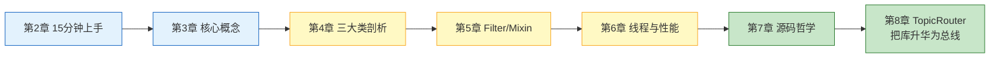
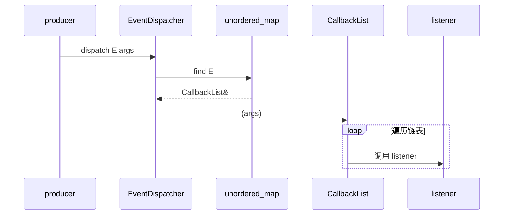
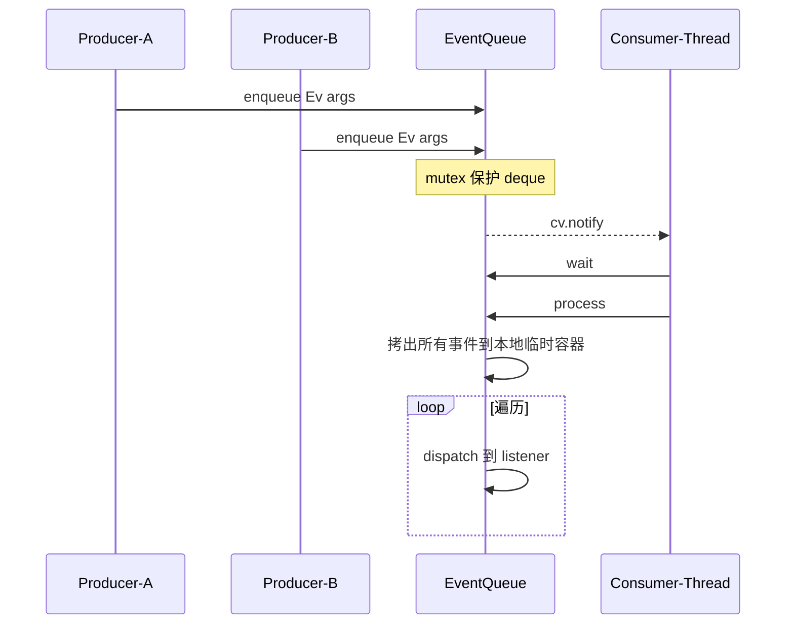
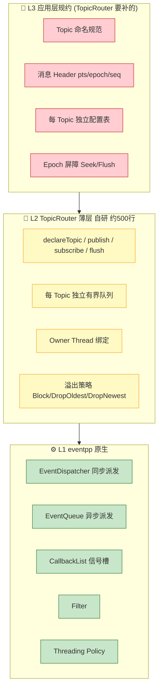
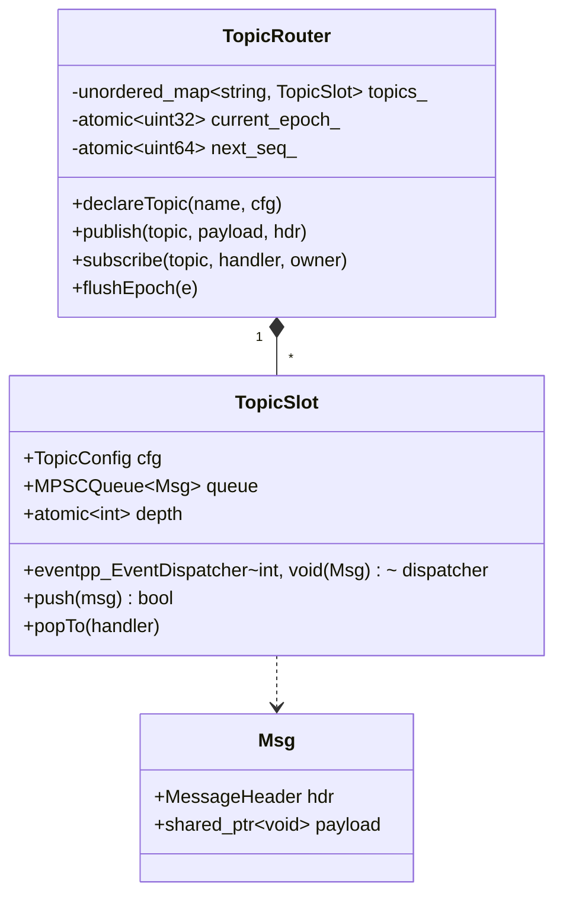
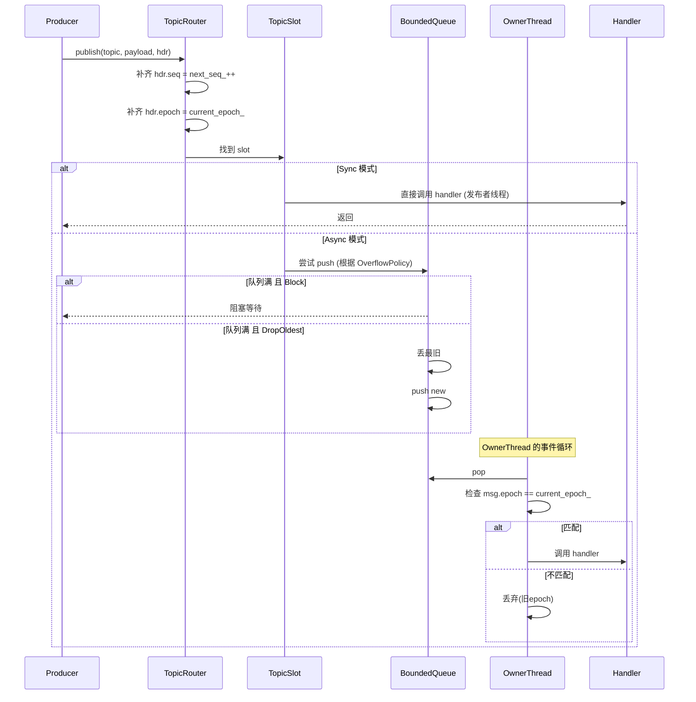
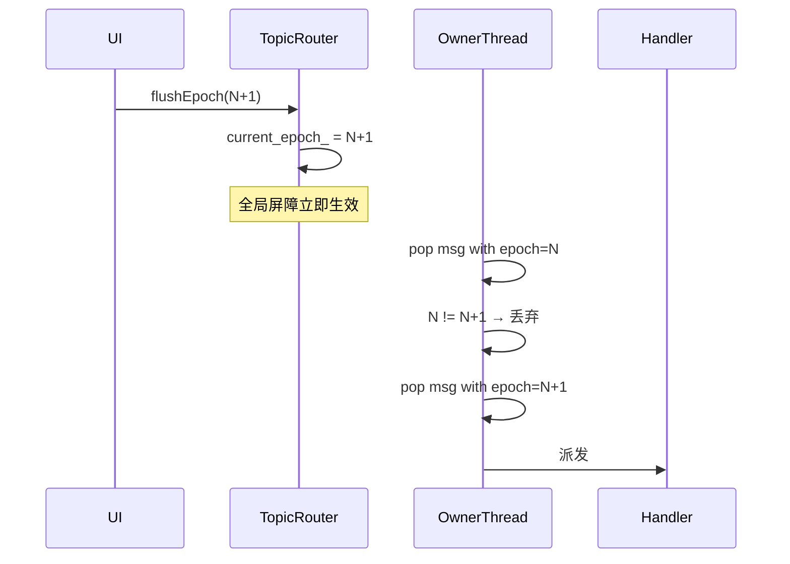

# eventpp 学习指南 —— 从入门到精通

**作者**：汪亮（bertonwang）  
**邮箱**：<47608843@qq.com>  
**版本**：v1.0 ｜ **最后更新**：2026-08-13

> **一句话定位**：**eventpp** 是 wqking 用 C++11 打造的 **Header-Only 事件分发引擎**（Apache 2.0）。它提供**三件套 CallbackList / EventDispatcher / EventQueue** + Filter/Interceptor + 线程策略，覆盖"信号槽、类型化事件分发、跨线程异步事件队列"三大高频场景，是 C++ 生态中**功能最齐全的进程内事件库之一**。
>
> **本文定位**：面向**从零到深度定制**的完整学习路径。前六章讲清"能做什么、怎么用"，第七章深入源码"为什么这样设计"，第八章给出**在 eventpp 之上自研 TopicRouter 应用层总线**的完整设计与底层逻辑——这是把 eventpp 从"库"升华为"系统总线"的关键一层。

---

## 📖 目录

- [一、TL;DR：eventpp 是什么，不是什么](#一tldreventpp-是什么不是什么)
- [二、快速上手：15 分钟三板斧](#二快速上手15-分钟三板斧)
- [三、核心概念全景](#三核心概念全景)
- [四、三大核心类深度剖析](#四三大核心类深度剖析)
- [五、Filter / Interceptor / Mixin 进阶特性](#五filter--interceptor--mixin-进阶特性)
- [六、线程策略与性能实测](#六线程策略与性能实测)
- [七、源码结构与设计哲学](#七源码结构与设计哲学)
- [八、在 eventpp 之上自研 TopicRouter：一层薄总线的完整设计与底层逻辑](#八在-eventpp-之上自研-topicrouter一层薄总线的完整设计与底层逻辑)
- [九、避坑清单与选型建议](#九避坑清单与选型建议)
- [十、参考资料](#十参考资料)

---

## 一、TL;DR：eventpp 是什么，不是什么

### 1.1 一句话定义

**eventpp = 类型安全 + 线程可配 + 无宏无侵入的 C++11 事件三件套**。

### 1.2 能力速查

| 能力 | eventpp 是否原生提供 | 备注 |
|---|:---:|---|
| 信号槽（1-N 广播） | ✅ `CallbackList` | 类似 Boost.Signals2 但更轻 |
| 类型化事件分发（按 EventID 路由） | ✅ `EventDispatcher` | EventID 可为 int/enum/string/type_index |
| 异步事件队列（跨线程） | ✅ `EventQueue` | 生产者 `enqueue` + 消费者 `process` |
| Filter（前置拦截/修改/丢弃） | ✅ `applyFilter()` | 责任链模式 |
| Mixin（横切能力叠加） | ✅ Policy-based | 靠模板 policy 拼装 |
| 线程安全策略 | ✅ `SingleThreading` / `MultipleThreading` | 编译期选择 |
| Header-Only | ✅ | 拷进 `include/` 即用 |

### 1.3 不提供什么（本文第八章要在其之上补齐）

| 特性 | eventpp 是否提供 | 后果 |
|---|:---:|---|
| Topic 命名规范（层级化） | ❌ | 用户自己约定字符串或枚举 |
| 每 Topic 独立队列 | ❌ | `EventQueue` 是单一全局队列 |
| 有界队列 + 溢出策略 | ❌ | 队列**无界**，背压全靠自研 |
| 消息 Header（PTS/epoch/seq） | ❌ | Header 完全自定义 struct |
| Owner Thread 绑定 | ⚠️ 半有 | 靠 `process()` 在哪个线程被调间接实现 |
| Epoch 屏障（原子 Flush） | ❌ | 完全自研 |

📌 **一句话**：eventpp 承担"派发引擎"，**"总线抽象"要靠上层自研**——这也是第八章 TopicRouter 存在的原因。

### 1.4 阅读路线图



---

## 二、快速上手：15 分钟三板斧

### 2.1 环境准备

```bash
git clone https://github.com/wqking/eventpp.git
# 无需编译，直接把 include/eventpp/ 拷贝到你的工程即可
```

CMake 集成：

```cmake
add_subdirectory(third_party/eventpp)  # 或 include_directories
target_link_libraries(myapp PRIVATE eventpp)
```

要求：**C++11 及以上**，MSVC 2015+/GCC 4.8+/Clang 3.4+。

### 2.2 三板斧 A：CallbackList（信号槽）

```cpp
#include <eventpp/callbacklist.h>

eventpp::CallbackList<void(int, const std::string&)> onValueChanged;

// 挂 3 个订阅者
auto h1 = onValueChanged.append([](int v, const std::string& src) {
    std::cout << "[L1] v=" << v << " from " << src << "\n";
});
onValueChanged.append([](int v, const std::string& src) {
    std::cout << "[L2] v=" << v << "\n";
});

// 触发
onValueChanged(42, "user-input");

// 摘掉某个订阅者
onValueChanged.remove(h1);
```

📌 **心智**：`CallbackList<F>` 就是"**一个函数原型 F**"的多播列表——**无 EventID**，纯广播。

### 2.3 三板斧 B：EventDispatcher（同步分发）

```cpp
#include <eventpp/eventdispatcher.h>

enum class Ev { LoginOk, LoginFail, Logout };

struct LoginEvent { std::string user; int code; };

eventpp::EventDispatcher<Ev, void(const LoginEvent&)> dispatcher;

dispatcher.appendListener(Ev::LoginOk, [](const LoginEvent& e) {
    std::cout << "welcome " << e.user << "\n";
});
dispatcher.appendListener(Ev::LoginFail, [](const LoginEvent& e) {
    std::cout << "failed code=" << e.code << "\n";
});

// 触发：**同步派发** —— 在调用线程直接调 listener
dispatcher.dispatch(Ev::LoginOk, LoginEvent{"alice", 0});
```

📌 **心智**：`EventDispatcher<EventID, F>` = "**按 EventID 路由的信号槽**"，**同步**在调用者线程完成。

### 2.4 三板斧 C：EventQueue（异步队列）

```cpp
#include <eventpp/eventqueue.h>
#include <thread>

eventpp::EventQueue<Ev, void(const LoginEvent&)> queue;

queue.appendListener(Ev::LoginOk, [](const LoginEvent& e) {
    std::cout << "[consumer thread] " << e.user << "\n";
});

// —— 消费者线程：循环 process ——
std::thread consumer([&]{
    while (running) {
        queue.wait();     // 阻塞至有事件
        queue.process();  // 一次性消费队列中所有事件
    }
});

// —— 生产者线程（可多个）——
queue.enqueue(Ev::LoginOk, LoginEvent{"bob", 0});
```

📌 **心智**：`EventQueue = EventDispatcher + 线程安全的 FIFO`。**`enqueue` 只入队，`process` 才真正回调 listener**。生产/消费天然解耦——这就是"跨线程事件"的骨架。

### 2.5 三板斧对比

| 类 | 有 EventID? | 是否异步 | 使用场景 |
|:---:|:---:|:---:|---|
| `CallbackList<F>` | ❌ | ❌ | 单一信号、纯广播 |
| `EventDispatcher<E,F>` | ✅ | ❌ | 需要按事件类型路由，且不跨线程 |
| `EventQueue<E,F>` | ✅ | ✅ | 需要跨线程、生产消费解耦 |

---

## 三、核心概念全景

### 3.1 五个必知词

| 概念 | 中文 | 白话理解 |
|---|---|---|
| **Listener** | 监听器 | 可调用对象（lambda/函数指针/`std::function`），签名匹配模板参数 F |
| **EventID / EventType** | 事件键 | 用来路由的键，可以是 `int/enum/std::string/std::type_index` |
| **Prototype** | 事件原型 | 你在模板参数里声明的函数签名，如 `void(int, const std::string&)` |
| **Handle** | 句柄 | `append/prepend` 返回的令牌，用于 `remove` |
| **Policies** | 策略 | 一组编译期配置项（线程策略、EventID 从参数推导等），塞进模板第 3 参数 |

### 3.2 Policies 模板（eventpp 的核心可定制性）

```cpp
struct MyPolicies {
    // 线程策略：MultipleThreading / SingleThreading
    using Threading = eventpp::MultipleThreading;

    // 从参数中提取 EventID（可选）
    static Ev getEvent(const LoginEvent& e) { return static_cast<Ev>(e.code); }

    // 参数是否引用传递、Mixin 列表等
};

eventpp::EventDispatcher<Ev, void(const LoginEvent&), MyPolicies> dispatcher;
```

📌 **eventpp 的可玩性 ≈ Policies 的可配置性**。业务代码基本不动，靠切换 Policies 就能得到"单线程零锁版" vs "多线程加锁版"。

### 3.3 API 速查

| 方法 | 属于 | 作用 |
|---|---|---|
| `append(cb)` / `prepend(cb)` | CallbackList | 尾插/头插监听器 |
| `insert(cb, before)` | CallbackList | 指定位置插 |
| `remove(handle)` | 全部 | 摘掉监听器 |
| `forEach(fn)` | 全部 | 遍历所有 listener |
| `appendListener(E, cb)` | Dispatcher/Queue | 挂到某 EventID |
| `dispatch(E, args...)` | Dispatcher | **同步**触发 |
| `enqueue(E, args...)` | Queue | 入队（非阻塞） |
| `process()` | Queue | 消费队列，回调所有匹配 listener |
| `processOne()` | Queue | 单步消费一个事件 |
| `waitFor(dur)` | Queue | 带超时的阻塞 |
| `applyFilter(fn)` | 全部 | 挂前置拦截器 |

---

## 四、三大核心类深度剖析

### 4.1 CallbackList<F, Policies>

#### 4.1.1 关键结构

```
CallbackList
 ├─ Node (双向链表节点)
 │    ├─ callback: std::function<F>
 │    └─ counter (用于稳定的移除语义)
 ├─ head / tail
 └─ Mutex (由 Threading 策略决定：真锁 / 空锁)
```

#### 4.1.2 内部机制要点

1. **双向链表**：`append/prepend/insert` 都是 O(1)；遍历 O(n)。
2. **"counter" 语义**：`operator()` 触发时，先记录当前"counter 上界"，只调用**触发前已存在的 listener**。这样在 listener 内部 `append` 新回调不会导致本轮被调用，避免循环。
3. **移除安全**：允许在自己的 callback 内 `remove(self_handle)`——链表节点通过引用计数延迟销毁。
4. **`forEach` 保序**：按插入顺序（`append` 从前往后、`prepend` 反之）。

#### 4.1.3 使用姿势

| 场景 | 姿势 |
|---|---|
| 一次性订阅 | `append` + 拿到 handle，销毁前 `remove` |
| 常驻订阅 | `append` + 不 remove（生命周期与 CallbackList 一致） |
| 需要头部优先执行 | `prepend` |
| 需要在触发中删自己 | 允许，`remove(handle)` 即可 |

### 4.2 EventDispatcher<E, F, Policies>

#### 4.2.1 关键结构

```
EventDispatcher
 └─ unordered_map<EventID, CallbackList<F>>
```

📌 一句话：`EventDispatcher = std::unordered_map<EventID, CallbackList>`——**按 EventID 分桶**，每桶是一个 `CallbackList`。

#### 4.2.2 dispatch 流程



#### 4.2.3 从参数推导 EventID

若不想显式传 EventID，可在 Policies 里定义 `getEvent`：

```cpp
struct P {
    static Ev getEvent(const LoginEvent& e) { return e.eventId; }
};
eventpp::EventDispatcher<Ev, void(const LoginEvent&), P> disp;
disp.dispatch(LoginEvent{Ev::LoginOk, ...});  // 无需再传 E
```

### 4.3 EventQueue<E, F, Policies>

#### 4.3.1 关键结构

```
EventQueue
 ├─ EventDispatcher<E, F>   (继承或组合)
 ├─ deque<QueuedEvent>       (待处理队列)
 ├─ mutex + condition_variable
 └─ 缓存参数（保留 args 到 process 时展开）
```

#### 4.3.2 生产消费流程



#### 4.3.3 关键设计点

1. **`process()` 一次性取空**：内部先加锁 swap 出 deque，然后**释放锁**再逐个 dispatch——生产者不阻塞。
2. **`enqueue` 参数保存**：内部把 args 打包成 `std::tuple` 保存（**值语义**），因此传引用给 `enqueue` 会**触发拷贝**。想零拷贝——传 `shared_ptr`！
3. **`wait/waitFor`**：基于 `condition_variable`，避免消费者忙轮询。
4. **不区分优先级**：FIFO；需要优先级得用多个 queue 或者自定义。

⚠️ **陷阱**：`EventQueue` **队列无界**——生产者猛干活会导致内存无限膨胀，**必须由使用者自行限流**。这是第八章 TopicRouter 要补的核心洞。

---

## 五、Filter / Interceptor / Mixin 进阶特性

### 5.1 Filter：前置拦截器

```cpp
dispatcher.appendFilter([](Ev e, const LoginEvent& evt) -> bool {
    if (evt.code < 0) return false;  // 返回 false → 事件被吞
    return true;
});
```

📌 **责任链**：**所有 filter 依次执行，任一 filter 返回 false 则事件被丢弃**。可用于：

- 权限检查（未登录用户屏蔽 `SendMessage` 事件）
- 频率限制（1s 内超过 N 次的事件丢弃）
- 参数修正（filter 允许修改传入参数）

### 5.2 Interceptor（拦截 + 增强）

严格来说 eventpp 里叫 **Mixin**，是编译期把额外能力横切进 CallbackList/Dispatcher/Queue。典型 Mixin：

- `MixinFilter`：为不支持 filter 的类型加上 filter 能力
- 自定义 Mixin：通过继承 CRTP 注入 hook 点

```cpp
struct MyPolicies {
    using Mixins = eventpp::MixinList<eventpp::MixinFilter>;
};
```

### 5.3 Homogeneous vs Heterogeneous 队列

- **HomogeneousQueue**：所有事件同一 F 原型（默认，性能最好）
- **HeterogeneousQueue**：允许不同参数类型入同一队列（**类型擦除**，成本略高但灵活）

```cpp
#include <eventpp/utilities/hetereventqueue.h>
eventpp::HeterEventQueue<Ev,
    eventpp::HeterTuple<
        void(int),
        void(const std::string&),
        void(const LoginEvent&)
    >> hetQueue;
```

📌 使用场景：**同一 Bus 上要跑多种签名的事件**——这是第八章 TopicRouter 的重要基础（Topic 载荷类型各异）。

### 5.4 Utilities 工具箱

`eventpp/utilities/` 提供了一系列便捷类：

| 工具 | 作用 |
|---|---|
| `ArgumentAdapter` | 让 listener 签名与 dispatch 签名不完全匹配也能挂 |
| `AnyId` | 允许 EventID 是任意类型（type erasure） |
| `ScopedRemover` | RAII 摘除，避免手动 remove 忘记 |
| `AnyData` | 变体载荷，配合 HeterQueue |
| `OrderedQueueList` | 优先级排序队列 |

---

## 六、线程策略与性能实测

### 6.1 两种 Threading Policy

| 策略 | 内部锁 | 适用 |
|---|---|---|
| `SingleThreading` | 空对象锁（编译器优化消除） | 确定单线程使用 |
| `MultipleThreading` | `std::mutex`（默认） | 多线程访问 |

```cpp
struct FastPolicies {
    using Threading = eventpp::SingleThreading;  // 极限速度
};
eventpp::CallbackList<void(int), FastPolicies> hotPath;
```

### 6.2 性能量级参考

基于官方 benchmark（Intel i7，Release，MSVC 2022）：

| 操作 | 单线程 ns/op | 多线程 ns/op |
|---|---:|---:|
| `CallbackList::operator()`（10 listeners） | ~180 | ~250 |
| `EventDispatcher::dispatch` | ~250 | ~350 |
| `EventQueue::enqueue`（值类型 4 字节） | ~350 | ~450 |
| `EventQueue::enqueue`（shared_ptr） | ~200 | ~280 |

📌 **优化经验**：
1. **能单线程就单线程**（`SingleThreading` 省锁）
2. **传 shared_ptr 而非大对象**（避免 tuple 拷贝）
3. **listener 内部要快**（否则拖垮整个 dispatch 链）

### 6.3 内存与生命周期

- listener 是 `std::function<F>`——**捕获大对象会分配堆内存**（SSO 阈值取决于实现，通常 32 字节）
- 建议 lambda 只捕获**弱引用/指针**，避免闭包本身超过 SSO
- `EventQueue::enqueue` 会把 args 打成 tuple 保存——**引用参数会被拷贝，指针/shared_ptr 才是零拷贝**

---

## 七、源码结构与设计哲学

### 7.1 目录一览

```
eventpp/
 └─ include/eventpp/
     ├─ callbacklist.h          ⭐ 三件套之一
     ├─ eventdispatcher.h       ⭐
     ├─ eventqueue.h            ⭐
     ├─ mixins/                 Mixin 实现
     │    └─ mixinfilter.h
     ├─ utilities/              便捷工具
     │    ├─ argumentadapter.h
     │    ├─ scopedremover.h
     │    ├─ hetereventqueue.h
     │    ├─ orderedqueuelist.h
     │    ├─ anyid.h
     │    └─ anydata.h
     └─ internal/               实现细节
          ├─ typeutil_i.h
          ├─ threadingutil_i.h
          └─ eventpolicies_i.h
```

### 7.2 三大设计原则

#### 原则一：Policy-based Design（策略基）

一切"选择"都放到编译期模板参数（Threading/Mutex/EventID 提取/Mixin 组合）——**零运行时开销，代码可读性略降**。这是 Andrei Alexandrescu《Modern C++ Design》的经典套路。

#### 原则二：Header-Only 优先

**所有实现都在 `.h`**——好处是零链接负担、易于集成；代价是每个 TU 都要重新编译模板实例，**大工程编译期偏长**。

#### 原则三：不侵入用户类型

- Event 不用继承任何基类
- EventID 无需注册
- Listener 无需实现接口
- **对用户零假设**——这是它比 Qt Signal/Slot 或 Boost.Signals2 更受纯 C++ 项目喜爱的关键

### 7.3 关键实现片段（示意）

`EventDispatcher::dispatch` 核心简化伪代码：

```cpp
template<typename E, typename F, typename Policies>
class EventDispatcher {
    using CallbackList_ = CallbackList<F, Policies>;
    std::unordered_map<E, CallbackList_> map_;
    typename Policies::Threading::Mutex mtx_;

public:
    void dispatch(E e, /* args... */) {
        CallbackList_* list;
        { std::lock_guard g(mtx_); list = &map_[e]; }
        (*list)(/* args... */);  // 遍历链表，逐个调 listener
    }
};
```

`EventQueue::process` 核心简化伪代码：

```cpp
void process() {
    std::deque<QueuedEvent> local;
    { std::lock_guard g(mtx_); local.swap(queue_); }
    for (auto& ev : local) {
        std::apply([&](auto&&... a){ dispatch(ev.id, a...); }, ev.args);
    }
}
```

📌 **一次 swap + 出锁再 dispatch** 是 eventpp 高吞吐的关键——**listener 执行时间与生产者无关**。

### 7.4 与业界库对比

| 库 | 语言 | 特点 | 与 eventpp 关系 |
|---|---|---|---|
| **Boost.Signals2** | C++ | 老牌，线程安全 | 更重、依赖 Boost；eventpp 更轻 |
| **Nano-signal-slot** | C++ | 极致性能，无锁 | 更快但只有 signal，无 EventQueue |
| **entityx::EventManager** | C++ | 与 ECS 深度耦合 | 只适合 ECS 内部 |
| **Qt Signal/Slot** | C++/moc | 需要 moc 预处理 | 侵入性大，跨平台开销 |
| **Chromium base::CallbackList** | C++ | 生产级，需带 base 库 | 单库难剥离 |

📌 **eventpp 的甜蜜点**：**功能齐全 + Header-Only + 零依赖 + Apache 2.0**——是 C++ 通用场景的"最大公约数"。

---

## 八、在 eventpp 之上自研 TopicRouter：一层薄总线的完整设计与底层逻辑

> 🎯 **本章目标**：把 eventpp 从"事件库"升华为"**系统总线**"。我们要在其之上叠加**约 500 行**的 `TopicRouter`，补齐 eventpp 不提供的六项能力：**Topic 命名、每 Topic 队列、有界背压、Owner Thread、Epoch 屏障、统一 Header**。这是笔者在《统一消息总线-开播与播放器一体化实现方案》中落地的核心组件。

### 8.1 为什么还需要一层？—— eventpp 的能力边界

回顾第 1.3 节的差距表，用一张图直观呈现：



### 8.2 TopicRouter 的对外 API（心智模型）

```cpp
class TopicRouter {
public:
    // 启动阶段：一次性声明所有 Topic
    void declareTopic(const std::string& name, const TopicConfig& cfg);

    // 运行期：发布消息（返回是否入队成功）
    template<typename T>
    bool publish(const std::string& topic, std::shared_ptr<const T> payload,
                 MessageHeader hdr = {});

    // 运行期：订阅（handler 只在 owner_thread 被调用）
    template<typename T>
    Handle subscribe(const std::string& topic,
                     std::function<void(const Message<T>&)> handler,
                     ThreadId owner_thread);

    // Seek 场景：全 Bus 更新 epoch，旧 epoch 消息丢弃
    void flushEpoch(uint32_t new_epoch);

    // 运维
    RouterStats stats() const;
};
```

### 8.3 消息模型：Header + Payload

```cpp
struct MessageHeader {
    uint64_t seq;          // 全局单调递增
    uint32_t epoch;        // 用于 Seek/Flush 屏障
    int64_t  pts_us;       // 采集/合成时间戳（微秒）
    int64_t  dts_us;       // 解码时间戳
    uint16_t source_id;    // 源标识
    uint8_t  priority;     // 0=最高
    uint8_t  flags;        // KeyFrame / EndOfStream / ...
};

template<typename T>
struct Message {
    MessageHeader hdr;
    std::shared_ptr<const T> payload;   // ⭐ 引用传递、载荷不可变
};
```

📌 **两个铁律**：
1. **`shared_ptr<const T>`**：只传引用，且载荷不可变——多订阅安全。
2. **Header 固定字段**：跨 Topic 统一——运维、Trace、Replay 有唯一时间轴。

### 8.4 Topic 命名规范

统一采用**四段式**：

```
<domain>.<source_id>.<stream>.<stage>
```

| 段 | 例 |
|---|---|
| `domain` | `src` / `mix` / `enc` / `net` / `ctrl` / `sys` |
| `source_id` | `cam0` / `cam1` / `mic0` / `scr0` |
| `stream` | `video` / `audio` / `subtitle` / `pkt` |
| `stage` | `raw` / `mixed` / `h264` / `rtmp` |

示例：

```
src.cam0.video.raw       # 摄像头0 采集出的原始视频
mix.video.raw            # 合成后视频
enc.video.h264           # 编码后视频
ctrl.player.cmd          # 控制命令
sys.buffer.health        # 系统上报
```

📌 **为什么四段式**：便于**通配订阅**（后续可扩展为 `src.*.video.raw`）、便于**Metrics 分层聚合**、便于人读日志。

### 8.5 Topic 声明表（TopicConfig）

```cpp
struct TopicConfig {
    int              max_depth;      // 队列上限
    OverflowPolicy   policy;         // Block / DropOldest / DropNewest
    DispatchMode     mode;           // Sync / Async
    ThreadId         owner_thread;   // 消费者线程绑定
    bool             allow_multi_sub;// 是否允许多订阅
    std::type_index  payload_type;   // 载荷类型（用于运行期检查）
};

enum class OverflowPolicy { Block, DropOldest, DropNewest };
enum class DispatchMode  { Sync, Async };
```

**开播场景示例声明**：

| Topic | max_depth | Overflow | Mode | Owner | 备注 |
|---|:---:|:---:|:---:|---|---|
| `src.cam0.video.raw` | 3 | DropOldest | Async | CompositorThread | 摄像头帧不排队 |
| `src.mic0.audio.raw` | 20 | Block | Async | MixerThread | 音频不丢 |
| `mix.video.raw` | 3 | DropOldest | Async | 多消费者 | Encoder + Preview 共享 |
| `mix.audio.raw` | 20 | Block | Async | 多消费者 | Encoder + Preview 共享 |
| `ctrl.pipeline.cmd` | 16 | Block | **Sync** | 发布者线程 | 命令类同步派发 |
| `sys.buffer.health` | 4 | DropOldest | Async | ABRThread | 状态上报 |

### 8.6 内部结构



📌 **关键点**：
- **每 Topic 一个 `TopicSlot`**，各自独立的**有界无锁队列** + eventpp `EventDispatcher` 作为回调链。
- **payload 用 `shared_ptr<void>`**（类型擦除）存储，`subscribe` 时做 `static_pointer_cast<const T>` 恢复类型。
- **无锁队列**：推荐 `moodycamel::ConcurrentQueue`（MPMC）或 `boost::lockfree::spsc_queue`（每 Topic 单消费者场景）。

### 8.7 publish 底层逻辑



### 8.8 subscribe 底层逻辑

```cpp
template<typename T>
Handle subscribe(const std::string& topic,
                 std::function<void(const Message<T>&)> handler,
                 ThreadId owner) {
    auto& slot = topics_[topic];
    // 关键：eventpp EventDispatcher 保存的是 type-erased handler
    return slot.dispatcher.appendListener(0, [handler](const InternalMsg& im){
        Message<T> m;
        m.hdr = im.hdr;
        m.payload = std::static_pointer_cast<const T>(im.payload);
        handler(m);
    });
}
```

📌 **一个 slot 复用 eventpp `EventDispatcher`** 承担"多订阅者广播"能力——这就是**利用 eventpp 现成的 CallbackList 语义**，避免自己写多播链表。

### 8.9 Owner Thread 绑定的底层机制

TopicRouter 内部维护**每 Owner Thread 一个事件循环**（可用 asio io_context 或 std::jthread + eventpp EventQueue）：

```cpp
class OwnerThread {
    eventpp::EventQueue<int, void(const InternalMsg&)> queue_;
    std::jthread th_;
public:
    OwnerThread() : th_([this](std::stop_token st){
        while (!st.stop_requested()) {
            queue_.waitFor(std::chrono::milliseconds(100));
            queue_.process();  // ⭐ eventpp 的核心作用
        }
    }) {}

    void post(const InternalMsg& m) { queue_.enqueue(0, m); }
};
```

📌 **eventpp `EventQueue` 在这里承担"消费循环 pump"角色**——一个 Owner 一个 EventQueue，`process()` 天然是**只在这个线程调 handler**。这就是"Owner Thread 绑定"的实现底座。

### 8.10 有界队列 + 溢出策略（eventpp 的补足）

eventpp `EventQueue` **无界**，因此 TopicRouter 不用它做**跨 Topic 存储**，而是：

- **跨 Topic 存储** → `moodycamel::ConcurrentQueue`（有界，可实现 Drop 策略）
- **Owner Thread 内部 pump** → eventpp `EventQueue`（无界但短命，被 Owner 循环快速吃掉）

分工示意：


📌 **背压发生在有界队列层**（生产者 push 失败/阻塞）；**eventpp EventQueue 内部永远短命**（生产入队后瞬间被 process 消费），永远不会累积。

### 8.11 Epoch 屏障：Seek 时的原子 Flush

```cpp
void flushEpoch(uint32_t new_epoch) {
    // 1. 原子更新全局 epoch
    current_epoch_.store(new_epoch, std::memory_order_release);
    // 2. 各 OwnerThread 在下一次 pop 时会检查 epoch，自动丢弃旧消息
    //    无需真正遍历/清空队列
}
```

**优雅之处**：不需要"暂停 → 清队列 → 恢复"这种重量级操作，只需**原子改一个数字**，**惰性丢弃**旧消息。



📌 **业界对照**：这本质是 **LMAX Disruptor 的 sequence barrier** 思路，也类似 **Redux 的 action versioning**——所有"批量失效"的问题都可以用 epoch 号解决。

### 8.12 完整最小可运行示例（120 行看懂全貌）

```cpp
#include <eventpp/eventqueue.h>
#include <concurrentqueue.h>  // moodycamel
#include <memory>
#include <unordered_map>
#include <thread>
#include <atomic>

// ---- 消息模型 ----
struct MessageHeader { uint64_t seq{}; uint32_t epoch{}; int64_t pts_us{}; };
struct InternalMsg { MessageHeader hdr; std::shared_ptr<const void> payload; };

// ---- 简化配置 ----
enum class Overflow { Block, DropOldest };
struct TopicConfig { int max_depth = 8; Overflow policy = Overflow::DropOldest; };

// ---- Owner Thread ----
class OwnerThread {
    eventpp::EventQueue<int, void(const InternalMsg&)> pump_;
    std::jthread th_;
public:
    OwnerThread() : th_([this](std::stop_token st){
        while (!st.stop_requested()) { pump_.waitFor(std::chrono::milliseconds(10)); pump_.process(); }
    }) {}
    void post(const InternalMsg& m) { pump_.enqueue(0, m); }
    template<typename Fn> void listen(Fn fn) { pump_.appendListener(0, fn); }
};

// ---- TopicSlot ----
struct TopicSlot {
    TopicConfig cfg;
    moodycamel::ConcurrentQueue<InternalMsg> queue;
    std::atomic<int> depth{0};
    OwnerThread* owner{nullptr};
};

// ---- TopicRouter ----
class TopicRouter {
    std::unordered_map<std::string, std::shared_ptr<TopicSlot>> topics_;
    std::atomic<uint32_t> epoch_{0};
    std::atomic<uint64_t> seq_{0};
public:
    void declareTopic(const std::string& name, const TopicConfig& cfg, OwnerThread* owner) {
        auto s = std::make_shared<TopicSlot>(); s->cfg = cfg; s->owner = owner;
        topics_[name] = s;
        // 从有界队列到 owner pump 的 relay 线程（简化：owner 内部拉）
        std::thread([s, this]{
            InternalMsg m;
            while (true) {
                if (s->queue.try_dequeue(m)) {
                    s->depth--;
                    if (m.hdr.epoch != epoch_.load()) continue;   // 屏障
                    s->owner->post(m);
                } else std::this_thread::sleep_for(std::chrono::microseconds(200));
            }
        }).detach();
    }

    template<typename T>
    bool publish(const std::string& t, std::shared_ptr<const T> p, MessageHeader hdr = {}) {
        auto& s = topics_.at(t);
        hdr.seq = ++seq_; hdr.epoch = epoch_.load();
        InternalMsg im{hdr, std::static_pointer_cast<const void>(p)};
        if (s->depth.load() >= s->cfg.max_depth) {
            if (s->cfg.policy == Overflow::DropOldest) { InternalMsg drop; s->queue.try_dequeue(drop); s->depth--; }
            else return false;  // Block 简化为拒绝
        }
        s->queue.enqueue(im); s->depth++; return true;
    }

    template<typename T>
    void subscribe(const std::string& t, std::function<void(MessageHeader, std::shared_ptr<const T>)> fn) {
        auto& s = topics_.at(t);
        s->owner->listen([fn](const InternalMsg& im){
            fn(im.hdr, std::static_pointer_cast<const T>(im.payload));
        });
    }

    void flushEpoch() { epoch_++; }
};
```

📌 **划重点**：**核心复用点只有 `eventpp::EventQueue`——用它做 OwnerThread 的 pump**，其余都是围绕它搭出的应用层。

### 8.13 复用 eventpp 能力的精确清单

| TopicRouter 特性 | 复用 eventpp 什么 |
|---|---|
| 每 Owner Thread 的事件泵 | `EventQueue::enqueue + wait + process` |
| 每 Topic 的多订阅广播 | `EventDispatcher` 或 `CallbackList` 内部机制 |
| Filter（未来扩展） | `applyFilter` |
| 线程安全策略 | `MultipleThreading` policy |
| 类型化的 listener 存储 | `std::function<F>` + `Policies` |

📌 **不复用 eventpp 的部分**（自研）：
- ❌ 跨 Topic 的**有界**队列（moodycamel 或 SPSC）
- ❌ Topic 命名与配置表
- ❌ Message Header
- ❌ Epoch 屏障
- ❌ 溢出策略

### 8.14 一句话总结

> **eventpp 提供"事件派发引擎"，TopicRouter 在它之上叠一层"总线抽象"**。前者是**通用库**（能力全，语义中立），后者是**领域架构组件**（约束多，语义明确）。**用 eventpp 造 TopicRouter，等于用 Netty 造 HTTP 框架**——分工清晰，各司其职。

---

## 九、避坑清单与选型建议

### 9.1 常见坑

| # | 坑 | 修正 |
|:---:|---|---|
| 1️⃣ | `EventQueue` 无界导致内存膨胀 | 上层加有界队列或 semaphore 限流 |
| 2️⃣ | listener 捕获大对象 | 只捕获 shared_ptr / weak_ptr |
| 3️⃣ | 触发过程中删自己没问题，但删**其他** listener 要小心 | 用 ScopedRemover 或延迟到本轮触发外 |
| 4️⃣ | 传大对象引用给 `enqueue` | 会被 tuple 拷贝——传 shared_ptr |
| 5️⃣ | 多线程用了 `SingleThreading` policy | UB！竞态；默认 `MultipleThreading` 才安全 |
| 6️⃣ | listener 里做长耗时任务 | 阻塞整个 dispatch 链——异步化或转 Actor |
| 7️⃣ | Filter 里改参数没生效 | 必须传引用参数才能改；值参数改了没意义 |
| 8️⃣ | HeterQueue 用错载荷类型 | 类型擦除后不匹配会静默 miss——上层加类型检查 |

### 9.2 选型建议

| 需求 | 建议 |
|---|---|
| 一个小工具、单线程简单信号 | **不用 eventpp**，用 `std::vector<std::function<F>>` 手写 |
| 单进程、需要类型化事件、单线程 | **eventpp Dispatcher + SingleThreading** |
| 单进程、需要跨线程事件 | **eventpp EventQueue + MultipleThreading** |
| 需要严格保序 + 背压 + 每 Topic 独立配置 | **eventpp + 自研 TopicRouter**（本文第 8 章） |
| 已经在用 Qt/entityx | 用它自带的信号槽 |
| 极致性能、只要信号槽 | Nano-signal-slot |
| 需要跨进程 | 换 ZeroMQ / iceoryx / DDS |

---

## 十、参考资料

### 10.1 官方资源

- 🏠 [GitHub 主页](https://github.com/wqking/eventpp)
- 📖 [官方文档](https://github.com/wqking/eventpp/blob/master/doc/introduction.md)
- 🧪 [官方 Benchmark](https://github.com/wqking/eventpp/tree/master/tests/benchmark)
- 📄 License: Apache 2.0

### 10.2 相关阅读

- 《Modern C++ Design》—— Andrei Alexandrescu（Policy-based Design 起源）
- Boost.Signals2 官方文档
- LMAX Disruptor Whitepaper（Sequence Barrier 思路来源）
- 本仓库：[进程内事件总线-优秀开源库汇总](进程内事件总线-优秀开源库汇总.md)
- 本仓库：[统一消息总线-开播与播放器一体化实现方案](统一消息总线-开播与播放器一体化实现方案.md)（TopicRouter 的原始落地场景）
- 本仓库：[直播开播端-Pipeline与事件总线-选型与实现方案](直播开播端-Pipeline与事件总线-选型与实现方案.md)
- 本仓库：[播放器-Pipeline与事件总线-选型与实现方案](播放器-Pipeline与事件总线-选型与实现方案.md)

### 10.3 一句话结语

> **eventpp 是一把好锤子——用它敲信号槽、敲 Dispatcher、敲 EventQueue 都很趁手；但真要造一栋"总线大楼"，还需要 TopicRouter 这一层薄薄的"承重梁"**。前者是通用工具，后者是领域架构。分层清晰的系统，往往起于对"每一层职责"的严谨界定。

---

📌 **文档定位复盘**：
- **第 1–6 章** = eventpp 使用手册（怎么用）
- **第 7 章** = eventpp 源码哲学（为什么这样设计）
- **第 8 章** = 在 eventpp 上造 TopicRouter（如何升华为总线）—— 这一章是**本文与其他 eventpp 教程的核心差异**，也是笔者《统一消息总线》系列的技术底座。
