# 播放器 Pipeline 与进程内事件总线 —— 选型指南（PC / 移动 / 跨端三条主线）

**作者**：汪亮（bertonwang）
**邮箱**：<47608843@qq.com>
**版本**：v1.0 ｜ **最后更新**：2026-08-13

> **问题背景**：一款现代**播放器（Player）**的完整链路通常包含：
>
> **① 协议接入**（HTTP/HTTPS/RTMP/RTSP/SRT/HLS/DASH/文件） →
> **② 解封装 Demux**（MP4/FLV/TS/MKV/WebM/OGG） →
> **③ 解码 Decode**（H.264/H.265/AV1/VP9/AAC/Opus/FLAC，软/硬解） →
> **④ 后处理**（色彩空间/HDR-Tone-Mapping/去交错/超分/字幕合成） →
> **⑤ 音画同步 A/V Sync**（以音频/系统/外部时钟为主时钟） →
> **⑥ 渲染 Render**（视频：D3D/Metal/GL/Vulkan；音频：WASAPI/CoreAudio/AAudio/AudioUnit）
>
> 且要求支持**运行时**：Seek、变速播放、切码率（ABR）、切音轨/字幕轨、切外挂字幕、切换 DRM 会话、断线续播。
> 那么用「进程内事件总线（In-process Event Bus）」的 Pub/Sub 模型来串接这一切是否可取？
> 本文给出结论、C++ 库推荐、更好的开源框架建议，以及**完整的双通道分层落地方案**。

---

## 📋 目录

- [一、结论速览（TL;DR）](#一结论速览tldr)
- [二、播放器 Pipeline 的本质特征](#二播放器-pipeline-的本质特征)
- [三、Event Bus 用于该场景的可行性分析](#三event-bus-用于该场景的可行性分析)
- [四、控制面选型：C++ Event Bus 库](#四控制面选型c-event-bus-库)
- [五、数据面选型：播放器框架（按三条主线）](#五数据面选型播放器框架按三条主线)
- [六、通用架构心智模型：Media Pipeline + Event Bus](#六通用架构心智模型media-pipeline--event-bus-)
- [七、参考实现骨架（工程落地要点）](#七参考实现骨架工程落地要点)
- [八、性能与踩坑清单](#八性能与踩坑清单)
- [九、参考资料](#九参考资料)

---

## 一、结论速览（TL;DR）

### 1.1 本文定位：**选型指南**

本文的重心是 **"面对不同的目标平台，我该选哪套播放器技术栈？"**，而不是手把手教你写代码。文档结构上：

- **§二 / §三** —— 澄清播放器的场景特征与"能不能用 Event Bus 撑全场"这一常见疑问（选型前的地基）。
- **§四** —— **控制面**选型：C++ 进程内事件总线库。
- **§五** —— **数据面**选型：按 **PC 端 / 移动端 / 跨端** 三条主线分别给出推荐（本文核心）。
- **§六** —— 通用架构心智模型（数据面 + 控制面），任何一条主线都通用。
- **§七** —— 参考实现骨架，只列关键契约，**不做深度实现**。
- **§八 / §九** —— 性能基线、踩坑清单、参考资料。

### 1.2 三条选型主线速查

| 主线 | 目标场景 | 数据面推荐 | 控制面推荐 | 详见 |
|:---:|---|---|---|:---:|
| 🖥️ **PC 端专属** | Windows / macOS / Linux 桌面播放器；本地文件 + 网络流；HDR / 8K / 多音轨 | 🥇 **libmpv**（mpv 内核）<br/>🥈 **libVLC** | 🥇 **eventpp** | [§5.2](#52-🖥️-主线-a：pc-端专属选型-libmpv-一等公民) |
| 📱 **移动端专属** | Android / iOS 播放；关心包体、耗电、审核 | 🥇 **系统播放器**（ExoPlayer / AVPlayer）+ FFmpeg mini<br/>🥈 **ijkplayer / MobileFFmpeg**<br/>🥉 GStreamer mini-build | 🥇 **eventpp** | [§5.3](#53-📱-主线-b：移动端专属选型-系统播放器-优先) |
| 🌍 **跨端通用** | 一份 C++ 核心跑 4 端；中大型团队 | 🥇 **FFmpeg + 自研 Player 内核 + HAL**<br/>🥈 **libmpv**（含移动端）<br/>🥉 **GStreamer playbin3** | 🥇 **eventpp** | [§5.4](#54-🌍-主线-c：跨端通用选型-ffmpeg--自研内核--hal) |

### 1.3 四个核心问题的答案

| # | 问题 | 答案 |
|---|------|------|
| **Q1** | 全链路（含 Demux/Decode/AVSync/Render）都用 Event Bus 维护，是否可取？ | ❌ **不可取**（对数据面而言，见 §三） |
| **Q2** | 若要用 C++ Event Bus 承担**控制面**，推荐哪个？ | 🥇 **eventpp** > 🥈 **Boost.Signals2** > 🥉 **Nano-signal-slot** |
| **Q3** | 三条主线各推什么框架？ | 见 §1.2 速查表 |
| **Q4** | 最佳工程实践？ | ⭐ **Media Pipeline（数据面）+ Event Bus（控制面）+ Master Clock 音画同步 + ABR 反馈回路**（见 §六） |

### 1.4 一图看懂

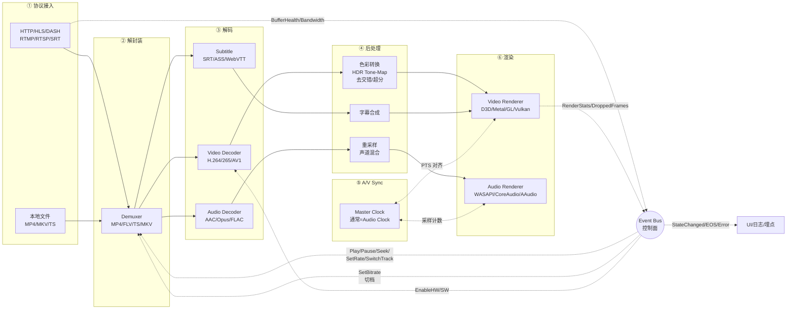

### 1.5 章节依赖关系（阅读顺序）

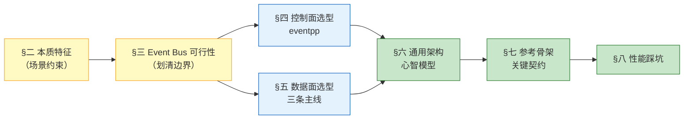

> 📌 **阅读建议**：赶时间只读 §1.2 + §五对应主线；系统了解读 §二→§五→§六；工程落地补充读 §七 + §八。

---

## 二、播放器 Pipeline 的本质特征

在做选型判断前，先看清播放器相较普通"单向数据流"多出的**四个新维度**：

### 2.1 双流并行 + 时钟主从

| 维度 | 说明 |
|------|------|
| **视频/音频/字幕三流并行** | 各自 Demux 解出、各自解码、各自后处理、各自渲染——但共享**同一个主时钟** |
| **主时钟通常 = Audio Clock** | 因为人耳对音频不连续极敏感（>10ms 就可闻卡顿）；视频以\"追音频\"为准，允许丢帧或重复帧 |
| **播片时钟 vs 系统时钟 vs 外部时钟** | 本地文件 → Audio Clock；无音频（纯视频） → System Clock；直播/RTC → 外部/网络时钟 |
| **时钟漂移吸收** | 视频与主时钟差 `>Threshold` 时的策略：`|Δ|<40ms` 显示；`40~100ms` 加速播放；`>100ms` 丢帧；`Δ<-100ms` 重复上一帧 |

### 2.2 Seek / 变速 / 切轨的运行时变更

| 操作 | 复杂度 | 说明 |
|------|:---:|------|
| **Seek** | ⭐⭐⭐⭐ | 需回退到最近关键帧（Keyframe）→ 清空所有队列（Demuxer/Decoder/Renderer）→ 快速解码到目标 PTS → 恢复播放 |
| **变速播放** | ⭐⭐⭐ | 视频调帧率，音频需**变速不变调**（SoundTouch / RubberBand / SonicNet） |
| **切音轨/字幕轨** | ⭐⭐ | 复用同一 Demuxer，切换 Stream Index；音频需切 Renderer 采样率 |
| **切外挂字幕** | ⭐ | 独立 SRT/ASS 解析器，按 PTS 与主时钟对齐 |
| **切码率 ABR** | ⭐⭐⭐⭐ | HLS/DASH 场景：切 playlist → 拉新 segment → 找 boundary（IDR 帧）→ 无缝拼接 |

### 2.3 数据流特征

| 维度 | 特征 | 数值示例 |
|------|------|----------|
| **数据密度** | 中高，单包 KB 级 | 1080p60 H.264 CBR 5Mbps → 平均包 10KB，60~120 pps |
| **实时性** | 软实时（点播） / 硬实时（直播） | 点播首帧 < 500ms；直播端到端 < 3s（低延迟 < 1s） |
| **顺序性** | 严格 FIFO（DTS 单调递增） | Demuxer 输出乱序即花屏 |
| **多流对齐** | 视频/音频/字幕 PTS 各自单调，跨流对齐用**主时钟** | 首帧对齐、Seek 后重新对齐 |
| **背压** | 显式处理 | Renderer 慢 → Decoder 停 → Demuxer 停 → Network 阻塞（TCP 天然背压） |
| **零拷贝** | 强需（硬解） | GPU 纹理直通渲染（DXVA/VideoToolbox/MediaCodec Surface） |

### 2.4 控制流特征

| 事件 | 频率 | 举例 |
|------|------|------|
| **播控命令** | 极低 | Play / Pause / Stop / Seek / SetRate |
| **切轨切档命令** | 极低 | SwitchAudioTrack / SwitchSubtitle / SwitchQuality |
| **状态变更** | < 20 Hz | Ready / Buffering / Playing / Paused / EOS / Error |
| **网络反馈** | 1~10 Hz | BufferHealth（缓冲区秒数）、Bandwidth（带宽估计） |
| **渲染反馈** | 1 Hz | 已渲染帧数、丢帧数、当前 PTS |
| **错误上报** | 稀疏 | DecodeError / NetworkTimeout / DrmLicenseExpired |
| **DRM 事件** | 稀疏 | KeyRequest / KeyResponse / LicenseRenew |

**关键洞察**：数据面是"多路（AV/字幕）+ 主时钟对齐 + Seek/ABR 状态跃迁"的**图执行体**；控制面是"每秒几到几十次、KB 级、可丢弃"的松散信令。二者约束完全不同。

---

## 三、Event Bus 用于该场景的可行性分析

### 3.1 用 Event Bus 承担**数据面**的五个致命问题 ❌

#### ❌ 问题 1：PTS/DTS 顺序无保障

- Event Bus 语义是"一发多收、无序广播"；播放器数据面必须保证 **DTS/PTS 严格单调 FIFO**，任何乱序都是花屏/爆音。
- Bus 内部若用 `MultipleThreadsPolicy`，多路 handler 抢锁后**顺序不可预测**。

#### ❌ 问题 2：主时钟同步做不好

- 音画同步需要在同一决策点比较 `audio_clock` vs `video_pts`；Event Bus 是解耦模型，**"谁负责比较、谁负责丢帧、谁负责等"没有明确归属**。
- 主时钟本质是**共享状态**，不是事件——用 Bus 传 Clock Tick 会带来至少 100µs 抖动。

#### ❌ 问题 3：Seek 一致性难保证

- Seek 需要**原子地清空 Demux → Decode → Post → Render 全链路队列**；Bus 里各订阅者独立处理事件，无法保证"所有队列同一瞬间清空"。
- 结果：Seek 后往往看到"上一片段的残帧"闪现。

#### ❌ 问题 4：背压方向反了

- 数据面背压方向是"下游反压上游"（Renderer 慢 → Decoder 停），是**拉模型**。
- Bus 是**推模型**（发布者不知谁在听、听得快慢），上游无法感知下游堵塞，会累积到 OOM。

#### ❌ 问题 5：硬解零拷贝无法通过 Bus 传递

- 硬解输出是 GPU 纹理（`ID3D11Texture2D` / `CVPixelBuffer` / `AHardwareBuffer`），必须直通到 Renderer 而不 map 回 CPU。
- Bus 中间转发一次就等于强制下载纹理，功耗/延迟双输。

### 3.2 用 Event Bus 承担**控制面** ✅

以下场景 Event Bus **非常适合**：

| 场景 | 事件类型 | 为什么合适 |
|------|---------|----------|
| 播控命令 | `Play / Pause / Stop / Seek / SetRate` | UI 与 Pipeline 完全解耦 |
| 切轨切档 | `SwitchAudioTrack / SwitchSubtitle / SwitchQuality` | 一发多收（Demuxer + Renderer + UI 都要感知） |
| 状态广播 | `StateChanged(Ready/Buffering/Playing/Paused/EOS)` | UI、埋点、监控多方订阅 |
| 缓冲反馈 | `BufferHealth { seconds, packets }` | ABR 控制器、UI 缓冲条同时订阅 |
| 带宽反馈 | `BandwidthEstimate { bps }` | ABR 决策 |
| 渲染反馈 | `RenderStats { rendered, dropped, current_pts }` | 音画同步观测、埋点 |
| 错误传播 | `DecodeError / NetworkTimeout / DrmError` | 解耦错误源与处理者 |
| DRM 会话 | `KeyRequest / LicenseAcquired / LicenseExpired` | 异步、跨线程 |

### 3.3 判断表

| 通道 | 频率 | 数据量 | 延迟敏感 | 需要背压 | 用 Event Bus？ |
|------|------|--------|----------|---------|---------------|
| **压缩包流（Demux 输出）** | 30~120 Hz | 中（KB 级/包） | ⭐⭐⭐⭐ | ✅ 必须 | ❌ 不用 |
| **解码后帧流（视频）** | 30~60 Hz | 高（MB 级/帧） | ⭐⭐⭐⭐⭐ | ✅ 必须 | ❌ 不用 |
| **解码后 PCM 流（音频）** | 100~1000 Hz | 中 | ⭐⭐⭐⭐⭐ | ✅ 必须 | ❌ 不用 |
| **主时钟 Tick** | 100 Hz | 极小 | ⭐⭐⭐⭐⭐ | ❌ | ❌ 不用（共享状态） |
| **播控命令** | 极低 | 极小 | ⭐ | ❌ | ✅ 推荐 |
| **切轨切档命令** | 极低 | 极小 | ⭐ | ❌ | ✅ 推荐 |
| **状态/缓冲/带宽/错误** | 1~20 Hz | 极小 | ⭐ | ❌ | ✅ 强烈推荐 |

**结论**：数据面走 **Media Graph（含 Demuxer / Decoder / Sync / Renderer）+ Master Clock**，控制面走 **Event Bus**。这是 mpv / ExoPlayer / GStreamer playbin 的一致做法。

---

## 四、控制面选型：C++ Event Bus 库

前提：**仅用于控制面**（播控命令、切轨、状态、缓冲、带宽、错误、DRM）。数据面的选型请看 §五。

| 排名 | 库 | 适配理由 | 局限 |
|------|-----|---------|------|
| 🥇 | [**eventpp**](https://github.com/wqking/eventpp) | 同时提供 **CallbackList / EventDispatcher / EventQueue**；线程安全；支持异步队列、过滤器、多线程调度器；Header-Only；Apache 2.0 | 学习曲线略陡 |
| 🥈 | [**Boost.Signals2**](https://www.boost.org/doc/libs/release/doc/html/signals2.html) | 线程安全、`scoped_connection` 自动断连、成熟 | 依赖 Boost，接入体积大 |
| 🥉 | [**Nano-signal-slot**](https://github.com/NoAvailableAlias/nano-signal-slot) | 性能极致、Header-Only；适合控制器内部高频信号 | 无内建异步队列 |
| 4️⃣ | [**sigslot (palacaze)**](https://github.com/palacaze/sigslot) | 现代 C++14、Qt 风格 | 仅信号-槽，无 topic bus 语义 |
| 5️⃣ | [**dexode/EventBus**](https://github.com/dexode/eventbus) | API 极简 `bus.listen<T>()`；Header-Only | 功能相对单薄 |

### 4.1 首推：eventpp 的底层推荐逻辑

1. **多模式并存**  
   - `CallbackList` → Renderer 状态回调（同步、低延迟）  
   - `EventDispatcher` → 命名事件的类型分发  
   - `EventQueue` → 跨线程投递（把 UI 播控指令抛到 Demuxer/Decoder 线程）
2. **线程安全内建**：`SingleThreadPolicy` / `MultipleThreadsPolicy` 按需切换。
3. **过滤器 & 拦截器**：`applyFilter` 天然适合做"Seek 前先鉴权"、"切码率前查会员权益"这类中间件。
4. **零外部依赖 / Apache 2.0**：商用友好。
5. **异步队列 `process()`**：把事件精确 pump 到指定线程（UI 线程、Player 主线程、Renderer 线程等）。
6. **类型强安全**：`EventQueue<type_index, void(const T&)>` 避免字符串 topic 拼写坑。

### 4.2 决策边

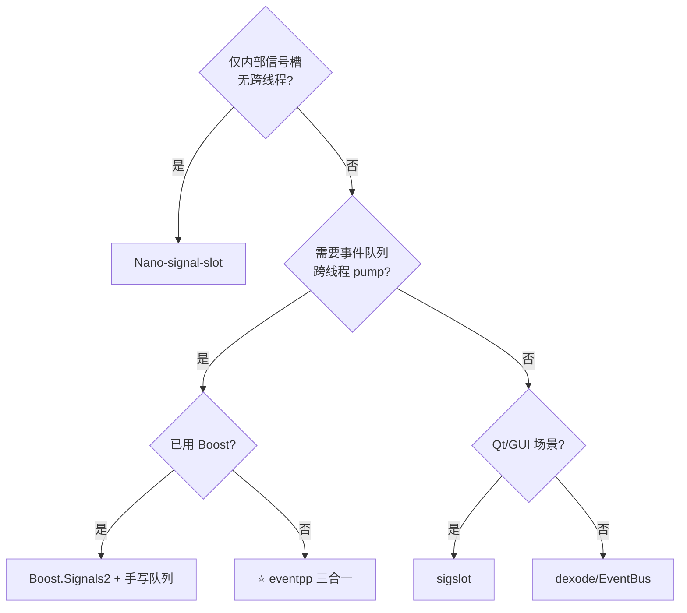

---

## 五、数据面选型：播放器框架（按三条主线）

播放器**数据面**应该交给专业的播放内核。本节按**目标平台**分为三条主线，每条主线独立可读：

- 🖥️ **[§5.2 主线 A：PC 端专属](#52-🖥️-主线-a：pc-端专属选型-libmpv-一等公民)**（Windows / macOS / Linux 优先，追求画质与生态）
- 📱 **[§5.3 主线 B：移动端专属](#53-📱-主线-b：移动端专属选型-系统播放器-优先)**（Android / iOS 优先，关心包体、耗电、审核）
- 🌍 **[§5.4 主线 C：跨端通用](#54-🌍-主线-c：跨端通用选型-ffmpeg--自研内核--hal)**（一份 C++ 核心跑 4 端）

### 5.0 三条主线一图看懂

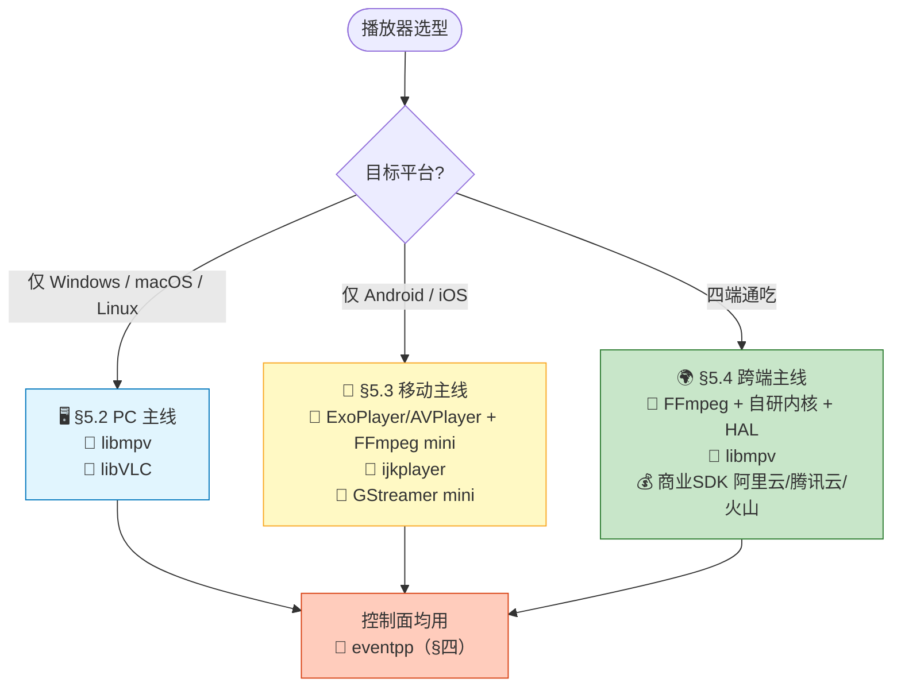

### 5.1 主流框架能力全景

| 框架 | 定位 | 是否原生支持"Demux + 解码 + AVSync + 渲染 + Seek + ABR" | 适用平台 |
|------|------|--------|----------|
| [**mpv / libmpv**](https://github.com/mpv-player/mpv) | **发烧级播放器内核** | ✅ 全套；顶级色彩管理、HDR、着色器脚本、硬解 | Win / macOS / Linux / **Android (mpv-android)** / **iOS (mpv-iOS)** |
| [**libVLC (VLC)**](https://github.com/videolan/vlc) | 全能媒体框架 | ✅ 全套；协议/格式最全 | 全平台官方 |
| [**FFmpeg (libav*)**](https://ffmpeg.org/) | 编解码/封装 lib | ⚠️ 提供 Demuxer/Decoder/Filter，但**无内建播放器逻辑**（AVSync/Renderer 需自研） | 全平台 |
| [**ExoPlayer (Media3)**](https://github.com/androidx/media) | Android 官方播放器 | ✅ 全套；HLS/DASH/SmoothStreaming/CMAF 一等公民 | Android only |
| [**AVPlayer (AVFoundation)**](https://developer.apple.com/av-foundation/) | iOS/macOS 官方播放器 | ✅ 全套；HLS 一等公民；FairPlay DRM 内建 | iOS / macOS only |
| [**ijkplayer**](https://github.com/bilibili/ijkplayer) | Bilibili 开源；FFmpeg 内核 + 平台封装 | ✅ 全套；Android/iOS 双端 API 一致 | Android / iOS（已停止维护，但仍广泛使用） |
| [**GStreamer playbin3**](https://gstreamer.freedesktop.org/) | 通用多媒体流水线 | ✅ 全套；四端官方 | 四端 |
| [**WebRTC (libwebrtc)**](https://webrtc.org/) | RTC 全栈 | ⚠️ 更偏 RTC 通话，非通用播放 | 全平台 |
| 💰 [阿里云/腾讯云/火山 播放器 SDK] | 商业 | ✅ 全套 + QoE + 加密 | 全平台 |

📌 **一句话记忆**：**发烧画质 = mpv；协议格式最全 = VLC；编解码 lib 化 = FFmpeg；Android 首选 = ExoPlayer；iOS 首选 = AVPlayer；跨端商业 = 阿里云/腾讯云**。

### 5.2 🖥️ 主线 A：PC 端专属选型（libmpv 一等公民）

> 🎯 **场景约束**：仅需支持 Windows / macOS / Linux；桌面播放器 / 客户端内嵌视频组件；追求 HDR / 8K / 高刷 / 色彩管理 / 多音轨 / 字幕特效。

#### 5.2.1 推荐路径

| 优先级 | 组合 | 适合团队 | 特点 |
|:---:|---|:---:|---|
| 🥇 | **libmpv + eventpp** | 中大型（≥3人） | mpv 内核，HDR/色彩管理/着色器/硬解全套现成；`mpv_command_string` + `mpv_observe_property` 是天然控制面 |
| 🥈 | **libVLC + eventpp** | 中小型 | 协议/格式覆盖最广；`libvlc_event_manager` 内建事件；插件式外挂字幕 |
| 🥉 | **FFmpeg + 自研 Player 内核** | 极少数深度定制 | 完全掌控 AVSync、渲染管线；但要自己写主时钟/Seek/ABR，工作量大 |

#### 5.2.2 为什么 libmpv 是 PC 端首选？

libmpv 的内建模型天然覆盖本文全部需求：

| libmpv 概念 | 对应本场景 |
|------------|----------|
| `mpv_command`（load-file / seek / cycle audio） | **播控命令**统一入口，UI 只需发字符串命令 |
| `mpv_observe_property`（time-pos / pause / duration / volume / demuxer-cache-time） | **状态订阅**——本质就是 libmpv 内建的 Event Bus |
| 内建 `hwdec=auto`（DXVA2 / D3D11VA / NVDEC / VideoToolbox / VAAPI） | **硬解自动协商**，一行配置搞定 |
| `--vo=gpu-next`（Vulkan / OpenGL / D3D11） | **顶级视频渲染器**，HDR/色彩管理开箱即用 |
| `--profile=fast/high-quality` | 场景化画质预设 |
| Lua/JavaScript 脚本引擎 | 用户脚本扩展（弹幕、AI 字幕等） |
| 内建 `--demuxer-max-bytes` / `--cache` | **缓冲/背压**参数化控制 |

#### 5.2.3 PC 主线的短板

| 短板 | 说明 | 缓解 |
|------|------|------|
| ❌ 移动端不友好 | libmpv 虽有 mpv-android/mpv-iOS 但非官方一等公民 | 若移动是主战场 → 转 §5.3 或 §5.4 |
| ⚠️ 二进制体积 | libmpv + FFmpeg 动辄 20–40 MB | 桌面场景可接受 |
| ⚠️ 许可证 | libmpv = **GPL-2.0/LGPL** 混合；FFmpeg 默认 LGPL，启用 x264 后为 GPL | 想闭源商用请评估：可选 libVLC（LGPL）+ FFmpeg LGPL 编译 |
| ⚠️ HLS/DASH 深度支持 | libmpv 依赖 FFmpeg 的 HLS demuxer，ABR 策略较基础 | 高级 ABR 需上层自研（或用 ExoPlayer/AVPlayer） |

#### 5.2.4 PC 主线一句话建议

> 🖥️ **桌面播放器 / 追求 HDR/8K/色彩管理 → 直接基于 libmpv 二次开发，用 eventpp 处理控制面。**
> 🖥️ **协议格式覆盖是核心诉求 → libVLC。**
> 🖥️ **想闭源商用且要深度定制 → FFmpeg LGPL + 自研 Player 内核。**

### 5.3 📱 主线 B：移动端专属选型（系统播放器 优先）

> 🎯 **场景约束**：仅需支持 Android / iOS；关注**包体、耗电、审核、DRM 合规**；短视频/长视频 App、直播观看端、教育课堂客户端常见。
> ⚠️ **核心洞察**：包体越小 → 能力越裸；**极致小包体 = 用系统播放器 API，不带自建编解码**。

#### 5.3.1 各方案包体基线（arm64-v8a, Release, strip 后）

| 方案 | 视频解码 | 音频解码 | 协议 | 渲染 | **静态增量包体** | 能力完整度 |
|------|---------|---------|------|------|:---------------:|:--------:|
| 🥇 **方案 P1：纯系统播放器** | ExoPlayer / AVPlayer 内建 | 系统 | HLS/DASH/MP4/PROG | SurfaceView / AVPlayerLayer | **~0 KB**（系统自带） / **~500 KB**（ExoPlayer AAR） | ⭐⭐⭐⭐ 主流场景全覆盖 |
| 🥈 **方案 P2：系统播放器 + FFmpeg mini** | 系统硬解 | 系统 | 系统 + 补充私有协议 | 系统 | **~1.5–3 MB** | ⭐⭐⭐⭐⭐ 兼容私有格式 |
| 🥉 **方案 P3：ijkplayer / MobileFFmpeg** | FFmpeg + MediaCodec/VideoToolbox 硬解 | FFmpeg | FFmpeg 全支持 | GLES / Metal | **~6–10 MB** | ⭐⭐⭐⭐⭐ 私有协议/RTSP 强 |
| ⚫ **方案 P4：libmpv 移动版** | 内建 | 内建 | 内建 | GLES / Metal | ~15–25 MB | ⭐⭐⭐⭐⭐ 但为发烧向 |
| ⚫ **方案 P5：GStreamer playbin3 mini** | MediaCodec / VideoToolbox | 系统 | 精挑 | glimagesink | ~5–8 MB | ⭐⭐⭐⭐ |
| 💰 **方案 P6：商业 SDK**（阿里云/腾讯云 精简版） | 内建 | 内建 | 内建 + 私有加密 | 内建 | 3–8 MB | ⭐⭐⭐⭐⭐ + QoE |

📝 **关键洞察**：**Android 有 ExoPlayer、iOS 有 AVPlayer**——如果需求在 HLS/DASH/MP4 主流范围，**用系统播放器是包体最优、审核最稳、功耗最低的选择**。

#### 5.3.2 按包体预算选方案（决策树）

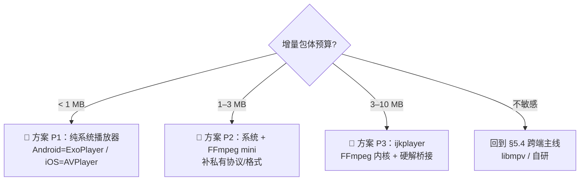

#### 5.3.3 🥇 方案 P1：纯系统播放器（极致最小 < 1 MB）

**思路**：Android 用 ExoPlayer (Media3)，iOS 用 AVPlayer，业务层用 C++ 抽象接口统一。

| 能力 | Android (ExoPlayer/Media3) | iOS (AVPlayer) |
|------|---------|-----|
| 协议 | HTTP/HLS/DASH/SmoothStreaming/RTSP/CMAF | HTTP/HLS/PROG (RTSP 需第三方) |
| Demux | 内建 | 内建 |
| 视频解码 | MediaCodec 硬解 | VideoToolbox 硬解 |
| 音频解码 | 内建 AAC/Opus/FLAC | 内建 |
| 渲染 | `SurfaceView` / `TextureView` | `AVPlayerLayer` |
| 字幕 | WebVTT/CEA-608/608/SRT/SSA | WebVTT/CEA-608 |
| ABR | 内建（Adaptive Bitrate） | 内建 |
| DRM | Widevine | FairPlay |
| Seek/变速 | ✅ | ✅ |

**取舍**：
- ✅ 包体最小、启动最快、审核零风险、耗电最优、DRM 内建
- ❌ 私有协议/格式不支持（如私有 P2P、私有加密）；深度定制受限

#### 5.3.4 🥈 方案 P2：系统播放器 + FFmpeg mini（性价比之王，~2 MB）

**思路**：主流内容用系统播放器，**只把不支持的协议/格式交给 FFmpeg mini**——通过 ExoPlayer 的 `MediaSource` 或 iOS 的 `AVAssetResourceLoader` 挂 FFmpeg 做兜底。

**FFmpeg mini-build 要点**（对齐开播端文档 §5.3.4，播放侧关注 Demuxer/Decoder/Parser）：
- 使用 `--disable-everything` 关闭所有默认模块
- 手动 `--enable-avformat / --enable-avcodec / --enable-avutil / --enable-swresample`
- `--enable-protocol=http,https,tcp,file` + 私有协议自研
- `--enable-demuxer=mov,flv,mpegts,matroska,hls,dash`
- `--enable-decoder=h264,hevc,av1,aac,opus,flac,mp3`
- `--enable-parser=h264,hevc,aac`、`--enable-bsf=h264_mp4toannexb,hevc_mp4toannexb`
- `--enable-small --disable-debug --disable-doc --disable-programs`

**编译产物**：`libavformat + libavcodec + libavutil + libswresample` 合计 **约 1.8 MB**（strip 后）。

**推荐组合**：**系统播放器 + FFmpeg mini 兜底 + eventpp**（Header-Only ~50 KB）
增量包体 **约 1.5–3 MB**，能力覆盖 99% 播放场景。

#### 5.3.5 🥉 方案 P3：ijkplayer 系（保留完整可控内核，~8 MB）

**适用**：**必须要私有协议 / RTSP / 私有格式 / 深度定制 AVSync/ABR**。

**推荐路径**：
- Android/iOS 双端使用 [ijkplayer](https://github.com/bilibili/ijkplayer) 或其继任者（如 [nplayer](https://github.com/nightingaledev/nplayer) / [KsPlayer](https://github.com/kingslay/KSPlayer)）
- 内核是 **FFmpeg + SDL 抽象 + MediaCodec/VideoToolbox 硬解桥接**
- 双端 Java/OC API 高度一致，业务层易封装

**取舍**：牺牲 5–8 MB 换来 FFmpeg 全协议/全格式覆盖 + 平台硬解 + 双端一致 API。

**注意**：ijkplayer 官方已停维护多年，生产环境建议：
1. Fork 自研维护，跟进 FFmpeg 新版本
2. 或换用活跃继任者（如 KSPlayer for iOS + Media3 for Android）

#### 5.3.6 移动端 DRM 与合规

播放器移动端**必须**面对 DRM，这是与开播端最大的场景差异：

| 场景 | Android | iOS |
|------|---------|-----|
| 主流 DRM | **Widevine**（L1 硬件级 / L3 软件级） | **FairPlay** |
| 备选 | PlayReady（较少） | — |
| 会话协议 | EME / MediaDrm | AVContentKeySession |
| 用系统播放器 | ✅ ExoPlayer 内建 Widevine | ✅ AVPlayer 内建 FairPlay |
| 用 FFmpeg | ❌ **无内建 DRM 解密**（需自研或用商业 SDK） | ❌ 同 |

📌 **一句话**：**如果要卖版权内容（电影/电视剧），几乎必须用系统播放器或商业 SDK；FFmpeg 系不适用**。

#### 5.3.7 通用减包体七字诀 🔥

| # | 手段 | 收益 | 副作用 |
|---|------|------|-------|
| 1️⃣ | **只用系统硬解（不带 libx264/openh264）** | 减 3–5 MB | 老旧机型硬解兼容性 |
| 2️⃣ | **`--disable-everything` 手工挑 demuxer/decoder** | FFmpeg 减 60–80% | 编译复杂 |
| 3️⃣ | **只保留必要的协议**（HLS/DASH/HTTP，去掉 RTSP/MMS/等） | 减 500 KB | 私有协议放弃 |
| 4️⃣ | **动态注册 = 只链接使用的插件** | 减 30–50% | 需手写注册表 |
| 5️⃣ | **单 arch 发布（arm64 App Bundle / APK Splits）** | APK 减 50% | 32 位机型放弃 |
| 6️⃣ | **符号剥离 + `-fvisibility=hidden`** | 减 5–10% | 无 |
| 7️⃣ | **Header-Only 事件总线（eventpp）** | 0 增量 | 编译时间稍长 |

#### 5.3.8 移动主线一句话建议

> 📱 **主流内容（HLS/DASH/MP4）+ DRM → 方案 P1（纯系统播放器）：< 1 MB，审核最稳。**
> 📱 **要私有协议/格式兜底 → 方案 P2（系统 + FFmpeg mini）：~2 MB。**
> 📱 **要 RTSP / 私有加密 / 深度可控 → 方案 P3（ijkplayer 系）：~8 MB。**
> 📱 **完全不 care 包体、要发烧画质 → 转 §5.4 跨端主线的 libmpv。**

### 5.4 🌍 主线 C：跨端通用选型（FFmpeg + 自研内核 + HAL）

> 🎯 **场景约束**：一份 C/C++ 播放器内核，4 个平台通用（Windows/macOS/Android/iOS），UI 层各自壳（Kotlin/Swift/C++/Obj-C）。
> ⚠️ **认清现实**：**没有一个开源播放器能在四端"零改动"通吃所有 DRM**——FairPlay 只有 iOS/macOS 有，Widevine 需要 Google 授权；商业 SDK 才能磨平这个差异。所以"跨端通用"的真实含义是：**核心解码/AVSync/渲染跨端 + 平台 DRM/硬解/权限适配层可插拔**。

#### 5.4.1 候选框架跨端能力四象限

| 框架 | Windows | macOS | Android | iOS | HDR/硬解 | DRM | 综合分 |
|------|:-------:|:-----:|:-------:|:---:|:--------:|:---:|:------:|
| **libmpv** | ✅ | ✅ | ⚠️ 社区 | ⚠️ 社区 | ✅ HDR顶级 | ❌ 无 Widevine/FairPlay | ⭐⭐⭐⭐ 画质王者但缺 DRM |
| **libVLC** | ✅ | ✅ | ✅ | ✅ | ⚠️ HDR 一般 | ⚠️ 有限 | ⭐⭐⭐⭐ 全平台覆盖 |
| **FFmpeg** | ✅ | ✅ | ✅ | ✅ | ✅（需手挂）| ❌ | ⭐⭐⭐⭐⭐ 底层最灵活 |
| **ExoPlayer/AVPlayer** | ❌ | ❌ | ✅ | ✅ | ✅ | ✅ 内建 | ⭐⭐⭐ 移动端最优但不跨端 |
| **GStreamer playbin3** | ✅ | ✅ | ✅ | ✅ | ✅ | ⚠️ | ⭐⭐⭐⭐ 四端官方 |
| **商业 SDK**（阿里云/腾讯云/火山） | ✅ | ✅ | ✅ | ✅ | ✅ | ✅ | ⭐⭐⭐⭐⭐ 收费/黑盒 |

**结论**：开源阵营里，**没有单一框架能在四端"零改动"通吃**。跨端最实用的组合是：
- **底层用 FFmpeg**（编解码/Demux 四端一致）
- **上层自研 Player 内核**（AVSync/Seek/ABR/字幕）
- **平台差异下沉到 HAL**（硬解/渲染/DRM）

#### 5.4.2 推荐组合（分预算/团队规模）

| 方案 | 组合 | 适合团队 | 优点 | 缺点 |
|------|------|:-------:|------|------|
| 🥇 **方案 A：FFmpeg + 自研内核 + HAL** | FFmpeg + 自研 AVSync/Renderer + eventpp + 平台 HAL | 中大型（≥5人） | 完全掌控；四端一致；LGPL 可闭源 | 自研 AVSync/ABR 工作量大（3–6 人月） |
| 🥈 **方案 B：libmpv 打底** | libmpv + eventpp + 平台 HAL（补 DRM） | 中小型（3–8人） | 画质顶级；开发周期短 | GPL 许可要评估；DRM 需自补 |
| 🥉 **方案 C：GStreamer playbin3** | GStreamer playbin3 + eventpp + HAL | 已用 GStreamer 的团队 | 与开播端复用 GStreamer 心智 | 学习曲线陡；包体大 |
| ⚫ **方案 D：分端最优 + 抽象接口** | PC=libmpv/libVLC；移动=ExoPlayer/AVPlayer | 大型（≥10人） | 每端体验最好；移动 DRM 天然过 | **维护两套播放器实现**，业务逻辑要双份适配 |
| 💰 **方案 E：商业 SDK** | 阿里云 / 腾讯云 LiteAV / 火山 vePlayer | 求快团队 | 一周出 Demo；DRM/QoE 全包 | 按流量/时长收费；黑盒 |

**默认推荐：方案 A（FFmpeg + 自研内核 + eventpp）**——"一份代码四端跑"的**最灵活、最可控**开源路径。追求开发速度可选方案 B（libmpv）。

#### 5.4.3 FFmpeg + 自研内核 跨端方案分层结构

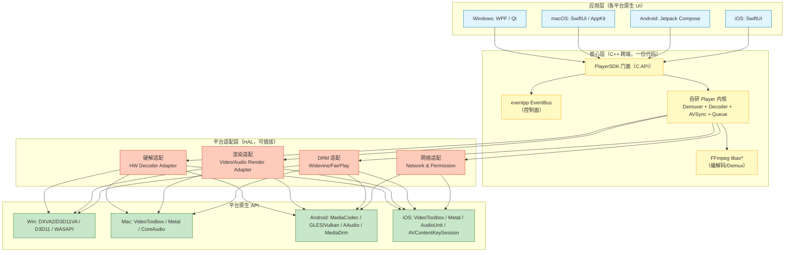

**核心原则**：**"核心跨端 100%，HAL 隔离 100%，UI 各自壳"**——业务代码写一次，硬件/DRM 差异全部下沉到 HAL。

#### 5.4.4 FFmpeg + 自研内核 跨端能力映射对照表

| 能力 | Windows | macOS | Android | iOS |
|------|---------|-------|---------|-----|
| Demux/Decode 软解 | FFmpeg libav* | FFmpeg | FFmpeg | FFmpeg |
| 视频硬解 | **DXVA2 / D3D11VA / NVDEC** | **VideoToolbox** | **MediaCodec** | **VideoToolbox** |
| 音频渲染 | **WASAPI** | **CoreAudio** | **AAudio / OpenSL ES** | **AudioUnit** |
| 视频渲染 | **D3D11 / Vulkan** | **Metal** | **GLES / Vulkan** | **Metal** |
| DRM | PlayReady（少）| FairPlay（macOS）| **Widevine (MediaDrm)** | **FairPlay (AVContentKeySession)** |
| 字幕渲染 | libass / 自研 | 同 | 同 | 同 |
| 网络 | libcurl / 自研 | 同 | 同 + 权限 | 同 + 权限 |

📝 **只有硬解/渲染/DRM 具体 API 不同，上层 AVSync/Seek/ABR/字幕逻辑完全共享**——这就是 FFmpeg + 自研内核跨端的核心红利。

#### 5.4.5 平台适配层（HAL）职责与接口约定

HAL 只承担四类职责，通过 C++ 抽象接口暴露给核心层：

| HAL 接口 | 职责 | 关键方法 |
|---|---|---|
| `IHwDecoder` | 创建平台专属硬解会话；接收 `AVPacket` / 输出 GPU 纹理 | `CreateH264 / CreateHEVC / CreateAV1 / DecodePacket / OutputTexture` |
| `IVideoRenderer` | 创建 GPU 渲染上下文，绑定平台窗口句柄 | `AttachSurface(nativeWindow) / RenderTexture(tex, pts) / SetHDRMetadata` |
| `IAudioRenderer` | 创建低延迟音频输出，反馈 audio clock | `Open(sr, ch, fmt) / Write(pcm) / GetAudioClock / SetVolume` |
| `IDrmSession` | DRM 会话管理，License 请求/解密 | `CreateSession / GenerateRequest / ProvideResponse / Decrypt` |

**工厂选择**：通过编译期宏（`_WIN32` / `__APPLE__` / `TARGET_OS_IOS` / `__ANDROID__`）选择具体实现类；上层业务只依赖抽象接口，四个平台各自实现一份 `.cpp`，其余代码完全共享。

📌 **接口设计原则**：**输出的都是 GPU 纹理句柄 + PTS**——让 Renderer "感受不到"底层硬解实现差异，实现零改动跨端。

#### 5.4.6 跨端必须直面的 6 个差异

| 差异点 | 说明 | HAL 处理策略 |
|--------|------|-------------|
| **硬解 API** | DXVA/VideoToolbox/MediaCodec 输入输出模型完全不同 | HAL 统一为 "AVPacket in → GPU Texture + PTS out" |
| **GPU 上下文** | Win=D3D11 / Mac & iOS=Metal / Android=EGL/Vulkan；纹理不通用 | 统一走 GPU 内传递，跨模块**只在 GPU 内**，不 map 回 CPU |
| **音频延迟** | iOS/Mac 低（CoreAudio）；Android 因厂商差异大 | Android 强制走 **AAudio**（低延迟通路）；反馈 audio clock 给主时钟 |
| **DRM 生态** | Widevine 需 Google 授权且分 L1/L3；FairPlay 只在 Apple 生态 | HAL 提供统一 `IDrmSession`；无版权内容可 stub |
| **HDR 元数据** | HDR10/HDR10+/DolbyVision 各平台色彩管理路径不同 | Renderer HAL 层做色彩空间转换 + tone mapping |
| **权限与生命周期** | 移动端网络权限、后台播放；PC 无 | HAL 提供 `RequestPermission()`；核心层订阅相关事件 |

#### 5.4.7 跨端选型决策树

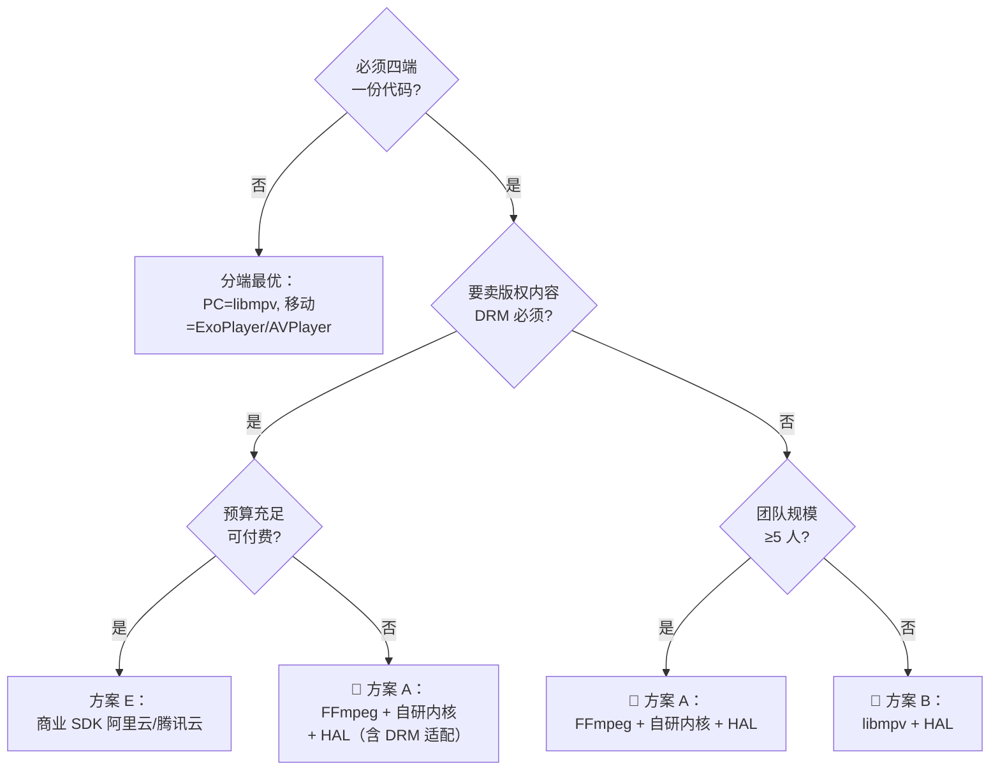

#### 5.4.8 跨端主线一句话建议

> 🌍 **一份 C++ 核心跑四端 + 要 DRM → 方案 A（FFmpeg + 自研内核 + HAL）或方案 E（商业 SDK）。**
> 🌍 **小团队求快、无 DRM → 方案 B（libmpv + HAL）。**
> 🌍 **PC 想极致画质、移动可以妥协 → 方案 D（PC 用 libmpv、移动用 ExoPlayer/AVPlayer）。**

### 5.5 三条主线横向对比速查

| 维度 | 🖥️ PC 主线（§5.2） | 📱 移动主线（§5.3） | 🌍 跨端主线（§5.4） |
|------|:-------------------:|:-------------------:|:-------------------:|
| **首选组合** | libmpv + eventpp | 系统播放器 + FFmpeg mini + eventpp | FFmpeg + 自研内核 + eventpp + HAL |
| **典型包体** | 20–40 MB（桌面可接受） | **1.5–3 MB**（极优） | 8–15 MB/端 |
| **HDR / 8K** | ✅ libmpv 顶级 | ⚠️ 依赖系统能力 | ✅ 自研可调 |
| **主流协议 HLS/DASH** | ✅ | ✅ 系统内建 | ✅ FFmpeg |
| **私有协议/格式** | ✅ 插件 | ⚠️ P2 兜底 | ✅ 完全掌控 |
| **DRM Widevine/FairPlay** | ⚠️ 需自补 | ✅ 系统内建 | ⚠️ HAL 补齐 |
| **ABR** | ⚠️ 基础 | ✅ 系统一等 | ✅ 可深度定制 |
| **变速/字幕特效** | ✅ 顶级 | ⚠️ 中等 | ✅ 可自研 |
| **许可证** | libmpv=GPL/LGPL | 系统 / LGPL / 商业 | LGPL |
| **开发工作量** | 低（1–2 人月） | 低–中（1–3 人月） | 中–高（3–6 人月） |
| **最适合团队** | 桌面播放器 / 客户端内嵌 | 短视频 / 长视频 App | 中大型跨端 App |

---

## 六、通用架构心智模型：Media Pipeline + Event Bus 🌟

无论选 §5.2 PC 主线（libmpv）、§5.3 移动主线（系统播放器 / FFmpeg mini）还是 §5.4 跨端主线（FFmpeg + 自研内核），**顶层架构都是这张图**——这是业界最佳实践，也是本文推荐的最终形态。

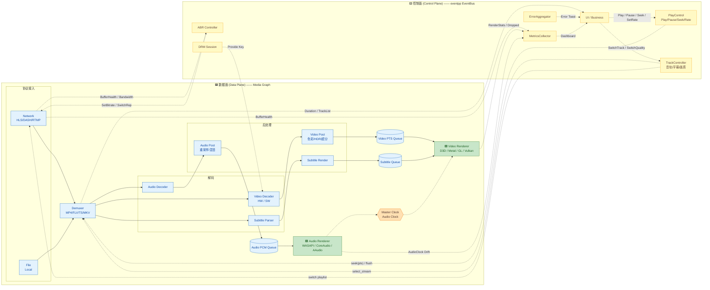

> 📌 **图例**：🟦 蓝 = 数据面节点（高频包/帧流）；🟨 黄 = 控制面节点（低频信令）；🟩 绿 = 渲染器；🟧 橙 = 主时钟。
> 实线（`—▶`）= 数据流；虚线（`- -▶`）= 控制/信令流。

### 6.1 两条通道的分工

| 通道 | 载体 | 传递内容 | 频率 | 顺序 | 背压 |
|------|------|---------|------|------|------|
| **数据面** | Media Graph Queue / GPU Texture | `AVPacket` / `AVFrame` / `PCM Buffer` | 高（30~120 Hz） | 强序（DTS/PTS 单调） | 显式队列水位 |
| **控制面** | EventBus (eventpp) | `Play/Pause/Seek/SwitchTrack/BufferHealth/Error` | 低（< 20 Hz） | 弱序 | 无需 |

### 6.2 主时钟 (Master Clock) 的关键设计

**主时钟不是事件，是共享状态**——由 Audio Renderer 每次 `write(pcm)` 后原子更新 `audio_pts`，Video Renderer 每帧读取此值决定"该丢/该等/该显示"。

| 决策规则 | Δ = video_pts - audio_pts | 动作 |
|----------|:---:|------|
| **显示** | `|Δ| < 40 ms` | 正常显示 |
| **加速播放** | `40 ~ 100 ms` | 缩短下一帧等待 |
| **丢帧** | `Δ > 100 ms`（视频领先太多，罕见） | 跳过下一 P/B 帧 |
| **重复上一帧** | `Δ < -100 ms`（视频落后） | 保持画面不动 |
| **触发 Reset** | `|Δ| > 3 s` | 判定失步，重新对齐 |

📌 **无音频轨时**：主时钟切换为 **System Clock**（`std::chrono::steady_clock`）。

### 6.3 Seek 的原子性契约

Seek 是播放器**最容易翻车**的操作，必须遵循**清空→回退→快解→恢复**四步：

- **Step 1 Flush**：控制面 `SeekTo(pts)` 发出后，**先冻结所有 handler**（Renderer 停止 present、Decoder 停止取包）
- **Step 2 Rewind**：Demuxer `avformat_seek_file(SEEK_BACKWARD)` 回到目标 PTS 之前最近的 IDR
- **Step 3 Fast Decode**：以\"仅解码不显示\"模式快速跑到目标 PTS
- **Step 4 Resume**：所有队列重置 `first_pts`，主时钟重置，广播 `SeekCompleted` 事件

📌 **约束**：Seek 期间的所有帧**必须打上 seek epoch 标签**，Renderer 只显示当前 epoch 的帧——否则会看到 Seek 前的\"残帧\"闪现。

### 6.4 ABR 反馈回路

自适应码率是网络流媒体的核心能力。工作在**控制面**，但决策依据来自**数据面上报**：

- **观测**：Network 每秒上报 `BufferHealth（缓冲区秒数）+ Bandwidth（吞吐估计）`；Renderer 上报 `Dropped Frames`
- **决策**：ABR Controller 综合三项指标，选择目标 `Representation`（HLS variant / DASH Adaptation）
- **执行**：切 playlist / MPD → 拉新 segment → 找 boundary（IDR）→ 无缝拼接
- **约束**：切档必须发生在**关键帧对齐点**，否则中间会花屏

### 6.5 硬解零拷贝的关键设计

硬解输出必须**直通到 GPU Renderer 而不下载回 CPU**：

| 平台 | 硬解输出 | 渲染路径 |
|------|---------|---------|
| Windows | `ID3D11Texture2D` (D3D11VA) | D3D11 shader 直采 |
| macOS/iOS | `CVPixelBuffer` (VideoToolbox) | Metal `MTLTexture` from `CVMetalTexture` |
| Android | `Surface`（MediaCodec output surface）| GLES `SurfaceTexture.updateTexImage()` |
| Linux | `AVDRMFrameDescriptor` (VA-API) | EGL `dma-buf import` |

📌 **实现要点**：硬解 handle **引用计数** + **GPU 内共享**；跨模块传视频**只在 GPU 内**，禁止 map 回 CPU。

---

## 七、参考实现骨架（工程落地要点）

> ⚠️ **本章定位**：本文以**选型**为核心（§四/§五），落地细节因所选框架而异。此处只给出与框架无关的**关键契约与心智模型**，作为参考骨架；深度实现示例请参见 §九 参考资料中的专项文档。

### 7.0 与第 6 章通用架构的对应关系

| §六 架构元素 | §七 实现约定 |
|---|---|
| 数据面 Media Graph | §7.1 三色分区、§7.3 关键契约 |
| 控制面 EventBus | §7.2 事件族心智地图 |
| Master Clock 音画同步 | §7.5 音画同步策略 |
| Seek 原子性 | §7.6 Seek 契约与状态机 |
| ABR 反馈回路 | §7.7 ABR 闭环 |
| 硬解零拷贝 | §7.3 数据面关键契约 |

📌 §七不引入 §六 之外的任何新架构决策，只做具象化。

### 7.1 分层系统模块（三色分区）

无论用 libmpv、ExoPlayer/AVPlayer 还是自研，工程都应按下面的**三色分区**组织：

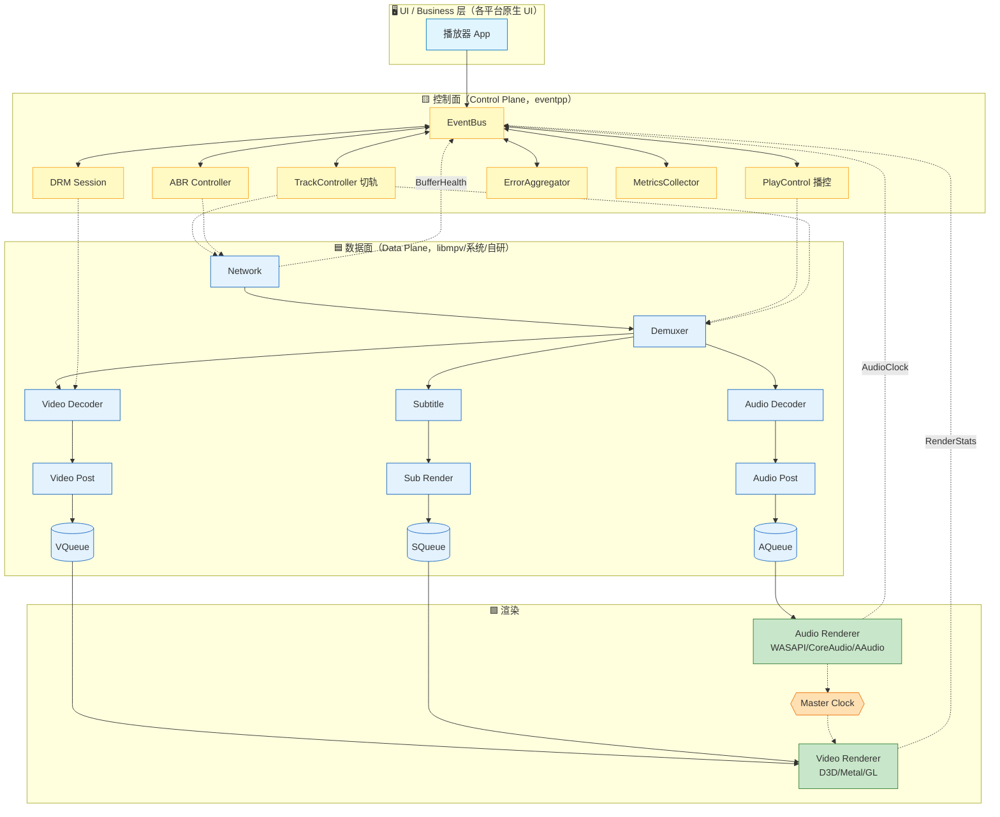

📌 **工程铁律**：**控制面模块不得直接 include 数据面头文件，反之亦然**——两条通道只通过 `EventBus` + 数据面 `Queue` 交互，未来任一层可整体替换。

### 7.2 控制面事件族（心智地图）

```mermaid
mindmap
  root((EventBus<br/>事件目录))
    命令 Command<br/>（UI → 系统）
      Play / Pause / Stop
      Seek(pts) / SetRate(x)
      SwitchAudioTrack / SwitchSubtitle
      SwitchQuality（ABR 手动）
      SetVolume / SetMute
    状态 State<br/>（系统 → UI）
      StateChanged(Idle/Ready/Buffering/Playing/Paused/EOS)
      SeekStarted / SeekCompleted
      TrackListReady / DurationReady
    上报 Metrics<br/>（数据面 → 控制面）
      BufferHealth（seconds）
      BandwidthEstimate（bps）
      RenderStats（fps/dropped/current_pts）
      AudioClock（pts/drift）
    错误 Error
      DecodeError / DemuxError
      NetworkTimeout / DrmError
      FormatUnsupported
    DRM
      KeyRequest / LicenseAcquired / LicenseExpired
    内部反馈 Feedback
      BufferHealth → ABR → SwitchRep
      AudioClock → Video AVSync 决策
```

**发布/订阅规约**：
- 事件类型用 POD `struct`，通过 `typeindex` 作 Key 注册；**编译期强类型**，避免字符串 topic。
- 同步派发（`publishSync`）用于渲染反馈/埋点；异步队列（`publishAsync`）用于命令/网络反馈。
- 订阅者析构必须 `ScopedRemover` 自动断连。

### 7.3 数据面关键契约

| 契约 | 内容 |
|---|---|
| **DTS/PTS 严格单调** | Demuxer 输出必须 DTS 单调；Decoder 输出必须 PTS 单调，B 帧重排在此完成 |
| **主时钟单一** | 有音频用 Audio Clock；无音频切 System Clock；直播可用外部时钟 |
| **Seek Epoch 标签** | Seek 期间所有帧带 epoch，Renderer 只显示当前 epoch |
| **热切轨铁律** | 切轨：**先暂停 → 再 flush → 再切 stream index → 再恢复**（顺序颠倒 = 花屏） |
| **零拷贝硬解** | 硬解输出 GPU handle **只在 GPU 内传递**，跨模块引用计数 |
| **DRM 解密位置** | 解密**必须在硬解前**（`AVPacket` 层），避免明文 CPU 落地 |

### 7.4 数据面各段队列策略（关键数值口径）

| 段位 | 队列深度 | 满时策略 | 目的 |
|------|:-------:|---|---|
| Network → Demuxer | 5–30 s | 阻塞（TCP 天然背压） | 抵御网络抖动 |
| Demuxer → Video Decoder | 30 packets | 阻塞 | 保住 GOP |
| Demuxer → Audio Decoder | 50 packets | 阻塞 | 音频包小密度高 |
| Video Decoder → VPost | 3 frames | 阻塞 | 硬解句柄稀缺 |
| Audio Decoder → APost | 20 frames | 阻塞 | 允许深队列吸收抖动 |
| **VPost → Video Renderer 队列** | **3–5 frames** | **丢最旧** | **Seek/切档时快速排空** |
| **APost → Audio Renderer 队列** | **500 ms PCM 环形** | **阻塞** | **音频不允许丢** |
| Subtitle → Renderer | 10 cue | 丢最旧 | 字幕不影响音画 |

📌 **核心口径**：**视频队列浅、Seek 时可丢；音频队列深、绝不丢** —— 这是 mpv / ExoPlayer / VLC 的一致做法。

### 7.5 音画同步（AVSync）策略图

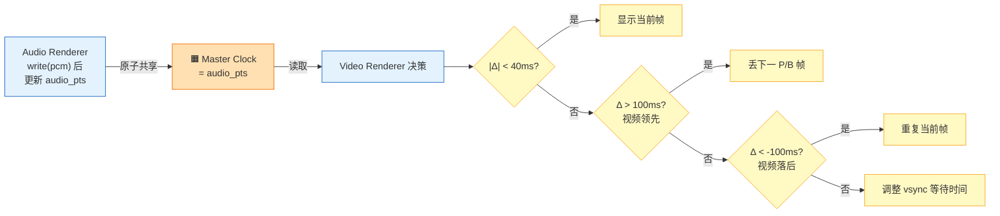

📌 **决策周期**：每次 vsync 或每帧解码完成时决策一次。**决策器在 Video Renderer 内部**，不走 EventBus。

### 7.6 Seek 状态机

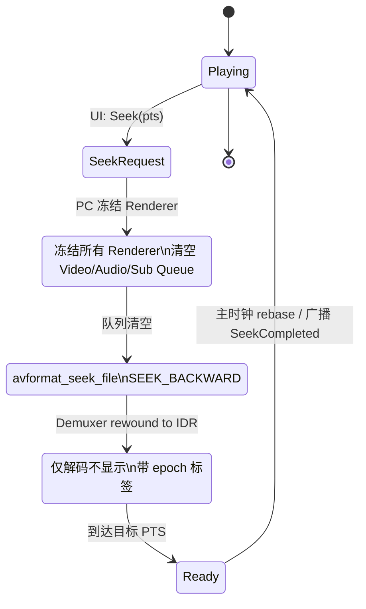

📌 **epoch 机制**：每次 Seek 递增 `seek_epoch`，所有帧携带该 epoch，Renderer 丢弃非当前 epoch 帧。

### 7.7 ABR 闭环反馈回路

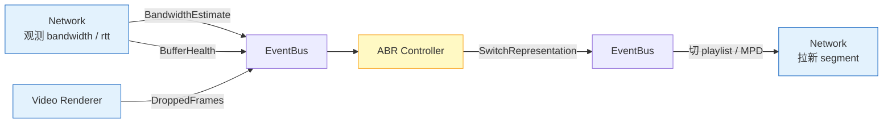

**决策参考**（实际可用 BOLA / Throughput / MPC 算法）：`buffer<3s` 保守降档；`buffer>15s && bw` 稳定 5s → 升档；`dropped>5%` 降档；升档必须在 IDR 边界。**执行走 EventBus 而非直接 API**，方便旁路埋点、AB 实验、算法替换。

### 7.8 三条主线落地对照

| 模块 | PC 主线（libmpv） | 移动主线（系统 + FFmpeg mini） | 跨端主线（FFmpeg + 自研内核） |
|------|---|---|---|
| Network/Protocol | libmpv 内建（ffmpeg 协议） | ExoPlayer / AVPlayer 内建 | libavformat + libcurl |
| Demuxer | libmpv 内建 | 系统 / FFmpeg mini | libavformat |
| Video Decoder | libmpv `hwdec=auto` | 系统 MediaCodec / VideoToolbox | 平台 HAL `IHwDecoder` |
| Audio Decoder | libmpv 内建 | 系统内建 | libavcodec |
| AVSync | libmpv 内建（audio-master） | 系统内建 | 自研（§7.5） |
| Seek | `mpv_command("seek")` | ExoPlayer.seekTo / AVPlayer.seek | 自研（§7.6） |
| ABR | 依赖 FFmpeg HLS | 系统一等公民 | 自研（§7.7） |
| DRM | 无内建（需外挂） | Widevine / FairPlay 内建 | 平台 HAL `IDrmSession` |
| Video Renderer | libmpv `--vo=gpu-next` | SurfaceView / AVPlayerLayer | 平台 HAL `IVideoRenderer` |
| Audio Renderer | libmpv 内建 | 系统内建 | 平台 HAL `IAudioRenderer` |
| EventBus | eventpp（订阅 mpv property） | eventpp | eventpp |

📌 **上层业务只依赖 §7.1 分层结构与 §7.2 事件目录**；换主线时**只需替换数据面组件**，控制面代码几乎零改动。

---

## 八、性能与踩坑清单

### 8.1 性能基线（压测目标）

| 指标 | 目标值 |
|------|--------|
| 首帧渲染延迟（点播，网络 30Mbps） | < 500 ms |
| 首帧渲染延迟（直播 LL-HLS/CMAF） | < 1.5 s |
| Seek 端到端延迟（4K H.265） | < 300 ms |
| 音画同步稳态偏差 | \|Δ\| < 40 ms |
| 单包 EventBus 派发耗时 | < 5 µs |
| 视频渲染丢帧率（1080p60 常速） | < 0.5% |
| 音频欠载率（underrun） | 0（0.1%以下告警） |
| 主时钟单次读取耗时 | < 100 ns（原子变量） |
| CPU 占用（1080p60 硬解 + 渲染） | 单核 < 30% |
| 内存占用（1080p60 稳态） | < 200 MB |

### 8.2 八大踩坑

1. ❌ **别用 System Clock 做视频主时钟当有音频时** —— 会累积漂移，几分钟后音画对不上。
2. ❌ **别在 Seek 时不清空 Video Renderer 队列** —— 会闪现 Seek 前的旧帧。
3. ❌ **别在 EventBus handler 里做渲染或解码** —— 会拖慢发布者线程；重活必须走数据面工作线程。
4. ❌ **别用字符串 topic** —— 编译期错不出，运维靠猜。
5. ❌ **别混用同步/异步分发而不加注释** —— 死锁高发地。
6. ❌ **别忘了 eventpp 的 `ScopedRemover`** —— 组件析构必须自动断连。
7. ❌ **别在硬解句柄未消费完时销毁 Decoder** —— 会导致 GPU 侧 UAF。
8. ❌ **别在 ABR 切档时不对齐关键帧** —— 中间会花屏 1–2 秒。

### 8.3 可观测性建议

- 每个 Node 暴露 `stats()` → `input_queue_size / output_fps / drop_count / avg_latency`
- Player 内核每秒发一次 `PlaybackHealth`，UI 可显示"卡顿/流畅/HD 掉档"红/黄/绿灯
- 控制面接入 Prometheus / QoE，把 `BufferHealth / Bandwidth / DroppedFrames / AVSyncDrift` 打成 metric
- 每个订阅回调用 `perf::scope_timer` 度量耗时，超阈值告警
- **QoE 五大黄金指标**：首帧时延、卡顿次数/时长、平均码率、Seek 时延、播放失败率

---

## 九、参考资料

- 📘 [进程内事件总线-优秀开源库汇总](进程内事件总线-优秀开源库汇总.md)
- 📘 [直播开播端-Pipeline与事件总线-选型与实现方案](直播开播端-Pipeline与事件总线-选型与实现方案.md)（对偶文档，开播端）
- 📘 [FFmpeg源码学习指南](FFmpeg源码学习指南.md)
- 📘 [GStreamer源码学习指南](GStreamer源码学习指南.md)
- 📘 [视频编码码控深入浅出-九大开源编码器对比与统一模型](视频编码码控深入浅出-九大开源编码器对比与统一模型.md)
- 🔗 [mpv / libmpv 官方文档](https://mpv.io/manual/master/)
- 🔗 [VLC / libVLC 官方](https://www.videolan.org/vlc/libvlc.html)
- 🔗 [ExoPlayer / AndroidX Media3](https://developer.android.com/media/media3)
- 🔗 [AVFoundation Programming Guide](https://developer.apple.com/av-foundation/)
- 🔗 [ijkplayer (Bilibili)](https://github.com/bilibili/ijkplayer)
- 🔗 [GStreamer playbin3](https://gstreamer.freedesktop.org/documentation/playback/playbin3.html)
- 🔗 [HLS RFC 8216](https://datatracker.ietf.org/doc/html/rfc8216)
- 🔗 [DASH ISO/IEC 23009-1](https://www.iso.org/standard/79329.html)
- 🔗 [Widevine DRM Overview](https://www.widevine.com/)
- 🔗 [FairPlay Streaming](https://developer.apple.com/streaming/fps/)

---

> ✨ **一句话总结**：面向不同目标平台选对主线 —— **🖥️ PC = libmpv｜📱 移动 = 系统播放器 + FFmpeg mini｜🌍 跨端 = FFmpeg + 自研内核 + HAL**；三条主线共享同一套心智模型：**数据面走 Media Graph（Demux / Decode / Post / AVSync / Render）+ 主时钟以 Audio Clock 为准 + 控制面走 Event Bus（eventpp）+ Seek 用 epoch 保证原子性 + ABR 闭环反馈**——这是 mpv / ExoPlayer / AVPlayer / VLC 的共同答案。
