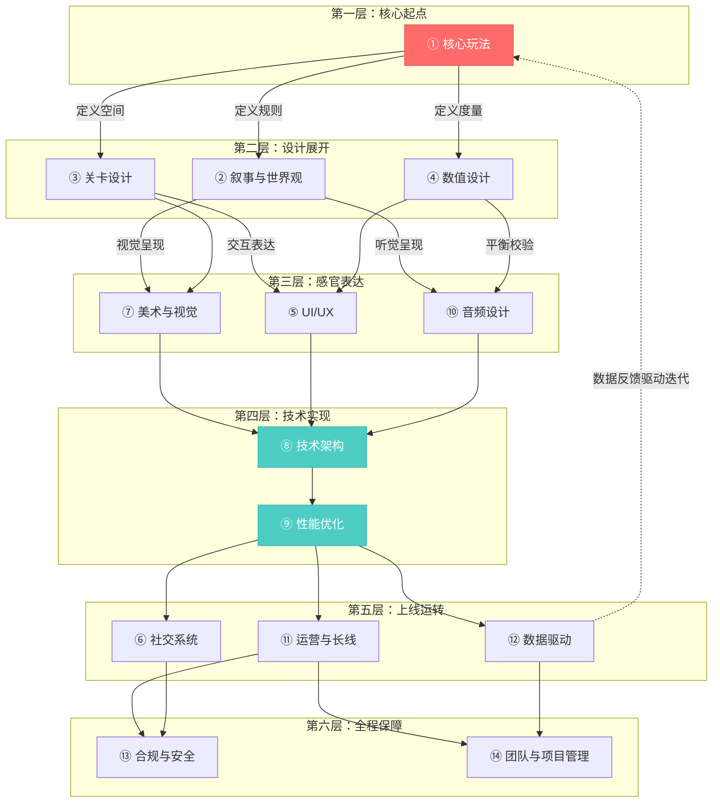

# 游戏设计全景概要 · 完整维度地图


> 本文是一份高屋建瓴的全景地图：从**五大专业领域**出发，告诉你一款完整的游戏需要认真对待哪些**核心维度**、由谁来完成、它们之间如何协同。无论你是策划、程序、美术还是独立开发者，这张地图都能帮你建立全局视野。

---

**作者**：汪亮（bertonwang）  
**邮箱**：<47608843@qq.com>  
**版本**：v3.0 ｜ **最后更新**：2026-09-10

---

## 0、全景一览

一款游戏从想法到上线，需要**五大专业领域**协作完成。每个领域下包含若干**核心维度**，共计 **14 个维度**，构成完整的游戏设计全貌。

### 一款游戏的诞生：五大领域 × 14 核心维度

**领域一：游戏策划** —— 游戏的"大脑"，决定玩什么、怎么玩、好不好玩

- ① 核心玩法：玩家每一秒在做什么？为什么觉得好玩？
- ② 叙事与世界观：玩家为什么关心这个世界？为什么想继续？
- ③ 关卡设计：空间怎么引导行为、制造节奏？
- ④ 数值设计：游戏中每一个"数字"填多少才刚好？
- ⑤ UI/UX：玩家怎么和游戏交互？信息怎么传递？
- ⑥ 社交系统：玩家之间怎么互动？怎么留住人？

**领域二：美术设计** —— 游戏的"外貌"，决定看起来怎样

- ⑦ 美术与视觉：游戏"看起来"是什么感觉？

**领域三：程序开发** —— 游戏的"骨架"，让一切跑起来

- ⑧ 技术架构：游戏跑得动吗？多人同时在线扛得住吗？
- ⑨ 性能优化：怎么在目标设备上流畅运行？

**领域四：音频设计** —— 游戏的"耳朵"，决定听起来怎样

- ⑩ 音频设计：游戏"听起来"是什么感觉？

**领域五：运营发行** —— 游戏的"心跳"，让游戏活下去

- ⑪ 运营与长线：上线后怎么让玩家持续玩下去？
- ⑫ 数据驱动：怎么用数据指导设计决策？

**跨领域协作** —— 贯穿所有团队的底层保障

- ⑬ 合规与安全：合法合规、玩家数据安全怎么保障？
- ⑭ 团队与项目管理：怎么组织一群人高效地把游戏做出来？

> 💡 **维度是"做什么"，领域是"谁来做"。** 一个维度往往由多个领域协作完成（比如 UI/UX 需要策划定义交互、美术绘制界面、程序实现功能）；一个领域也会触及多个维度。理解这种"多对多"关系，是团队协作的基础。

下面按领域逐一展开每个核心维度。

---

## 一、游戏策划（Game Design）

策划是游戏的"大脑"，决定"这个游戏玩什么、怎么玩、好不好玩"。包含 6 个核心维度。

---

### 1.1 核心玩法设计（Core Gameplay）

> 核心问题：**玩家每一秒在做什么？为什么觉得好玩？**

这是游戏设计的**第一性原理**。其他维度再精妙，如果"玩起来不好玩"，一切白搭。

#### 需要考虑的要点

| 模块 | 要解决的问题 |
|------|-------------|
| 核心循环 | 玩家重复做的最小行为闭环是什么？（射击→击杀→拾取→射击） |
| 心流体验 | 怎么让玩家进入"忘记时间"的沉浸状态？难度与技能的匹配 |
| 操作手感 | 按键响应、打击感、镜头反馈——"手感"怎么调？ |
| 反馈系统 | 玩家做了一个动作后，游戏怎么"告诉他做对了"？ |
| 策略深度 | 有没有多种可行策略？还是只有一种最优解？ |
| 随机性与确定性 | 多少结果由技术决定、多少由运气决定？ |
| 失败成本 | 失败了损失什么？重来的代价多大？ |

#### 关键认知

- 核心玩法是**30 秒体验**的问题：如果你的游戏在 30 秒内不能让人觉得"有意思"，后面的系统再丰富也没用。
- **好的手感 = 输入延迟低 + 视觉反馈强 + 音效匹配准**。这三者缺一不可。
- 核心循环要满足"简单易学、难以精通"（Easy to learn, hard to master）。

#### 经典案例

| 游戏 | 核心循环 | 为什么好玩 |
|------|---------|-----------|
| 俄罗斯方块 | 旋转→放置→消行 | 极简规则 + 无限深度 |
| 黑暗之魂 | 观察→闪避→反击 | 高风险高回报的精确操作 |
| 文明 | 探索→扩张→开发→征服 | "再来一回合"的策略瘾 |

---

### 1.2 叙事与世界观设计（Narrative & Worldbuilding）

> 核心问题：**玩家为什么关心这个世界？为什么想继续玩下去？**

#### 需要考虑的要点

| 模块 | 要解决的问题 |
|------|-------------|
| 世界观架构 | 这个世界的规则是什么？历史、地理、种族、势力怎么设定？ |
| 主线叙事 | 故事的核心冲突是什么？玩家扮演什么角色？ |
| 支线与碎片叙事 | 怎么用环境、物品、NPC 对话补充世界的厚度？ |
| 角色塑造 | 主角和关键 NPC 怎么让玩家产生情感连接？ |
| 叙事与玩法的融合 | 故事怎么通过"玩"来讲，而不只是"看"？ |
| 分支与选择 | 玩家的选择会影响剧情走向吗？多结局怎么设计？ |
| 文本量管理 | 多少文字是"丰富"，多少是"啰嗦"？ |
| 本地化叙事 | 不同文化背景的玩家怎么理解你的故事？ |

#### 关键认知

- **"Show, don't tell"**（展示，而非告知）：最好的游戏叙事是让玩家通过行动和探索自己发现故事，而不是读一堆文字。
- 世界观不需要一开始就完美，但需要**内在自洽**——规则可以奇幻，但不能自相矛盾。
- 叙事是**情感引擎**：数值让玩家"变强"，叙事让玩家"在乎"。

#### 不同品类的叙事策略

| 品类 | 叙事权重 | 策略 |
|------|---------|------|
| RPG | 极高 | 深度主线 + 丰富支线 + 角色弧光 |
| MOBA/竞技 | 低 | 背景设定 + 角色故事（不影响玩法） |
| 开放世界 | 高 | 碎片叙事 + 环境叙事 + 玩家自发故事 |
| 休闲/超休闲 | 极低 | 几乎不需要叙事，靠玩法本身 |
| 恐怖 | 高 | 氛围叙事 + 信息缺失制造悬念 |

---

### 1.3 关卡设计（Level Design）

> 核心问题：**玩家在什么样的空间里玩？空间怎么引导行为？**

#### 需要考虑的要点

| 模块 | 要解决的问题 |
|------|-------------|
| 空间布局 | 地图的形状、大小、路线怎么设计？ |
| 引导与节奏 | 怎么用光线、地形、敌人分布引导玩家前进？ |
| 难度曲线 | 关卡之间的难度怎么递进？（和数值平衡篇联动） |
| 重玩价值 | 同一个关卡怎么让玩家想再玩一次？ |
| 秘密与探索 | 隐藏区域、彩蛋怎么放？放多少？ |
| 多人关卡 | 多人模式下地图怎么保证公平性？ |
| 教学关卡 | 怎么在不"说教"的情况下教会玩家操作？ |
| 垂直设计 | 高低差、多层结构怎么利用？ |

#### 关键认知

- 好的关卡设计是**"隐形的老师"**：玩家觉得自己在自由探索，实际上每一步都在你的引导之中。
- **任天堂的"起承转合"法则**：引入新机制 → 让玩家安全练习 → 增加变化 → 终极考验。这是关卡设计的黄金模板。
- 关卡设计师需要同时具备**空间思维**（建筑学）和**时间思维**（节奏感）。

#### 关卡设计的"三明治"结构

```
┌─────────────────────────────────────┐
│  高潮（BOSS / 大战 / 关键抉择）       │
├─────────────────────────────────────┤
│  上升（难度递增 / 新机制引入）         │
├─────────────────────────────────────┤
│  铺垫（安全区 / 教学 / 叙事交代）      │
└─────────────────────────────────────┘
```

---

### 1.4 数值设计（Numerical Design）

> 核心问题：**游戏中的每一个"数字"填多少？怎么让玩家觉得"刚刚好"？**

数值设计是将游戏体验**量化**的过程：伤害填多少、升级要多久、抽卡概率多大、物品卖多少钱——这些数字直接决定了玩家的"爽感"和"节奏感"。

#### 需要考虑的要点

| 模块 | 要解决的问题 |
|------|-------------|
| 经济系统 | 货币怎么产出、怎么消耗、物品怎么定价？怎么防通胀？ |
| 成长系统 | 升级多快？属性怎么涨？新老玩家差距怎么控制？ |
| 战斗公式 | 攻击力和防御力怎么转化成伤害？暴击、闪避怎么算？ |
| 概率系统 | 抽卡/掉落的概率怎么设？保底机制怎么做？ |
| 平衡设计 | PVE 多难合适？PVP 怎么公平？职业怎么平衡？ |
| 付费设计 | 怎么赚钱又不赶走免费玩家？LTV 怎么算？ |
| 数据验证 | 上线后怎么知道数值对不对？怎么调优？ |

#### 关键认知

- **数值是"隐形"的好设计**：玩家觉得"手感好""节奏好""不亏"，但说不出具体哪个数字让他满意——这就对了。
- **玩法决定"需要哪些数字"，数值决定"这些数字填多少"。** 脱离玩法谈数值，等于脱离地基造房子。
- 数值和本文的每个维度都有交集：经济影响付费、成长影响关卡、战斗影响手感、概率影响心理、数据验证一切。
- 常见误区：以为数值策划就是"填 Excel 表"。实际上，数值策划需要理解**玩法、心理学、经济学和统计学**。

#### 七大模块速览

```
┌───────────────────────────────┐
│       数值设计七大模块          │
├───────────────────────────────┤
│  ① 经济  ② 成长  ③ 战斗      │
│  ④ 概率  ⑤ 平衡  ⑥ 付费      │
│  ⑦ 数据                      │
├───────────────────────────────┤
│  经济是地基，成长是骨架，       │
│  战斗是核心手感，概率是惊喜，   │
│  平衡是生命力，付费是引擎，     │
│  数据是校准仪。                │
└───────────────────────────────┘
```

📄 本系列已有 7 篇专文详解每个模块，参见 → `游戏数值设计-全局概要与知识地图.md`

---

### 1.5 UI/UX 设计（用户界面与用户体验）

> 核心问题：**玩家怎么和游戏交互？信息怎么传递才不累？**

#### 需要考虑的要点

| 模块 | 要解决的问题 |
|------|-------------|
| 信息层级 | 哪些信息最重要？怎么让玩家一眼看到？ |
| HUD 设计 | 血条、小地图、技能栏怎么摆？占多大面积？ |
| 菜单与导航 | 玩家怎么从 A 功能跳到 B 功能？最多点几下？ |
| 新手引导 | 怎么教会玩家使用界面？强引导 vs 弱引导？ |
| 操作映射 | 手柄/键鼠/触屏，同一个功能怎么适配不同输入？ |
| 可读性 | 字体大小、颜色对比度、图标清晰度够不够？ |
| 红点系统 | 怎么提示"有新东西"但不让玩家焦虑？ |
| 无障碍 | 色盲模式、字幕、按键重映射——怎么让更多人能玩？ |

#### 关键认知

- **最好的 UI 是"不存在"的 UI**：玩家不应该"使用界面"，而应该"直接做事"。每多一次点击都是摩擦。
- **3 秒法则**：玩家想做一件事，如果 3 秒内找不到入口，就会烦躁。
- UI/UX 是**留存率的隐形杀手**：很多玩家流失不是因为"不好玩"，而是因为"不知道怎么玩"或"界面太乱"。

#### 手游 UI 的常见布局

```
┌──────────────────────────────────┐
│  [血条/状态]              [小地图] │
│                                  │
│                                  │
│          （游戏画面）              │
│                                  │
│                                  │
│  [摇杆]              [技能按钮群] │
│           [菜单入口]              │
└──────────────────────────────────┘
```

> 核心原则：**左手移动，右手操作，中间留给画面**。

---

### 1.6 社交系统设计（Social System）

> 核心问题：**玩家之间怎么互动？怎么让人"拉朋友一起玩"？**

#### 需要考虑的要点

| 模块 | 要解决的问题 |
|------|-------------|
| 好友系统 | 加好友、删好友、好友状态、好友互动怎么设计？ |
| 组队/公会 | 怎么让陌生人组到一起？公会有什么意义？ |
| 聊天系统 | 文字/语音/表情包，怎么选？怎么防骚扰？ |
| 排行榜 | 排行榜激励竞争还是劝退弱者？怎么分层？ |
| 社交货币 | 玩家怎么"炫耀"？称号、头像框、限定皮肤的社交价值 |
| 协作 vs 竞争 | 你的游戏偏合作还是对抗？两者怎么平衡？ |
| 社区生态 | 游戏外的社区（论坛、Discord、B 站）怎么运营？ |
| 防沉迷与社交安全 | 未成年人保护、举报系统、反欺凌怎么做？ |

#### 关键认知

- **社交是最强的留存手段**：玩家可能因为游戏不好玩而离开，但很少因为"朋友还在玩"而离开。
- 社交设计的本质是**制造"共同经历"**：一起打过的 BOSS、一起赢过的比赛，比任何奖励都更有粘性。
- 排行榜是双刃剑：**前 10% 的人被激励，后 50% 的人被打击**。考虑用"好友排行"替代"全服排行"。

#### 社交系统的层次模型

```
第 1 层：被动社交（看到其他玩家存在）
    ↓
第 2 层：轻度互动（点赞、送花、排行榜）
    ↓
第 3 层：协作互动（组队、公会任务）
    ↓
第 4 层：深度社交（语音开黑、公会管理、师徒）
    ↓
第 5 层：社区文化（玩家自发创作、梗、传说）
```

> 不是每个游戏都需要做到第 5 层，但至少要做到第 2 层。

---

## 二、美术设计（Art & Visual）

美术决定"游戏长什么样"，是玩家的**第一印象**。包含 1 个核心维度。

---

### 2.1 美术与视觉设计（Art & Visual Design）

> 核心问题：**游戏"看起来"是什么感觉？视觉怎么服务于体验？**

#### 需要考虑的要点

| 模块 | 要解决的问题 |
|------|-------------|
| 美术风格 | 写实 vs 卡通 vs 像素 vs 赛博朋克……怎么选？ |
| 色彩语言 | 颜色怎么传递情绪？怎么区分阵营/品质/状态？ |
| 角色设计 | 角色的剪影辨识度够不够？一眼能认出来吗？ |
| 场景设计 | 环境怎么讲故事？怎么配合关卡引导？ |
| 特效设计 | 技能特效怎么做到"好看但不遮挡视野"？ |
| 动画系统 | 角色动作怎么做到流畅自然？过渡动画怎么处理？ |
| UI 美术 | 界面风格怎么和游戏世界统一？ |
| 美术资源管理 | 怎么在"好看"和"性能"之间取舍？ |

#### 关键认知

- 美术风格没有"最好"，只有"最合适"。**风格统一比单张图好看更重要。**
- **剪影测试**：把角色涂成纯黑色，还能一眼认出来 → 设计合格。英雄联盟、守望先锋都通过了这个测试。
- 美术是玩家的**第一印象**：在玩家体验到你精心设计的数值和玩法之前，他们先看到的是画面。

#### 美术风格选择参考

| 风格 | 优势 | 劣势 | 适合品类 |
|------|------|------|---------|
| 写实 | 沉浸感强 | 成本极高、恐怖谷效应 | 3A 大作、军事射击 |
| 卡通/风格化 | 辨识度高、成本可控 | 部分玩家觉得"幼稚" | MOBA、冒险、全年龄 |
| 像素 | 成本低、怀旧感 | 受众有限 | 独立游戏、Roguelike |
| 低多边形 | 简洁现代、性能友好 | 表现力有限 | 休闲、策略 |

---

## 三、程序开发（Engineering）

程序把策划的设计变成可运行的代码，是所有设计的**实现载体**。包含 2 个核心维度。

---

### 3.1 技术架构（Technical Architecture）

> 核心问题：**游戏跑得动吗？多人同时在线扛得住吗？**

#### 需要考虑的要点

| 模块 | 要解决的问题 |
|------|-------------|
| 引擎选择 | Unity / Unreal / Godot / 自研？怎么选？ |
| 客户端架构 | 渲染管线、资源管理、热更新怎么做？ |
| 服务端架构 | 单服 vs 分布式？怎么扛高并发？ |
| 网络同步 | 帧同步 vs 状态同步？延迟怎么处理？ |
| 数据存储 | 玩家数据存哪？怎么防丢失？怎么做回档？ |
| 反作弊 | 外挂怎么检测？关键逻辑放客户端还是服务端？ |
| 热更新 | 不发版本就能改内容/修 Bug，怎么实现？ |
| 跨平台 | iOS / Android / PC / 主机，怎么一套代码多端运行？ |

#### 关键认知

- **技术选型在项目初期决定，后期几乎无法更改。** 选错引擎或架构，可能要推倒重来。
- 网络同步是多人游戏的**最大技术难点**：100ms 的延迟在 FPS 里就是"打不中人"。
- 反作弊的核心原则：**永远不要信任客户端。** 所有关键判定（伤害、掉落、交易）必须在服务端完成。

#### 引擎选择速查

| 引擎 | 优势 | 劣势 | 适合 |
|------|------|------|------|
| Unity | 生态丰富、跨平台强、上手快 | 大型项目性能瓶颈 | 手游、独立游戏、中型项目 |
| Unreal | 画质顶级、蓝图可视化 | 学习曲线陡、包体大 | 3A、主机、射击类 |
| Godot | 开源免费、轻量 | 生态小、3D 能力弱 | 独立游戏、2D 游戏 |
| 自研 | 完全可控 | 成本极高 | 大厂、特殊需求 |

---

### 3.2 性能优化（Performance Optimization）

> 核心问题：**怎么让游戏在目标设备上流畅运行？**

#### 需要考虑的要点

| 模块 | 要解决的问题 |
|------|-------------|
| 帧率目标 | 30fps / 60fps / 120fps，目标是多少？ |
| 渲染优化 | Draw Call、LOD、遮挡剔除、Shader 复杂度怎么控制？ |
| 内存管理 | 资源加载/卸载策略？内存峰值怎么控制？ |
| 包体大小 | 安装包多大？首包 + 热更怎么拆？ |
| 发热与耗电 | 手游跑 10 分钟手机烫得拿不住怎么办？ |
| 加载速度 | 进游戏要等多久？切场景要等多久？ |
| 低端机适配 | 怎么让 3 年前的手机也能玩？ |
| 性能监控 | 上线后怎么实时监控卡顿、崩溃？ |

#### 关键认知

- **性能优化不是"做完再优化"，而是"从第一天就要考虑"。** 技术债越积越多，后期优化成本指数增长。
- 手游的性能瓶颈往往不是 GPU，而是**发热降频**：CPU/GPU 过热后自动降速，帧率断崖式下跌。
- **"玩家感知帧率"比"实际帧率"更重要**：稳定的 30fps 比波动的 40～60fps 体验更好。

---

## 四、音频设计（Audio）

音频是最容易被忽视、但影响力巨大的领域。包含 1 个核心维度。

---

### 4.1 音频设计（Audio Design）

> 核心问题：**游戏"听起来"是什么感觉？声音怎么强化体验？**

#### 需要考虑的要点

| 模块 | 要解决的问题 |
|------|-------------|
| 背景音乐（BGM） | 不同场景用什么音乐？怎么切换不突兀？ |
| 音效（SFX） | 攻击、受击、拾取、UI 点击……每个动作的声音怎么设计？ |
| 环境音 | 风声、水声、脚步声——怎么用声音构建空间感？ |
| 语音 | 角色配音怎么选？多语言怎么处理？ |
| 动态音乐 | 音乐怎么根据游戏状态实时变化？（战斗激烈→音乐加速） |
| 音频反馈 | 暴击、升级、获得稀有物品——怎么用声音制造"爽感"？ |
| 音频优先级 | 同时发生 20 个音效时，哪些优先播放？ |
| 无障碍设计 | 听障玩家怎么获取声音传递的信息？ |

#### 关键认知

- **关掉声音玩一次你的游戏**——如果体验大幅下降，说明你的音频设计是成功的。
- 音效是**操作手感的隐形支柱**：同样的攻击动画，配上沉重的打击音 vs 轻飘的"噗"声，手感天差地别。
- 好的 BGM 不是"好听的歌"，而是**"让你忘记它存在但又离不开它"**的氛围。

#### 音频设计的优先级

```
第 1 优先：核心玩法音效（攻击、受击、移动）
第 2 优先：UI 反馈音效（点击、确认、错误提示）
第 3 优先：背景音乐
第 4 优先：环境音
第 5 优先：语音配音
```

> 预算有限时，按这个顺序分配资源。核心玩法音效做不好，其他都是锦上添花。

---

## 五、运营发行（Ops & Publish）

运营决定"游戏怎么活下去"，是游戏上线后的**核心引擎**。包含 2 个核心维度。

---

### 5.1 运营与长线设计（Live Operations）

> 核心问题：**游戏上线后怎么让玩家持续玩下去？**

#### 需要考虑的要点

| 模块 | 要解决的问题 |
|------|-------------|
| 版本节奏 | 多久出一个大版本？多久出一个小更新？ |
| 活动设计 | 限时活动怎么设计才能拉活跃又不破坏平衡？ |
| 赛季制 | 赛季多长？赛季重置什么？保留什么？ |
| 内容储备 | 上线时准备多少内容？后续内容的生产管线怎么建？ |
| 玩家分层运营 | 新手、活跃、沉默、流失——不同阶段的玩家怎么区别对待？ |
| 公告与沟通 | 怎么和玩家沟通版本计划、Bug 修复、补偿？ |
| 口碑管理 | 差评怎么处理？社区舆情怎么监控？ |
| 用户召回 | 流失玩家怎么拉回来？召回奖励怎么设计？ |

#### 关键认知

- **上线不是终点，是起点。** 一款成功的长线游戏，上线后的运营工作量远超开发期。
- 活动设计的黄金法则：**"给玩家一个今天必须登录的理由"**。
- 版本节奏太快 → 玩家跟不上焦虑；太慢 → 玩家无聊流失。**找到你的玩家群体的"呼吸节奏"**。

#### 典型的版本节奏

```
每周：小活动 / 限时任务
每 2 周：新角色 / 新装备 / 小版本
每月：中型版本（新玩法 / 新地图）
每季度：大版本（新赛季 / 新系统 / 大型剧情）
每半年：周年庆 / 资料片级更新
```

---

### 5.2 数据驱动（Data-Driven Design）

> 核心问题：**怎么用数据指导设计决策，而不是拍脑袋？**

这个维度和数值设计中的"数据篇"有交集，但范围更广——不只是数值验证，而是**整个游戏设计的数据化思维**。

#### 需要考虑的要点

| 模块 | 要解决的问题 |
|------|-------------|
| 核心指标体系 | DAU、留存、LTV、付费率——怎么建立指标看板？ |
| 行为漏斗 | 从下载→注册→新手教程→首次付费，每一步流失多少？ |
| 热力图 | 玩家在地图上哪里死得最多？哪里停留最久？ |
| A/B 测试 | 两个方案怎么科学对比？样本量要多大？ |
| 玩家画像 | 你的玩家是谁？年龄、性别、游戏时长、付费习惯？ |
| 预测模型 | 能不能提前预测哪些玩家即将流失？ |
| 数据埋点规范 | 埋什么、怎么埋、谁来埋？ |
| 数据隐私 | GDPR、个人信息保护法——数据收集的法律边界在哪？ |

#### 关键认知

- **数据告诉你"是什么"，不告诉你"为什么"。** 看到留存下降了，还需要结合定性分析（玩家反馈、社区讨论）找原因。
- 不要陷入"数据崇拜"：**有些好的设计决策在短期数据上看不出来**（比如降低付费压力可能短期收入下降，但长期留存提升）。
- 数据驱动的前提是**埋点规范**。上线后才想起"忘了埋这个点"，就晚了。

---

## 六、跨领域协作

以下 2 个维度不属于单一领域，而是**贯穿所有团队**的底层保障。

---

### 6.1 合规与安全（Compliance & Security）

> 核心问题：**怎么确保游戏合法合规、玩家数据安全？**

#### 需要考虑的要点

| 模块 | 要解决的问题 |
|------|-------------|
| 版号与审批 | 国内上线需要版号，流程多久？需要什么材料？ |
| 概率公示 | 抽卡概率必须公示，怎么合规？ |
| 防沉迷 | 未成年人游戏时长限制、实名认证怎么接入？ |
| 内容审核 | 暴力、色情、政治敏感内容的红线在哪？ |
| 数据安全 | 玩家个人信息怎么存储？怎么防泄露？ |
| 支付合规 | 苹果/谷歌抽成规则？虚拟货币的法律定义？ |
| 知识产权 | 美术素材、音乐、字体的版权怎么处理？ |
| 海外合规 | 不同国家/地区的法规差异（GDPR、COPPA、韩国游戏法）？ |

#### 关键认知

- 合规不是"上线前检查一下"，而是**从立项开始就要考虑**。版号审批可能需要数月，倒排时间。
- **知识产权是最容易踩的坑**：用了一个免费字体，上线后被告侵权，赔偿金额可能超过游戏收入。
- 海外发行的合规成本远超想象：每个国家的分级制度、隐私法规、支付规则都不同。

---

### 6.2 团队管理与项目管理（Team & Project Management）

> 核心问题：**怎么组织一群人高效地把游戏做出来？**

#### 需要考虑的要点

| 模块 | 要解决的问题 |
|------|-------------|
| 团队构成 | 策划、程序、美术、测试、运营——各需要多少人？ |
| 开发流程 | 瀑布式 vs 敏捷 vs 混合？怎么选？ |
| 里程碑管理 | 原型→Alpha→Beta→上线，每个阶段的目标是什么？ |
| 版本管理 | 代码、美术资源、策划配置怎么管理版本？ |
| 沟通机制 | 日会/周会/评审会怎么开才不浪费时间？ |
| 外包管理 | 哪些工作适合外包？怎么保证外包质量？ |
| 风险管理 | 核心成员离职、技术方案失败、版号被拒——怎么应对？ |
| 文档管理 | 设计文档怎么写？怎么保证"写了有人看"？ |

#### 关键认知

- **游戏开发中最大的浪费是"做了又砍"。** 好的项目管理就是尽早验证、尽早砍掉不行的方案。
- 策划和程序之间的沟通成本是项目效率的**最大瓶颈**。一份好的设计文档能省几十个小时的扯皮。
- 游戏开发的"不可能三角"：**质量、速度、成本——最多只能同时满足两个**。

#### 游戏开发的典型里程碑

```
概念阶段 ──► 原型验证 ──► 预生产 ──► 全面生产 ──► Alpha ──► Beta ──► 上线
  │            │           │          │          │        │        │
  │            │           │          │          │        │        │
 核心创意     可玩Demo    管线跑通    内容量产   功能冻结  Bug修复  发布
 市场验证     玩法验证    风格确定    系统完善   性能优化  压力测试 运营启动
```

---

## 七、各维度的关联关系



> **核心玩法是灵魂，叙事和关卡是血肉，数值是度量衡，美术和音频是皮肤，UI/UX 是神经系统，技术是骨架，运营是心跳，数据是眼睛，合规是免疫系统，团队管理是大脑。** 注意最底部的虚线回路——⑫ 数据驱动会将运营数据反馈回 ① 核心玩法，形成"设计→上线→度量→迭代"的闭环。

---

## 八、给游戏设计者的 10 条忠告

| 编号 | 忠告 | 解释 |
|------|------|------|
| 1 | **先做好玩，再做好看** | 核心玩法永远是第一优先级 |
| 2 | **尽早做原型，尽早让人玩** | 纸上谈兵不如 10 分钟的试玩 |
| 3 | **杀死你的宠儿** | 你最喜欢的设计如果不好玩，果断砍掉 |
| 4 | **为玩家设计，不为自己设计** | 你觉得好玩不算，玩家觉得好玩才算 |
| 5 | **少即是多** | 10 个精打细磨的系统胜过 50 个半成品 |
| 6 | **抄对的，改好的** | 学习优秀游戏不丢人，关键是理解"为什么这么做" |
| 7 | **数值是手段，体验是目的** | 不要为了数值优美而牺牲玩家体验 |
| 8 | **上线才是开始** | 做完游戏只是走了一半，运营是另一半 |
| 9 | **尊重玩家的时间** | 不要用无意义的重复消耗玩家的生命 |
| 10 | **保持热爱** | 做游戏很苦，但如果你自己都不爱玩，玩家一定能感觉到 |

---

## 九、总结：一张表看全局

| 领域 | 维度 | 一句话定义 | 核心方法/工具 |
|------|------|-----------|-------------|
| 游戏策划 | 核心玩法 | 每一秒在做什么、为什么好玩 | 核心循环、心流理论、原型测试 |
| | 叙事与世界观 | 玩家为什么在乎这个世界 | 英雄之旅、碎片叙事、角色弧光 |
| | 关卡设计 | 空间怎么引导行为和情绪 | 起承转合、引导设计、灰盒测试 |
| | 数值设计 | 每个"数字"填多少才刚好 | 收支平衡表、伤害公式、期望值 |
| | UI/UX | 玩家怎么和游戏交互 | 信息层级、3 秒法则、可用性测试 |
| | 社交系统 | 玩家之间怎么互动 | 社交层次模型、共同经历设计 |
| 美术设计 | 美术与视觉 | 游戏看起来是什么感觉 | 风格指南、剪影测试、色彩语言 |
| 程序开发 | 技术架构 | 游戏跑得动吗、扛得住吗 | 引擎选型、网络同步、反作弊 |
| | 性能优化 | 在目标设备上流畅运行 | 帧率预算、内存管理、发热控制 |
| 音频设计 | 音频设计 | 游戏听起来是什么感觉 | 动态音乐、音效分层、优先级系统 |
| 运营发行 | 运营与长线 | 上线后怎么持续吸引玩家 | 版本节奏、活动设计、玩家分层 |
| | 数据驱动 | 用数据指导设计决策 | 指标体系、A/B 测试、行为漏斗 |
| 跨领域 | 合规与安全 | 合法合规、数据安全 | 版号流程、概率公示、GDPR |
| | 团队与项目管理 | 高效地把游戏做出来 | 敏捷开发、里程碑、风险管理 |

---

> **一款真正优秀的游戏，是所有领域、所有维度协同共振的结果。** 理解了这张全景地图，你就知道了：做游戏不是只做好某一个维度就够了，而是在创造一个完整的世界。
