# 直播开播端 Pipeline 与进程内事件总线 —— 选型指南（PC / 移动 / 跨端三条主线）

**作者**：汪亮（bertonwang）
**邮箱**：<47608843@qq.com>
**版本**：v3.0 ｜ **最后更新**：2026-08-13

> **问题背景**：直播**开播端（Broadcaster / Publisher）**的完整链路通常包含：
>
> **① 多路采集**（摄像头 / 屏幕 / 麦克风 / 系统声 / 外接声卡 / 播片） →
> **② 前处理**（美颜、降噪、AEC/ANS/AGC、滤镜、抠图） →
> **③ 合成**（视频 Compositor 多图层叠加、音频 Mixer 多路混音） →
> **④ 本地预览**（Tee 分流，低延迟渲染） →
> **⑤ 编码** →
> **⑥ 封装** →
> **⑦ 推流发送**
>
> 且以上多路源允许**运行时动态增删**（切摄像头、加播片、加背景音乐、加游戏源）。
> 那么用「进程内事件总线（In-process Event Bus）」的 Pub/Sub 模型来串接这一切是否可取？
> 本文给出结论、C++ 库推荐、更好的开源框架建议，以及**完整的双通道分层落地方案**。

---

## 📋 目录

- [一、结论速览（TL;DR）](#一结论速览tldr)
- [二、开播端 Pipeline 的本质特征](#二开播端-pipeline-的本质特征)
- [三、Event Bus 用于该场景的可行性分析](#三event-bus-用于该场景的可行性分析)
- [四、控制面选型：C++ Event Bus 库](#四控制面选型c-event-bus-库)
- [五、数据面选型：多媒体框架（按三条主线）](#五数据面选型多媒体框架按三条主线)
- [六、通用架构心智模型：Media Pipeline + Event Bus](#六通用架构心智模型media-pipeline--event-bus-)
- [七、参考实现骨架（工程落地要点）](#七参考实现骨架工程落地要点)
- [八、性能与踩坑清单](#八性能与踩坑清单)
- [九、参考资料](#九参考资料)

---

## 一、结论速览（TL;DR）

### 1.1 本文定位：**选型指南**

本文的重心是 **"面对不同的目标平台，我该选哪套技术栈？"**，而不是手把手教你写代码。文档结构上：

- **§二 / §三** —— 澄清开播端的场景特征与"能不能用 Event Bus 撑全场"这一常见疑问（选型前的地基）。
- **§四** —— **控制面**选型：C++ 进程内事件总线库。
- **§五** —— **数据面**选型：按 **PC 端 / 移动端 / 跨端** 三条主线分别给出推荐（本文核心）。
- **§六** —— 通用架构心智模型（数据面 + 控制面），任何一条主线都通用。
- **§七** —— 参考实现骨架，只列关键契约，**不做深度实现**。
- **§八 / §九** —— 性能基线、踩坑清单、参考资料。

### 1.2 三条选型主线速查

| 主线 | 目标场景 | 数据面推荐 | 控制面推荐 | 详见 |
|:---:|---|---|---|:---:|
| 🖥️ **PC 端专属** | Windows / macOS 主播端；重合成、多源、插件生态 | 🥇 **libobs**（OBS Studio 底座） 🥈 GStreamer | 🥇 **eventpp** | [§5.2](#52-🖥️-主线-a：pc-端专属选型-libobs-一等公民) |
| 📱 **移动端专属** | Android / iOS 主播端；关心包体、耗电、审核 | 🥇 **系统 API + FFmpeg mini-build**（1.5–2 MB） 🥈 纯系统 API（< 1 MB） 🥉 GStreamer mini-build（4–6 MB） | 🥇 **eventpp** | [§5.3](#53-📱-主线-b：移动端专属选型-系统-api-优先) |
| 🌍 **跨端通用** | 一份 C++ 核心跑 4 端；中大型团队 | 🥇 **GStreamer + HAL 适配层** | 🥇 **eventpp** | [§5.4](#54-🌍-主线-c：跨端通用选型-gstreamer--hal) |

### 1.3 四个核心问题的答案

| # | 问题 | 答案 |
|---|------|------|
| **Q1** | 全链路（含多源、预览、混流）都用 Event Bus 维护，是否可取？ | ❌ **不可取**（对数据面而言，见 §三） |
| **Q2** | 若要用 C++ Event Bus 承担**控制面**，推荐哪个？ | 🥇 **eventpp** > 🥈 **Boost.Signals2** > 🥉 **Nano-signal-slot** |
| **Q3** | 三条主线各推什么框架？ | 见 §1.2 速查表 |
| **Q4** | 最佳工程实践？ | ⭐ **Media Pipeline（数据面）+ Event Bus（控制面）+ Tee 预览分流 + 动态源管理器**（见 §六） |

### 1.4 一图看懂

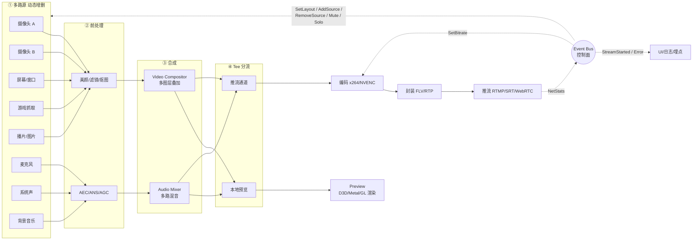

### 1.5 章节依赖关系（阅读顺序）

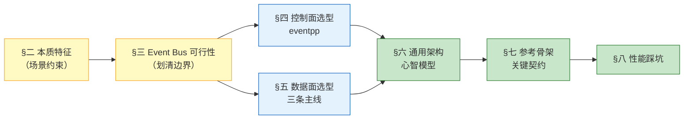

> 📌 **阅读建议**：赶时间只读 §1.2 + §五对应主线；系统了解读 §二→§五→§六；工程落地补充读 §七 + §八。

---

## 二、开播端 Pipeline 的本质特征

在做选型判断前，先看清这条链路相较普通"单路推流"多出的**三个新维度**：

### 2.1 多路源 + 动态拓扑

| 维度 | 说明 |
|------|------|
| **来源异构** | 摄像头（YUV / NV12）、屏幕（BGRA）、游戏（DXGI 共享纹理）、播片（视频文件解码后的 AVFrame）、图片（RGBA）、外接采集卡 |
| **时钟异构** | 每路源都有自己的时钟：摄像头 30 fps、屏幕可变率、播片按 PTS、麦克风 48kHz、系统声 44.1/48kHz |
| **运行时增删** | 主播可以任意加/删源（"加个背景音乐"、"切个游戏画面"、"下播摄像头"）——拓扑图必须支持**热插拔** |
| **图层布局** | 视频端需要 Compositor（缩放、裁剪、Z 序、透明度、旋转、绿幕）；音频端需要 Mixer（增益、平衡、静音、独听） |

### 2.2 本地预览（Tee 分流）

- 预览需求：**低延迟**（< 60 ms 感知无卡顿）、**尽量用 GPU 渲染**（避免下载回 CPU）、**分辨率可独立**（预览 720p、推流 1080p）。
- 实现要点：**在 Compositor 之后 Tee** 出一路走渲染，一路走编码；两路互不阻塞、独立背压。

### 2.3 数据流特征

| 维度 | 特征 | 数值示例 |
|------|------|----------|
| **数据密度** | 极高，单帧 KB~MB 级 | 1080p60 YUV420：约 3 MB/帧，60fps → 180 MB/s |
| **实时性** | 硬实时约束 | 端到端延迟 < 200ms（直播）、< 100ms（RTC） |
| **顺序性** | 严格 FIFO（PTS 单调递增） | PTS/DTS 乱序即花屏 |
| **多源对齐** | Compositor 需按主时钟对齐所有输入 | 摄像头/游戏源用主视频时钟；播片可能需要 rebase PTS |
| **背压** | 必须显式处理 | 编码器堵塞 → 采集必须丢帧或阻塞 |
| **零拷贝** | 强需 | GPU 纹理、`AVFrame` 引用计数、`dma-buf`/`ID3D11Texture2D` 共享 |

### 2.4 控制流特征

| 事件 | 频率 | 举例 |
|------|------|------|
| **动态源变更** | 极低 | AddSource / RemoveSource / RenameSource |
| **布局变更** | 极低 | SetLayout（Z 序/位置/大小）、Fullscreen、PiP |
| **音频控制** | 低 | SetVolume / Mute / Solo / SetGain |
| **状态变更** | < 10 Hz | Start/Stop/Pause/切分辨率 |
| **错误上报** | 稀疏 | CameraLost、EncoderCrash、NetTimeout |
| **统计上报** | 1 Hz | 编码 FPS、丢帧率、码率、每路源健康度 |
| **码率反馈** | 1~10 Hz | ABR 自适应 |

**关键洞察**：数据面是"每秒百 MB 级、纳秒抖动敏感、拓扑可变、需要 Tee 分流与 Compositor 合成"的**图（Graph）执行体**；控制面是"每秒几到几十次、KB 级、可丢弃"的松散信令。二者约束完全不同。

---

## 三、Event Bus 用于该场景的可行性分析

### 3.1 用 Event Bus 承担**数据面**的五个致命问题 ❌

#### ❌ 问题 1：性能天花板不够

- 主流 Event Bus 单次派发耗时 **100 ns ~ 1 µs**（含虚函数/`std::function`/list 遍历/加锁）。
- 多路 8K + 多路音频 + Tee 预览合流时，Bus 内部 `std::mutex` 会成为**唯一瓶颈**。
- Event Bus 通常是 **`vector<Listener>` + 全局锁**，与数据面**每路独立 SPSC 无锁队列**背道而驰。

#### ❌ 问题 2：语义错配 —— 广播 vs 图执行

- Event Bus 语义是"一发多收、订阅者互不感知"；开播端需要的是"**上游→下游 pad**、多输入 Compositor 按主时钟对齐、Tee 独立背压"。
- 强行用 Bus 后，谁负责 Compositor 输入对齐？谁负责预览/推流两条 Tee 的独立丢帧？——都会**丢失显式的图结构**。

#### ❌ 问题 3：类型与生命周期风险

- 传 `std::shared_ptr<AVFrame>` 跨订阅者，引用计数飘忽，容易在 GPU 纹理释放时机上翻车。
- Bus 若用运行时 `type_index` 分发，编译期无法检查"Frame vs Packet"错发。

#### ❌ 问题 4：Tee 分流做不好

- 预览要"丢得起"，推流要"稳"；同一事件被两个订阅者消费时，**谁能丢、谁能阻塞**没有显式表达。
- Bus 也没有"预览独立 GPU 内存 pool"这类概念，非常容易把两路互相拖死。

#### ❌ 问题 5：动态拓扑难维护

- 加源/删源本质是"在图里加节点、连边、启动线程、分配显存"，是**图操作**，不是"多发一个订阅者"。
- Bus 里没有 pad/caps 协商，多路源分辨率/采样率对齐要自己写胶水，代价巨大。

### 3.2 用 Event Bus 承担**控制面** ✅

以下场景 Event Bus **非常适合**：

| 场景 | 事件类型 | 为什么合适 |
|------|---------|----------|
| 源管理命令 | `AddSource / RemoveSource / RenameSource` | UI 与 Pipeline 完全解耦 |
| 布局变更 | `SetLayout / SetZOrder / SetTransform` | 主副屏、PiP、场景切换 |
| 音频控制 | `SetVolume / Mute / Solo` | 每路独立订阅 |
| 状态广播 | `StreamStarted / StreamStopped / Paused` | 一发多收（UI、日志、埋点、监控） |
| 错误传播 | `CameraLost / EncoderCrash / NetTimeout` | 解耦错误源与处理者 |
| ABR/带宽反馈 | `NetStats { rtt, loss, bw }` | 控制器订阅，采集/编码器不必知道谁在听 |
| 动态配置 | `BitrateChange / SetProfile` | 编码器订阅即可 |
| 埋点上报 | `EncodeStats / SourceHealth` | 1 Hz 低频广播 |

### 3.3 判断表

| 通道 | 频率 | 数据量 | 延迟敏感 | 需要背压 | 用 Event Bus？ |
|------|------|--------|----------|---------|---------------|
| **原始帧流（多路）** | 30~60 Hz × N | 高（MB 级/帧） | ⭐⭐⭐⭐⭐ | ✅ 必须 | ❌ 不用 |
| **合成后帧流 → 预览** | 30~60 Hz | 高 | ⭐⭐⭐⭐⭐ | ✅ | ❌ 不用（走 Tee） |
| **合成后帧流 → 编码** | 30~60 Hz | 高 | ⭐⭐⭐⭐ | ✅ | ❌ 不用 |
| **编码包流** | 30~60 Hz | 中 | ⭐⭐⭐⭐ | ✅ | ❌ 不用 |
| **动态源变更命令** | 极低 | 极小 | ⭐ | ❌ | ✅ 推荐 |
| **布局/音量控制** | 极低 | 极小 | ⭐ | ❌ | ✅ 推荐 |
| **状态/错误/统计** | < 10 Hz | 极小 | ⭐ | ❌ | ✅ 强烈推荐 |

**结论**：数据面走 **Media Graph（含 Compositor / Mixer / Tee）**，控制面走 **Event Bus**。这是 OBS Studio / GStreamer / WebRTC 的一致做法。

---

## 四、控制面选型：C++ Event Bus 库

前提：**仅用于控制面**（源管理、布局、音量、状态、错误、码率反馈、埋点等）。数据面的选型请看 §五。

| 排名 | 库 | 适配理由 | 局限 |
|------|-----|---------|------|
| 🥇 | [**eventpp**](https://github.com/wqking/eventpp) | 同时提供 **CallbackList / EventDispatcher / EventQueue**；线程安全；支持异步队列、过滤器、多线程调度器；Header-Only；Apache 2.0 | 学习曲线略陡 |
| 🥈 | [**Boost.Signals2**](https://www.boost.org/doc/libs/release/doc/html/signals2.html) | 线程安全、`scoped_connection` 自动断连、成熟 | 依赖 Boost，接入体积大 |
| 🥉 | [**Nano-signal-slot**](https://github.com/NoAvailableAlias/nano-signal-slot) | 性能极致、Header-Only；适合控制器内部高频信号 | 无内建异步队列 |
| 4️⃣ | [**sigslot (palacaze)**](https://github.com/palacaze/sigslot) | 现代 C++14、Qt 风格 | 仅信号-槽，无 topic bus 语义 |
| 5️⃣ | [**dexode/EventBus**](https://github.com/dexode/eventbus) | API 极简 `bus.listen<T>()`；Header-Only | 功能相对单薄 |

### 4.1 首推：eventpp 的底层推荐逻辑

1. **多模式并存**  
   - `CallbackList` → 编码器状态回调（同步、低延迟）  
   - `EventDispatcher` → 命名事件的类型分发  
   - `EventQueue` → 跨线程投递（把 UI 事件抛到采集/合成线程）
2. **线程安全内建**：`SingleThreadPolicy` / `MultipleThreadsPolicy` 按需切换。
3. **过滤器 & 拦截器**：`applyFilter` 天然适合做"码率变更前先鉴权"、"源添加前查配额"这类中间件。
4. **零外部依赖 / Apache 2.0**：商用友好。
5. **异步队列 `process()`**：把事件精确 pump 到指定线程（UI 线程、Compositor 线程等）。
6. **类型强安全**：`EventQueue<type_index, void(const T&)>` 避免字符串 topic 拼写坑。

### 4.2 决策边

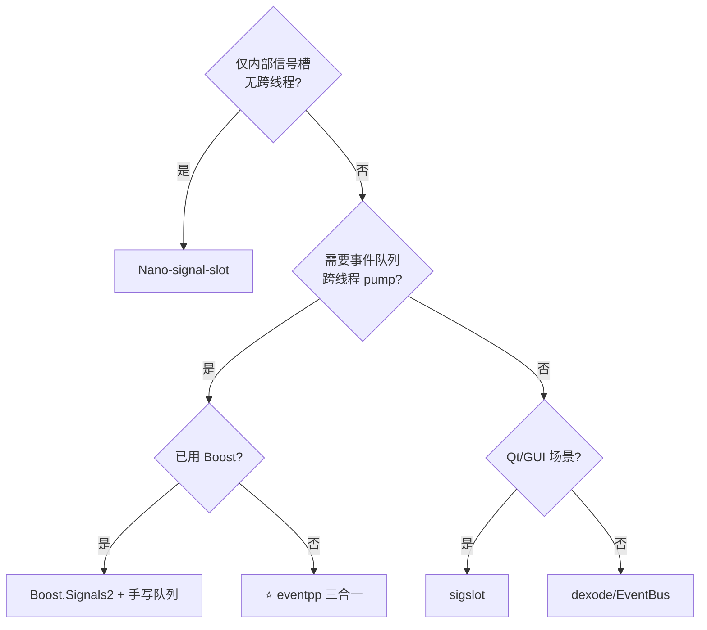

---

## 五、数据面选型：多媒体框架（按三条主线）

开播端**数据面**应该交给专业的 Media Graph 框架。本节按**目标平台**分为三条主线，每条主线独立可读：

- 🖥️ **[§5.2 主线 A：PC 端专属](#52-🖥️-主线-a：pc-端专属选型-libobs-一等公民)**（Windows / macOS 优先，追求生态与开箱即用）
- 📱 **[§5.3 主线 B：移动端专属](#53-📱-主线-b：移动端专属选型-系统-api-优先)**（Android / iOS 优先，关心包体、耗电、审核）
- 🌍 **[§5.4 主线 C：跨端通用](#54-🌍-主线-c：跨端通用选型-gstreamer--hal)**（一份 C++ 核心跑 4 端）

### 5.0 三条主线一图看懂

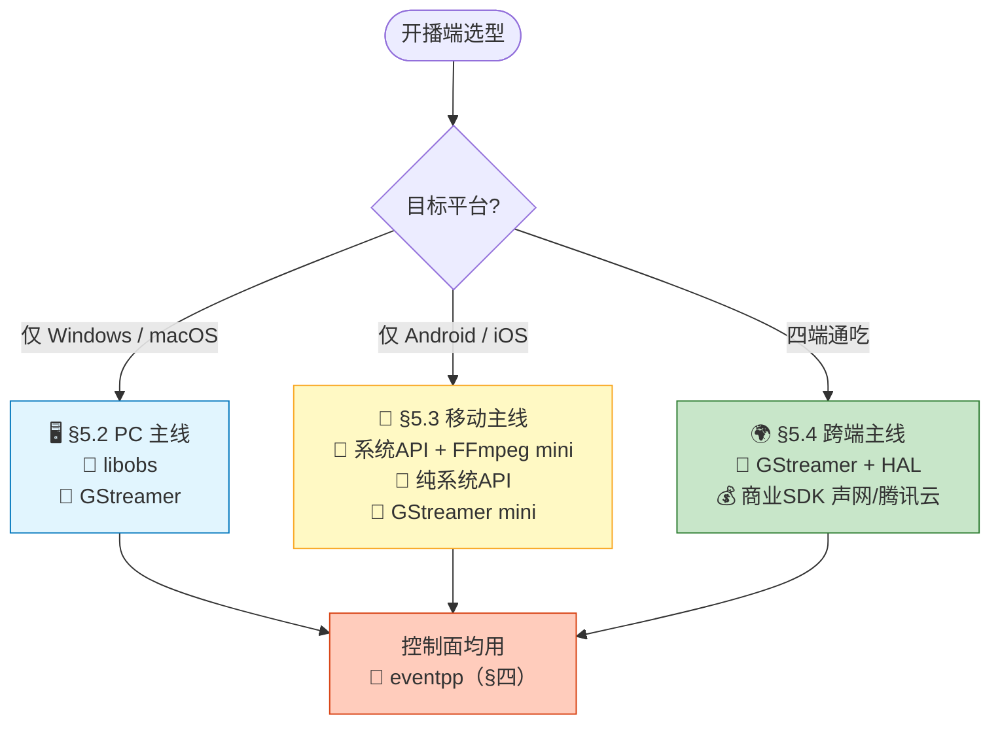

### 5.1 主流框架能力全景

| 框架 | 定位 | 是否原生支持"多源 + 合成 + 预览 + 推流" | 适用平台 |
|------|------|--------|----------|
| [**libobs (OBS Studio)**](https://github.com/obsproject/obs-studio) | **直播开播底座** | ✅ **Source / Scene / Filter / Encoder / Output 全套；GPU 合成；插件生态丰富** | Win / macOS / Linux |
| [**GStreamer**](https://gstreamer.freedesktop.org/) | 通用多媒体流水线 | ✅ `compositor`/`audiomixer`/`tee` 元素齐全 | **四端官方支持** |
| [**FFmpeg (libav\*)**](https://ffmpeg.org/) | 编解码/封装 lib | ⚠️ 有 `filter_complex overlay/amix` 但缺 runtime 图管理 | 全平台 |
| [**WebRTC (libwebrtc)**](https://webrtc.org/) | RTC 全栈 | ⚠️ 网络自适应最强，但合成能力弱 | 全平台 |
| [**Google MediaPipe**](https://github.com/google/mediapipe) | AI 多媒体图 | ✅ Graph 声明式，AI 前处理首选 | 全平台 |
| [**NVIDIA DeepStream**](https://developer.nvidia.com/deepstream-sdk) | GPU 视频 AI 流水线 | ✅ 基于 GStreamer | NVIDIA GPU |
| [**Intel oneVPL**](https://www.intel.com/content/www/us/en/developer/tools/oneapi/onevpl.html) | 硬件编解码 | ⚠️ 硬编硬解为主 | Intel 平台 |

📌 **一句话记忆**：**PC 生态最强 = libobs；跨端最广 = GStreamer；编解码 lib 化 = FFmpeg；RTC 通话 = WebRTC；AI 前处理 = MediaPipe**。

### 5.2 🖥️ 主线 A：PC 端专属选型（libobs 一等公民）

> 🎯 **场景约束**：仅需支持 Windows / macOS（可选 Linux）；主播端桌面软件；重合成、多图层、插件生态、直播助手风格。

#### 5.2.1 推荐路径

| 优先级 | 组合 | 适合团队 | 特点 |
|:---:|---|:---:|---|
| 🥇 | **libobs + eventpp** | 中大型（≥3人） | OBS Studio 底座，插件生态、UI 场景系统、GPU 合成、编码器抽象全套现成；上层做业务壳即可 |
| 🥈 | **GStreamer + eventpp** | 追求 SDK 化 | 更灵活的 Pipeline 编排；便于将来演进到跨端（无缝复用 §5.4） |
| 🥉 | **FFmpeg + 自研图** | 极少数深度定制 | 编解码全在手中；但合成、多源、预览得自己写，工作量大 |

#### 5.2.2 为什么 libobs 是 PC 端首选？

libobs 的内建模型天然覆盖本文全部需求：

| libobs 概念 | 对应本场景 |
|------------|----------|
| `obs_source` | 摄像头/屏幕/播片/图片/游戏抓取/麦克风等**任意一路源**，运行时 create/release |
| `obs_scene` + `obs_sceneitem` | 视频**多图层布局**（Z 序/变换/裁剪） |
| `obs_source_filter` | 每路源独立**前处理**（美颜/降噪/色键抠图） |
| `audio_mixer` | **多路音频混音** + 每路独立增益/静音 |
| `obs_encoder` | 编码器抽象（x264/NVENC/QSV/VideoToolbox） |
| `obs_output` | 推流输出（RTMP/SRT/WebRTC/文件） |
| **前后台合成分离** | 主线程负责 UI + 场景管理，后台 graphics 线程 30/60Hz 合成 |
| **信号系统 signal_handler** | libobs 内建的**控制面事件总线**（跟本文所说 eventpp 概念一致）|

#### 5.2.3 PC 主线的短板

| 短板 | 说明 | 缓解 |
|------|------|------|
| ❌ 移动端不支持 | libobs 官方无 Android/iOS 目标 | 若未来要上移动 → 转 §5.4 跨端主线 |
| ⚠️ 二进制体积 | libobs + 插件动辄 30–50 MB | 桌面场景可接受 |
| ⚠️ 许可证 | libobs = GPL-2.0，源码开源风险 | 想闭源商用请评估：可选 GStreamer（LGPL） |

#### 5.2.4 PC 主线一句话建议

> 🖥️ **主播端桌面软件 / 云端导播机 → 直接基于 libobs 二次开发，用 eventpp 处理控制面。**
> 🖥️ **未来要出移动端或做闭源商用 → 用 GStreamer 打底（顺便得到 §5.4 跨端能力）。**

### 5.3 📱 主线 B：移动端专属选型（系统 API 优先）

> 🎯 **场景约束**：仅需支持 Android / iOS；关注**包体、耗电、审核**；App Store 空中下载限制、小程序/插件化宿主、出海低端机场景常见。
> ⚠️ **核心洞察**：包体越小 → 能力越裸；**极致小包体 = 尽可能"用系统 API，不带库"**。

#### 5.3.1 各方案包体基线（arm64-v8a, Release, strip 后）

| 方案 | 视频编码 | 音频编码 | 封装 | 采集 | 渲染 | **静态增量包体** | 能力完整度 |
|------|---------|---------|------|------|------|:---------------:|:--------:|
| 🥇 **方案 M1：纯系统 API** | MediaCodec / VideoToolbox | AudioRecord / AudioUnit | 自写 FLV Muxer | Camera2 / AVFoundation | GLES / Metal | **~200–500 KB** | ⭐⭐⭐ 单源单路 |
| 🥈 **方案 M2：系统 API + FFmpeg mini** | 系统 | 系统 | libavformat FLV/RTMP | 系统 | 系统 | **~1.5–2 MB** | ⭐⭐⭐⭐ 推流协议全 |
| 🥉 **方案 M3：GStreamer mini-build** | MediaCodec | 系统 | flvmux + rtmp2sink | ahcsrc / avfvideosrc | glimagesink | **~4–6 MB** | ⭐⭐⭐⭐ 灵活图管理 |
| ⚫ FFmpeg 全家桶（默认 build） | libx264+MediaCodec | libfdk-aac | 全套 muxer | 系统 | 系统 | ~6–10 MB | ⭐⭐⭐⭐⭐ |
| ⚫ GStreamer 全量 | 齐全 | 齐全 | 齐全 | 齐全 | 齐全 | 10–20 MB | ⭐⭐⭐⭐⭐ |
| ⚫ libwebrtc（裁剪） | 内建 | 内建（Opus/AAC） | 内建 | 内建 | 内建 | 6–12 MB | ⭐⭐⭐⭐ 但为 RTC |
| 💰 商业 SDK（腾讯/声网 精简版） | 内建 | 内建 | 内建 | 内建 | 内建 | 3–8 MB | ⭐⭐⭐⭐⭐ |

📝 **关键洞察**：**FFmpeg 和 GStreamer 都可 mini-build**，通过 `--disable-everything` + 手动 `--enable-*` 精挑必要模块，能把包体压到基线的 1/5–1/10。

#### 5.3.2 按包体预算选方案（决策树）

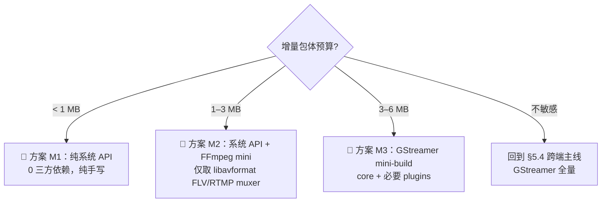

#### 5.3.3 🥇 方案 M1：纯系统 API（极致最小 < 1 MB）

**思路**：每个平台一套原生实现，业务层用 C++ 抽象接口统一。

| 能力 | Android | iOS |
|------|---------|-----|
| 摄像头 | `Camera2` + `ImageReader` / `SurfaceTexture` | `AVCaptureSession` + `AVCaptureVideoDataOutput` |
| 麦克风 | `AudioRecord`（PCM） | `AVAudioEngine` / `AudioUnit` |
| 视频编码 | `MediaCodec`（H.264/H.265 硬编） | `VTCompressionSession`（VideoToolbox） |
| 音频编码 | `MediaCodec`（AAC） | `AudioConverter`（AAC） |
| 渲染预览 | GLES + `SurfaceView` / `TextureView` | Metal + `CAMetalLayer` |
| 封装 | **自写 FLV Muxer**（<500 行 C 代码，跨端共享） | 同 Android |
| 推流 | **自写 RTMP Client**（~1500 行 C 代码，跨端共享） | 同 Android |

**取舍**：
- ✅ 包体极小、启动最快、审核零风险（无第三方编解码许可）
- ❌ 合成/多源/预览分流全得自己写 GL/Metal，工作量约 **3–4 人月**

#### 5.3.4 🥈 方案 M2：系统 API + FFmpeg mini（性价比之王，~2 MB）

**思路**：采集/编码/渲染继续用系统 API，**只把最难写的 muxer + 推流协议交给 FFmpeg**。

**FFmpeg mini-build 要点**：
- 使用 `--disable-everything` 关闭所有默认模块
- 手动 `--enable-avformat / --enable-avcodec / --enable-avutil`
- `--enable-protocol=rtmp,tcp,file`、`--enable-muxer=flv,mp4`
- `--enable-parser=h264,aac`、`--enable-bsf=h264_mp4toannexb,aac_adtstoasc`
- 加 `--enable-small --disable-debug --disable-doc --disable-programs` 进一步压包

**编译产物**：`libavformat + libavcodec + libavutil` 合计 **约 1.2 MB**（strip 后）。

**优势**：
- 只需 300 行胶水代码完成 `H.264 + AAC → FLV → RTMP` 推流
- 天生支持 SRT / HLS / DASH（只需再 `--enable-protocol=srt` 等）
- LGPL 许可，动态链接可闭源商用

**推荐组合**：**系统 API 采集编码 + FFmpeg mini muxer/protocol + eventpp**（Header-Only ~50 KB）
增量包体 **约 1.5–2 MB**，能力覆盖 90% 直播推流场景。

#### 5.3.5 🥉 方案 M3：GStreamer mini-build（保留图能力，~5 MB）

**适用**：**必须要多源合成、Tee 预览**又要控包体。

**mini-build 要点**：
- 用 `meson --buildtype=release --strip -Dauto_features=disabled`
- 只启用 `gstreamer:tools=disabled`（去命令行工具）
- 保留 `gst-plugins-base`：`app`、`videoconvertscale`、`compositor`、`audiomixer`
- 保留 `gst-plugins-good`：`flv`、`rtp`
- Android 额外启用 `gst-plugins-bad:androidmedia`（挂 MediaCodec 硬编）

**产物**：核心库 + 6–10 个插件，合计 **约 4–6 MB**。
**取舍**：牺牲 3 MB 换来 GStreamer 完整的 Pad/Bin/Bus 编排能力和跨端一致性（同 §5.4 拓扑）。

#### 5.3.6 通用减包体七字诀 🔥

| # | 手段 | 收益 | 副作用 |
|---|------|------|-------|
| 1️⃣ | **只用系统硬编（不带 x264/fdk-aac）** | 减 3–5 MB | 老旧机型硬编兼容性差 |
| 2️⃣ | **`--disable-everything` 手工挑模块** | FFmpeg/GStreamer 减 60–80% | 编译复杂度上升 |
| 3️⃣ | **Release + `-Os` + `strip` + LTO** | 减 20–30% | 编译时间增加 |
| 4️⃣ | **动态注册 = 只链接使用的插件** | 减 30–50% | 需手写注册表 |
| 5️⃣ | **单 arch 发布（arm64 App Bundle / APK Splits）** | APK 减 50% | 老 32 位机型放弃 |
| 6️⃣ | **符号剥离 + `-fvisibility=hidden`** | 减 5–10% | 无 |
| 7️⃣ | **Header-Only 事件总线（eventpp）** | 0 增量 | 编译时间稍长 |

#### 5.3.7 移动主线一句话建议

> 📱 **单路推流、极致小 → 方案 M1（纯系统 API）：< 1 MB。**
> 📱 **要 SRT/HLS/多协议、追求性价比 → 方案 M2（系统 API + FFmpeg mini）：~2 MB。**
> 📱 **要多源合成 + Tee 预览、又想小 → 方案 M3（GStreamer mini-build）：~5 MB。**
> 📱 **完全不 care 包体 → 转 §5.4 跨端主线，享受 GStreamer 全量能力。**

### 5.4 🌍 主线 C：跨端通用选型（GStreamer + HAL）

> 🎯 **场景约束**：一份 C/C++ 核心，4 个平台通用（Windows/macOS/Android/iOS），UI 层各自壳（Kotlin/Swift/C++/Obj-C）。
> ⚠️ **认清现实**：**没有一个开源框架能在四端"零改动"通吃**——差异集中在 ① 采集设备 API、② 硬件编码器、③ GPU 渲染后端、④ 权限与生命周期。所以"跨端通用"的真实含义是：**核心 Pipeline 跨端 + 平台适配层可插拔**。

#### 5.4.1 候选框架跨端能力四象限

| 框架 | Windows | macOS | Android | iOS | 硬编硬解 | 综合分 |
|------|:-------:|:-----:|:-------:|:---:|:--------:|:------:|
| **libobs** | ✅ 一等公民 | ✅ 官方支持 | ❌ 无官方移动端 | ❌ 无官方移动端 | ✅ NVENC/QSV/VT | ⭐⭐⭐ PC 强，移动残缺 |
| **GStreamer** | ✅ | ✅ | ✅ 官方 `gst-android` | ✅ 官方 `gst-ios` | ✅ MediaCodec / VideoToolbox / NVENC / VAAPI | ⭐⭐⭐⭐⭐ **唯一四端官方支持** |
| **FFmpeg (libav\*)** | ✅ | ✅ | ✅ | ✅ | ✅（需手动挂硬编） | ⭐⭐⭐⭐ 编解码通吃，缺 runtime 图管理 |
| **libwebrtc** | ✅ | ✅ | ✅ | ✅ | ✅ | ⭐⭐⭐⭐ 通吃但**为 RTC 定制**，非开播 |
| **MediaPipe** | ✅ | ✅ | ✅ | ✅ | ⚠️ | ⭐⭐⭐ 强 AI，弱推流 |
| **Agora / 腾讯云 / 声网 SDK** | ✅ | ✅ | ✅ | ✅ | ✅ | ⭐⭐⭐⭐⭐ **商业闭源**，快，收费 |

**结论**：开源阵营里，**GStreamer 是唯一四端都有官方 Release + 长期维护 + 完整合成/预览/推流能力的框架**。

#### 5.4.2 推荐组合（分预算/团队规模）

| 方案 | 组合 | 适合团队 | 优点 | 缺点 |
|------|------|:-------:|------|------|
| 🥇 **方案 A：GStreamer 一把梭** | GStreamer + eventpp + 平台采集/渲染适配层 | 中大型（≥5人） | 真·四端统一；`appsrc/appsink` 挂平台专属采集；通吃 GL/EGL/Metal | 学习曲线陡；包体大（10–20MB/端） |
| 🥈 **方案 B：FFmpeg + 自研图管理** | FFmpeg (libav\*) + 自写 Compositor/Mixer/Tee + eventpp | 中小型（3–8人） | 包体最小（4–8MB）；灵活可控；许可证宽（LGPL） | 合成/多源/预览全得自己写；开发周期长 |
| 🥉 **方案 C：libwebrtc 魔改** | libwebrtc 采集/编码/网络 + 自研合成/UI | RTC 团队 | 网络自适应最强（GCC/NACK/FEC）；ABR 免费送 | 为 1 对 N 通话设计，改成多源合成推流很痛 |
| ⚫ **方案 D：分端最优 + 抽象接口** | PC = libobs；移动 = GStreamer/自研 | 大型（≥10人） | 每端体验最好；PC 享受 OBS 插件生态 | **维护两套 Pipeline 实现**，业务逻辑要双份适配 |
| 💰 **方案 E：商业 SDK** | 声网/腾讯云 LiteAV/即构 ZEGO | 求快团队 | 一周出 Demo；有商务支持；QoS 保底 | 按分钟/流量收费；黑盒不可深度定制 |

**默认推荐：方案 A（GStreamer + eventpp）**——"一份代码四端跑"的**最短路径**且完全开源。

#### 5.4.3 GStreamer 跨端方案分层结构

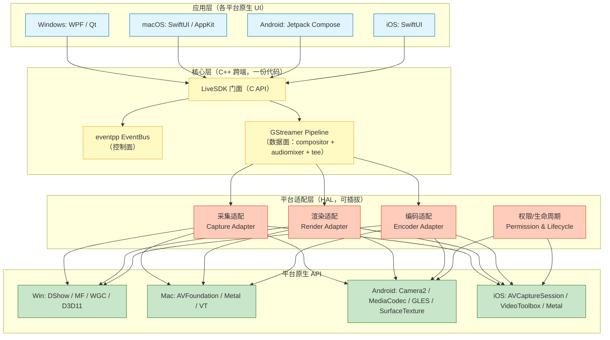

**核心原则**：**"核心跨端 100%，HAL 隔离 100%，UI 各自壳"**——业务代码写一次，硬件差异全部下沉到 HAL。

#### 5.4.4 GStreamer 跨端元素映射对照表

| 能力 | Windows | macOS | Android | iOS |
|------|---------|-------|---------|-----|
| 摄像头采集 | `mfvideosrc` | `avfvideosrc` | `ahcsrc` / `androidcamerasrc` | `avfvideosrc` |
| 屏幕采集 | `d3d11screencapturesrc` | `avfvideosrc device-index=1` | `MediaProjection`（自封 `appsrc`）| ReplayKit（自封 `appsrc`）|
| 麦克风 | `wasapisrc` | `osxaudiosrc` | `openslessrc` / `oboesrc` | `osxaudiosrc` |
| 视频合成 | `compositor` / `glvideomixer` | `glvideomixer` | `glvideomixer` | `glvideomixer` |
| 音频混音 | `audiomixer` | `audiomixer` | `audiomixer` | `audiomixer` |
| 预览渲染 | `d3d11videosink` | `glimagesinkelement` | `glimagesink`（挂 `SurfaceView`）| `glimagesink`（挂 `CAEAGLLayer`）|
| 硬件编码 | `nvh264enc` / `qsvh264enc` / `mfh264enc` | `vtenc_h264` | `amcvidenc-omxgooglecodech264` | `vtenc_h264` |
| 封装/推流 | `flvmux` + `rtmp2sink` | 同 | 同 | 同 |

📝 **只有采集/编码/渲染元素名不同，Pipeline 拓扑与业务代码完全一致**——这就是 GStreamer 跨端的核心红利。

#### 5.4.5 平台适配层（HAL）职责与接口约定

HAL 只承担四类职责，通过 C++ 抽象接口暴露给核心层：

| HAL 接口 | 职责 | 关键方法 |
|---|---|---|
| `ICaptureAdapter` | 创建平台专属的采集 `GstElement`；列出设备；请求权限 | `CreateVideoSource / CreateAudioSource / EnumerateCameras / RequestPermission` |
| `IRenderAdapter` | 创建预览 sink，接收平台窗口句柄（HWND/NSView\*/ANativeWindow\*/CAEAGLLayer\*） | `CreatePreviewSink(nativeWindow) / OnSurfaceChanged` |
| `IEncoderAdapter` | 创建硬件编码器；ABR 热更码率 | `CreateH264Encoder / SupportHardware / SetBitrateRuntime` |
| `IPermissionLifecycle` | 移动端权限请求 + 生命周期 `onPause/onResume/EnterBackground` | 平台专属，PC 端可 no-op |

**工厂选择**：通过编译期宏（`_WIN32` / `__APPLE__` / `TARGET_OS_IOS` / `__ANDROID__`）选择具体实现类；上层业务只依赖抽象接口，四个平台各自实现一份 `.cpp`，其余代码完全共享。

📌 **接口设计原则**：**返回的都是 `GstElement*`**——让 GStreamer Pipeline 层"感受不到"底层平台差异，实现零改动跨端。

#### 5.4.6 跨端必须直面的 5 个差异

| 差异点 | 说明 | HAL 处理策略 |
|--------|------|-------------|
| **权限模型** | Android 6+ 动态权限；iOS `NSCameraUsageDescription`；PC 无 | HAL 提供 `RequestPermission()` 异步回调；核心层订阅 `PermissionGranted/Denied` 事件 |
| **生命周期** | 移动端有 `onPause/onResume/背景挂起`；PC 无 | 核心层暴露 `Pause/Resume/EnterBackground` API；GStreamer 切 `GST_STATE_PAUSED` |
| **GPU 上下文** | Win=D3D11 / Mac & iOS=Metal / Android=EGL；纹理不通用 | 统一走 GStreamer `GstGLContext`；跨模块传纹理**只在 GPU 内**，不走 CPU |
| **音频延迟** | iOS/Mac 低（CoreAudio）；Android 因厂商差异大 | Android 强制走 **Oboe**（低延迟通路）；容忍 40–100ms 音画差，用 PTS 对齐 |
| **热重连** | 移动端切网/切热点频繁 | 网络层独立线程；`Sender` 内建断线重连；`BitrateAdapter` 感知网络切换 |

#### 5.4.7 跨端选型决策树

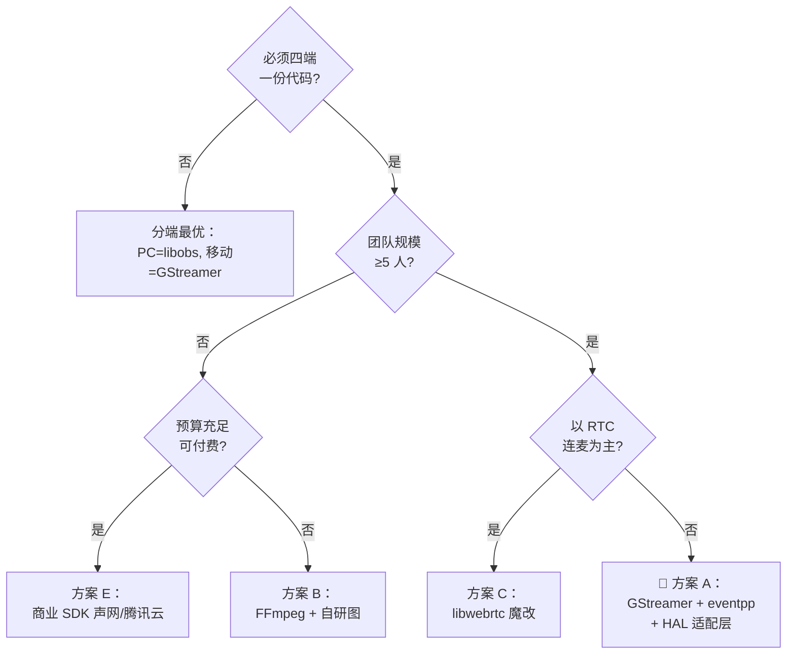

#### 5.4.8 跨端主线一句话建议

> 🌍 **一份 C++ 核心跑四端 → 方案 A（GStreamer + eventpp + HAL 适配层）。**
> 🌍 **求快求稳有预算 → 方案 E（声网/腾讯云 LiteAV/即构 ZEGO）。**
> 🌍 **PC 想极致体验、移动可以妥协 → 方案 D（PC 用 libobs、移动用 GStreamer）。**

### 5.5 三条主线横向对比速查

| 维度 | 🖥️ PC 主线（§5.2） | 📱 移动主线（§5.3） | 🌍 跨端主线（§5.4） |
|------|:-------------------:|:-------------------:|:-------------------:|
| **首选组合** | libobs + eventpp | 系统 API + FFmpeg mini + eventpp | GStreamer + eventpp + HAL |
| **典型包体** | 30–50 MB（桌面可接受） | **1.5–2 MB**（极优） | 10–20 MB/端 |
| **合成/多源** | ✅ 原生 Scene/Item | ⚠️ 需自研（M1）或用 M3 | ✅ compositor/audiomixer |
| **预览 Tee** | ✅ 内建 | ⚠️ 需自写 | ✅ tee 元素 |
| **动态源热插拔** | ✅ | ⚠️ 需自写 | ✅ pad 动态请求 |
| **硬件编码** | NVENC/QSV/VT | MediaCodec/VideoToolbox | 四端全支持 |
| **插件生态** | ✅ OBS 插件极丰富 | ❌ 无 | ⚠️ GStreamer 中等 |
| **许可证** | libobs = GPL-2.0 | LGPL / MIT / 商业 | LGPL |
| **开发工作量** | 低（1–2 人月） | 中–高（3–4 人月） | 中（2–3 人月） |
| **最适合团队** | 桌面直播工具/云导播 | 移动短视频/直播 App | 中大型跨端 App |

---

## 六、通用架构心智模型：Media Pipeline + Event Bus 🌟

无论选 §5.2 PC 主线（libobs）、§5.3 移动主线（系统 API / FFmpeg mini）还是 §5.4 跨端主线（GStreamer），**顶层架构都是这张图**——这是业界最佳实践，也是本文推荐的最终形态。

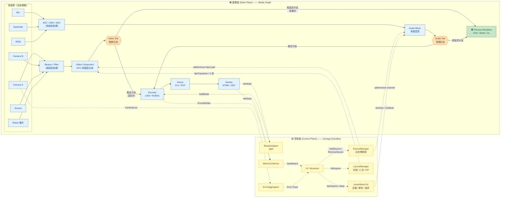

> 📌 **图例**：🟦 蓝 = 数据面节点（高频帧流）；🟨 黄 = 控制面节点（低频信令）；🟩 绿 = 预览专用；🟧 橙 = Tee 分流点。
> 实线（`—▶`）= 数据流；虚线（`- -▶`）= 控制/信令流。

### 6.1 两条通道的分工

| 通道 | 载体 | 传递内容 | 频率 | 顺序 | 背压 |
|------|------|---------|------|------|------|
| **数据面** | Media Graph Pad/Queue/GPU Texture | `Frame` / `AudioBuffer` / `Packet` | 高（30~60 Hz × N 路） | 强序（PTS 单调） | 显式队列水位 |
| **控制面** | EventBus (eventpp) | `AddSource / SetLayout / Mute / Stats / Error / SetBitrate` | 低（< 20 Hz） | 弱序 | 无需 |

### 6.2 Tee 分流的关键设计

预览与推流共享 **Compositor 输出**，但独立背压：

| Tee 分支 | 队列深度 | 满时策略 | 目标 |
|---------|---------|---------|------|
| **→ Preview** | 1~2 帧 | **丢最旧**（宁可预览掉帧也不能拖累推流） | 低延迟渲染，< 60ms |
| **→ Encoder** | 30 帧（≈500ms） | **丢 P/B 保 I** | 稳定编码，不拖预览 |

**实现要点**：Tee 之后**引用计数 +1，GPU 纹理只读共享**，两个分支任一 handler 释放不影响另一路。

### 6.3 动态源的热插拔契约

- **AddSource**：SourceManager 收到 UI 命令 → 创建源对象 → 在数据面 Graph 上调用 `compositor.addInputPad(source)` / `mixer.addChannel(source)` → 启动源工作线程 → 发 `SourceAdded` 广播。
- **RemoveSource**：先在 Graph 上 `pausePad` → 排空该 pad 队列 → 断开 → 停源工作线程 → 释放 GPU/CPU 资源 → 发 `SourceRemoved` 广播。
- **切换/替换**：等价于 Remove + Add，但**通过 LayoutManager 保留同一个 sceneitem slot**，避免 UI 抖动。
- **约束**：Compositor 合成用**主视频时钟**（一般选摄像头 A 或系统时钟）；播片按 PTS 重采样对齐；音频统一 resample 到 48kHz 后再 mix。

---

## 七、参考实现骨架（工程落地要点）

> ⚠️ **本章定位**：本文以**选型**为核心（§四/§五），落地细节因所选框架而异。此处只给出与框架无关的**关键契约与心智模型**，作为参考骨架；深度实现示例请参见 §九 参考资料中的专项文档。

### 7.1 分层系统模块（三色分区）

无论用 libobs、GStreamer 还是自研，工程都应按下面的**三色分区**组织：

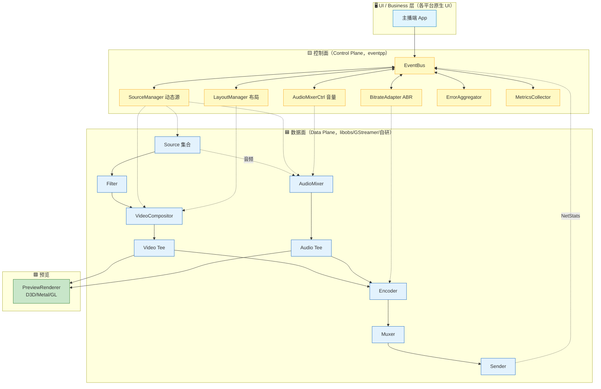

📌 **工程铁律**：**控制面模块不得直接 include 数据面头文件，反之亦然**——两条通道只通过 `EventBus` + 数据面 `Pad/Element` 交互，未来任一层可整体替换。

### 7.2 控制面事件族（心智地图）

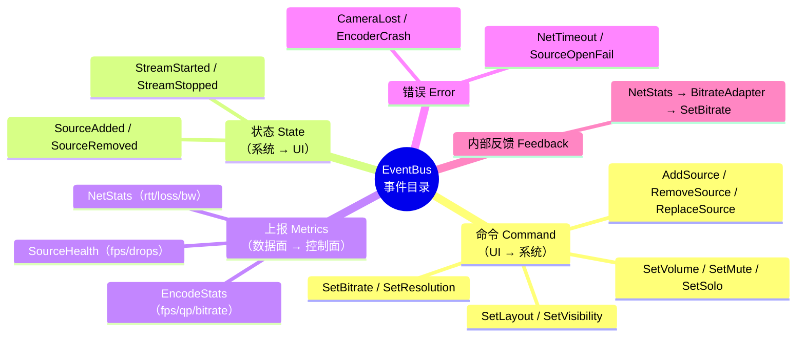

**发布/订阅规约**：
- 事件类型用 POD `struct`，通过 `typeindex` 作 Key 注册；**编译期强类型**，避免字符串 topic。
- 同步派发（`publishSync`）用于埋点/上报；异步队列（`publishAsync`）用于命令/反馈。
- 订阅者析构必须 `ScopedRemover` 自动断连。

### 7.3 数据面关键契约

| 契约 | 内容 |
|---|---|
| **主时钟** | Compositor 用**一个主视频时钟**（通常摄像头 A 或系统时钟），其他源 rebase / resample 对齐 |
| **取最新语义** | Compositor 每路输入只保留"最新一帧"，主时钟到点即合成 |
| **音频周期** | AudioMixer 每 10 ms 一次；所有通道 resample 到 48 kHz/2ch 后 mix |
| **热插拔铁律** | RemoveSource：**先 Stop 源 → 再断 Pad → 再释放对象**（顺序颠倒 = UAF 崩溃） |
| **Tee 分流** | 一进多出，每条分支**独立队列 + 独立满时策略**（见 §7.4） |
| **零拷贝** | Tee 分支之间共享 GPU 纹理引用计数；跨模块传视频**只在 GPU 内**，不 map 回 CPU |

### 7.4 数据面各段队列策略（关键数值口径）

| 段位 | 队列深度 | 满时策略 | 目的 |
|------|:-------:|---|---|
| 源 → 前处理 | 3~5 帧 | 丢最旧 | 快速吸收采集抖动 |
| 前处理 → Compositor 输入 pad | 2 帧 | 丢最旧 | 保实时合成 |
| Compositor → Tee | 1 | 覆盖 | 合成器"取最新" |
| **Tee → Preview** | **1~2 帧** | **丢最旧** | **低延迟 < 60ms** |
| **Tee → Encoder** | **30 帧（≈500ms）** | **丢 P/B 保 I / 阻塞上游** | **稳定编码 + 触发降码率** |
| 编码 → 封装 | 60 | 触发 `NetTimeout` | 网络异常检测 |
| 封装 → 发送 | 1~3s 抖动缓冲 | 触发降码率 | ABR 上游信号 |
| 音频源 → Mixer 通道 | 100ms 环形 | 丢最旧 | 吸收采集抖动 |
| Mixer → Tee | 20~40ms 环形 | 覆盖 | 保持低延迟 |

📌 **核心口径**：**预览浅+丢最旧、推流深+阻塞**——这是 OBS Studio / GStreamer 的一致做法，也是 §六 Tee 分流设计的具体数值化。

### 7.5 ABR 闭环反馈回路

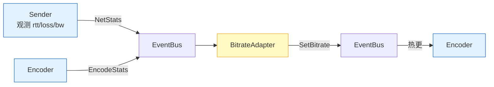

**决策阈值参考**（实际用 GCC/BBR）：`loss>5%` → ×0.7；`rtt>400ms` → ×0.8；`bw` 持续回暖 5s → ×1.1；`qp>40` 持续 3s → 降分辨率。**执行走 EventBus 而非直接 API**，方便旁路埋点、AB 实验、算法替换。

### 7.6 三条主线落地对照

| 模块 | PC 主线（libobs） | 移动主线（系统 API+FFmpeg mini） | 跨端主线（GStreamer） |
|------|---|---|---|
| Source | `obs_source` | 自研 `Camera2Wrapper` / `AVCaptureSessionWrapper` | `mfvideosrc` / `avfvideosrc` / `ahcsrc` 等 |
| Filter | `obs_source_filter` | 自研 GLES/Metal Shader | `gleffects` / 自研 element |
| Compositor | `obs_scene` + `obs_sceneitem` | 自研 GLES/Metal 合成器 | `compositor` / `glvideomixer` |
| Mixer | `audio_mixer`（内建） | 自写 PCM 混音 | `audiomixer` |
| Tee | `obs_source_get_signal_handler` 广播 | 自写 SPSC + 引用计数 | `tee` element |
| Encoder | `obs_encoder` 抽象 | `MediaCodec` / `VideoToolbox` 原生 | `nvh264enc` / `vtenc_h264` / `amcvidenc-*` |
| Muxer/Sender | `obs_output` | FFmpeg `libavformat` + `rtmp` protocol | `flvmux` + `rtmp2sink` |
| EventBus | libobs `signal_handler` 或 eventpp | eventpp（Header-Only） | eventpp（Header-Only） |

📌 **上层业务只依赖 §7.1 分层结构与 §7.2 事件目录**；换主线时**只需替换数据面组件**，控制面代码几乎零改动。

---

## 八、性能与踩坑清单

### 8.1 性能基线（压测目标）

| 指标 | 目标值 |
|------|--------|
| 预览端到端延迟（采集 → 屏幕） | < 60 ms |
| 推流端到端延迟（采集 → RTMP first byte） | < 200 ms |
| 单帧 EventBus 派发耗时 | < 5 µs |
| 数据面 SPSC 入队/出队 | < 100 ns |
| 控制面事件量 | < 100 Hz 汇总 |
| Compositor 单帧合成耗时（1080p60，8 图层，GPU） | < 5 ms |
| AudioMixer 单周期（10ms，8 路） | < 500 µs |
| CPU 占用（1080p60 x264 medium + 8 源） | 双核 < 80% |

### 8.2 八大踩坑

1. ❌ **别把 `Frame*` 通过 Event Bus 传** —— 引用计数漂移，随时 UAF。
2. ❌ **别在 EventBus handler 里做重计算/渲染** —— 会拖慢发布者线程。
3. ❌ **别用字符串 topic** —— 编译期错不出，运维靠猜。
4. ❌ **别混用同步/异步分发而不加注释** —— 死锁高发地。
5. ❌ **别忘了 eventpp 的 `ScopedRemover`** —— 组件析构必须自动断连。
6. ❌ **别让预览队列跟推流队列共用** —— 预览必须丢得起、推流必须稳。
7. ❌ **别忘了在 RemoveSource 前排空 pad 队列** —— 否则合成器可能引用已释放的 Frame。
8. ❌ **多源合成时别用"各自时钟"** —— 必须选一个**主时钟**（通常摄像头 A 或系统时钟），其他源 rebase / resample 对齐。

### 8.3 可观测性建议

- 每个 Node/Pad 暴露 `stats()` → `input_queue_size / output_fps / drop_count / avg_latency`
- 每路 Source 每秒发一次 `SourceHealth`，UI 可显示"源健康度"红/黄/绿灯
- 控制面接入 Prometheus，把 `NetStats / EncodeStats / SourceHealth` 打成 metric
- 每个订阅回调用 `perf::scope_timer` 度量耗时，超阈值告警

---

## 九、参考资料

- 📘 [进程内事件总线-优秀开源库汇总](进程内事件总线-优秀开源库汇总.md)
- 📘 [FFmpeg源码学习指南](FFmpeg源码学习指南.md)
- 📘 [GStreamer源码学习指南](GStreamer源码学习指南.md)
- 📘 [开播侧画面采集设计与实现](开播侧画面采集设计与实现.md)
- 📘 [开播侧-采集端音画同步设计与实现](开播侧-采集端音画同步设计与实现.md)
- 📘 [屏幕画面采集 —— 完整技术指南](屏幕画面采集%20——%20完整技术指南.md)
- 📘 [视频编码码控深入浅出-九大开源编码器对比与统一模型](视频编码码控深入浅出-九大开源编码器对比与统一模型.md)
- 🔗 [OBS Studio (libobs) 源码](https://github.com/obsproject/obs-studio)
- 🔗 [GStreamer — compositor / audiomixer / tee 元素](https://gstreamer.freedesktop.org/documentation/plugins.html)
- 🔗 [WebRTC Architecture](https://webrtc.googlesource.com/src/+/refs/heads/main/docs/native-code/architecture.md)
- 🔗 [Enterprise Integration Patterns — Pipes and Filters](https://www.enterpriseintegrationpatterns.com/patterns/messaging/PipesAndFilters.html)
- 🔗 [Game Programming Patterns — Event Queue](https://gameprogrammingpatterns.com/event-queue.html)

---

> ✨ **一句话总结**：面向不同目标平台选对主线 —— **🖥️ PC = libobs｜📱 移动 = 系统 API + FFmpeg mini｜🌍 跨端 = GStreamer + HAL**；三条主线共享同一套心智模型：**数据面走 Media Graph（Compositor / Mixer / Tee）+ 控制面走 Event Bus（eventpp）+ 预览/推流 Tee 独立背压**——这是 OBS Studio / GStreamer / WebRTC 的共同答案。
