# 统一消息总线 (UMB) —— 开播与播放器一体化实现方案

**作者**：汪亮（bertonwang）
**邮箱**：<47608843@qq.com>
**版本**：v1.0 ｜ **最后更新**：2026-08-13

> **本文定位**：与《直播开播端-Pipeline与事件总线-选型与实现方案》《播放器-Pipeline与事件总线-选型与实现方案》并列的**第三种架构选择**——用**一条统一消息总线（Unified Message Bus, UMB）**同时承载**数据流与控制流**，让开播端与播放器共享同一套心智模型和运行时。
>
> **适用团队**：中小型（3–8 人）、追求快速迭代、可接受"性能够用而非极致"、想要一套代码兼顾开播+播放的场景。
> **不适用场景**：4K60 HDR 顶级画质、超低延迟 RTC（< 300ms）、多路 8K 混流——请回到双通道方案。

---

## 📋 目录

- [一、结论速览（TL;DR）](#一结论速览tldr)
- [二、可行性论证：为什么"数据+命令同 Bus"能成立](#二可行性论证为什么数据命令同-bus-能成立)
- [三、UMB 核心概念与心智模型](#三umb-核心概念与心智模型)
- [四、七条硬约束（违反则崩）](#四七条硬约束违反则崩)
- [五、Topic 命名规范与消息模型](#五topic-命名规范与消息模型)
- [六、开播端一体化架构（含动态图、预览组合、音画同步）](#六开播端一体化架构含动态图预览组合音画同步)
- [6.6 开播端音画同步工程化参考模型](#66-开播端音画同步工程化参考模型)
- [七、播放器一体化架构（含音画同步）](#七播放器一体化架构含音画同步)
- [八、库选型与内核实现要点](#八库选型与内核实现要点)
- [九、性能预算与基线](#九性能预算与基线)
- [十、迁移路径与与前两篇的关系](#十迁移路径与与前两篇的关系)
- [十一、踩坑清单](#十一踩坑清单)
- [十二、参考资料](#十二参考资料)

---

## 一、结论速览（TL;DR）

### 1.1 一句话方案

> ⭐ **用一条 Topic 路由 + 有界队列 + 单一 Owner 线程 + 零拷贝句柄的消息总线（UMB），同时承担所有数据流与控制流。**

### 1.2 核心决策一览

| # | 决策点 | 采用方案 | 关键理由 |
|:---:|---|---|---|
| D1 | 用一条 Bus 还是两条通道？ | **一条 UMB** | 心智统一、代码复用 |
| D2 | Bus 语义 | **Topic 路由**（非广播） | 只有订阅方收，天然按源过滤 |
| D3 | 数据传递 | **`shared_ptr<Buffer>` / GPU 句柄 + 对象池** | 零拷贝 + 内存复用 |
| D4 | 顺序保证 | **每 Topic 独立 MPSC 队列 + 单一 Owner 线程消费** | 天然 FIFO |
| D5 | 背压 | **有界队列 + 三种策略**（Block/DropOldest/DropNewest） | 显式水位 |
| D6 | 主时钟 (AudioClock) | **原子共享变量，不走 Bus** | 抖动 < 100 ns |
| D7 | 硬解 GPU 数据 | **Bus 传句柄，Renderer 直采纹理** | 零拷贝、低功耗 |
| D8 | **动态源/图构建** | **SourceManager + 运行期 declareTopic/subscribe** | 支持热插拔 |
| D9 | **预览** | **Bus 上挂

### 1.3 一图看懂

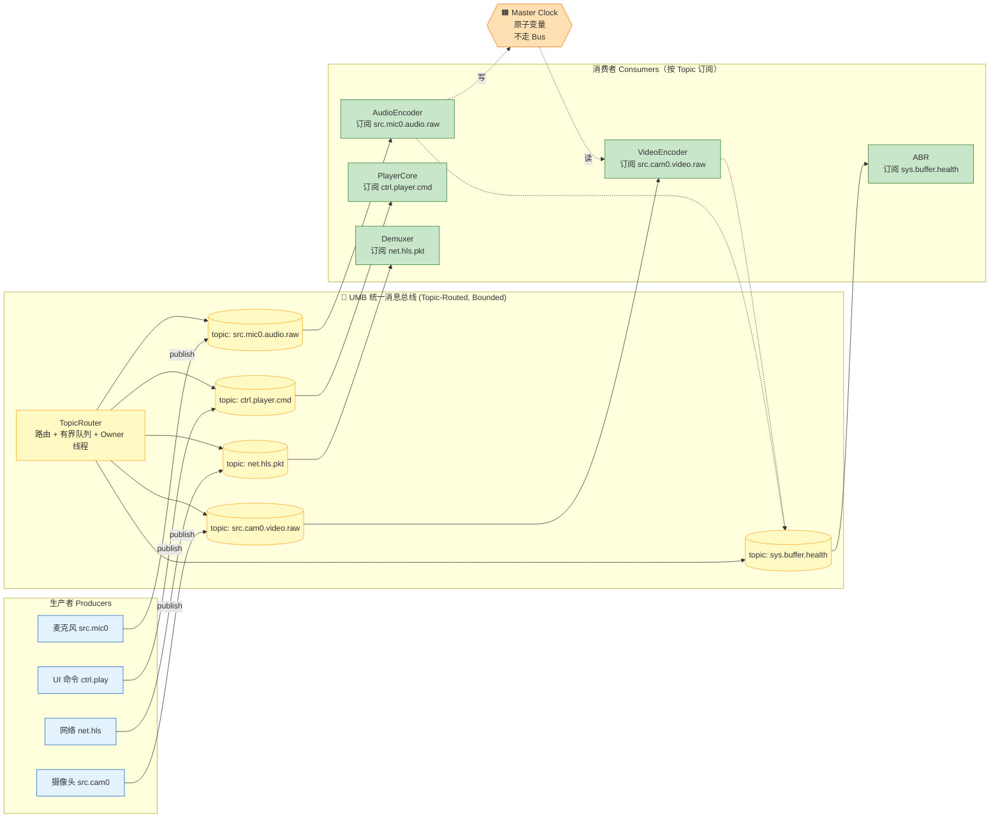

### 1.4 你的原始思考 → 我的对应设计

| 你的假设 | 对应的 UMB 设计 |
|---|---|
| ① 每秒音视频包不多 | ✅ 30–200 pkt/s → Bus 路由 + 单个 Handler 派发 < 5 µs 完全够用 |
| ② 数据+命令走同 Bus | ✅ 统一 API `publish/subscribe`，内部按 Topic 分级调度 |
| ③ 按数据源过滤 | ✅ **用 Topic 名字过滤而非 Handler 内 if**（例：`src.cam0.video.raw`） |
| ④ 走同一 Bus 逻辑清晰 | ✅ 心智统一：所有交互皆消息，Producer/Consumer 完全解耦 |

### 1.5 本轮新增三大主题（本次强化点）

| 主题 | 承接章节 | 一句话说明 |
|:---:|:---:|---|
| 🅰️ **零拷贝 + 内存复用** | §5.3 / §5.4 | Bus 只传 `shared_ptr`，配自定义 deleter 把 Buffer 归还对象池——**永不 malloc/free 稳态运行** |
| 🅱️ **动态图（源热插拔）** | §6.3 | SourceManager 集中管理 Add/Remove；`declareTopic + subscribe` 是运行期 API；订阅表变化即图变化 |
| 🅲️ **预览 = 播放器组件零胶水复用** | §6.4 / §6.4.5 | Preview 直接复用播放器的 `VideoRenderer/AudioRenderer` 类，只换 Topic + 时钟源；**零新渲染代码** |
| 🅳️ **音画同步双方案** | §6.5（开播） / §7.3（播放器） | 开播：**合成端对齐**（CompositeClock + PTS）；播放：**渲染端追赶**（AudioClock + 分级策略） |

---

## 二、可行性论证：为什么"数据+命令同 Bus"能成立

### 2.1 频率与体积的量化分析

| 消息类型 | 频率 | 单包大小 | 每秒吞吐 | Bus 是否吃得下？ |
|---|:---:|:---:|:---:|:---:|
| **压缩视频包** (1080p60 H.264 @ 5Mbps) | 60 pkt/s | ~10 KB | 600 KB/s | ✅ 完全够 |
| **压缩音频包** (AAC 128kbps) | 50 pkt/s | ~330 B | 16 KB/s | ✅ |
| **原始 YUV420 视频帧** (1080p60) | 60 pkt/s | **3 MB** | **180 MB/s** | ⚠️ **必须传 `shared_ptr`，不能拷贝** |
| **原始 PCM 音频帧** (48kHz 立体声 10ms) | 100 pkt/s | 3.8 KB | 380 KB/s | ✅ |
| **硬解 GPU 纹理句柄** | 60 pkt/s | **8 字节** | 480 B/s | ✅ 只传句柄 |
| **播控命令** | < 5 Hz | < 100 B | ~500 B/s | ✅ |
| **状态/上报** | 1–20 Hz | < 500 B | < 10 KB/s | ✅ |

📌 **关键洞察**：**数据走 Bus 是否可行，取决于是否值拷贝**。只要遵循硬约束 **C1（只传引用/句柄）**，Bus 的负载天花板由 CPU 派发开销决定，而不是内存带宽——**60 fps × 5 µs/派发 = 300 µs/秒 = 0.03% CPU**，完全无压力。

### 2.2 顺序、背压、零拷贝的实现路径

| 挑战 | 传统 Bus 做不到 | UMB 的解法 |
|---|---|---|
| **顺序保证** (DTS/PTS 单调) | 广播 + 多线程 handler 抢锁 → 乱序 | **每 Topic 独立 MPSC 队列 + 绑定 Owner 线程消费**（Actor 语义）|
| **背压** (下游慢 → 上游停) | 推模型无反馈 → OOM | **有界队列** + `full → block / drop`，producer 感知满即停 |
| **零拷贝** (硬解直通渲染) | 值拷贝 → 强制 map 回 CPU | 消息只装 `shared_ptr<GpuTexture>` 引用，纹理生命周期由智能指针管理 |
| **多路合成对齐** | 广播天然无对齐 | Compositor 订阅多路 Topic + **各路水位监控 + 主时钟对齐** |
| **Seek 原子性** | Bus 全局清空困难 | **Topic 独立 `flush(epoch)` API**，Owner 线程在 flush 后只处理当前 epoch 消息 |

### 2.3 一个"看起来纯 Bus，实则内含 Graph 语义"的架构

📌 **本质透视**：UMB 表面是"一条 Bus"，内部实现是"**Topic 路由的有界 MPSC 队列 + Owner 线程 + Epoch 屏障**"——这正是 **Actor Model / ROS 2 / Erlang** 的核心特征。所以：

> **UMB ≈ Topic-Routed Bounded Actor Bus**
> 它不是传统 pub/sub Event Bus，也不是纯 Media Graph；它是**两者的最小公倍数**：对上层像 Bus 一样简洁，对底层像 Graph 一样保序、有背压、零拷贝。

---

## 三、UMB 核心概念与心智模型

### 3.1 五个核心概念

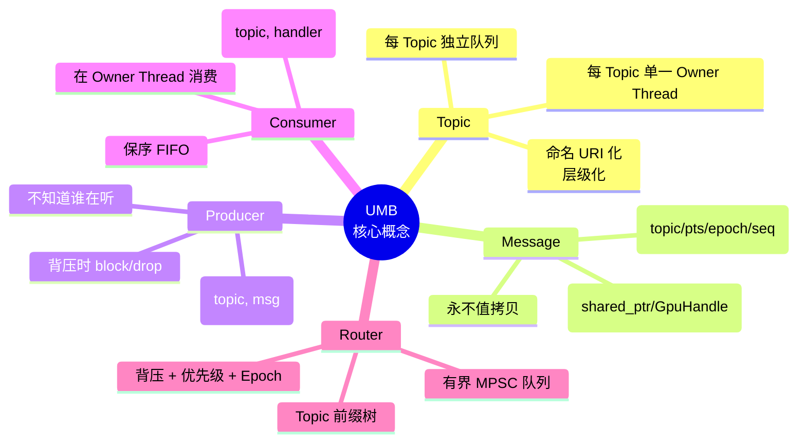

### 3.2 与前两篇架构的心智对比

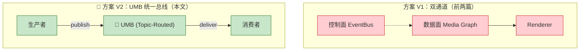

| 维度 | V1 双通道 | V2 UMB |
|---|---|---|
| API 数量 | 2 套（Queue + Bus） | **1 套**（`publish/subscribe`） |
| 数据传递 | 显式 Queue | **消息（含引用）** |
| 控制传递 | Bus | **消息** |
| 新人学习曲线 | 陡（要理解两套） | **缓（一套心智）** |
| 极致性能上限 | 高 | 中高（够用） |
| 组件解耦度 | 高 | **极高**（连数据都不知道谁生产/消费） |
| 调试难度 | 中 | **低**（一处日志看全流量） |

📌 **心智收益**：新人只需理解"**发消息 / 订阅消息**"，即可开发任何 Node；老手在 Bus 上挂一个 `MessageInspector` 就能看到全链路流量，调试和埋点极为方便。

---

## 四、七条硬约束（违反则崩）

| 约束 | 内容 | 违反后果 |
|:---:|---|---|
| **C1** | 数据消息**只传 `shared_ptr<Buffer>` / `GpuHandle` / `HwFrameRef`**，禁止值拷贝；**配合 `BufferPool` + 自定义 deleter 稳态零分配**（见 §5.4） | 60fps × 3MB = 180 MB/s 内存流量，缓存爆炸 |
| **C2** | 每个 Topic **独立 MPSC 有界队列**，Bus 内部按 Topic 路由（非广播） | 无法保序、无法背压 |
| **C3** | 每个 Topic 有 **`max_depth` + `overflow_policy`（Block / DropOldest / DropNewest）** | 无背压 → OOM |
| **C4** | 每个 Topic 有**单一 Owner Thread** 消费；跨线程通过 Bus 而非直接锁 | 竞争、乱序、死锁 |
| **C5** | 主时钟（Audio Clock）**用 `std::atomic<int64_t>` 共享，不走 Bus** | 抖动 100µs+ |
| **C6** | 硬解 GPU 纹理**只在 Bus 上传句柄**，Renderer 侧再拿纹理，禁止 map 回 CPU | 功耗翻倍、延迟增加 |
| **C7** | **命令类 Topic 走同步派发**（发布者线程直接调 handler）；**数据类 Topic 走异步队列** | 同步派发数据 → 阻塞采集线程 |

### 4.1 约束的物化：Topic 声明表

每个 Topic 在项目启动时集中声明，编译期或启动期校验：

| Topic 名字 | Payload 类型 | Owner Thread | max_depth | 溢出策略 | 派发模式 |
|---|---|:---:|:---:|:---:|:---:|
| `src.cam0.video.raw` | `shared_ptr<GpuFrame>` | Encoder-Thread | 3 | DropOldest | Async |
| `src.mic0.audio.raw` | `shared_ptr<AudioBuffer>` | Encoder-Thread | 20 | Block | Async |
| `enc.video.h264` | `shared_ptr<AVPacket>` | Muxer-Thread | 30 | Block | Async |
| `enc.audio.aac` | `shared_ptr<AVPacket>` | Muxer-Thread | 50 | Block | Async |
| `ctrl.player.cmd` | `PlayCmd` (POD) | Player-Thread | 16 | Block | **Sync** |
| `ctrl.source.mgr` | `SourceCmd` (POD) | Pipeline-Thread | 16 | Block | **Sync** |
| `sys.buffer.health` | `BufferHealth` (POD) | ABR-Thread | 4 | DropOldest | Async |
| `sys.render.stats` | `RenderStats` (POD) | Metrics-Thread | 4 | DropOldest | Async |
| `sys.error` | `ErrorInfo` | Any (fanout) | 16 | Block | **Sync** |

📌 **Topic 声明表就是架构文档**——所有队列策略、线程归属、背压行为集中一览。

---

## 五、Topic 命名规范与消息模型

### 5.1 Topic 命名规范（URI 风格 + 层级化）

```
{domain}.{source_id}.{stream_type}.{stage}[.{tag}]
  |         |             |            |         |
  |         |             |            |         └── 可选标签（如 preview/main）
  |         |             |            └── 阶段（raw / encoded / muxed）
  |         |             └── 数据流类型（video / audio / subtitle / data）
  |         └── 源 ID（cam0 / mic0 / hls_main）
  └── 领域（src / enc / mux / net / ctrl / sys）
```

**示例**：

| Topic | 含义 |
|---|---|
| `src.cam0.video.raw` | 摄像头 0 的原始视频帧 |
| `src.mic0.audio.raw` | 麦克风 0 的原始 PCM |
| `src.cam0.video.encoded.preview` | 摄像头 0 编码后的**预览**分支（低码率） |
| `src.cam0.video.encoded.main` | 摄像头 0 编码后的**主**分支（推流） |
| `enc.video.h264` | 混合视频合成 + 编码后的 H.264 包（推流用） |
| `net.hls.pkt` | 播放器：HLS 拉流的解封装包 |
| `ctrl.player.cmd` | 播放器控制命令（Play/Pause/Seek） |
| `ctrl.source.mgr` | 开播端：AddSource/RemoveSource |
| `sys.buffer.health` | 缓冲区健康度 |
| `sys.error` | 全局错误 |

📌 **过滤天然发生在 Topic 层面**——`SubtitleRenderer` 只订阅 `src.*.subtitle.parsed`，永远收不到视频帧；这就是你思路里 **"按数据源过滤"** 的最佳实现。

### 5.2 消息结构

```cpp
struct Header {
    std::string_view topic;   // 从 Topic Table 常量池借用，零拷贝
    int64_t pts_us;           // 微秒 PTS（视频/音频/字幕通用）
    int64_t dts_us;           // 微秒 DTS（可选）
    uint32_t seq;             // 单 Topic 内单调序号（校验保序）
    uint32_t epoch;           // Seek/Reset 世代号
    uint32_t source_id;       // 冗余的源 ID（快速匹配）
    uint8_t  priority;        // 优先级（0=最高）
    uint8_t  flags;           // KeyFrame / EndOfStream / Discontinuity
};

template<typename Payload>
struct Message {
    Header header;
    std::shared_ptr<const Payload> payload;   // 🔑 引用而非值
};
```

**Payload 常见类型**：
- `GpuFrame`：`{ platform_handle, format, w, h, colorspace }`
- `AudioBuffer`：`{ shared_ptr<uint8_t[]> data, samples, sr, ch, fmt }`
- `AVPacket`（FFmpeg 原生）：已引用计数
- `PlayCmd`：`enum {Play, Pause, Seek, SetRate} + params`

### 5.3 生命周期与引用计数

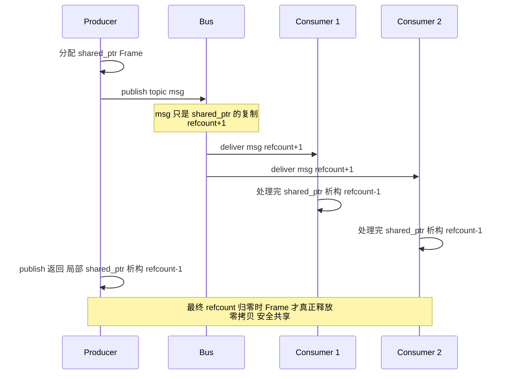

### 5.4 零拷贝 + 内存复用：shared_ptr × 对象池

> 🎯 **回答你的第 ① 点**：Bus 上传输数据**必须**用 `shared_ptr`（或 GPU 句柄），并且通过**自定义 deleter 把 Buffer 归还对象池**，做到稳态运行零 malloc/free。

#### 5.4.1 三层内存模型

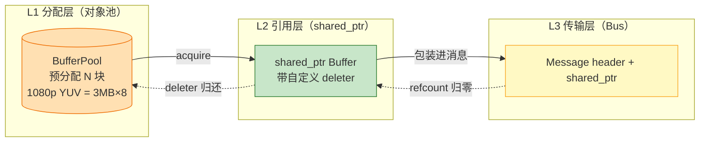

#### 5.4.2 参考实现

```cpp
class BufferPool {
    std::vector<std::unique_ptr<Buffer>> free_list_;
    std::mutex mu_;
public:
    // 从池取一块，包装为 shared_ptr，deleter 负责归还
    std::shared_ptr<Buffer> acquire() {
        std::unique_ptr<Buffer> raw;
        {
            std::lock_guard g(mu_);
            if (free_list_.empty()) raw = std::make_unique<Buffer>(kSize);
            else { raw = std::move(free_list_.back()); free_list_.pop_back(); }
        }
        return std::shared_ptr<Buffer>(raw.release(), [this](Buffer* p) {
            std::lock_guard g(mu_);
            free_list_.emplace_back(p);  // ⭐ 归还，不 delete
        });
    }
};
```

#### 5.4.3 三种载荷的复用策略

| 载荷类型 | 池化方式 | 命中率目标 |
|---|---|:---:|
| **CPU YUV/PCM Buffer** | `BufferPool` 预分配 8–16 块 | > 99% |
| **GPU 纹理** (D3D11/Metal/OpenGL) | `TexturePool` 按 (w,h,fmt) 分池 | > 99% |
| **`AVPacket` / `AVFrame`** | FFmpeg 自带 `av_packet_alloc` + 引用计数 | 天然 |

📌 **关键收益**：稳态下 **`new/delete = 0`**，内存占用被 Pool 的容量硬性框住，也就把 Bus 背压转化为**Pool 空转 → Producer acquire 阻塞**——**背压天然落到数据源头**，比事后 OOM 更可控。

---

## 六、开播端一体化架构（含动态图、预览组合、音画同步）

### 6.1 分层结构

```mermaid
flowchart TB
    subgraph UI["🖥️ UI 层"]
        UIC["UI 组件"]
    end
    subgraph UMB["🌈 UMB 统一消息总线"]
        BUS["TopicRouter"]
    end
    subgraph SRC["生产者节点"]
        CAM["CameraCapture"]
        MIC["MicCapture"]
        SCR["ScreenCapture"]
        UIN["UIInput"]
    end
    subgraph PROC["处理节点"]
        VMIX["VideoCompositor"]
        AMIX["AudioMixer"]
        VENC["VideoEncoder"]
        AENC["AudioEncoder"]
        MUX["Muxer"]
    end
    subgraph OUT["输出节点"]
        RTMP["RTMPSender"]
        PREV["PreviewRenderer"]
    end
    subgraph SIDE["旁路"]
        SM["SourceManager"]
        ABR["ABRController"]
        MET["Metrics"]
    end

    UIC -->|publish ctrl.*| BUS
    CAM -->|publish src.cam0.video.raw| BUS
    MIC -->|publish src.mic0.audio.raw| BUS
    SCR -->|publish src.scr0.video.raw| BUS
    BUS -->|src.*.video.raw| VMIX
    BUS -->|src.*.audio.raw| AMIX
    VMIX -->|publish mix.video.raw| BUS
    AMIX -->|publish mix.audio.raw| BUS
    BUS -->|mix.video.raw| VENC & PREV
    BUS -->|mix.audio.raw| AENC
    VENC -->|publish enc.video.h264| BUS
    AENC -->|publish enc.audio.aac| BUS
    BUS -->|enc.*| MUX
    MUX -->|publish mux.flv| BUS
    BUS -->|mux.flv| RTMP
    BUS -->|ctrl.source.mgr| SM
    BUS -->|sys.buffer.health, net.stats| ABR
    ABR -->|publish ctrl.encoder.bitrate| BUS
    BUS -->|ctrl.encoder.bitrate| VENC
    BUS -->|sys.*| MET

    classDef ui fill:#E1F5FE,stroke:#0277BD;
    classDef bus fill:#FFF9C4,stroke:#F9A825;
    classDef src fill:#E3F2FD,stroke:#1565C0;
    classDef proc fill:#C8E6C9,stroke:#2E7D32;
    classDef out fill:#FFCCBC,stroke:#D84315;
    classDef side fill:#F3E5F5,stroke:#6A1B9A;
    class UIC ui;
    class BUS bus;
    class CAM,MIC,SCR,UIN src;
    class VMIX,AMIX,VENC,AENC,MUX proc;
    class RTMP,PREV out;
    class SM,ABR,MET side;
```

### 6.2 Topic 声明表（开播）

| Topic | Payload | Owner | max_depth | 溢出 | 派发 |
|---|---|:---:|:---:|:---:|:---:|
| `src.cam*.video.raw` | `shared_ptr<GpuFrame>` | Compositor-Thread | 3 | DropOldest | Async |
| `src.mic*.audio.raw` | `shared_ptr<AudioBuffer>` | Mixer-Thread | 20 | Block | Async |
| `mix.video.raw` | `shared_ptr<GpuFrame>` | Encoder-Thread | 3 | DropOldest | Async |
| `mix.audio.raw` | `shared_ptr<AudioBuffer>` | Encoder-Thread | 20 | Block | Async |
| `mix.video.preview` | `shared_ptr<GpuFrame>` | UI-Thread | 2 | **DropOldest** | Async |
| `enc.video.h264` | `shared_ptr<AVPacket>` | Muxer-Thread | 30 | Block | Async |
| `enc.audio.aac` | `shared_ptr<AVPacket>` | Muxer-Thread | 50 | Block | Async |
| `mux.flv` | `shared_ptr<Buffer>` | Sender-Thread | 60 | Block | Async |
| `ctrl.source.mgr` | `SourceCmd` | Pipeline-Thread | 16 | Block | **Sync** |
| `ctrl.encoder.bitrate` | `int` | Encoder-Thread | 4 | DropOldest | Async |
| `sys.buffer.health` | `BufferHealth` | ABR-Thread | 4 | DropOldest | Async |

### 6.3 动态图：源的实时增减 & Pipeline 热构建

> 🎯 **回答你的第 ② 点**：开播时经常要**动态加/减摄像头、麦克风、屏幕采集、外部 RTMP 拉流**。UMB 的 Topic 是运行期可声明/订阅的，**图（Pipeline）就是"当前活跃 Topic + 订阅关系"**——`SourceManager` 一处集中改，全图自动生效。

#### 6.3.1 心智模型：图 = 订阅表快照

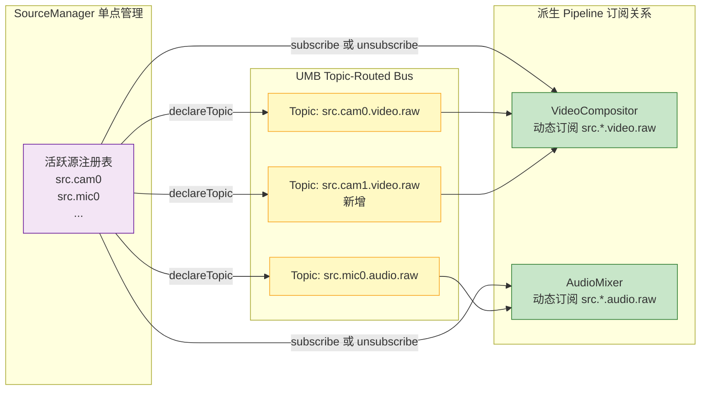

📌 **本质**："动态构图" ≡ "**改订阅表**"。没有额外的图对象、没有"重连管线"的复杂性；Mixer/Compositor 只关心当前订阅列表，与源的动态变化完全解耦。

#### 6.3.2 源的生命周期状态机

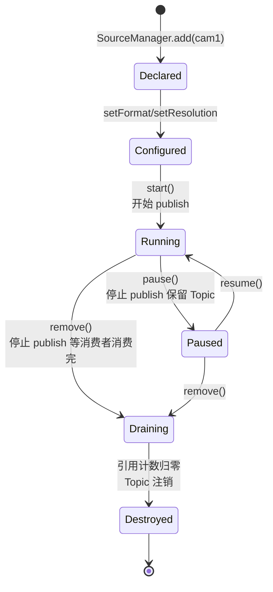

📌 **关键点**：
- **Declared → Configured** 阶段允许**热配置**（改分辨率、帧率），此时 Bus 上无数据流动；
- **Draining** 阶段**先停 producer，再等 refcount 归零**才注销 Topic，避免消费者半程崩溃；
- 每次状态迁移都以 `ctrl.source.mgr` 命令为唯一入口，**审计与回放友好**。

#### 6.3.3 完整时序：动态加一路摄像头 → 稳定推流 → 动态移除

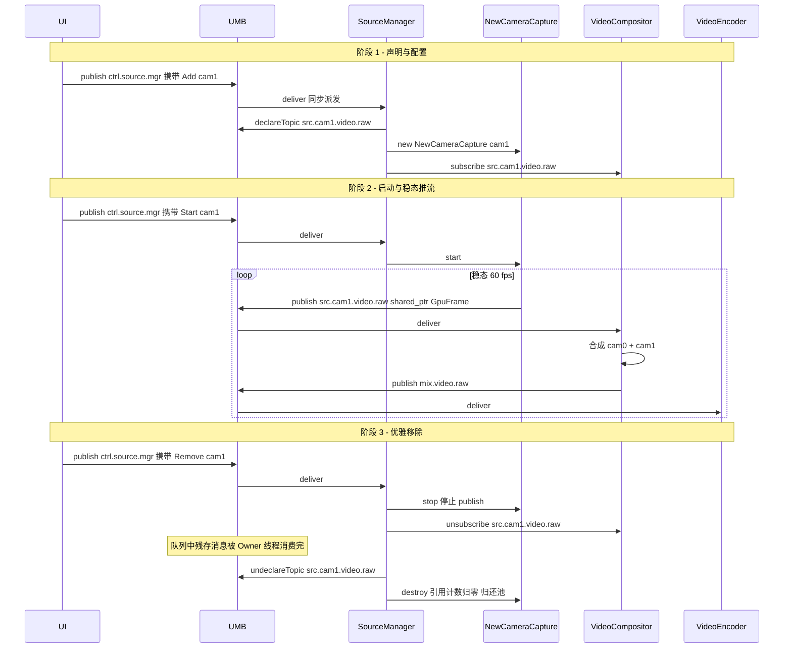

#### 6.3.4 SourceManager 契约（API 骨架）

| API | 语义 | 触发的 Bus 动作 |
|---|---|---|
| `add(src_desc)` | 声明新源，未启动 | `declareTopic("src.<id>.<type>.raw")` |
| `configure(id, cfg)` | 修改分辨率/帧率/编码参数 | 无（仅本地状态） |
| `start(id)` | 启动 producer 循环 | Producer 开始 `publish` |
| `pause(id)` | 暂停但保留 Topic | Producer 停 publish；Topic 保留 |
| `remove(id)` | 优雅移除 | stop → drain → unsubscribe → undeclareTopic |
| `listActive()` | 获取当前所有活跃源 | 只读 |

📌 **一处管理，全链路自动响应**——UI 只与 `SourceManager` 打交道；下游节点（Mixer/Compositor/Encoder）通过订阅通知获得图变化，无需感知源的具体身份。

---

### 6.4 预览：Bus 上的迷你播放器

> 🎯 **回答你的第 ③ 点**：开播预览本质就是"**把送去编码器的画面/声音同时送去本地渲染**"。在 UMB 上挂预览 = **挂一个迷你播放器**，**完全复用第七章播放器的 `VideoRenderer + AudioRenderer + Master Clock` 心智**——不用重造轮子。

#### 6.4.1 预览挂载模型：Tee 分流

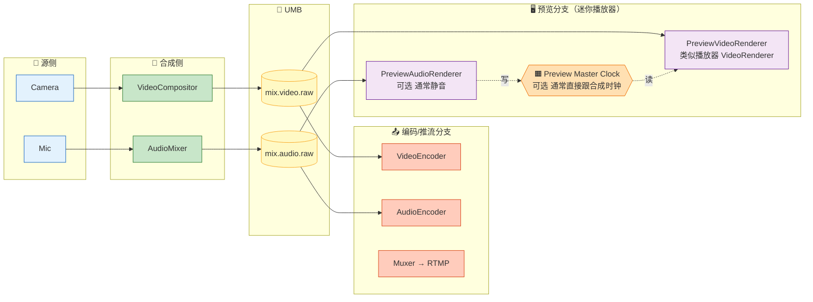

📌 **核心洞察**：`mix.video.raw` / `mix.audio.raw` **一个 Topic 挂两个订阅者**——`VideoEncoder`（编码推流）与 `PreviewVideoRenderer`（本地预览）。这是 UMB 中**唯一允许多订阅者的数据类 Topic**（因为两者都是只读消费者，无写冲突）。

#### 6.4.2 预览与播放器的心智对照

| 组件 | 播放器（§7） | 开播预览（本节） | 复用度 |
|---|---|---|:---:|
| 视频渲染 | `VideoRenderer`（订阅 `post.video`） | `PreviewVideoRenderer`（订阅 `mix.video.raw`）| **95%** |
| 音频渲染 | `AudioRenderer`（订阅 `post.audio`） | `PreviewAudioRenderer`（可选，通常静音） | 90% |
| 主时钟 | Audio Clock（音频驱动） | 通常直接用合成时钟（因合成时已同步） | 简化 |
| Seek | 有 | **无**（直播场景无 Seek） | — |
| ABR | 有 | **无** | — |

📌 **实现建议**：把播放器的 `VideoRenderer` 抽成一个**只依赖"一个视频 Topic + 一个可选时钟源"**的通用组件——**播放器和开播预览共享同一个类**，只是构造参数不同：

```cpp
// 播放器场景
auto player_vr = VideoRenderer::create({
    .video_topic = "post.video",
    .clock_source = ClockSource::AudioMaster,
});

// 开播预览场景
auto preview_vr = VideoRenderer::create({
    .video_topic = "mix.video.raw",     // ⭐ 只是 Topic 换了
    .clock_source = ClockSource::Immediate,  // 无需音画同步
});
```

#### 6.4.3 预览的三种典型模式

| 模式 | Topic 订阅 | 场景 | 备注 |
|---|---|---|---|
| **① 主输出预览**（Program） | 订阅 `mix.video.raw` | 主播看自己推流的最终画面 | 最常见 |
| **② 单源预览**（Source Preview） | 订阅 `src.cam0.video.raw` 等单路 | 导播切换前预览各机位 | 常见于多机位场景 |
| **③ 编码后预览**（Post-encode） | 订阅 `enc.video.h264` + 本地解码器 | 排查编码质量问题 | 调试用 |

📌 **模式①/②的关键差异**：模式①的画面**已经过合成**，预览与推流所见即所得；模式②走**旁路**，不影响推流。三种模式在 UMB 下都只是"多订阅一个 Topic"——**心智极其统一**。

#### 6.4.4 Topic 声明表补充

| Topic | Payload | Owner | max_depth | 溢出 | 派发 | 备注 |
|---|---|:---:|:---:|:---:|:---:|---|
| `mix.video.raw` | `shared_ptr<GpuFrame>` | 多消费者 | 3 | DropOldest | Async | ⭐ Encoder + Preview 共享 |
| `mix.audio.raw` | `shared_ptr<AudioBuffer>` | 多消费者 | 20 | Block | Async | ⭐ Encoder + Preview 共享 |
| `src.cam*.video.raw` | 同前 | 多消费者 | 3 | DropOldest | Async | Compositor + 单源预览 |

⚠️ **注意**：允许多订阅的 Topic 必须**载荷不可变**（`shared_ptr<const T>`），并**统一 DropOldest**——任一消费者慢都不能阻塞其他消费者。

#### 6.4.5 组合装配：三步搭出预览

> 🎯 **回答你的第 ① 点**：预览功能能否轻松复用播放器？**答案：能，且是"零胶水"的组合式复用**。核心在于 UMB 让"渲染器"只依赖两个抽象输入——**一个 Topic + 一个时钟源**——因此播放器与开播预览可以**共享同一份 `VideoRenderer` / `AudioRenderer` 实现类**。

##### 6.4.5.1 组合模型：Renderer 的两个抽象输入

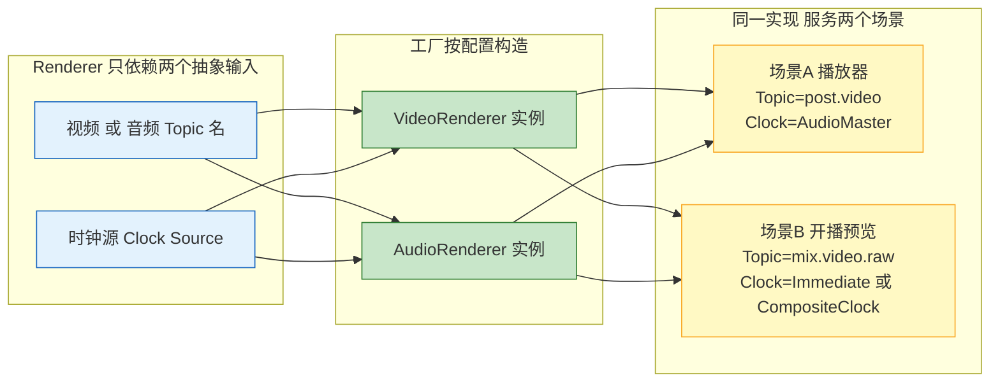

##### 6.4.5.2 三步搭出预览

| 步骤 | 动作 | 具体做什么 |
|:---:|---|---|
| **① 声明订阅** | 复用 `mix.video.raw` / `mix.audio.raw` | 无需新 Topic；Encoder 已订阅，Preview 再订阅一次即可（多订阅） |
| **② 装配 Renderer** | `VideoRenderer::create(cfg)` | 传入 Topic 名 + 时钟源 + Owner=UI/Render Thread |
| **③ 挂 UI Surface** | `preview_vr->attach(hwnd)` | 把渲染目标绑定到 UI 层的窗口/View |

##### 6.4.5.3 装配代码骨架

```cpp
// —— 播放器场景（已有）——
auto player_vr = VideoRenderer::create({
    .video_topic  = "post.video",
    .clock_source = ClockSource::AudioMaster,   // 音频驱动
    .owner_thread = "PlayerRenderThread",
});

// —— 开播预览场景（新增，只改配置，不改实现）——
auto preview_vr = VideoRenderer::create({
    .video_topic  = "mix.video.raw",            // ⭐ 换 Topic
    .clock_source = ClockSource::CompositeClock, // ⭐ 换时钟源
    .owner_thread = "PreviewRenderThread",       // ⭐ 独立线程，与编码器隔离
});
preview_vr->attach(preview_hwnd);

// —— 音频预览可选（默认静音；导播场景才启用）——
auto preview_ar = AudioRenderer::create({
    .audio_topic  = "mix.audio.raw",
    .clock_source = ClockSource::CompositeClock,
    .owner_thread = "PreviewAudioThread",
    .muted        = true,   // 主播场景静音，避免回声
});
```

##### 6.4.5.4 复用度矩阵

| 组件 | 播放器 | 开播预览 | 组合方式 | 复用度 |
|---|---|---|---|:---:|
| `VideoRenderer` 类 | ✅ | ✅ | **同一份实现**，构造参数不同 | **100%** |
| `AudioRenderer` 类 | ✅ | ✅（可静音） | 同上 | **100%** |
| 时钟源接口 `IClockSource` | AudioClock | CompositeClock / Immediate | **同接口，不同实现** | 100% |
| A/V 同步策略 `ISyncStrategy` | PlayerSyncStrategy | PreviewSyncStrategy | 同接口 | 100% |
| UI Surface 绑定层 | 平台各异 | 平台各异 | 走 HAL | 90% |

📌 **一句话**：**预览 = 播放器组件 + 换 Topic + 换时钟源**——**没有一行新的渲染代码**。

##### 6.4.5.5 独立线程隔离（关键工程约束）

⚠️ 预览的 Renderer **必须与编码器 Owner Thread 严格隔离**：

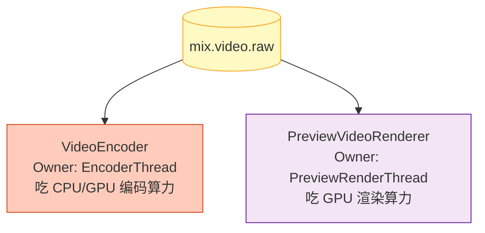

📌 **原因**：编码器一旦卡顿（复杂帧、码率突变），若预览与其共享线程，UI 会立即冻结。**两者必须在独立 Owner Thread**，通过 Bus 的多订阅机制天然解耦。

---

### 6.5 开播端音画同步方案

> 🎯 **回答你的第 ② 点（开播侧）**：开播场景的音画同步**责任在 Compositor + Mixer 两端**——推流出去的音视频必须"合成时就已对齐"，而不是靠下游播放器纠正。UMB 通过**帧 PTS 标签 + 合成端时钟 (Composite Clock) + 抗抖水位**三件套实现。

#### 6.5.1 同步责任分工（重要心智）

| 角色 | 责任 | 是否走 Bus |
|---|---|:---:|
| **CameraCapture / MicCapture** | 采集时打 **原始 PTS（wall clock, µs）** | ✅ 消息头字段 |
| **VideoCompositor** | 按 PTS 对齐多路视频，输出 `mix.video.raw` | ✅ |
| **AudioMixer** | 按 PTS 对齐多路音频，输出 `mix.audio.raw` | ✅ |
| **CompositeClock** | 全局单调时钟基准，`std::atomic<int64_t>` | ❌ 不走 Bus |
| **Encoder / Muxer** | 忠实转发 PTS 到编码流，不做同步纠正 | — |

📌 **核心原则**：同步在**合成端一次性完成**；后续 Encoder/Muxer/Sender **仅透传 PTS**，不再纠正。这样才能保证下游播放器拿到的流"天生同步"。

#### 6.5.2 三件套机制

##### ① 消息头统一携带 PTS

```cpp
struct MessageHeader {
    uint64_t seq;           // 消息序号
    uint32_t epoch;         // 用于 Flush / Seek
    int64_t  pts_us;        // ⭐ 采集/合成时打的 PTS（微秒）
    int64_t  dts_us;        // ⭐ 解码时间戳（B帧场景才 ≠ pts）
    SourceId src;           // 源标识
};
```

📌 每条 `src.*.raw` / `mix.*.raw` / `enc.*` 消息头**必须**带 `pts_us`——**PTS 是同步的唯一货币**。

##### ② CompositeClock：合成端主时钟


📌 **规则**：**以音频为主时钟**（因为音频对连续性最敏感、绝不能丢），VideoCompositor 输出每帧时**参考音频时钟决定该帧的目标 PTS**——落后则跳、超前则等。

##### ③ 抗抖水位：多源对齐窗口

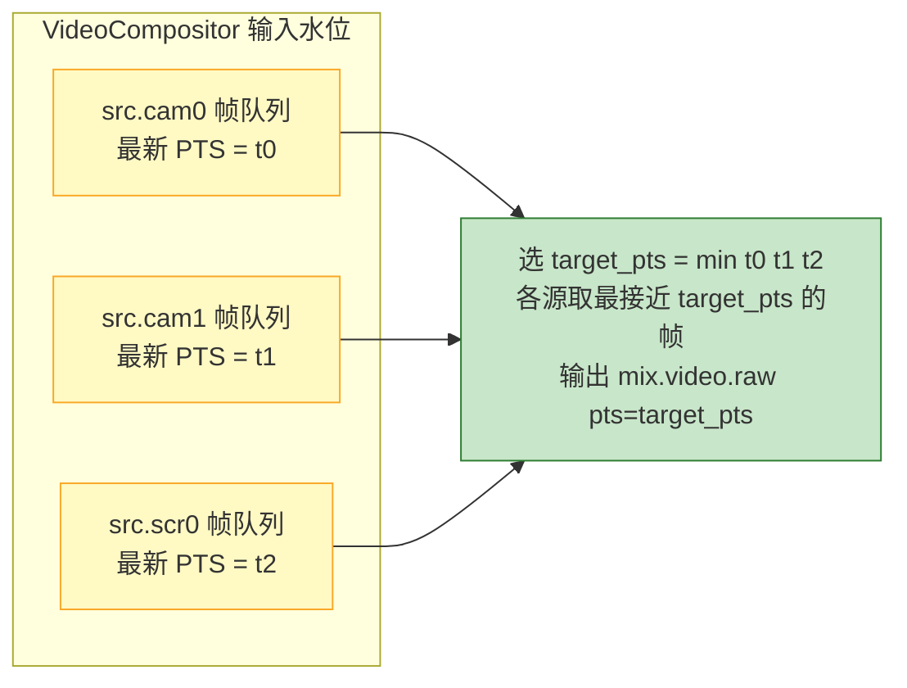

📌 **算法**：Compositor 维护每路源的输入水位（默认 3 帧 = 50ms @ 60fps），按**最慢源**的 PTS 作为合成基准；水位不足则**短暂等待**，超阈值则**丢最旧**。

#### 6.5.3 同步算法（VideoCompositor 循环）

| 步骤 | 判断 | 动作 |
|:---:|---|---|
| 1 | 从所有活跃 `src.*.video.raw` 队列各取最新帧 | — |
| 2 | 计算 `target_pts = min(所有源当前 PTS)` | — |
| 3 | `audio_pts = CompositeClock.load()` | 读主时钟 |
| 4 | `Δ = target_pts - audio_pts` | 计算偏差 |
| 5 | `Δ > +40ms`（视频超前） | **等待 Δ 后再输出** |
| 6 | `Δ < -40ms`（视频落后） | **丢弃当前帧，取下一帧** |
| 7 | 否则 | **输出合成帧，pts=target_pts** |

📌 **40 ms 阈值**来自人耳感知：音画偏差 |Δ| < 40ms 人眼几乎无感；> 80ms 明显不适。

#### 6.5.4 采集端补偿：处理硬件时钟漂移

开播的坑：**摄像头晶振 ≠ 麦克风晶振 ≠ 系统时钟**，长时间运行会漂移。

| 场景 | 现象 | 解决 |
|---|---|---|
| **摄像头掉帧** | 硬件报 pts 但少一帧 | Compositor 检测到 PTS 跳跃 > 1/fps × 1.5 → 复制上一帧填补 |
| **麦克风走时快** | 音频 pts 增速略高 | Mixer 每 30s 检查，微幅重采样（±0.1%）软吸收 |
| **系统睡眠恢复** | 全部 PTS 跳变 | 检测跳变 > 500ms → epoch++，全链路重同步 |

#### 6.5.5 同步偏差监控（sys.av.sync）

新增 Bus 上报 Topic，用于运维和自愈：

| Topic | Payload | 频率 | 用途 |
|---|---|:---:|---|
| `sys.av.sync` | `{delta_ms, video_pts, audio_pts, action}` | 1 Hz | Metrics 上报 + ABR 决策 |

📌 **闭环**：当 `\|delta_ms\| > 80ms` 持续 5s，Metrics 触发 `ctrl.pipeline.resync` 命令，Compositor 强制重对齐（等价于一次 mini-flush）。

---

### 6.6 开播端音画同步工程化参考模型

> 🎯 **本节目的**：§6.5 已经把音画同步嵌入 UMB 的拓扑与消息模型；本节把开播端常见的同步难题抽象为一个**与具体实现无关的参考模型**，让读者读完能建立起：**"开播时会遇到哪些同步麻烦，每种麻烦应该用什么思路应对"** 的整体认知。所有细节实现（伪码、参数、字段、指标阈值）都不在本节展开，仅点到"用什么策略"为止。

#### 6.6.1 抽象全景：双阶段同步模型

> 🔑 **核心思想**：把开播端的音画同步拆成**两个阶段**——**先把多源拉到同一时间起点，再让它们持续锁在同一参考时钟上**。前者一次性，后者持续运行。

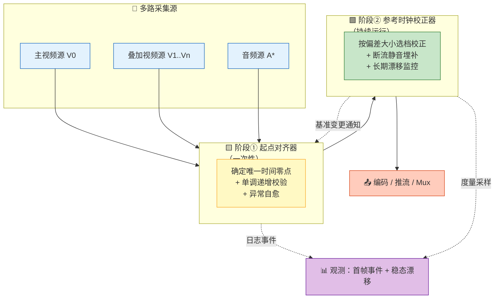

📌 **双阶段职责一句话**：
- **阶段① 起点对齐器**：解决"**多源在哪一刻算作同时开始**"。
- **阶段② 参考时钟校正器**：解决"**长时间运行后多源如何不发散**"。

📌 **两阶段是串联关系**（`采集 → ① → ② → 输出`）。反向只有一条通道：当阶段② 判定时间轴整体位移时，会通知阶段① 同步位移基准，避免两阶段各算一套。

#### 6.6.2 与 §6.5 抽象模型的对应

| §6.5 抽象概念 | 本节对应 | 属阶段 |
|---|---|:---:|
| 消息头 `pts_us` | 帧时戳 | – |
| CompositeClock 主时钟 | 稳态参考时钟 | ② |
| 合成端对齐（起点） | 起点对齐器 | ① |
| 抗抖水位 | 起点等待窗口 + 稳态死区 | ①＋② |
| 主时钟单调递增 | 单调校验 + 自愈守卫 | ① |
| 采集端补偿 | 静音埋补 + 分档校正 | ② |
| 同步偏差监控 | 首帧事件 + 长期漂移 | 双通道 |

> ⚠️ **一点主从关系差异**：§6.5 说"以音频为主时钟"（稳态），本节说"以主视频源 V0 为起点参考"（起点）——两者作用在不同阶段，并不冲突：**起点看视频**（因为画面出来才叫"开播了"），**稳态看音频**（因为声音连续性是硬约束）。

---

#### 6.6.3 阶段①：起点对齐器（Origin Aligner）

> **一句话**：主源首帧才能"发令"，其他源等号响再入场。

##### 核心思想

- **只有一个时间零点**，由主视频源的首帧确立（首帧到达那一刻的 PTS 被记录为全局起点）。
- 其他源在起点确立之前**一律不放行**（视频叠加源、音频源都要等）。
- 起点确立后，所有源都把自己的 PTS **减去这个零点**再向下游输出——从下游视角看，时间轴永远从 0 开始。
- 每条流独立做**单调递增校验**：若新帧 PTS ≤ 上一帧，正常丢弃；但要防止"真数据被无限丢弃"的病态情况，因此需要**自愈守卫**兜底。

##### 会遇到的场景与应对

| 场景 | 现象 | 建议应对 |
|---|---|---|
| **叠加摄像头/麦克风比主源先到** | 起点尚未确立，早到帧要不要留？ | **一律丢弃**，只对首次丢弃打日志（后续限流），避免日志洪水 |
| **主源永久失联**（V0 拔线/权限失败/驱动异常） | 等下去会**永久卡在启动阶段** | 设置**等待超时**（数秒量级）；超时后按预设顺序**降级接管**（例如让叠加源或占位黑帧当零点），并上报告警。**主源事后到达也不许夺回零点**，避免时间轴二次抖动 |
| **设备乱序回流**（断流恢复时先吐新帧再吐旧帧） | 上一帧 PTS 已被推到未来，后续真实旧帧会被**持续判为回退** | 用**丢帧自愈守卫**：连续丢弃达阈值（如"连续 N 帧"或"单次回退量超过 T 毫秒"）就自动**重新对齐基准**并放行 |
| **上游做了复帧填补** | 同上，PTS 被提前推进后真数据被误丢 | 同上，由自愈守卫兜底 |
| **硬件时钟 32-bit 计数器绕回**（约 71.6 分钟） | 出现巨大回退（>1 小时），但**物理时间实际连续** | 视为"绕回"而非"断裂"：用**补偿量**保持输出 PTS 单调（缝上即可），不惊动下游 |
| **系统时钟跳变**（NTP 校时、手动改时间、睡眠唤醒） | 出现较大回退（几百毫秒到几十分钟），**时间轴真的断了** | 视为"时间轴断裂"：**重定基准**并**通知全链路重同步**（对应 §6.5.4 的 epoch++）——必须让下游知道 |
| **首帧延迟难定位**（客诉"起播卡顿"，事后无从复现） | 关键时序在毫秒级、日志散落各处 | 用**首帧事件环**（一个小型环形缓冲）记录首帧阶段的关键动作，首帧走完自动 dump，事后即可回溯 |

📌 **关键区分：绕回 vs 跳变**
> **绕回**（计数器循环）→ **补偿**保持输出单调，物理时间连续，无需惊动下游。
> **跳变**（时钟被改写）→ **重同步**通告下游，时间轴断裂必须显式声明。
> **一句话**：**绕回缝上即可，跳变必须告知全链路。**

---

#### 6.6.4 阶段②：参考时钟校正器（Reference Clock）

> **一句话**：起点确立后，用一个"输出播出指针"追踪真实到达的数据 PTS，让它们持续锁在一起——像一个音频锁相环。

##### 核心思想

- 阶段② 内部维护一个**输出播出指针**（下一帧应盖什么时刻），并把它与真实到达数据的 PTS 比对，得到偏差量 `drift`：
  - `drift > 0`：**数据超前于播出指针** → 播出指针要**加速推进**追上去；
  - `drift < 0`：**数据落后于播出指针** → 播出指针要**减速推进**或**抵扣已埋补的静音**；
  - `drift ≈ 0`：不动作。
- **不同量级的偏差用不同强度的手段**——量级越大手段越激进。这就是"分档校正"的思想（详见"四档校正"）。
- 音频要求连续性硬约束：若真数据没到，就**先垫静音帧**顶住输出，等真数据回来再抵扣。

##### 关键名词简介

在展开场景表之前，先把后文出现的算法/名词说清楚，避免"照着念但看不懂"：

| 名词 | 一句话简介 |
|---|---|
| **参考时钟 / 输出播出指针** | 阶段② 自己维护的"下一帧应输出到哪一刻"的原子变量，帧率驱动持续推进 |
| **drift（漂移偏差）** | 到达数据 PTS − 播出指针；正=数据超前，负=数据落后 |
| **死区（DeadZone）** | 控制工程标准做法：偏差小于阈值时**不动作**，避免控制器与噪声共振 |
| **滞回（Hysteresis）** | 从模拟电路借来的思想：**进入阈值**与**退出阈值**分开设置，用"迟钝"换"稳定"，防止在阈值边界反复切档 |
| **PI 控制器** | 经典控制律：`修正量 = Kp·drift + Ki·∫drift`；P 项快速响应、I 项吃掉稳态偏差。这里用来给每帧时长做**微修正** |
| **静音埋补（Mute Fill）** | 断流期间生成 PCM 静音帧顶住输出，保证音频不断流 |
| **Drain 抵扣** | 断流恢复时若一次性回吐大批积压旧数据（drift < 0），按"埋了多少就抵扣多少"的预算**丢弃或替换**已埋补的静音，直到收敛 |
| **PPM 漂移** | 音频硬件晶振与系统时钟存在百万分之几的速率差，数小时后累积成可感知偏差；本质是**缓慢线性**误差，交给 PI 的 I 项吸收即可 |
| **Rebase（跨阶段基准同步）** | 阶段② 判定时间轴整体位移（Snap）时，通知阶段① 同步位移基准，让两阶段对"当前时间轴"的认知一致 |

##### 四档校正（本节最核心的算法思想）

> 💡 **为什么要分档而不是用一个统一策略**：既要**快速收敛**（大偏差要马上处理）、又要**平滑无跳变**（小偏差不能让人听见）、还要**震荡免疫**（噪声区间别乱动）——单一策略做不到三者兼得，所以按 `|drift|` 量级**分层控制**。

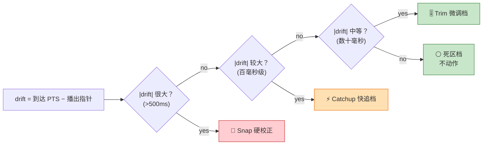

**四档一览**（强度从强到弱）：

| 档位 | 触发量级 | 一句话含义 | 何时用 | 副作用 |
|:---:|:---:|---|---|---|
| **🚨 Snap 硬校正** | 很大（>500 ms） | "**一步到位**"——播出指针直接跳到目标位置 | 睡眠恢复、系统时钟跳变等极端场景 | 一次性大跳变，下游可能听到轻微跳音；用得越少越好 |
| **⚡ Catchup 快追档** | 较大（百毫秒级） | "**多走/少走两步**"——保持连续但允许每帧步长偏离标称值 | 断流恢复的默认档、瞬时偏差修复 | 数秒内平滑收敛，肉眼/耳不易察觉 |
| **🎚 Trim 微调档** | 中等（数十毫秒） | "**每帧微调**"——用 PI 控制律给每帧时长做微小修正 | 长期 PPM 漂移、稳态微偏 | 无跳变、平滑；分钟级收敛 |
| **⚪ 死区档** | 小（<数十毫秒） | "**不管它**"——偏差在死区内不动作 | 抖动 / 噪声 | 抖动免疫 |

📌 **两个关键补充**：
1. **档位都是双向的**：档位由 `|drift|` 大小决定，方向由 `drift` 符号决定——数据超前就加速，数据落后就减速。**Catchup 不是"只会加速"**。
2. **档位边界要加滞回**：`|drift|` 在阈值附近漂动时，用"进入阈值高、退出阈值低"的滞回带隔离，防止反复切档产生"呼吸感"。

##### 会遇到的场景与应对

| 场景 | 现象 | 建议应对 |
|---|---|---|
| **音频"晚启动"时机** | 音频链路（重采样/混音/编码）过早启动会做无用功、过晚会导致"先听声后见画" | 音频链路等到**起点已确立**（或纯音频推流）再进入 Running；必须带**超时兜底**，防止主源永久失联时音频永远等下去 |
| **麦克风瞬断（几十到几百毫秒）** | 若不处理，编码器断流→播放卡死 | **静音埋补**：从当前播出指针连续生成静音帧顶住；同时**记账**已埋补多少帧 |
| **断流恢复（实时回流，drift ≈ 0）** | 设备丢弃了断流期间的数据、直接吐当前时刻新音频 | Trim / 死区档平滑衔接即可，用户无感 |
| **断流恢复（积压回补，drift < 0）** | 设备一次性吐出断流期间缓存的**旧数据** | 用 **Drain 抵扣**——落在已埋补时间窗内的数据按预算**丢弃或替换**静音区间。**注意此时方向是反的，不能用 Catchup"快追"**（会越追越远） |
| **音频硬件时钟 PPM 漂移** | 数小时后累积成几十到几百毫秒的相位偏差 | 交给 **Trim 档的 I 项**慢慢吸收；**禁止**用 Snap 周期性拉齐（会变成周期性可听跳音） |
| **系统睡眠恢复 / 系统时钟跳变** | 播出指针与到达数据一下差出几百毫秒到几秒 | Snap 一次性拉齐 + 发起 **Rebase** 通知阶段① 同步位移基准 + 视情况全链路重同步 |
| **叠加视频源相对主视频源漂移** | 多摄像头长时间后逐渐"貌合神离"（两台晶振有微小频差） | **视频通道复用同一档位框架**，但手段不同——不能拉伸帧时长，只能**微调采样时机**（Trim 档）或**丢帧/复帧**（Catchup 档） |
| **档位边界抖动** | drift 恰好在阈值附近漂动，反复切档 | 每档设置**滞回带**（进入阈值 vs 退出阈值分开） |

📌 **音频 vs 视频的关键差异**：音频可以**连续微调每帧时长**（拉伸/压缩），肉眼/耳不易察觉；视频只能**离散地丢帧/复帧或改采样时机**（一次改动就是一整个 frameDuration），因此视频通道的 Catchup 应比音频更保守。

##### 阶段②→阶段① 的基准同步（Rebase）

> **为什么需要这条反向通道**：当阶段② 判定"时间轴整体位移了"（Snap 触发），零点必须同步位移——如果只有阶段② 动、阶段① 的基准不动，两阶段会对"当前时间轴"各算一套，输出 PTS 忽前忽后。

**做法（原则性描述）**：
- 零点的**唯一所有者是阶段①**：阶段② 只**发起请求**，以阶段① 返回的基准为最终值再更新自己的播出指针。
- 同进程内直调，避免异步延迟造成的分叉窗口。
- 支持**幂等去重**：阶段① 自身可能也判定过一次基准变更（如遇到时钟跳变），带一个单调递增的序号防止重复修正。

---

#### 6.6.5 开播典型异常 ↔ 机制对应表

> 一张表看清"每种开播异常各归哪个阶段/哪种手段处理"。

| 典型异常 | 阶段① 处置 | 阶段② 处置 | 用户感知 |
|---|---|---|---|
| 多源启动乱序（叠加源先到） | 丢弃 + 日志限流 | 音频晚启动，等起点 | 无感知 |
| **主源永久失联**（V0 拔线/权限失败） | 超时后按预设顺序**降级接管** | 按新零点立即启动 | 有告警，但推流不卡死 |
| 麦克风瞬断 | — | **静音埋补** + 记账 | 音频不断流 |
| **断流恢复**（实时回流） | 正常放行 | Trim / 死区档平滑衔接 | 无感知 |
| **断流恢复**（积压回补） | 若乱序回流 → **自愈守卫**兜底 | **Drain 抵扣**，残余交 Catchup 收尾 | 无感知 |
| 屏幕采集阵发式掉帧 | 复帧填补（对齐 §6.5.4） | Trim 档吸收残余小偏差 | 无感知 |
| 叠加视频源相对漂移 | — | 视频通道 Trim 档微调采样时机 | 长时不发散 |
| 系统睡眠恢复 | 收到 Rebase → 重定基准 | Snap 拉齐 + 发起 Rebase | 一次性回正，可能有轻微跳音 |
| 音频 PPM 漂移 | — | Trim 档持续吸收（禁用 Snap） | 长时不发散、无跳音 |
| 同一帧 PTS 重复 | 单调校验丢弃 | — | 时间轴健康 |
| **系统时钟跳变** | 判定断裂 → 重定基准 + 通知阶段② | Snap 拉齐 + 全链路重同步 | 时间轴断裂被显式声明 |
| **硬件时钟绕回**（约 71.6 分钟） | **补偿**保持输出单调 | 无感 | 下游无异常 |
| 首帧延迟难定位 | **首帧事件环**自动 dump | 记录音频启动时刻 | 事后可回溯 |

---

#### 6.6.6 与 UMB 的集成方式

- **两阶段同属一个 UMB 节点内的两级子模块**（视频侧在 `VideoCompositor`、音频侧在 `AudioMixer` 内），阶段① → 阶段② 通过**函数直调**传递帧，**不占用任何 Topic**。节点整体对外只有一进一出：订阅 `src.*.raw`，产出 `mix.*.raw`。
- **内部状态一律不入 Bus**：起点、播出指针、自愈守卫、事件环等全部是节点私有的原子变量或本地缓冲，保持开销极低。
- **只上报度量**：阶段② 把采样后的偏差周期性发到 `sys.av.sync`（1 Hz），供 Metrics/QoS/ABR 消费；参考时钟本体**绝不走总线**。
- **控制通道**：当 `sys.av.sync.delta_ms` 持续超阈（§6.5.5 的 80 ms / 5 s 规则），沿 `ctrl.pipeline.resync` 反向命令该节点做一次 mini-flush（内部等价于一次 Snap + Rebase）。

> 📌 **一句话**：阶段①② 是**无锁、计算密集型**的节点内实现，UMB 只在**消费输出**与**下发重对齐命令**时介入。

---

📌 **开播端同步哲学一句话**：

> **"起点用原子操作一次锁死，稳态用四档双向校正，基准变更靠跨阶段一致同步、单阶段自愈兜底。"**

---

## 七、播放器一体化架构（含音画同步）
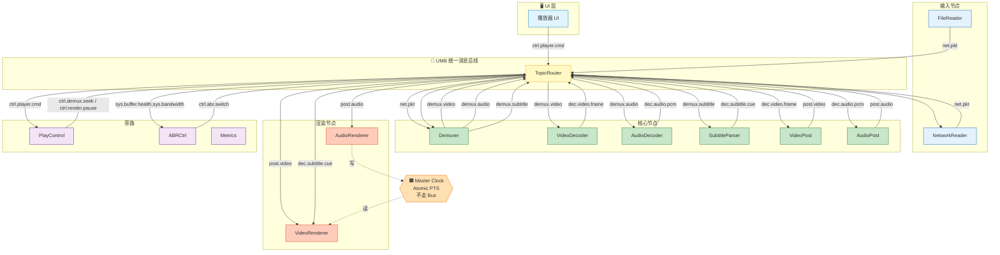

### 7.2 Topic 声明表（播放器）

| Topic | Payload | Owner | max_depth | 溢出 | 派发 |
|---|---|:---:|:---:|:---:|:---:|
| `net.pkt` | `shared_ptr<Buffer>` | Demuxer-Thread | 30s(byte) | Block | Async |
| `demux.video` | `shared_ptr<AVPacket>` | VDec-Thread | 30 | Block | Async |
| `demux.audio` | `shared_ptr<AVPacket>` | ADec-Thread | 50 | Block | Async |
| `demux.subtitle` | `shared_ptr<AVPacket>` | SDec-Thread | 10 | DropOldest | Async |
| `dec.video.frame` | `shared_ptr<GpuFrame>` | VPost-Thread | 3 | Block | Async |
| `dec.audio.pcm` | `shared_ptr<AudioBuffer>` | APost-Thread | 20 | Block | Async |
| `post.video` | `shared_ptr<GpuFrame>` | VR-Thread | 3–5 | **DropOldest**（Seek 快排空） | Async |
| `post.audio` | `shared_ptr<AudioBuffer>` | AR-Thread | 500 ms | **Block**（音频不丢） | Async |
| `ctrl.player.cmd` | `PlayCmd` | Player-Thread | 16 | Block | **Sync** |
| `ctrl.demux.seek` | `SeekCmd(pts, epoch)` | Demuxer-Thread | 4 | Block | **Sync** |
| `sys.buffer.health` | `BufferHealth` | ABR-Thread | 4 | DropOldest | Async |

### 7.3 播放器音画同步方案

> 🎯 **回答你的第 ② 点（播放器侧）**：与开播不同，播放器**必须相信输入流的 PTS**，同步责任在**渲染端**——VideoRenderer 根据 AudioClock 决定每帧的显示时刻。UMB 通过 **AudioClock（主时钟）+ 视频 PTS 跟随 + 分级追赶策略** 实现。

#### 7.3.1 同步责任分工

| 角色 | 责任 | 是否走 Bus |
|---|---|:---:|
| **Demuxer** | 从容器解出 PTS/DTS 并透传 | ✅ 消息头字段 |
| **VideoDecoder / AudioDecoder** | 解码后保留 PTS 到帧结构 | ✅ |
| **AudioRenderer** | 每次写入音频硬件后**更新 AudioClock** | ✅（数据）+ ❌（时钟单独） |
| **AudioClock** | `std::atomic<int64_t>`，**唯一主时钟** | ❌ 不走 Bus |
| **VideoRenderer** | 每帧对比 AudioClock 决定"渲染/等待/丢弃" | 只读 AudioClock |

📌 **核心心智**：**音频永远按时播放**（丢音频人耳立即察觉），**视频永远追赶音频**（丢一帧人眼几乎无感）——业界标准做法（FFmpeg/mpv/VLC 都是这套）。

#### 7.3.2 AudioClock 更新机制

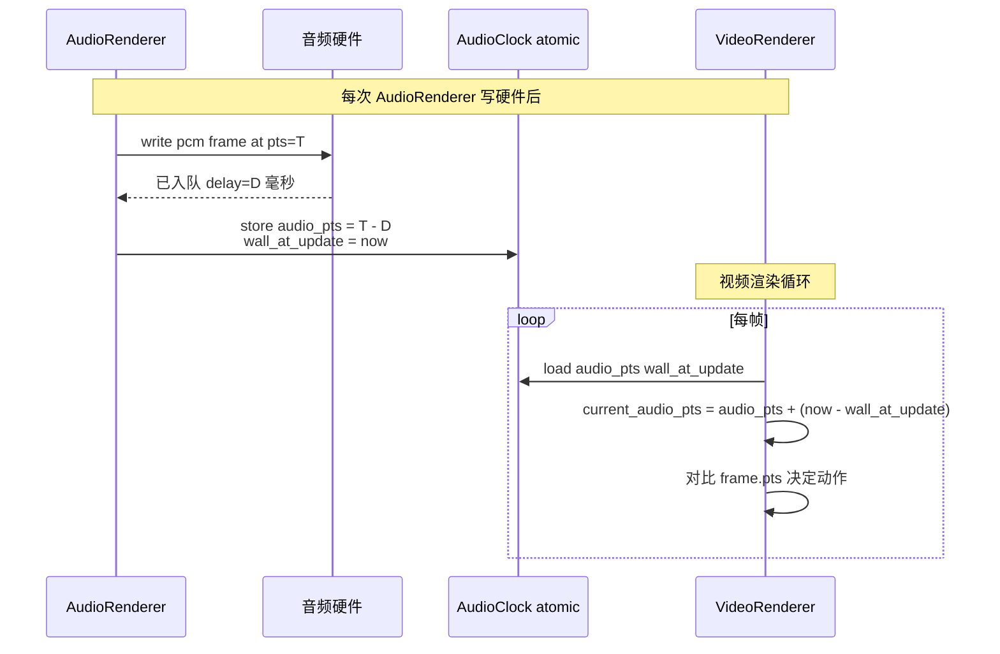

📌 **两个原子字段**：`audio_pts_us`（最近写入的音频 PTS 减去硬件延迟）+ `wall_at_update_us`（更新时刻的墙钟）。VideoRenderer 读取时用 `audio_pts + (now - wall_at_update)` 得到**当前应播放的 PTS**。

#### 7.3.3 视频跟随算法（分级追赶策略）

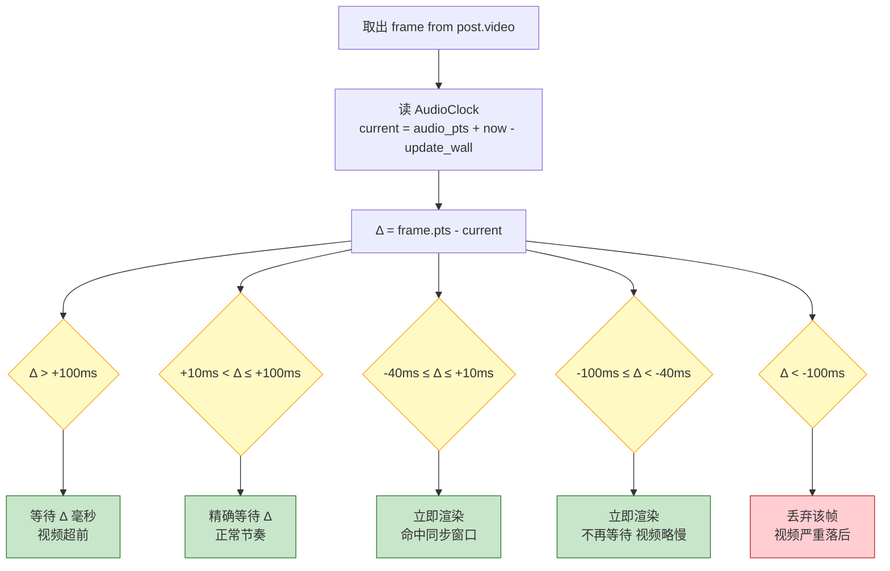

| 偏差 Δ | 状态 | 动作 | 备注 |
|---|---|---|---|
| Δ > +100ms | 视频远超前 | 精确等待 | 通常首帧 或 Seek 后 |
| +10 < Δ ≤ +100 | 视频略超前 | `nanosleep(Δ)` | 稳态主路径 |
| -40 ≤ Δ ≤ +10 | 同步窗口内 | 立即渲染 | 感知无差 |
| -100 ≤ Δ < -40 | 视频略落后 | 立即渲染，不再补偿 | 追赶 |
| Δ < -100ms | 视频严重落后 | **丢帧** | 通常 CPU 过载/网络卡顿后追赶 |

#### 7.3.4 字幕同步

字幕自成一条链，同样以 AudioClock 为准：

```
SubtitleParser → dec.subtitle.cue (含 start_pts / end_pts)
                ↓
VideoRenderer 每帧渲染时：
   if cue.start_pts ≤ current_audio_pts ≤ cue.end_pts: 叠加显示
```

📌 字幕不设独立时钟，**共享 AudioClock 即可**——三者（音频/视频/字幕）在同一时间轴上。

#### 7.3.5 Seek 时的同步重置

Seek 会触发 epoch++，同时 AudioClock 也需要**原子重置**：

| 步骤 | 动作 |
|:---:|---|
| 1 | `PlayControl` 收到 Seek 命令，发布 `ctrl.demux.seek(pts, epoch=N+1)` |
| 2 | Router 更新全局 epoch 为 N+1 |
| 3 | **AudioClock.reset(seek_target_pts)** ← 关键：清零旧时钟，避免视频以旧时钟计算 Δ |
| 4 | 各 Owner 线程丢弃旧 epoch 消息 |
| 5 | 首个新 epoch 的音频帧到达 AudioRenderer 时，正常更新 AudioClock |
| 6 | 首个新 epoch 的视频帧到达 VideoRenderer 时，Δ 计算基于新 AudioClock |

⚠️ **踩坑警示**：若忘记 reset AudioClock，Seek 后前几帧视频会用旧的 audio_pts 计算 Δ，导致巨大偏差 → 视频要么"疯狂等待"要么"疯狂丢帧"，出现约 300–500ms 的黑屏。

#### 7.3.6 硬解 GPU 帧的特殊考虑

硬解场景下，`post.video` 载荷是 GPU 纹理句柄，不能 CPU 侧解析像素。同步机制**完全不变**——PTS 存在消息头，与载荷无关，Renderer 的判断逻辑照旧。这也是"PTS 是同步的唯一货币"的另一个体现。

### 7.4 Seek 场景（Epoch 屏障机制）

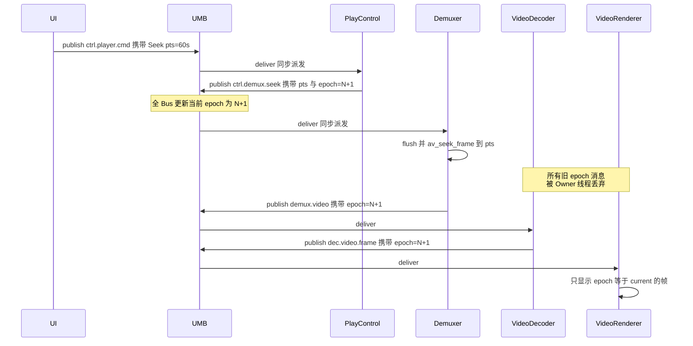

📌 **Epoch 屏障**：每个消息带 epoch 号；Seek 时 Router 更新全局 epoch，所有 Owner 线程在 dequeue 时丢弃旧 epoch 消息——**天然的原子 Flush 机制**。

### 7.5 倍速播放（Playback Rate Control）

> 🎯 **目标**：支持 0.5×、0.75×、1.25×、1.5×、2.0× 乃至任意 X× 倍速切换，且切换过程**不出现音画错位、不出现"卡顿一下再变速"**。核心思路一句话：**音频用变速不变调算法拉伸/压缩波形，视频改变帧输出节奏，主时钟本身仍按"1× 墙钟"推进，只是被"速率因子 r"重新解释**。

#### 7.5.1 核心问题：为什么倍速不能"简单调播放器帧率"

朴素想法：`2×` 就把视频显示节奏加快一倍、音频丢一半样本。这么做会遇到三个致命问题：

| 朴素做法 | 出现的问题 |
|---|---|
| 音频直接抽/复采样 | 音调升高（松鼠音）或降低（磁带音），**不可接受** |
| 视频只提高刷新频率 | 音频不动 → 音画立即错位 |
| Renderer 拿到 PTS 后自己乘 `1/r` | 每个节点都可能算出不同结果，`Seek + 变速`叠加时时钟错乱 |

正确做法必须满足三条硬约束：

1. **音调保持不变** → 使用 **变速不变调（Time-Stretch）** 算法处理音频。
2. **主时钟单调、且倍速前后可追溯** → 主时钟继续按 1× 语义存"媒体 PTS"，速率因子 `r` 只在**推进映射**这一步生效。
3. **切换点无跳变** → 速率切换发布为一条控制消息，携带 `apply_at_pts` 生效点，所有节点按此点同步过渡。

#### 7.5.2 责任分工

| 角色 | 倍速下的责任 | 是否走 Bus |
|---|---|:---:|
| **PlayControl** | 接收 UI 命令，广播 `ctrl.rate.change(r, apply_at_pts, epoch)` | ✅ |
| **AudioRenderer** | 用 **SoundTouch / RubberBand / WSOLA** 做变速不变调；输出速率与硬件采样率一致 | ✅ 数据 |
| **AudioClock** | 存储的仍是**媒体 PTS**（1× 语义），但**推进斜率乘以 r**（详见 §7.5.3） | ❌ 时钟 |
| **VideoRenderer** | 读取 AudioClock 得到当前媒体 PTS，逻辑与 1× 完全一致（"追时钟"）；额外做**极端倍速下的帧策略调整** | 只读 |
| **Demuxer / Decoder** | 通常**不感知倍速**，按原节奏产出解码帧；极高倍速（≥ 4×）时可开启"只解 I/P 帧"降负载 | 部分感知 |

📌 **关键心智**：**倍速只影响 AudioRenderer 的时间拉伸 + AudioClock 的推进斜率**，其他节点的算法**不需要为倍速改一行**。这是 UMB 拓扑的收益——控制维度单点收敛。

#### 7.5.3 主时钟在倍速下的推进模型

> **一句话**：`current_media_pts = audio_pts + (now - wall_at_update) × r`
> —— 唯一的改动就是把"墙钟增量"乘上速率因子 `r`。

```mermaid
flowchart LR
    subgraph N["1× 情况（回顾）"]
        N1["写入音频硬件<br/>audio_pts = T<br/>wall_at_update = W"]
        N2["读取时：<br/>current = T + (now - W) × 1"]
    end
    subgraph R["r× 情况"]
        R1["写入音频硬件<br/>audio_pts = T<br/>wall_at_update = W<br/>rate = r"]
        R2["读取时：<br/>current = T + (now - W) × r"]
    end
    N1 --> N2
    R1 --> R2

    classDef box fill:#E3F2FD,stroke:#1565C0;
    class N1,N2,R1,R2 box;
```

- **AudioClock 增加一个原子字段 `rate`**（float，默认 1.0）；`audio_pts / wall_at_update / rate` 三者需**同一次更新中原子写入**（可用 seqlock 或"更新序号 + 双缓冲"实现），避免视频侧读到"旧 pts + 新 rate"的组合。
- **视频侧公式无需增加分支**：`current = audio_pts + (now - wall_at_update) * rate`，`rate = 1` 时退化为原公式。
- **暂停 = `rate = 0`**：数学上完全等价，暂停/播放可以用同一条通路。（工程上通常仍保留独立的 Paused 状态，方便日志与 QoS。）

#### 7.5.4 音频变速不变调（Time-Stretch）算法一览

音频链路上加入一级 **TimeStretch 处理器**（位于 `AudioDecoder → AudioRenderer` 之间，或作为 AudioRenderer 的内部一级）。核心是**"改变时长、保留频谱"**。

| 算法 | 原理一句话 | 适用倍速 | 音质 | CPU | 备选场景 |
|---|---|:---:|:---:|:---:|---|
| **WSOLA**（Waveform Similarity Overlap-Add） | 按相似性找拼接点，重叠加窗 | 0.5×–2.0× | 中 | 低 | 移动端首选，SoundTouch 默认算法 |
| **Phase Vocoder** | 短时傅里叶变换后调整相位再合成 | 0.25×–4.0× | 高 | 中高 | 音乐场景，RubberBand 高质档 |
| **PSOLA**（Pitch Synchronous OLA） | 按基音周期切分再拼接 | 0.5×–2.0× | 高（人声） | 中 | 有声书 / 播客 |
| **简单重采样**（禁用变调补偿） | 直接改采样率 | — | 差（变调） | 极低 | ❌ 仅调试用 |

**工程建议**：
- **默认 SoundTouch (WSOLA)**：跨平台、License 友好（LGPL）、CPU 低。
- **高音质档 RubberBand (Phase Vocoder)**：音乐/演唱会类内容，配置项开放给用户。
- **≤ 0.5× 或 ≥ 2.0×** 建议自动切到 Phase Vocoder，因为 WSOLA 在极端倍速下会出现"金属回声"（伪影）。

📌 **PCM 缓冲长度会变化**：`r = 2.0` 时，输入 1024 样本 → 输出约 512 样本；`r = 0.5` 时 → 输出约 2048 样本。AudioRenderer 内部要按**输出侧样本数**推进 `audio_pts`（`pts += out_samples / sample_rate`），而不是按输入侧。

#### 7.5.5 速率切换的时序（含"平滑生效点"）

```mermaid
sequenceDiagram
    participant UI
    participant Bus as UMB
    participant PC as PlayControl
    participant AR as AudioRenderer
    participant CLK as AudioClock
    participant VR as VideoRenderer

    UI->>Bus: publish ctrl.player.rate 携带 r=2.0
    Bus->>PC: deliver
    PC->>PC: 计算 apply_at_pts = current + 200ms
    PC->>Bus: publish ctrl.rate.change 携带 r apply_at_pts
    Bus->>AR: deliver
    Bus->>VR: deliver
    Note over AR: 待处理帧 pts ≥ apply_at_pts 时<br/>TimeStretch 从 1× 切到 2×
    AR->>CLK: 原子更新 rate = 2.0<br/>同步更新 audio_pts wall
    Note over VR: 读取 CLK 得到新 rate<br/>渲染节奏自动跟随
```

**关键设计点**：
1. **不在"立刻当前时刻"生效**，而在 `apply_at_pts`（通常 =`current + 100~200ms`）生效——给 AudioRenderer 留出跨过 TimeStretch 内部窗口的时间，避免切换点出现"半个窗口用旧 r、半个用新 r"的伪影。
2. **AudioClock 的 rate 更新必须与该次 audio_pts 更新原子发生**——由 AudioRenderer 在处理完 apply_at_pts 那一批样本、写入硬件后**同一次 store** 完成。
3. **视频端零感知切换**：VideoRenderer 在下一次读取 AudioClock 时自动拿到新 rate，`(now - wall) × rate` 得到新的当前 PTS，`Δ = frame.pts - current` 自然进入分级追赶策略。
4. **Seek + 变速叠加**：Seek 触发 `epoch++` 但**不重置 rate**；变速触发 `apply_at_pts` 但**不改 epoch**。两条控制通道正交、无锁交叉。

#### 7.5.6 分区间的策略差异

| 倍速区间 | 音频策略 | 视频策略 | 备注 |
|:---:|---|---|---|
| **0.5× ~ 1×** | TimeStretch 拉长波形 | Renderer 分级追赶（大多数帧走"等待 Δ"路径） | 用户看慢动作，视频"多等" |
| **1× ~ 2×** | TimeStretch 压缩波形 | Renderer 分级追赶（部分帧命中"立即渲染"） | 主战场，最需保证音质 |
| **2× ~ 4×** | TimeStretch 压缩（切 Phase Vocoder） | 开启**跳帧策略**：每 N 帧只渲染 1 帧 | 追赶超过 100ms 交给 §7.3.3 的"丢帧档"兜底 |
| **≥ 4× 或用户想"快进"** | ⚠️ 音频通常**静音**（TimeStretch 伪影不可接受） | Demuxer 切换到 **只解 I 帧**（av_seek + 关键帧步进） | 属"快进浏览"而非"倍速播放" |
| **< 0.25×** | Phase Vocoder + 可选**冻结帧插值** | 视频显式"复帧" | 属"慢动作分析"场景 |

📌 **一个易忽视的点**：**倍速切换必须重算缓冲水位**。例如从 1× 切到 2×，AudioRenderer 内部环形缓冲的"耗尽时间"直接减半——若底层水位阈值不做等比缩放，可能出现"变速后 3 秒就 underrun"。建议策略：`min_buffer_ms_effective = min_buffer_ms / rate`。

#### 7.5.7 UI 与 QoS 集成

- **UI 命令**：`ctrl.player.rate(float r)`，允许区间 `[0.25, 4.0]`（超出区间由 PlayControl 拒绝或钳制）；配合 `ctrl.player.cmd(FastForward)` 用于 ≥ 4× 快进。
- **状态回读**：PlayControl 周期性发 `state.player.status`，其中包含当前 `rate`，让 UI 显示"1.5×"角标不至于错位。
- **QoS 观测**：`sys.av.sync.delta_ms` 在倍速下阈值**等比放宽**（`80ms × r`），避免高倍速下持续误报"音画不同步"。
- **埋点必带 rate 维度**：卡顿率、首帧时间等指标在不同倍速下分布差异极大，聚合时必须按 `rate` 分桶。

#### 7.5.8 踩坑清单

| 坑 | 症状 | 规避 |
|---|---|---|
| AudioClock 的 rate/pts/wall 非原子更新 | 切换瞬间视频"闪一下"或"倒流一帧" | 用 seqlock 或双缓冲原子交换 |
| TimeStretch 未跨窗口对齐切换 | 切换点出现"哒"的杂音 | 引入 `apply_at_pts` 缓冲点，跨过内部窗口后切 |
| 高倍速仍全解码 | CPU 过热、掉帧 | ≥ 4× 切到 I 帧步进 |
| 高倍速仍走 TimeStretch | 音频"金属噪声" | ≥ 4× 直接静音，UI 标注"快进" |
| 缓冲水位未按 r 缩放 | 高倍速下频繁 underrun | `effective_buffer = buffer / r` |
| Seek 后忘同步 rate | Seek 后倍速被重置为 1× | Seek 只重置 epoch/AudioClock 的 pts，**保留 rate** |
| 硬解不支持任意帧率输出 | 高倍速下硬件渲染节奏被限死 | Renderer 侧改用软等待/丢帧，不依赖硬件回调节奏 |

---

## 八、库选型与内核实现要点

### 8.1 底层库选型

| 层次 | 选型 | 理由 |
|---|---|---|
| 事件分发引擎 | 🥇 **eventpp** | Header-Only、Apache 2.0、含 EventDispatcher + EventQueue + Filter |
| 无锁队列 | `moodycamel::ConcurrentQueue` 或 `boost::lockfree::spsc_queue` | 每 Topic 一份 |
| 内存管理 | `std::shared_ptr` + **对象池 `boost::pool`**（GpuFrame/AudioBuffer） | 避免频繁分配 |
| 线程模型 | 每 Owner Thread 一个 asio io_context 或 std::jthread + 条件变量 | 灵活 |
| 序列化（若需跨进程） | Cap'n Proto / FlatBuffers | 零拷贝反序列化 |

### 8.2 TopicRouter 内核关键契约

```mermaid
classDiagram
    class TopicRouter {
        +declareTopic(name, config)
        +publish(topic, msg) : bool
        +subscribe(topic, handler, ownerThread)
        +flush(topic, epoch)
        +stats() : RouterStats
    }
    class TopicConfig {
        +int max_depth
        +OverflowPolicy policy
        +DispatchMode mode
        +ThreadId owner
    }
    class TopicQueue~T~ {
        -MPSCQueue~Message~T~~ q
        -atomic~int~ depth
        -atomic~uint32~ current_epoch
        +push(msg) : bool
        +popTo(handler)
        +setEpoch(e)
    }
    class Message~T~ {
        +Header header
        +shared_ptr~T~ payload
    }

    TopicRouter "1" *-- "*" TopicQueue
    TopicRouter ..> TopicConfig
    TopicQueue ..> Message
```

**关键契约**：
1. `declareTopic` **必须在系统启动阶段完成**，运行时禁止改配置（保 Topic 表稳定）。
2. `publish` 是非阻塞或有界阻塞的，返回 `bool` 表示是否入队；`overflow=Block` 时可选择带 timeout。
3. `subscribe` 时**必须显式指定 owner thread**；Router 保证 handler 只在该线程调用。
4. `flush(topic, epoch)` 更新 Topic 的 `current_epoch`，此后 `popTo` 只递交 `msg.epoch >= current_epoch` 的消息。
5. **Sync 派发**：`publish` 时直接在发布者线程调 handler（用于命令类，需谨慎判死锁）。
6. **Async 派发**：`publish` 入队，Owner Thread 循环 `popTo`。

### 8.3 主时钟单独实现（不走 Bus）

```cpp
class MasterClock {
    std::atomic<int64_t> audio_pts_us_{0};
    std::atomic<int64_t> wall_at_update_us_{0};
public:
    // Audio Renderer 每次 write() 后调用
    void updateAudioPts(int64_t pts_us) noexcept {
        wall_at_update_us_.store(now_us(), std::memory_order_relaxed);
        audio_pts_us_.store(pts_us, std::memory_order_release);
    }
    // Video Renderer 每帧查询
    int64_t getClock() const noexcept {
        auto pts = audio_pts_us_.load(std::memory_order_acquire);
        auto elapsed = now_us() - wall_at_update_us_.load(std::memory_order_relaxed);
        return pts + elapsed;
    }
};
```

📌 **原因**：主时钟每帧读取，抖动必须 < 100 ns；Bus 派发至少 1–5 µs，**若走 Bus 则音画同步立刻抖动 50x**。这是 UMB "一切皆消息" 的**唯一例外**。

---

## 九、性能预算与基线

### 9.1 单机 CPU/内存预算（1080p60 直播开播场景）

| 项目 | 消息频率 | 单次派发耗时 | CPU 占用 |
|---|:---:|:---:|:---:|
| `src.cam0.video.raw` (60fps) | 60 Hz | ~2 µs | 0.012% |
| `src.mic0.audio.raw` (100pkt/s) | 100 Hz | ~2 µs | 0.02% |
| `mix.video.raw` | 60 Hz | ~2 µs | 0.012% |
| `enc.video.h264` | 60 Hz | ~2 µs | 0.012% |
| `mux.flv` | 120 Hz | ~2 µs | 0.024% |
| 全部命令+反馈 | < 100 Hz | ~5 µs | 0.05% |
| **UMB 总开销** | | | **< 0.2%** |

📌 **数据面 CPU 主要吃在实际处理（编码/解码/渲染），Bus 派发开销可忽略**。

### 9.2 关键基线指标

| 指标 | 目标值 |
|---|:---:|
| Bus 单次派发耗时 (P99) | < 5 µs |
| Topic 声明数（典型开播） | < 30 |
| Topic 声明数（典型播放器） | < 25 |
| 主时钟单次读取 | < 100 ns |
| Seek → 首帧显示端到端 | < 300 ms |
| 音画同步稳态偏差 | \|Δ\| < 40 ms |
| 内存峰值（1080p60 稳态） | < 300 MB |
| CPU 占用（1080p60 硬编+推流） | 单核 < 40% |

---

## 十、迁移路径与与前两篇的关系

### 10.1 三种方案对照

| 方案 | 心智负担 | 性能上限 | 极致场景适应 | 代码复用（开播↔播放）| 推荐团队 |
|---|:---:|:---:|:---:|:---:|:---:|
| **V1 双通道**（前两篇） | 中 | 极高 | 4K60/8K HDR | 中 | 大型（≥8人） |
| **🌟 V2 UMB 统一**（本文） | **低** | 高 | 1080p60 主流 | **极高** | **中小型（3–8人）** |
| V3 纯广播 Bus | 低 | 低 | 不适合 | 高 | 玩具项目 |

### 10.2 从 V1 迁移到 V2 的思路

```mermaid
flowchart LR
    V1["V1 双通道<br/>Media Graph + EventBus"] -->|抽象出<br/>Topic 概念| MID["中间态<br/>为 Queue 命名"]
    MID -->|统一 API| V2["V2 UMB<br/>Topic-Routed Bounded Bus"]

    classDef v1 fill:#FFCDD2,stroke:#C62828;
    classDef mid fill:#FFF9C4,stroke:#F9A825;
    classDef v2 fill:#C8E6C9,stroke:#2E7D32;
    class V1 v1;
    class MID mid;
    class V2 v2;
```

**具体步骤**：
1. 把 V1 数据面中的每个 `Queue<AVPacket>` 命名为一个 Topic。
2. 把 V1 控制面 EventBus 事件也纳入 Topic 命名空间（`ctrl.*`）。
3. 用 UMB `subscribe/publish` API 替换直连的 `queue.push/pop`。
4. 主时钟保持原子共享变量不变。
5. 硬解 GPU 句柄改为 `shared_ptr<GpuFrame>` 装载。

### 10.3 何时该选 V2 而非 V1？

✅ **推荐 V2**：
- 团队 3–8 人，希望快速搭出开播+播放两个产品
- 1080p60 及以下主流分辨率
- 未来打算做 A/B 实验、埋点、旁路观测（Bus 统一入口非常方便）
- 想让新人尽快上手（一套 API）

❌ **推荐 V1**：
- 4K60 HDR、8K、多路 8 机位混流等极致场景
- 端到端延迟 < 300ms 的 RTC / 云游戏
- 已有大量 Media Graph 组件（libobs/GStreamer 深度定制）

---

## 十一、踩坑清单

| # | 坑 | 规避 |
|:---:|---|---|
| 1️⃣ | 在 Bus 上传值拷贝的 YUV/PCM Buffer | 强制 `shared_ptr<const T>`，代码 review 卡点 |
| 2️⃣ | 主时钟走 Bus | 主时钟必须 `std::atomic`，不入 Bus |
| 3️⃣ | 无 Topic 表，运行时字符串拼 topic | Topic 表编译期常量池；`std::string_view` 借用 |
| 4️⃣ | 溢出策略默认 Block，Seek 时死锁 | 视频类必须 DropOldest；Block 只用于强序音频/命令 |
| 5️⃣ | 命令走 Async，UI 响应慢 | 命令 Topic 必须 **Sync 派发** |
| 6️⃣ | Sync 派发链路上做重活（编码/解码） | Sync handler 只做状态更新和"再 publish 一次"，禁止阻塞 |
| 7️⃣ | 订阅方在错误的 Owner Thread 上做 GPU 调用 | Renderer Handler 的 Owner 必须绑定 Render Thread（含 GL/D3D 上下文） |
| 8️⃣ | Epoch 号忘记递增，Seek 后残帧 | 所有 flush API 必须原子递增 epoch |
| 9️⃣ | GpuFrame 生命周期跨 Bus 后被误 map 回 CPU | GpuFrame 只暴露 `bindAsTexture()` API，无 CPU map 方法 |
| 🔟 | 一个 Topic 挂 N 个订阅者，退化为广播 | 数据类 Topic 默认单消费者（Actor 语义）；**允许多订阅时载荷必须 `shared_ptr<const T>`（不可变），统一 DropOldest，避免慢消费者拖垮快消费者** |
| 1️⃣1️⃣ | `shared_ptr` 用 `new/delete` 而非对象池 | 稳态下将频繁抖动 malloc；必须用 **BufferPool + 自定义 deleter** 归还池，稳态零分配 |
| 1️⃣2️⃣ | 动态增减源时忘记 drain 就 undeclareTopic | 消费者读到悬空引用；SourceManager 必须**先 stop producer → 等 refcount 归零 → 再 undeclareTopic** |
| 1️⃣3️⃣ | 预览渲染器绑到编码器 Owner 线程 | 编码卡顿→预览卡顿→UI 冻结；Preview `VideoRenderer` 的 Owner 必须绑定 **UI/Render Thread**，与编码器 Owner 严格隔离 |
| 1️⃣4️⃣ | 开播 Encoder/Muxer 自己调整 PTS "抢救同步" | 同步必须在 **Compositor+Mixer 合成端一次完成**；下游只透传 PTS，否则发送流已不同步 |
| 1️⃣5️⃣ | 播放器 Seek 后忘重置 AudioClock | 旧 `audio_pts` 导致首帧 Δ 巨大→视频疯狂丢帧或黑屏 300–500ms；Seek 时必须原子 `reset(seek_target_pts)` |
| 1️⃣6️⃣ | AudioClock 未减去硬件 delay | 写入硬件后硬件至少延时 D；`audio_pts = written_pts - D`，否则视频会持续提前 D 毫秒 |

---

## 十二、参考资料

- 📘 [直播开播端-Pipeline与事件总线-选型与实现方案](直播开播端-Pipeline与事件总线-选型与实现方案.md)（V1 方案）
- 📘 [播放器-Pipeline与事件总线-选型与实现方案](播放器-Pipeline与事件总线-选型与实现方案.md)（V1 方案）
- 📘 [进程内事件总线-优秀开源库汇总](进程内事件总线-优秀开源库汇总.md)
- 🔗 [eventpp](https://github.com/wqking/eventpp) —— 三合一事件引擎
- 🔗 [moodycamel::ConcurrentQueue](https://github.com/cameron314/concurrentqueue) —— 无锁 MPMC 队列
- 🔗 [ROS 2 rclcpp](https://docs.ros.org/en/rolling/) —— Topic-Routed Bus 的工业级参考
- 🔗 [Erlang/OTP Actor Model](https://www.erlang.org/) —— UMB 的心智源头
- 🔗 [Cap'n Proto](https://capnproto.org/) / [FlatBuffers](https://google.github.io/flatbuffers/) —— 若需跨进程

---

> ✨ **一句话总结**：**"数据+命令走同一 Bus" 不是简单的 Event Bus，而是 Topic-Routed 有界队列 + 单一 Owner Thread + 零拷贝句柄 + Epoch 屏障的 Actor 化消息总线**。它牺牲一点极致性能，换来极高的心智统一度和代码复用率——开播端和播放器共享同一套 UMB 内核，只是 Topic 表不同而已。中小型团队追求"一套代码打天下"时的最优解。
