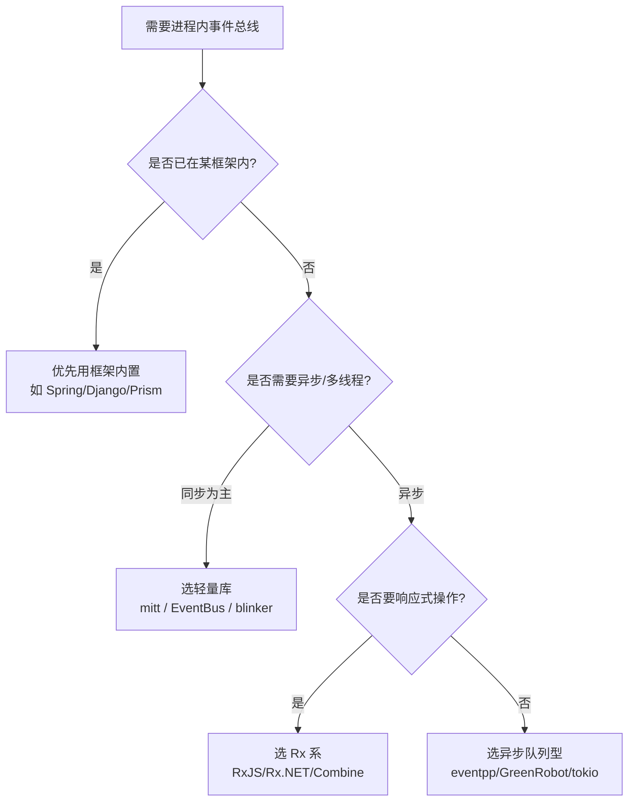

# 进程内事件总线（In-process Event Bus）优秀开源库汇总

**作者**：汪亮（bertonwang）
**邮箱**：<47608843@qq.com>
**版本**：v1.0 ｜ **最后更新**：2026-08-13

> **进程内事件总线**（In-process Event Bus / Publish-Subscribe）是一种**同进程内**的消息传递机制：发布者（Publisher）无需知道订阅者（Subscriber）即可广播事件，订阅者按事件类型或主题订阅感兴趣的消息。
> 它是**解耦模块**、**实现 MVVM/MVP、ECS 通信、GUI 事件、领域事件**的常用工具。
> **与进程间消息队列（Kafka/RabbitMQ/NATS）的区别**：无网络、无持久化、无跨进程能力，但**零延迟、零拷贝、类型安全、无外部依赖**。

---

## 📋 目录

- [一、选型维度说明](#一选型维度说明)
- [二、C / C++ 生态](#二c--c-生态)
- [三、C# / .NET 生态](#三c--net-生态)
- [四、Java / Kotlin / Android 生态](#四java--kotlin--android-生态)
- [五、JavaScript / TypeScript 生态](#五javascript--typescript-生态)
- [六、Python 生态](#六python-生态)
- [七、Go / Rust / Swift 其他生态](#七go--rust--swift-其他生态)
- [八、选型建议](#八选型建议)
- [九、参考资料](#九参考资料)

---

## 一、选型维度说明

对比表格采用业界通用的**十字段模板**：

| 字段 | 说明 |
|------|------|
| **名称** | 库名 + GitHub 链接 |
| **语言** | 支持的编程语言 / 运行时 |
| **许可证** | 开源协议（MIT/BSL/Apache 2.0/BSD/…） |
| **Star ★** | GitHub 星标数量（截至 2026-08，仅供参考） |
| **分发方式** | 按事件类型（Type-based）/ 按主题字符串（Topic-based）/ 通道（Channel） |
| **线程模型** | 同步（Sync）/ 异步（Async）/ 线程池 / 支持指定线程调度 |
| **类型安全** | 编译期类型检查（强类型）/ 运行时反射（弱类型） |
| **依赖** | 是否 Header-Only / 有无第三方依赖 |
| **性能特征** | 单发布延迟、吞吐量、无锁等特性 |
| **典型场景** | UI 事件、游戏 ECS、领域事件、微服务内解耦 |

---

## 二、C / C++ 生态

| 名称 | 语言 | 许可证 | Star ★ | 分发方式 | 线程模型 | 类型安全 | 依赖 | 性能特征 | 典型场景 |
|------|------|--------|--------|---------|----------|---------|------|---------|----------|
| [**EventBus (gelldur)**](https://github.com/gelldur/EventBus) | C++11 | MIT | 500+ | Type-based | 同步 + 延迟队列 | ✅ 强类型 | Header-Only | 轻量、可裸机 | Cocos2d-x、GUI |
| [**dexode/EventBus**](https://github.com/dexode/eventbus) | C++17 | MIT | 400+ | Type-based | 同步 / 延迟处理 | ✅ 强类型 | Header-Only | 简洁 API，`listen<T>()` | 游戏、嵌入式 |
| [**Boost.Signals2**](https://www.boost.org/doc/libs/release/doc/html/signals2.html) | C++03/11 | BSL 1.0 | Boost | 信号-槽 | 同步 + 线程安全 | ✅ 强类型 | 依赖 Boost | 成熟稳定，业界标杆 | GUI、通用解耦 |
| [**sigslot**](https://github.com/palacaze/sigslot) | C++14 | MIT | 800+ | 信号-槽 | 同步 + 可选异步 | ✅ 强类型 | Header-Only | 现代 C++、Qt-like | 替代 Qt Signal |
| [**entityx EventManager**](https://github.com/alecthomas/entityx) | C++11 | MIT | 2k+ | Type-based | 同步 | ✅ 强类型 | 无 | 与 ECS 集成 | 游戏 ECS 内事件 |
| [**Nano-signal-slot**](https://github.com/NoAvailableAlias/nano-signal-slot) | C++17 | MIT | 500+ | 信号-槽 | 同步 | ✅ 强类型 | Header-Only | 性能极致，Benchmark 冠军 | 高频事件 |
| [**eventpp**](https://github.com/wqking/eventpp) | C++11 | Apache 2.0 | 900+ | Type + Topic | 同步 / 队列 / 异步 | ✅ 强类型 | Header-Only | 支持 EventQueue、Callback List | 通用事件系统 |
| [**cpp-event**](https://github.com/coin-au-carre/cpp-event) | C++14 | MIT | 100+ | Type-based | 同步 | ✅ 强类型 | Header-Only | 极简教学向 | 学习参考 |

> 💡 **C++ 首选建议**：追求**性能极致**用 `Nano-signal-slot`；追求**功能齐全**（异步队列、过滤器、拦截器）用 `eventpp`；已用 `entityx` 则直接用其内置 `EventManager`。

---

## 三、C# / .NET 生态

| 名称 | 语言 | 许可证 | Star ★ | 分发方式 | 线程模型 | 类型安全 | 依赖 | 性能特征 | 典型场景 |
|------|------|--------|--------|---------|----------|---------|------|---------|----------|
| [**MediatR**](https://github.com/jbogard/MediatR) | C# | Apache 2.0 | 10k+ | Type-based（Request/Notification） | 同步 + async/await | ✅ 强类型 | DI 容器 | 简洁 API，事实标准 | CQRS、DDD 领域事件 |
| [**Prism EventAggregator**](https://github.com/PrismLibrary/Prism) | C# / WPF / Xamarin | MIT | 3k+ | Type-based | 同步 / UI 线程 / 后台 | ✅ 强类型 | Prism | MVVM 首选 | WPF、UWP、MAUI |
| [**Microsoft ReactiveUI MessageBus**](https://github.com/reactiveui/ReactiveUI) | C# | MS-PL | 8k+ | Type-based | Rx 调度器 | ✅ 强类型 | Rx.NET | 与 Rx 深度整合 | 响应式 UI |
| [**Caliburn.Micro EventAggregator**](https://github.com/Caliburn-Micro/Caliburn.Micro) | C# / WPF | MIT | 2.5k+ | Type-based | 支持 UI 线程调度 | ✅ 强类型 | Caliburn.Micro | 轻量 MVVM 框架内建 | WPF/UWP |
| [**Easy.MessageHub**](https://github.com/NimaAra/Easy.MessageHub) | C# | Apache 2.0 | 400+ | Type-based | 同步 / 全局单例 | ✅ 强类型 | 无 | 单文件、极简 | 单进程解耦 |
| [**CommunityToolkit Messenger**](https://github.com/CommunityToolkit/dotnet) | C# | MIT | 3k+ | Type-based | 同步 / 弱引用 | ✅ 强类型 | Toolkit | 官方推荐、支持 Token | MVVM Toolkit |

> 💡 **.NET 首选建议**：**DDD/CQRS** 用 `MediatR`；**WPF/MAUI MVVM** 用 `CommunityToolkit.Mvvm.Messaging` 或 `Prism.EventAggregator`；追求**极简**用 `Easy.MessageHub`。

---

## 四、Java / Kotlin / Android 生态

| 名称 | 语言 | 许可证 | Star ★ | 分发方式 | 线程模型 | 类型安全 | 依赖 | 性能特征 | 典型场景 |
|------|------|--------|--------|---------|----------|---------|------|---------|----------|
| [**Guava EventBus**](https://github.com/google/guava/wiki/EventBusExplained) | Java | Apache 2.0 | 50k+ | 注解 `@Subscribe` | 同步 / AsyncEventBus | ✅ 强类型 | Guava | 简单易用、成熟 | 通用 Java 项目 |
| [**GreenRobot EventBus**](https://github.com/greenrobot/EventBus) | Java / Android | Apache 2.0 | 25k+ | 注解 `@Subscribe(threadMode=…)` | Main/Background/Async 多线程模式 | ✅ 强类型 | 无 | Android 事实标准 | Android UI 事件 |
| [**Otto (Square)**](https://github.com/square/otto) | Java / Android | Apache 2.0 | 8k+ | 注解 `@Subscribe` | UI 线程 | ✅ 强类型 | Guava | 已停止维护 | 早期 Android |
| [**MBassador**](https://github.com/bennidi/mbassador) | Java | MIT | 900+ | 注解 + 反射 | 同步 / 异步 / 弱引用 | ✅ 强类型 | 无 | 高性能、支持继承 | 高并发解耦 |
| [**Vert.x EventBus**](https://vertx.io/docs/vertx-core/java/#event_bus) | Java / Kotlin | Apache 2.0 | 14k+ | 主题字符串 (Address) | 异步、支持集群 | ⚠️ 弱类型 (需 Codec) | Vert.x | 支持点对点/广播/请求-响应 | Reactor 微服务 |
| [**Spring ApplicationEventPublisher**](https://docs.spring.io/spring-framework/reference/core/beans/context-introduction.html#context-functionality-events) | Java | Apache 2.0 | Spring | Type-based | 同步 + `@Async` | ✅ 强类型 | Spring | Spring 生态原生 | Spring 应用内解耦 |
| [**KEventBus (Kotlin)**](https://github.com/toxicbakery/EventBus) | Kotlin | Apache 2.0 | — | 通道 (Flow) | 协程 / Flow | ✅ 强类型 | Coroutines | Kotlin 惯用法 | Kotlin/Compose |

> 💡 **Java 首选建议**：**Android** 首选 `GreenRobot EventBus`；**Spring** 用原生 `ApplicationEventPublisher`；**Kotlin 协程** 直接用 `SharedFlow` / `StateFlow`（无需第三方库）。

---

## 五、JavaScript / TypeScript 生态

| 名称 | 语言 | 许可证 | Star ★ | 分发方式 | 线程模型 | 类型安全 | 依赖 | 性能特征 | 典型场景 |
|------|------|--------|--------|---------|----------|---------|------|---------|----------|
| [**mitt**](https://github.com/developit/mitt) | JS/TS | MIT | 9k+ | Topic-based | 同步 | ✅ TS 泛型 | 无 | 200 字节，极致轻量 | 前端组件通信 |
| [**EventEmitter3**](https://github.com/primus/eventemitter3) | JS/TS | MIT | 3.5k+ | Topic-based | 同步 | ⚠️ 字符串 | 无 | Node.js EventEmitter 兼容 | Node/浏览器通用 |
| [**tiny-emitter**](https://github.com/scottcorgan/tiny-emitter) | JS | MIT | 1k+ | Topic-based | 同步 | ⚠️ 字符串 | 无 | 极小 (~200B) | 库内部使用 |
| [**RxJS Subject / EventBus 模式**](https://rxjs.dev) | JS/TS | Apache 2.0 | 30k+ | Type + Operator | Rx 调度器 | ✅ 强类型 | 无 | 支持过滤/合并/防抖 | 响应式前端 |
| [**Node.js `events` 模块**](https://nodejs.org/api/events.html) | Node.js | MIT | 内置 | Topic-based | 同步 | ⚠️ 字符串 | 无 | 官方内置 | Node 应用 |
| [**PubSubJS**](https://github.com/mroderick/PubSubJS) | JS | MIT | 4k+ | Topic-based + 层级 | 异步 (setTimeout) | ⚠️ 字符串 | 无 | 支持通配符订阅 | 大型前端解耦 |

> 💡 **JS/TS 首选建议**：**前端组件通信** 用 `mitt`；**Node.js** 用内置 `events` 或 `EventEmitter3`；**响应式** 用 `RxJS Subject`。

---

## 六、Python 生态

| 名称 | 语言 | 许可证 | Star ★ | 分发方式 | 线程模型 | 类型安全 | 依赖 | 性能特征 | 典型场景 |
|------|------|--------|--------|---------|----------|---------|------|---------|----------|
| [**blinker**](https://github.com/pallets-eco/blinker) | Python | MIT | 1.6k+ | 信号名 | 同步 | ⚠️ 弱类型 | 无 | Flask 依赖，标杆级 | Web 框架 |
| [**PyDispatcher**](https://github.com/mcfletch/pydispatcher) | Python | BSD | 400+ | 信号名 | 同步 | ⚠️ 弱类型 | 无 | Django Signals 前身 | 通用信号 |
| [**Django Signals**](https://docs.djangoproject.com/en/stable/topics/signals/) | Python | BSD | 内置 | Type + Sender | 同步 | ✅ 强类型 | Django | Django ORM 生命周期钩子 | Django 应用 |
| [**pypubsub**](https://github.com/schollii/pypubsub) | Python | BSD | 200+ | Topic 层级 | 同步 | ⚠️ 弱类型 | 无 | wxPython 御用 | GUI 应用 |
| [**asyncio EventBus (自研常见)**](https://docs.python.org/3/library/asyncio-queue.html) | Python 3.8+ | PSF | — | Type/Topic | 协程 | ✅ 强类型 | 无 | `asyncio.Queue` 封装 | 异步应用 |

> 💡 **Python 首选建议**：**Flask/Web** 用 `blinker`；**Django** 用官方 `Signals`；**协程应用** 用 `asyncio.Queue` 封装。

---

## 七、Go / Rust / Swift 其他生态

| 名称 | 语言 | 许可证 | Star ★ | 分发方式 | 线程模型 | 类型安全 | 依赖 | 性能特征 | 典型场景 |
|------|------|--------|--------|---------|----------|---------|------|---------|----------|
| [**asaskevich/EventBus**](https://github.com/asaskevich/EventBus) | Go | MIT | 2.5k+ | Topic + 反射 | 同步 / 异步 goroutine | ⚠️ 反射 | 无 | Go 生态最流行 | 微服务内解耦 |
| [**mustafaturan/bus**](https://github.com/mustafaturan/bus) | Go | Apache 2.0 | 400+ | Topic | 同步 | ✅ 泛型 (Go 1.18+) | 无 | 现代 Go 风格 | 现代 Go 项目 |
| [**Go Channel-based Bus**](https://gobyexample.com/channels) | Go | — | 内置 | Channel | 协程 | ✅ 强类型 | 无 | 语言原生 | Go 首选 |
| [**bus (rust)**](https://github.com/jonhoo/bus) | Rust | MIT | 500+ | 广播队列 | 多线程无锁 | ✅ 强类型 | 无 | 无锁 SPMC | 多消费者广播 |
| [**tokio broadcast**](https://docs.rs/tokio/latest/tokio/sync/broadcast/index.html) | Rust | MIT | Tokio | Channel | 异步 | ✅ 强类型 | Tokio | 官方广播通道 | Tokio 应用 |
| [**Combine PassthroughSubject**](https://developer.apple.com/documentation/combine/passthroughsubject) | Swift | Apple | 官方 | Type-based | 主线程 / 后台 | ✅ 强类型 | Combine | Apple 平台原生 | iOS/macOS |
| [**SwiftEventBus**](https://github.com/cesarferreira/SwiftEventBus) | Swift | MIT | 1.2k+ | Topic-based | 主线程 / 后台 | ⚠️ 字符串 | 无 | 简洁 API | iOS 组件通信 |

> 💡 **Go 首选建议**：优先使用**原生 channel + goroutine**；确需库时用 `asaskevich/EventBus`。
> 💡 **Rust 首选建议**：`tokio::sync::broadcast`（异步）或 `jonhoo/bus`（同步无锁）。
> 💡 **Swift 首选建议**：iOS 13+ 直接用 `Combine.PassthroughSubject`。

---

## 八、选型建议

### 8.1 一句话决策树

### 8.2 六大关键权衡点

| 关注点 | 优先选择 | 反例 |
|-------|---------|------|
| **性能极致 (高频事件)** | 强类型 + 无反射（Nano-signal-slot、bus-rust） | 反射型（asaskevich/EventBus） |
| **类型安全** | 泛型/模板（mitt with TS、eventpp） | 字符串 topic（PubSubJS） |
| **跨线程分发** | 内建 ThreadMode（GreenRobot、Vert.x） | 纯同步库（Boost.Signals2） |
| **无依赖** | Header-Only / 单文件（Easy.MessageHub、mitt） | 依赖 Boost/Guava |
| **异步/响应式** | Rx 系或 Kotlin Flow | 传统同步分发 |
| **DDD/CQRS 落地** | MediatR、Spring Events | 简单 pub-sub 库 |

### 8.3 反模式警示 ⚠️

1. **全局单例 EventBus 滥用** → 演变为"隐式全局变量"，可测试性下降
2. **弱类型 topic 字符串** → 编译期无法发现拼写错误，重构困难
3. **跨模块循环订阅** → 事件风暴，栈溢出
4. **在事件处理器里发布新事件** → 无限递归风险
5. **将事件总线当消息队列用** → 无持久化，进程崩溃丢消息

---

## 九、参考资料

- 📘 [EntityX 学习指南-从入门到精通](EntityX学习指南-从入门到精通.md)（含 ECS 内 EventManager 剖析）
- 🔗 [Enterprise Integration Patterns: Publish-Subscribe Channel](https://www.enterpriseintegrationpatterns.com/patterns/messaging/PublishSubscribeChannel.html)
- 🔗 [Martin Fowler: Domain Events](https://martinfowler.com/eaaDev/DomainEvent.html)
- 🔗 [Game Programming Patterns: Event Queue](https://gameprogrammingpatterns.com/event-queue.html)

---

> ✨ **备注**：Star 数为编写时抓取的粗略量级，选型时请以最新数据、活跃度、Issue 响应速度综合判断。欢迎在 PR 中补充或修正。
